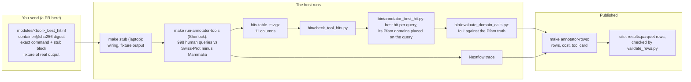

# Adding a tool to the annotation leaderboard

This page is for authors of a protein search or annotation tool who want it on the
[protein function annotation leaderboard](https://seanome.github.io/protein-function-annotation-leaderboard/).
You send one Nextflow module that runs your tool from a container. We run it on Stanford's
Sherlock cluster, on the same queries as every other tool, and measure its time and memory
from the Nextflow trace. Every tool's cost is then measured the same way, on the same
machines. What you get back, and how to dispute a row, is in the site's
[SUBMIT.md](https://github.com/seanome/protein-function-annotation-leaderboard/blob/olgabot/submission-guide/SUBMIT.md)
(on its branch until that PR is merged).



## 1. The module

One Nextflow module per tool, in its own file under
`nextflow-runs/qfo-pfam-region-benchmark/modules/`. The worked example, and the template to
copy, is the DIAMOND module,
[`modules/diamond_best_hit.nf`](nextflow-runs/qfo-pfam-region-benchmark/modules/diamond_best_hit.nf)
(from [PR 160](https://github.com/seanome/2024-kmerseek-analysis/pull/160)). The MMseqs2 module
beside it has the same shape. A module has:

- **A workflow, `<TOOL>_BEST_HIT`,** that takes the reference FASTA, the query FASTA and a list
  of settings, and emits `hits` as `(tool, setting, hits file)` and `run_info`. The entry
  workflow, `annotator_tools.nf`, includes it next to the other tools; add your tool there,
  under the name `--tools` selects it by (`--tools diamond,mmseqs2` is the default, and the
  Makefile passes `ANNOT_TOOLS` as `--tools`).
- **A database build in its own process** (`diamondMakedb`), so its cost is counted as a build
  and not as the search.
- **One search process per setting** (`diamondBestHitSearch`, tag `diamond <setting>`).
  Settings you want compared (`sensitive` and `ultra-sensitive` for DIAMOND) are each a run.
- **A container pinned by digest**: `container '<registry>/<image>@sha256:<64 hex>'`, with the
  tag in a comment. A tag alone (`:2.2.8`) is refused, because a tag can be moved to another
  image. Look up a BioContainers digest with
  `curl -s 'https://quay.io/api/v1/repository/biocontainers/<tool>/tag/?specificTag=<tag>'`.
  The image must not set an `ENTRYPOINT`.
- **The exact command**, built once as a string, run, and written to
  `<tool>.<setting>.run.txt` together with the version the binary prints (`diamond version`)
  and the CPU model. `bin/annotator_tool_rows.py` reads the version from that file into each
  row's `tool_version`, puts the image into a `container_digest` column, and builds the tool
  card's command from it.
- **Resources from measured history**, written in a comment with their source. DIAMOND's
  module asks 8 cores, 8 GB and 1 h, from the throughput benchmark's 17 s and 1.2 GB per
  1,000 Swiss-Prot queries. `errorStrategy { retryOnKill(task) }` (from
  `modules/annotator_common.nf`) retries a task the cluster killed up to twice, and memory and
  time double on each try (`8.GB * 2 ** (task.attempt - 1)`: 8, 16, 32 GB).
- **A `stub:` block** that copies real output of your tool from
  `tests/fixtures/annotator/` instead of running it. `tests/make_annotator_fixture.sh` shows
  how the DIAMOND and MMseqs2 fixtures were made: 60 human queries against 120 yeast
  proteins, with the real tools. `make stub` then runs the whole pipeline on a laptop in
  under a minute, with no container.

The DIAMOND search process, as it is in the module:

```groovy
process diamondBestHitSearch {
    tag "diamond ${setting}"
    container 'quay.io/biocontainers/diamond@sha256:e02013280712f1295e59339dc6ea162adf8a6bbdd730e73a9c00700c03c3e556' // 2.2.8--he361c42_0
    cpus 8
    memory { 8.GB * 2 ** (task.attempt - 1) }
    time { 1.h * 2 ** (task.attempt - 1) }
    errorStrategy { retryOnKill(task) }
    maxRetries 2
    publishDir "${params.outdir}/hits", mode: 'copy'

    input:
    tuple val(setting), path(db), path(queries)

    output:
    tuple val("diamond_besthit"), val(setting), path("diamond_besthit.${setting}.hits.tsv.gz"), emit: hits
    path "diamond_besthit.${setting}.run.txt", emit: run_info

    script:
    def cmd = "diamond blastp --query ${queries} --db ${db} --${setting} " +
              "--threads ${task.cpus} --out hits.tsv " +
              "--outfmt 6 qseqid sseqid qstart qend sstart send bitscore evalue pident qseq_gapped sseq_gapped"
    """
    set -euo pipefail
    ${cmd}
    gzip -nc hits.tsv > diamond_besthit.${setting}.hits.tsv.gz
    {
        echo "command: ${cmd}"
        echo "version: \$(diamond version)"
        echo "cpu_model: \$(grep -m1 'model name' /proc/cpuinfo | cut -d: -f2- | sed 's/^ *//')"
    } > diamond_besthit.${setting}.run.txt
    """

    stub:
    """
    cp ${projectDir}/tests/fixtures/annotator/diamond_besthit.${setting}.hits.tsv.gz .
    printf 'command: stub\\nversion: stub\\ncpu_model: stub\\n' > diamond_besthit.${setting}.run.txt
    """
}
```

## 2. Output: the hits table

Tab-separated, gzip, no header, one row per hit, these 11 columns in this order (the table
`bin/annotator_best_hit.py` reads):

| Column | What it holds |
| --- | --- |
| `query` | Query name as in the query FASTA (`sp\|P10415\|BCL2_HUMAN`), or its accession (`P10415`) |
| `target` | Target name as in the reference FASTA (a plain accession there) |
| `qstart`, `qend` | Where the hit sits on the query: 1-based, both ends included, start ≤ end |
| `tstart`, `tend` | Where the hit sits on the target, the same way |
| `bits` | The tool's score; higher ranks first. The best hit per query is the highest |
| `evalue` | E-value; for a tool that reports a probability, 1 − probability; `NA` if neither |
| `pident` | Percent identity, 0 to 100 |
| `qaln`, `taln` | The aligned query and target residues, `-` for a gap (DIAMOND `qseq_gapped` / `sseq_gapped`, MMseqs2 `qaln` / `taln`) |

The aligned residues are what place the hit protein's Pfam domains on the query, residue by
residue, so a tool must report them. A tool that only reports whole proteins, with no
coordinates, cannot be scored here: the leaderboard scores where on the query a family sits,
by the overlap (IoU, intersection over union) between the call and the true region.

Check a file before sending it:

```bash
python nextflow-runs/qfo-pfam-region-benchmark/bin/check_tool_hits.py \
    diamond_besthit.sensitive.hits.tsv.gz \
    --query-fasta queries.fasta --target-fasta reference.fasta
```

It fails on a wrong column count, a coordinate that is not a whole number, a start below 1,
an end before its start or past the sequence, a score that is not a number, a negative
E-value, a `pident` outside 0 to 100, aligned strings of unequal length or whose residues do
not add up to the two intervals, a name not in the FASTA, or an empty file.

The QfO pipeline (`main.nf`), which searches each of 15 relatives' proteomes, uses the first
8 of these columns, plus an optional 9th, `n_matched_residues`, for motif tools such as
Folddisco. The same check reads all three widths.

## 3. The trace

Cost on the leaderboard comes only from the Nextflow trace of the host's run, never from a
number the author reports. `nextflow.config` writes these trace fields for every task:
`realtime`, `cpus`, `%cpu`, `peak_rss`, `memory`, `time`, `attempt`, `container`, `status`,
`exit`, `tag`. For that to measure your tool:

- all the work happens inside the search process (no download or index build hidden in it,
  no daemon started outside it);
- the process uses `task.cpus` threads and no more;
- a GPU tool says so in the PR; the host runs it with one GPU (`--gres=gpu:1` on the hns
  partition, as for the MMseqs2 and Foldseek GPU runs), and its GPU-hours are recorded
  separately from CPU-hours.

The site's release table counts only the `*BestHitSearch` step as the tool's cost: reserved
core-hours (`cpus` × `realtime`) per 1,000 queries, the largest `peak_rss`, GPU-hours, and the
dollar cost at a stated price-list rate, beside the hardware line and the run date. Building
the database, placing domains and scoring are not part of it.

## 4. What the host does with your PR

1. Reviews the module, checks the digest resolves, runs `make stub` and the hits check on the
   stub's hits files.
2. Sets the first memory and time request from measured history (the module's comment, or
   the closest tool's earlier traces scaled by input size), named in the PR. A retry asks for
   double; the peak is read back with `sacct` afterwards.
3. Runs `make run-annotator-tools` on Sherlock: the 998 midi-plus human queries against
   Swiss-Prot 2026_03 with Mammalia removed, scored against the midi-plus Pfam truth.
4. Runs `make annotator-rows`, which writes the rows, the cost table and a tool card per
   setting, and copies them to the site. There `scripts/validate_rows.py --submitted` checks
   every row has a version, container digest, 95% interval, `n`, measured cost, hardware and
   run date.

## 5. The worked example: DIAMOND through this path

What ran on a laptop, with no Sherlock run (seanome/protein-function-annotation-leaderboard
PR 18 has the site half):

| Step | Result |
| --- | --- |
| `make stub` | 15 tasks, all complete; `annotator-rows-stub` wrote 168 rows, 14 cost rows, 268 pile-up calls, 3 tool cards |
| `check_tool_hits.py` on the stub hits (real DIAMOND and MMseqs2 output, with both FASTAs) | `diamond_besthit.sensitive` ok (64 rows), `diamond_besthit.ultra-sensitive` ok (78), `mmseqs2_besthit.s7.5` ok (422) |
| Scorer | ran inside the stub's `scoreAnnotatorTool` |
| Site row schema | the 168 rows, copied to the site as `tests/fixtures/annotator_stub/`, pass `schema/results_row.json`; the DIAMOND image reaches `container_digest`; `--submitted` refuses them for the 95% interval, peak memory and run date, which a stub cannot fill (macOS reports no task memory) |

This ran at commit 2be8c6b5, which merges PR 160 at fc5f1d8f. The stub's version is the
word `stub`; a real run writes what `diamond version` prints.

The real run waits on Olga launching `make run-annotator-tools ANNOT_TOOLS=diamond,mmseqs2` on
Sherlock (both tools are also the default).

## 6. What is not built yet

- No row carries a run date, and the scorer does not compute a 95% interval. Until both are
  added, no row passes `validate_rows.py --submitted`.
- The QfO pipeline's search processes are still all in `main.nf`; only the best-hit tools
  have one file per tool.
