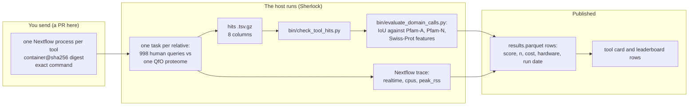

# Adding a tool to the annotation leaderboard

This page is for authors of a protein search or annotation tool who want it on the
[protein function annotation leaderboard](https://seanome.github.io/protein-function-annotation-leaderboard/).
You send one Nextflow module that runs your tool from a container. We run it on Stanford's
Sherlock cluster, on the same queries and relatives as every other tool, and measure its time
and memory from the Nextflow trace. Every tool's cost is then measured the same way, on the
same machines. What you get back, and how to dispute a row, is in the site's
[SUBMIT.md](https://github.com/seanome/protein-function-annotation-leaderboard/blob/olgabot/submission-guide/SUBMIT.md)
(on its branch until that PR is merged).



## 1. The module

One Nextflow module per tool. The worked example is the DIAMOND module on branch
`olgabot/annotator-tools`; copy its layout. Until that branch is merged, the closest shape in
this repository is `phmmerSearch` in
[`nextflow-runs/qfo-pfam-region-benchmark/main.nf`](nextflow-runs/qfo-pfam-region-benchmark/main.nf).
A module has:

- **One search process** that takes one relative's proteome and the human queries and writes
  one hits file. If your tool builds a database first, that is a second process, so its cost is
  counted as a build and not as a search.
- **A container pinned by digest**: `container '<registry>/<image>@sha256:<64 hex>'`. A tag alone
  (`:2.2.8`) is refused, because a tag can be moved to another image. Look up a BioContainers
  digest with
  `curl -s 'https://quay.io/api/v1/repository/biocontainers/<tool>/tag/?specificTag=<tag>'`.
  The image must not set an `ENTRYPOINT`.
- **The exact command** in the `script:` block, every parameter written out. What is in the
  block is what runs. The tool card's command is copied from it by hand into the site's
  `scripts/tools.py`, so the host checks the two match when adding the card. Parameters you want compared (a fast and a
  sensitive mode, for example) are separate named settings, each a separate run.
- **The version**, printed by the tool inside the container to a file `<tool>.version` that the
  process emits, so the row's `tool_version` comes from the binary that ran.
- **`label 'high_cpu'`** (16 cores and 64 GB on the Sherlock profile, set in `nextflow.config`
  from the measured history of earlier runs), and `errorStrategy { retryOnKill(task) }` like the
  other search processes, so a task the cluster kills is retried up to twice, with a time
  limit of 12 h × attempt (at most 48 h). If your tool needs more memory than 64 GB, say how
  much it used on a proteome of known size, and the host sizes the first request from that.
- **`tag "human_vs_${species}"`**, so each trace row names its relative.

A sketch for DIAMOND in that shape (the module on `olgabot/annotator-tools` is the reference;
the digest is DIAMOND 2.2.8's, read from quay.io's API on 2026-10-16):

```groovy
process diamondSearch {
    tag "human_vs_${species}"
    container 'quay.io/biocontainers/diamond@sha256:e02013280712f1295e59339dc6ea162adf8a6bbdd730e73a9c00700c03c3e556'
    label 'high_cpu'
    publishDir "${params.outdir}/regions/diamond", mode: 'copy', pattern: '*.tsv.gz'
    errorStrategy { retryOnKill(task) }
    maxRetries 2

    input:
    tuple val(species), path(species_dmnd), path(human_fasta)

    output:
    tuple val(species), val("diamond"), val("more_sensitive"),
          path("human_vs_${species}.diamond.tsv.gz"), path("diamond.version")

    script:
    """
    set -euo pipefail
    diamond version > diamond.version
    diamond blastp \\
        --query ${human_fasta} \\
        --db ${species_dmnd} \\
        --more-sensitive \\
        --evalue ${params.evalue_report} \\
        --max-target-seqs 1000 \\
        --threads ${task.cpus} \\
        --outfmt 6 qseqid sseqid qstart qend sstart send bitscore evalue \\
    | gzip -c > human_vs_${species}.diamond.tsv.gz
    """
}
```

## 2. Output: the hits file

Tab-separated, gzip, no header, one row per hit, these 8 columns in this order:

| Column | What it holds |
| --- | --- |
| `query` | Query name as in the FASTA given to the tool, e.g. `sp\|P10415\|BCL2_HUMAN` |
| `target` | Target name as in the relative's FASTA |
| `qstart`, `qend` | Where the hit sits on the query: 1-based, inclusive, start ≤ end |
| `tstart`, `tend` | Where the hit sits on the target: 1-based, inclusive, start ≤ end |
| `score` | The tool's score; higher ranks first |
| `evalue` | E-value; for a tool that reports a probability, 1 − probability; `NA` if neither |
| `n_matched_residues` | Optional 9th column, for motif tools: how many residues matched (Folddisco writes it) |

A tool that only reports whole proteins, with no coordinates, cannot be scored here: the
leaderboard scores where on the query a family sits, by the overlap (IoU, intersection over
union) between the hit and the true region. Check a file with:

```bash
python nextflow-runs/qfo-pfam-region-benchmark/bin/check_tool_hits.py \
    human_vs_zebrafish.diamond.tsv.gz \
    --query-fasta UP000005640_9606.fasta --target-fasta UP000000437_7955.fasta
```

It fails on a wrong column count, a coordinate that is not a whole number, a start below 1, an
end before its start or past the sequence, a score that is not a number, a negative E-value, a
name not in the FASTA, or an empty file.

## 3. The trace

Cost on the leaderboard comes only from the Nextflow trace of the host's run, never from a
number the author reports. The pipeline's `nextflow.config` writes these trace fields for every
task: `realtime`, `cpus`, `%cpu`, `peak_rss`, `memory`, `time`, `attempt`, `container`,
`status`, `exit`, `tag`. For that to measure your tool:

- all the work happens inside the search process (no download or index build hidden in it, no
  daemon started outside it);
- the process uses `task.cpus` threads and no more;
- a GPU tool says so in the PR; the host runs it with one GPU (`--gres=gpu:1` on the hns
  partition, as for the MMseqs2 and Foldseek GPU runs), and its GPU-hours are recorded
  separately from CPU-hours.

The leaderboard shows reserved core-hours (`cpus` × `realtime`) per relative per 1,000
queries, the largest `peak_rss`, GPU-hours, and the dollar cost at a stated price-list rate,
beside the hardware line (for example "Stanford Sherlock, SLURM partition hns") and the run
date.

## 4. What the host does with your PR

1. Reviews the module, checks the digest resolves, and runs the hits check on the mini query
   set.
2. Sets the first memory and time request from measured history: the closest tool's earlier
   traces, scaled by input size, named in the PR with its run and job id. A retry asks for
   double; the peak is read back with `sacct` afterwards.
3. Runs it on Sherlock against the 998 human queries and the 15 Quest for Orthologs relatives.
4. Scores it with `bin/evaluate_domain_calls.py`, exports the long tables
   (`make leaderboard-tables`, which is on
   [PR 148](https://github.com/seanome/2024-kmerseek-analysis/pull/148) and not merged yet), and
   copies them to the site, where
   `scripts/validate_rows.py --submitted` checks every row has a version, container digest,
   95% interval, `n`, measured cost, hardware and run date.

## 5. What is not built yet

- No module is in its own file yet: every process is in `main.nf`. The DIAMOND module on
  `olgabot/annotator-tools` sets the layout for one file per tool.
- The DIAMOND module itself (branch `olgabot/annotator-tools`) and its first host run.
- The long-table export does not yet carry the container digest, the tool version or the run
  date into each row, and the scorer does not compute a 95% interval. Until both are added, a
  row cannot pass `validate_rows.py --submitted`.
- There is no `make stub` target in `qfo-pfam-region-benchmark`; a module's dry run is the hits
  check on the mini query set.
