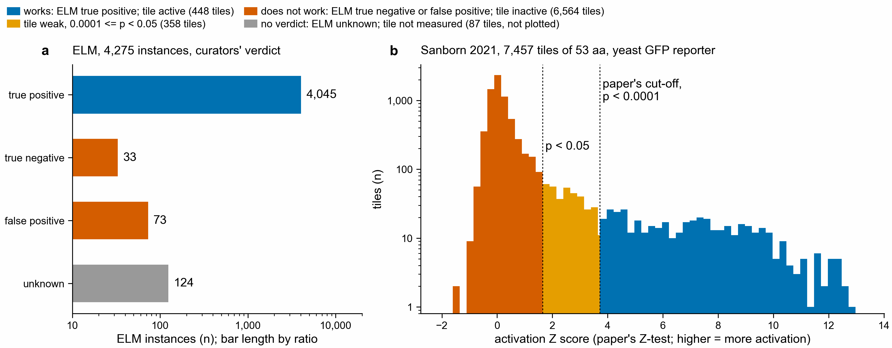

# Notebook 353: finding existing measurements for a short protein stretch

A scientist has a stretch of 15 to 60 residues and wants to know whether anyone has
already measured something on it, or on a similar stretch. This folder tests whether
kmerseek (reduced-alphabet k-mer search) gets them to a useful measurement faster than
an exact lookup plus BLAST, or than their own current workflow.

The verdict is in [report.md](report.md). The rules were written before any query
existed and are in [evaluation_plan.yaml](evaluation_plan.yaml).



**a**, ELM instances by the curators' verdict. **b**, the 7,457 activation tiles from
Sanborn et al. 2021 by the paper's Z score. Inactive and weak tiles stay in the
collection: a search that returns "this stretch was tested and did nothing" has found a
measurement too.

## What is here

| file | what it does |
|---|---|
| `evaluation_plan.yaml` | the frozen rules: data, query split, controls, settings grid, card cut-off, review protocol, pass rule, compute budget |
| `mr353.py` | the command-line tool, one subcommand per step (run `python mr353.py -h`) |
| `Makefile` | `make test`, `make evidence`, `make synthetic-run`, `make cost-probe`, and the real-queue steps |
| `templates/` | empty sheets for the analyst's queue, workflow C, development labels, the timed session and the blind review |
| `sherlock/` | workflow A (kmerseek index and search) as Slurm jobs; prepared, not submitted |
| `fixtures/make_synthetic.py` | made-up proteins, queries, judgments and times, used only to test the software |
| `tests/` | 16 tests; one runs every step end to end on the synthetic fixtures |
| `results/evidence/` | checksums and counts of the real evidence collection |
| `results/cost_probe/` | machine time and memory of workflow B on the real collection, with synthetic queries |
| `results/synthetic_fixture_run/` | the end-to-end synthetic run: verdict, per-query table, viewer page. Not data. |
| `make_figures.py`, `figures/` | the figure above |

## Steps

```text
analyst queue ──> import-queries ──> first 40: development │ next 100: evaluation
ELM + Sanborn ──> import-evidence ──> evidence.parquet, evidence_proteins.fasta
each query ─────> make-controls ───> 20 composition + 20 adjacent-pair shuffles
queries + shuffles ─> search-b (exact + BLAST, laptop)
                   └> kmerseek-jobs ─> Sherlock ─> read-kmerseek       (workflow A)
hits ──> cards (one per query and measured record; self-records dropped;
         "expected cards this good from one shuffle" for every card)
development cards + blind labels ──> tune ──> freeze (checksums of everything)
evaluation ──> session-pack ──> analyst handles each query with A, B (and C), timed
           ──> review-pack ──> blind reviewers judge every card, workflow hidden
           ──> score ──> PASS / FAIL / INSUFFICIENT_EVIDENCE, every query's outcome
```

Coordinates inside the tool are 0-based and end-exclusive. Each record also keeps the
coordinates exactly as its source printed them, and says which convention that was.

## Running it

The laptop steps use the `2025-kmerseek-analysis` environment and BLAST+ 2.16 from the
`orthofinder` environment (paths at the top of the Makefile).

```bash
make test
```

```bash
make evidence
```

With the analyst's queue saved as `/Users/olga/data/353_measurement_retrieval/analyst_queue.csv`:

```bash
make search-b sherlock-inputs
```

## Workflow A on Sherlock

kmerseek index and search do not run on the laptop. After the compute budget in the plan
is agreed, copy `work/sherlock_in/` (three files) to
`/scratch/users/olgabot/353_measurement_retrieval/in/` and run, from the repository
checkout on a Sherlock login node:

```bash
bash analysis/353_measurement_retrieval/sherlock/submit.sh
```

It builds kmerseek v0.4.0 (commit 0aed5ca), then runs one array task per alphabet and k
in the grid. Copy `kmerseek_out/*.csv` back and run
`python mr353.py --work <work> read-kmerseek --dir <that folder>`.
