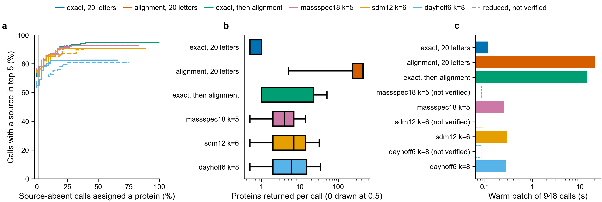

# 358. Source protein of a de novo peptide call: reduced alphabet against full alphabet

**Verdict: INSUFFICIENT_EVIDENCE.** No experimental peptide calls exist on the laptop or in
the repo, so the question cannot be answered yet. The plan, the input checks and the full
evaluation are built and tested. Run on labeled synthetic fixtures, they behave as the plan
says. The fixture numbers below test the software only. They say nothing about real calls.

The pass rule, the split, the source-absent design and every threshold rule were written in
[FROZEN_PLAN.md](FROZEN_PLAN.md) before any method ran. Its SHA-256 is recorded in each
run's `prepare.json`.

## What is missing

Searched on 2026-10-20: this repo, every worktree under `~/code`, `~/Downloads`,
`~/Documents` and `~/data`, for mzTab, mzML, MGF, Casanovo, Novor, PEAKS, InstaNovo, PSM and
peptide tables and cRAP FASTA files. Nothing found. nb300 (branch
`olgabot/nb300-peptide-lookup`) downloads the human reference proteome and cRAP on Sherlock,
but it has no peptide calls either; it uses spiked substitutions, which this experiment
does not allow.

To run the real experiment, one completed analysis must supply:

1. The protein FASTA that analysis searched (human plus contaminants), frozen as files.
2. At least 500 de novo calls (`calls.tsv`, schema in FROZEN_PLAN.md), with the caller's
   peptide score and, if it gives them, per-residue scores and alternative residues.
3. A database search of the same spectra (MSFragger, Comet, Sage or similar) giving the
   accepted peptide and its PSM q-value for each call (`accepted.tsv`).

A public PRIDE dataset with raw human spectra would do: run a de novo caller and a database
search on the same spectra, both on Sherlock. Choosing that dataset is a decision for you;
none was downloaded.

### Candidate public datasets (PRIDE API, read 2026-10-20; nothing downloaded)

All three are human, trypsin-digested DDA data (one fragment spectrum per selected peptide),
which is what de novo callers read. Sizes are PRIDE's file sizes.

| Dataset | What it holds | Size to fetch | Fit for 358 |
|---|---|---|---|
| PXD055277, NovoBoard (bioRxiv 10.1101/2024.04.16.589668), Q Exactive | De novo calls from PEAKS, PointNovo, Casanovo and GraphNovo plus a Proteome Discoverer database search (SwissProt 2024-02-24, 1% peptide FDR), on spectra reused from earlier studies. `eval_human.zip` 0.71 GB, `eval_ABRF.zip` 1.73 GB, `2017-12-4_ABRF_200_DDA1.mgf` 0.42 GB, `pd_merged.csv.db.psms.csv` 0.01 GB (other zips are yeast, E. coli, Arabidopsis, HLA, non-tryptic) | 0.72 GB for `eval_human.zip` + PSM table | Best: calls and accepted peptides from the same spectra already exist, so nothing has to be called. Not yet checked: what is inside the zips, which study the human spectra come from, and whether the search database had contaminants. |
| PXD022287, HeLa DDA (*J Proteome Res*, 10.1021/acs.jproteome.0c01029), Orbitrap Fusion, COMPLETE submission | 3 raw files (`HELA-DDA-60C-rep1.raw` 0.56 GB, `rep2` 0.27 GB, `Human-Protein-Training_Trypsin.raw` 0.17 GB), mzML 1.90 GB, MS-GF+ results 0.49 GB | 1.0 GB raw + 0.49 GB results | Good fallback: accepted peptides from MS-GF+ are deposited; de novo calls would be made on Sherlock (e.g. Casanovo). The runs mix HCD and ETD spectra; callers are trained on HCD, so ETD spectra must be dropped. |
| PXD044934, InstaNovo (*Nat Mach Intell*, 10.1038/s42256-025-01019-5), Exploris 480 / Eclipse | 67 raw files, 36.8 GB, from several experiments: HLA peptides (not tryptic), nanobodies, snake venom, a human wound-fluid digest with its Proteome Discoverer result (`Wound_fluid_human.pdResult` 1.83 GB), human canonical FASTA | the wound-fluid raw subset (sample-to-file map not in the file names) | Weakest: mixed project, largest download, and which raw files are the wound fluid must be worked out first. |

The table's DOIs come from PRIDE's project records, not from memory; they have not been
checked against the publishers.

### First dataset: NovoBoard (PXD055277)

Chosen 2026-10-20; the rules are in FROZEN_PLAN.md, "Amendment, 2026-10-20". The same
question is asked on PXD005280 with PEAKS calls by `olgabot/nb354-fragment-source`, so this
is a second, independent dataset with a different caller (Casanovo 4.1.0).

What is in `eval_human.zip` (read from its file list and the first rows of each table,
about 300 KB fetched by HTTP range requests; the zip itself has not been downloaded):

| Member | Size | Use |
|---|---|---|
| `Human_Benchmark_DDA_1hr.mgf` | 208 MB | the real spectra |
| `db.psms.csv` | 4.4 MB | accepted peptides: PEAKS DB search of the same spectra, 1% peptide FDR, no per-PSM q-value |
| `Casanovo/Sample 1.denovo.csv` | 32 MB | the calls; per-residue scores in `opt_ms_run[1]_aa_scores` |
| `Novor/Sample 1`, `PEAKS/Sample 10`, `PointNovo/Sample 10`, `GraphNovo/Sample 10` | 10-15 MB each | other callers on the real spectra (not used) |
| `decoy_spectra_X/*.mgf` and the other PEAKS, PointNovo, GraphNovo samples | 2.2 GB | NovoBoard's artificial decoy spectra: excluded |

"Sample 1" is not always the real file: for PEAKS and PointNovo it is the `decoy_0.10`
file. The converter keeps rows by their `Source File` column, never by file name.

`novoboard/novoboard.sbatch` downloads `eval_human.zip` (710,560,551 bytes),
`uniprot_sprot-only2024_01.tar.gz` (1,610,292,503 bytes) and cRAP, stops if a size
differs, records SHA-256 for each, then runs `novoboard/convert_novoboard.py`:
`inspect` (every member's rows, source files and scans, as `inspect.json`), `collection`
(human Swiss-Prot 2024_01 plus cRAP) and `convert` (500 calls, `calls.tsv`,
`accepted.tsv`, `inputs.json`, `conversion_report.json`). The converter is standard-library
Python and parses under Sherlock's `/usr/bin/python3` (3.6.8).

## Commands

```bash
cd analysis/358_peptide_source_retrieval
make test                                         # 53 tests, about 70 s
make fixtures run                                 # the fixture run below, about 1 min
make validate INPUTS=/path/to/inputs.json         # check real data and print checksums
make run INPUTS=/path/to/inputs.json WORK=/path/to/run358
```

Every build and search runs in its own process (`peptide_source.py build` / `search`), so a
cold batch includes loading the index from disk. Timing is in `WORK/timing/`.

Expected cost on the real collection (about 11.4 million residues, 70 times the fixture's
160,000): aligning one call against every protein took 1.6 s on a random collection of
that size, with a peak of 1.4 GB, so a batch of about 1,000 cases takes about 25 minutes.
The full run (prepare,
6 index builds, 6 searches run cold and warm, evaluation) fits the plan's budget of one CPU,
16 GB and 4 hours. It is plain Python and NumPy; no kmerseek index or search runs on the
laptop.

## Methods

Each method gets the same call, the same alternative residues and I = L. Each candidate
protein from any method is scored by one shared rule: Smith-Waterman local alignment with
PAM30 (gap open 9, extend 1, BLAST's settings for short queries) against a window of the
protein. The score is divided by the call's score against itself, giving the **match
fraction** (0 to 1).

| Method | How candidates are found |
|---|---|
| exact, 20 letters | 5-mer index; proteins containing the call (or a version with allowed alternatives) |
| alignment, 20 letters | every protein aligned; nothing skipped |
| exact, then alignment | exact; alignment only when exact finds nothing |
| massspec18 k=5, sdm12 k=6, dayhoff6 k=8 | proteins sharing a reduced k-mer, ranked by reduced matches (not verified) or by match fraction (verified) |

## Fixture run (software check, not evidence)



**a**, share of source-present evaluation calls with a valid source in the top 5, against
the share of source-absent evaluation calls given any protein, as the match-fraction
threshold moves. The grey line marks 1%. **b**, proteins each search returns for each
source-present evaluation call before any threshold (alignment keeps those with match
fraction ≥ 0.2). **c**, time for one warm batch of all 948 cases: 485 calls from both
sides plus 463 shuffled copies of evaluation calls (265 keeping residue counts, 198 keeping
adjacent pairs).
Dashed: reduced search ranked without verification.

Fixtures: 460 proteins (300 random with human residue frequencies, 30 paralog families of
4, 20 isoforms, one 12-residue segment shared by 3 to 8 proteins in 10 places, 5 repeat-rich
proteins, 15 contaminants). 500 calls; 10 dropped for q-value > 0.01 and 5 whose accepted
peptide is in no protein, leaving 485. Errors put in (labeled in `fixtures/error_labels.tsv`):
none, I/L swap, K/Q swap, two adjacent residues swapped, N read as GG, deamidation, one
random substitution, a wholly wrong call, one X.

| | Development | Evaluation |
|---|---|---|
| source present | 176 | 212 |
| source absent | 44 | 53 |

At the frozen thresholds (fitted on the 44 development source-absent calls):

| Method | Recovered (of 212) | Source-absent calls given a protein (of 53) |
|---|---|---|
| exact, 20 letters | 155 | 0 |
| alignment, 20 letters | 169 | 2 |
| exact, then alignment | 169 | 2 |
| massspec18 k=5, verified | 169 | 2 |
| massspec18 k=5, not verified | 167 | 2 |
| sdm12 k=6, verified | 167 | 2 |
| dayhoff6 k=8, verified | 167 | 3 |
| dayhoff6 k=8, not verified | 0 | 0 |

What the fixture run shows about the software:

- **One development source-absent call sets each threshold.** One percent of 44 calls is 0
  calls, so the threshold sits just above the best wrong match among them. For alignment that
  is call C0455 (`NLWPQLSRPELFR`, no error put in): with its source PAR16_0 removed, it
  matches the paralog PAR16_2 at match fraction 0.907. Paralogs are the main way a
  source-absent call gets a confident wrong answer.
- **Thresholds from development calls do not hold the 1% ceiling on evaluation calls.** Most
  methods give 2 or 3 of 53 evaluation source-absent calls a protein (3.8% to 5.7%). With so
  few source-absent calls, the 1% rule cannot be checked closely in either set.
- dayhoff6 not verified recovers nothing: a development source-absent call matched a wrong
  protein in every reduced class, so its threshold is above 1.0.
- Proteins returned per call (median): exact 1, massspec18 4, dayhoff6 6, sdm12 7,
  alignment 442.
- Warm batch, 948 cases: exact 0.12 s, reduced verified 0.26 to 0.29 s, exact then
  alignment 14.4 s, alignment 20.5 s.
- 67 of 265 shuffles that keep adjacent residue pairs were dropped: short calls often have
  only one sequence with their pairs, so every redraw was the call itself, which is in a
  protein.

`verdict_if_data_were_real` in `fixture_run/results/verdict.json` is FAIL. On fixtures this
only shows that the pass rule runs end to end.

## Outputs of a run

| File | What |
|---|---|
| `prepare.json`, `checksums.tsv` | exclusion counts, split sizes, SHA-256 of every input and of the plan |
| `cases.tsv` | every case: side, source present or absent, control, valid sources, exclusions |
| `results/candidate_lists/<method>.tsv.gz` | per call: candidates at or above the threshold, the best valid source, and the top 10 |
| `results/summary.tsv` | per method: threshold, counts, denominators, Wilson 95% intervals, surviving candidates, controls |
| `results/recall_vs_false_assignment.tsv` | the curves in panel a |
| `results/surviving_candidates.tsv` | candidates at or above the frozen threshold, per call |
| `results/strata.tsv` | counts by low complexity, X or alternatives, call equal to accepted peptide, length bin, call-score quartile |
| `results/runtime.tsv` | build, cold and warm batch time, CPU time, peak memory, index size, daily cost amortized over 30 batches |
| `results/verdict.json` | gates, criteria A and B, bootstrap interval of the recovery difference, verdict |

## Limitations

- The reduced search is a Python version of kmerseek's idea (reduced-alphabet k-mer seeds,
  then the best diagonal), not kmerseek itself. kmerseek index and search are not allowed
  on the laptop, and the region E-value is never used as the chance an assignment is right.
- Cold timing starts a new process but does not flush the operating-system file cache,
  which needs root.
- The pair-keeping shuffle walks the pairs in a random order; it is not a uniform draw.
- With about 50 source-absent evaluation calls, 0 false assignments still allows a true
  rate up to about 7% (Wilson 95% upper bound), so gate 2 cannot show a rate below 1%.
