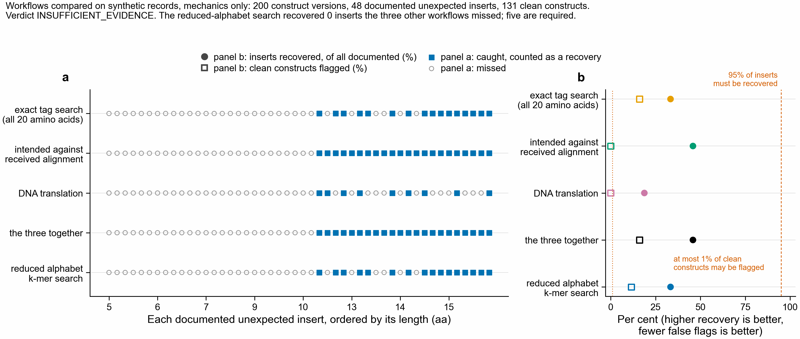

# Does a reduced-alphabet search catch unexpected inserts in protein constructs?

**Verdict: INSUFFICIENT_EVIDENCE.** No historical construct submissions exist in this
repository or anywhere on this machine: no intended-against-received sequence pairs, no
specification of permitted tags and linkers, no discrepancy decisions, no original DNA,
and no recorded review sessions. The pass rule in [PLAN.md](PLAN.md) cannot be assessed,
so this directory delivers the frozen plan, import templates, a runnable pipeline, and a
mechanics check on synthetic records. Synthetic recovery is not evidence that the method
is useful.



The figure is the mechanics check, on records this repository's own script generated.
Panel a: every documented insert, ordered by length, caught or missed by each workflow.
Panel b: inserts recovered and clean constructs flagged, against the two thresholds the
pass rule sets. Nothing in it says anything about real constructs.

## What was searched for, and what was found

| Looked for | Result |
| --- | --- |
| Construct submissions, plasmid maps, GenBank or SnapGene files | none in the repository or in `/Users/olga` |
| Intended against received protein pairs | none |
| Specifications of permitted tags, linkers, cleavage sites | none |
| Historical discrepancy decisions | none |
| Recorded review sessions with timing | none |
| Reusable search code | `notebooks/hp_conservation_utils.py` holds the reduced alphabet tables, copied from kmerseek's `src/rust/alphabets.rs`; Biopython supplies local alignment |

This repository is a protein k-mer search analysis project. It has no construct
management data of any kind, so the application question stays unanswered.

## What is here

| Path | What it is |
| --- | --- |
| `PLAN.md` | The evaluation plan, frozen before any data were read, with one dated amendment |
| `templates/` | The five CSV files to fill, and their column contract |
| `src/records.py` | Loading and validation; refuses bad coordinates, statuses, groups and review rows |
| `src/dictionary.py` | Per-construct insert dictionary, with the date and group rules that stop leakage |
| `src/workflows.py` | The four workflows, all writing one flag format |
| `src/controls.py` | Composition-matched natural stretches, both shuffles, and the `L_distinguish` fit |
| `src/evaluate.py` | Event matching, the pass rule, the paired table, the data-sufficiency check |
| `src/cli.py` | `validate`, `run`, `controls` |
| `src/synthetic.py` | Synthetic records, for mechanics only |
| `src/figure.py` | The figure above |
| `tests/test_pipeline.py` | 35 mechanics tests |

## Running it

Everything runs on one CPU core or a few, with no GPU, writing to local disk.

```bash
make -C analysis/construct_insert_check check
```

That runs the tests, generates synthetic records, validates them, runs every workflow,
and draws the figure. On real records, once `templates/` is filled into a directory:

```bash
conda activate 2025-kmerseek-analysis
python analysis/construct_insert_check/src/cli.py validate --input <records dir>
python analysis/construct_insert_check/src/cli.py run --input <records dir> --output <results dir> --development <frozen dev dir> --workers 4
python analysis/construct_insert_check/src/figure.py --results <results dir> --figure figures/construct_insert_check_paired_workflows --source "historical submissions"
```

`validate` prints a SHA-256 for each of the five input files and stops on the first
problem. `run` repeats those checksums into `summary.json`, together with the checksum of
`PLAN.md`, so a result can be tied to the inputs and the rule it was judged against.

## What each flag says

Every workflow writes the same columns to `flags.csv`: construct and version, the 1-based
inclusive coordinates on the received sequence, the original residues at those
coordinates, the candidate insert's name, the match that supports it, whether the
specification permits that insert there, the outcome (`unexpected`, `permitted` or
`ambiguous`), and for the reduced-alphabet search a region E-value.

The region E-value is the chance of an exact reduced-alphabet run that long anywhere in
the search space, given the received sequence's own composition. It is not the
probability that the construct has an error, and it says nothing about whether the
specification permits the insert. Those are separate columns on purpose. The composition
is taken from the received sequence including the insert, which raises the E-value a
little, in the conservative direction.

Nothing is corrected. A test asserts that no workflow changes a sequence.

## What the mechanics check showed

200 synthetic construct versions, 48 documented inserts, 131 clean constructs, 21
unresolved, 98 with DNA. The run took 1.3 s elapsed, 9.3 s of CPU across 4 workers
(0.0026 CPU-hours), 71 MB peak memory, and wrote 268 KB.

- Every workflow loads the same specifications, finds, names and coordinates a 35-residue
  insert, and reports it with an E-value where it has one.
- The reduced-alphabet search recovered 16 of 48 inserts; the three other workflows
  together recovered 22; it recovered **none that they missed**. In 20 of the 48 events
  the insert was already in the dictionary (`events_whose_insert_was_already_in_the_dictionary`
  in `summary.json`), so 16 of 48 is not a count of inserts the dictionary had never seen.
- It flagged 11.5% of clean constructs against the 1% the pass rule allows; alignment
  alone flagged 0%.
- Everything below about 11 residues was missed by every workflow, because the frozen
  `L_distinguish` of 11 to 13 residues makes a shorter match ambiguous, and because
  k is 20 and 10 for the two reduced settings. Most real tags are shorter than that:
  His6 is 6 residues, FLAG 8, a TEV site 7.

On synthetic records the method therefore points at the drop conditions rather than away
from them. That is a statement about the mechanics and the frozen parameters, not about
real constructs, and it is not the verdict.

## What it would take to answer the question

- 200 construct versions in the template format, including clean ones.
- At least 20 documented unexpected-insert decisions, with the evidence that settled them.
  Fewer cannot tell 95% recovery from 90%.
- At least 100 clean constructs. With 100, one false flag is already 1%.
- Recorded review sessions for both the comparison workflow and the method, from a review
  tool's own timestamps. Without them criterion 4 cannot be assessed, and machine runtime
  is not a substitute.

`cli.py run` prints each of these shortfalls by name and returns
`INSUFFICIENT_EVIDENCE` while any of them holds.
