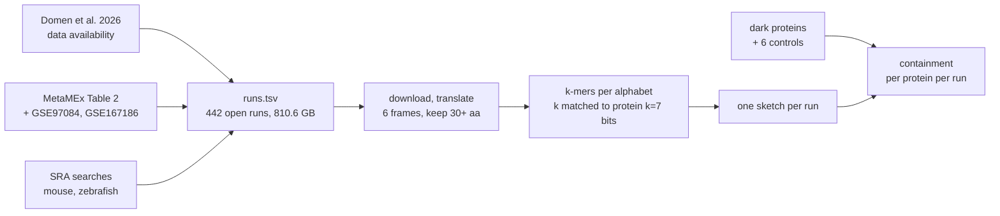

# Where else is this gene expressed: a small k-mer index of RNA-seq runs

Status 2026-10-27: the 64 runs of Domen et al. 2026 (`runs_to_index.tsv`) are being indexed
first, at scaled = 5. Four of them are sketched (see "Sizing tests"). The 452 other *Botryllus*
runs (`runs_botryllus_more.tsv`) come next. The human, mouse and zebrafish runs in `runs.tsv`
are not indexed yet.

## Dark proteins (`dark.txt`)

`dark.txt` lists 20,448 of the 45,339 *Botryllus* proteins (45.1%): those with no hit at
E <= 0.001 from MMseqs2, phmmer or jackhmmer against Swiss-Prot with all Ascidiacea
removed. It is copied from the invertebrate-dark-set pipeline's output on Sherlock
(`/scratch/users/olgabot/invertebrate-dark-set/results/botryllus/botryllus_dark_set.parquet`,
2026-09-13). Names follow the pipeline's FASTA, where a name used more than once in the
proteome gets `.1`, `.2`; 925 of the dark names carry such a number.

kmerseek is not part of that rule. The same pipeline's kmerseek protein20 k = 10 search
reached 173 of the 20,448 (`botryllus_kmerseek_dark_gain.json`); those 173 are still in
`dark.txt`.

## Runs to index

| Organism | Runs | GB (SRA) | Reads (millions) | Largest run, GB | Where the accessions came from |
|---|---:|---:|---:|---:|---|
| *Botryllus schlosseri* | 64 | 50.2 | 1,309 | 8.3 | BioProject PRJNA1219309, the only SRA accession in Domen et al. 2026's data availability statement |
| *Homo sapiens* | 354 | 705.4 | 25,268 | 38.1 | 7 GEO series with SRA runs: 6 from MetaMEx Table 2, plus GSE167186 |
| *Mus musculus* | 18 | 49.2 | 1,272 | 5.7 | SRA searches, 6 runs per theme, query in the `query` column |
| *Danio rerio* | 6 | 5.9 | 182 | 1.4 | SRA search; only the exercise theme returned runs |
| Total | 442 | 810.6 | 28,031 | 38.1 | |

- MetaMEx Table 2 lists 64 GEO rows (55 distinct series) and one ArrayExpress entry,
  E-MEXP-740. GEO records 49 of the 55 series as "Expression profiling by array", with no
  SRA runs. The other 6 have 261 open RNA-seq runs: GSE71972 (48), GSE86931 (6), GSE87748
  (20), GSE113165 (56), GSE97084 (103), GSE99963 (28). GSE167186 adds 93. Per-series
  detail: `series_status.tsv`.
- SRA reports no human run as controlled access. The counts fallback (step d) adds nothing.
- The 49 microarray series are not indexed (decided 2026-10-27). They have no reads, and
  the counts fallback is only for controlled-access RNA-seq. Building sketches from their
  expressed genes stays possible later; their GEO matrices are a few MB each.
- 16 of the 64 *Botryllus* runs hold fewer than 10,000 read pairs. The smallest,
  SRR32233947, holds 278. They are kept, as the paper lists them.
- Domen et al. also list eight human and mouse GEO series from their exercise comparison.
  The plan copies only SRA and BioProject accessions from the paper, so those are not in
  `runs.tsv` unless MetaMEx Table 2 also lists them. Three are in Table 2 (GSE27536,
  GSE99963, GSE28998, all arrays); GSE104079, GSE120862, GSE83578, GSE111555 and
  GSE144304 are not.

## Sizing tests on Sherlock, 2026-10-27

Four runs of `runs_to_index.tsv` were sketched twice, on 8 cores with 64 GB: first at scaled = 1
(every k-mer hash kept; array job 49855725), then at scaled = 5 (FracMinHash keeps the hashes at
or below sourmash's `max_hash_for_scaled(5)`, about 1 in 5; array job 49887524). Scaled = 5 is
what the index uses (Olga's choice, 2026-10-27).

| Run | FASTQ (both files) | Download | Sketch file, scaled 1 | Sketch file, scaled 5 |
|---|---:|---:|---:|---:|
| SRR32233927 | 97 KB | 9 s | 7.7 MB | 1.5 MB |
| SRR32233950 | 50 KB | 15 s | 5.9 MB | 1.2 MB |
| SRR32233988 | 144 KB | 10 s | 14.8 MB | 2.9 MB |
| SRR32233928 | 1.72 GB | 42 min (0.59-0.83 MB/s per file) | 21.9 GB | 4.37 GB |

For SRR32233928 (25.9 million reads, 93.2 million kept pieces):
- **Scaled 1:** the sketch was written in 45 min (3 h 5 min of CPU). The check that counts its
  signatures then ran out of 64 GB, because grep held the whole one-line JSON in memory.
- **Scaled 5:** the job took 13 min 49 s in all, 9 min 8 s of it sketching, with 47 min 58 s
  of CPU and 9.3 GB peak memory. The FASTQs from the first test were reused, so no download.
  The check now splits the JSON at commas and braces before counting, and it passed.

At scaled 5, the sketch is 2.5 times the size of the FASTQ. The 64 paper runs are 78.0 GB of
FASTQ by ENA's file sizes, so they would make about 200 GB of sketches. All 516 *Botryllus*
runs would make about 3.2 TB. The 50.2 GB in the table above is SRA's size field, which is
smaller than what ENA serves.

## Measured speeds (`speed.tsv`)

| Where | Download from ENA, one connection | 810.6 GB at that speed |
|---|---:|---:|
| Laptop | 0.108 MB/s (12.9 MB in 120 s) | 87 days |
| Sherlock login node | 0.80 MB/s (48.1 MB in 60 s) | 11.7 days |

Translating reads in Python, one core: 6,896 reads per second over the three smallest
runs (3,724 reads). The 28,031 million reads would take 47 core-days. That time does not
include hashing k-mers.

## Translation

Reads are translated in all six frames with the standard genetic code. A codon with one N
stands for four codons: if all four give one amino acid, that amino acid is used (only the
eight four-fold families: GCN A, CGN R, GGN G, CTN L, CCN P, TCN S, ACN T, GTN V); if any
of the four is a stop, or they give different amino acids, the codon becomes X, which is
not a stop. A codon with two or more Ns becomes X. `codon_table_with_N.tsv` lists all 61
N-containing codons and is written by `translate.py`. A piece of translation is kept only
if it has at least 30 amino acids before a stop or the end of the read.

## k for each alphabet (`k_for_protein7_bits.tsv`)

Each alphabet's k is chosen so a k-mer carries about as many bits as a protein 7-mer
(29.18 bits). Bits per letter are the entropy of the alphabet's letters, with letter
frequencies summed from Swiss-Prot 2026_03 amino acid counts (209,008,777 residues). The
amino acid groups are read from kmerseek's `src/rust/alphabets.rs` (commit fc3ce72c) and
sourmash's Dayhoff and HP tables. Examples: protein20 k = 7, dayhoff6 k = 13, gbmr4
k = 19, hp_lehninger2 k = 29.

## Files

| File | What it is |
|---|---|
| `sources/metamex_table2.tsv` | Table 2 of Pillon et al. 2020, read from Europe PMC (PMC6981202) |
| `sources/domen2026_data_availability.txt` | the data availability statement of Domen et al. 2026 (PMC13229227) |
| `build_runs.py` | queries SRA with pysradb 2.5.1; writes `runs.tsv`, `runs_all.tsv`, `series_status.tsv` |
| `measure_speed.py` | the speed test above; writes `speed.tsv` |
| `translate.py` | six-frame translation with the N rule; writes `codon_table_with_N.tsv` |
| `k_for_protein7_bits.py` | k per alphabet; writes `k_for_protein7_bits.tsv` |
