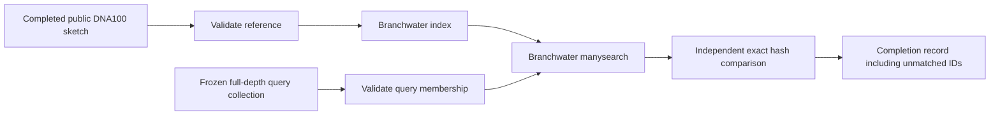

# One-run DNA100 adoption milestone

This implementation reuses one completed public DNA sketch and one frozen query
collection. It validates their checksums, settings and IDs, builds a Branchwater
index, searches every query, and checks the result against independently computed
shared hashes. An empty query stays in the completion record as an empty sketch.
A zero-match result passes only when independent hash comparison also gives zero.

## Status on 2026-10-25

Sherlock access was restored. Job 49520265 ran source 49d75dcb; the independent
audits and corrected-protocol checks completed, then the Nextflow audit failed
because its `log` input resolved to the built-in logger. The input is renamed
`search_log`; recovery job 49521583 passed all seven bounded migration scenarios. See the committed
[evidence and scope](../results/migration-20261025/STATUS.md).

| Work | Status | Evidence or remaining gate |
|---|---|---|
| Corrected six-frame translator | Tested locally and on Sherlock | Lengths29/30/31, stops, X, all frames, coordinates and original membership |
| Pinned Branchwater X handling | Passed fixture test | All 7 protein-k7, 12 Dayhoff-k12 and 30 HP-k30 X-spanning hashes retained at scaled1 |
| Corrected 2,000-query sketches | Passed | 4,659 segment/alphabet comparisons; every original ID retained; real sample has no X-bearing retained segment |
| Initial DNA shard | Independently audited | 380,867 original queries, 38 collections, eight runs, 36 query–run pairs |
| Historical translated preflight | Saved results and original query hashes independently audited | Exact intersections, identities, scale losses and word-by-word reconstruction; historical stop/X protocol |
| Nextflow adoption/index/search | Executed successfully | First-run trace retained |
| Nextflow audit and migration gates | Passed on compute | First run, cached resume, query change, controlled stop/resume, corruption and protocol mismatch |
| Production adoption | Blocked | Production execution tests and historical build-provenance gaps remain |

The local helper checks use Biopython1.88 and Sourmash4.9.4. Sherlock checks use
Sourmash4.9.4 and Branchwater0.9.15. Local Branchwater0.9.14.dev0 is rejected.
Local Sourmash emits SQLite ResourceWarnings under Python3.13. Black and Python
compilation pass; Ruff is unavailable in the local analysis environment.

## Adoption manifest

Supply separate JSON manifests for reference and query. Each has these fields:

- `role`: `reference` or `query`.
- `artifact_id`, absolute `artifact_path`, and full-file `artifact_sha256`.
- `source_sha256`, `source_code_sha256`, and nonempty `source_tool_versions`.
  The source checksum binds the recorded provenance document for a historical
  reference, or the original sequence source for a query. Original build-code
  checksums and tool versions were not recorded for the audited historical
  artifacts. Such manifests carry `source_code_sha256: null` and
  `provenance_scope: historical-build-code-unrecorded-test-only`; the production
  profile refuses them. Do not substitute the current audit code for missing
  historical build provenance.
- `ownership`: `completed-read-only`, established by the independent inventory.
- `expected_ids`: every expected signature name, including empty query sketches.
- `settings`: `{"moltype":"DNA","k":31,"scaled":100,"seed":42,"abundance":false,"stop_policy":"not-applicable","minimum_aa":null}`.
- `preprocessing`: `{"tool":"trim_galore","quality":20,"minimum_nt":20,"paired_mode":"independent-files"}`.

These are assertions to establish from the source audit, not values to infer from
filenames. File hashes and signature settings/membership are checked on compute.
Historical metadata must establish source preprocessing and provenance before a
manifest is accepted for use. This milestone accepts one reference run only.

The workflow has no download or sketch process and never writes to adopted files.
New indexes and results stay in Nextflow work directories. No `storeDir` or
`publishDir` is used. Preserve the work directory and `.nextflow/cache` together.
Deep content hashing is enabled for task inputs. Reference and query adoption are
separate, so changing a query should leave the reference index reusable; this
passed the real Nextflow query-change test.

The driver requires renewed-access, resource-review, and ownership-review flags.
It also requires an explicit Slurm partition, CPU, memory, time, interpreter and
Sourmash path. The batch test scripts record their bounded resource requests. Read current
cluster instructions, resource history and ownership before any further launch. Nextflow is pinned to 25.04.7;
Branchwater is checked as 0.9.15 in the same environment as the Python interpreter.
Task errors terminate this bounded workflow and preserve files; no automatic retry
is configured. Trace, report, timeline and DAG outputs are enabled.

## Corrected peptide path

`../peptide_protocol.py` exports a new directory containing original DNA and IDs,
segment coordinates and peptide FASTA. The rule is all six standard-code frames,
split only at `*`, keep stretches of at least 30 amino acids, preserve internal `X`.
Coordinates are zero-based, half-open. Reverse-frame DNA coordinates refer to the
original forward sequence. Original records with no qualifying stretch remain in
`origins.jsonl`. A checksummed completion manifest is written last.

`../sketch_corrected_peptides.py` consumes that export in a new output directory.
It uses Branchwater manysketch, verifies every segment against the peptide API,
and aggregates segment hashes under original IDs. The bounded pilot holds its
records in memory. It is not an archive-scale streaming implementation. An all-empty
translation writes explicit empty original sketches without calling manysketch.
The pinned synthetic test confirms that words spanning X contribute hashes in all
three alphabets. API agreement is not biological validation or evidence of
equivalence to the historical split-X protocol.

The older `pilot_minimum_peptide.py` and `stopfree_public_pilot.py` implement
historical stop/X splitting. Their results remain historical; do not use them as
corrected-protocol launchers or relabel their outputs.

## Grouped tests and remaining work

Current Sherlock rules require short tasks to be grouped. `allocation_test`
runs the workflow with the local executor inside an existing Slurm allocation;
it refuses to run without `SLURM_JOB_ID`. This exercises real Branchwater and
Nextflow tasks on compute without submitting many short batch jobs. It does not
verify Slurm task dispatch, preemption or external scheduler interruption.
`migration_tests.py` records a controlled application stop before search and then
resumes. A scheduler-interruption test remains separate.

`migration-suite.sbatch` preserves its work/cache, logs and partial files in an
archive on shared Scratch. `migration-recovery.sbatch` extracts only completed
audit inputs and corrected sketches into a new directory. It never changes the
original archive. Node-local absolute paths in the archived cache are evidence,
not a portable cross-job resume mechanism.

## Remaining work

The independent historical audits, corrected pinned-tool pilot, and bounded
migration matrix passed; see the linked evidence for exact scope and counts.
Remaining work is scheduler interruption and Slurm child-task dispatch testing,
portable cross-job cache recovery, complete production provenance, missing-artifact
download/trim/sketch channels, safe worker draining, measured resource selection
and archive-scale aggregation. Public/Swiss-Prot coverage and private-report
integration remain separate. No historical denominator changed in this continuation.
