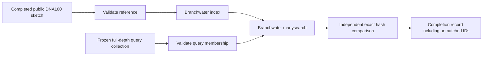

# One-run DNA100 adoption milestone

This implementation reuses one completed public DNA sketch and one frozen query
collection. It validates their checksums, settings and IDs, builds a Branchwater
index, searches every query, and checks the result against independently computed
shared hashes. An empty query stays in the completion record as an empty sketch.
A zero-match result passes only when independent hash comparison also gives zero.

## Status on 2026-10-25

| Work | Status | Evidence or remaining gate |
|---|---|---|
| Corrected six-frame translator | Implemented and locally tested | Five tests: lengths 29/30/31, internal X, actual stops, all frames, forward coordinates, original DNA and empty membership, duplicate IDs, overwrite refusal |
| Adoption and result validator | Implemented and locally tested | Seven tests: checksums, protocol, ownership, membership, wrong or duplicate matches, incomplete logs, independently confirmed zero matches |
| Nextflow adoption/index/search/audit | Implemented; runtime untested | Nextflow is absent locally; no syntax, resolved-profile, first-run or resume claim |
| Corrected Branchwater peptide builder | Implemented; pinned execution pending | Uses manysketch per segment, compares peptide API hashes, merges by original ID, retains empty originals at scales 10/100 |
| Historical recovery scripts and outputs | Preserved | Existing dirty recovery scripts and report files remain outside this change |
| Sherlock audit, corrected pilot and rollout | Pending | Access confirmation required; no SSH attempt made in this continuation |

The local tests use Biopython 1.88 and Sourmash 4.9.4. Local Branchwater is
0.9.14.dev0; production code refuses it because the intended pin is 0.9.15.
The local Sourmash loader emits SQLite connection ResourceWarnings under Python
3.13. The tests pass; they do not establish the pinned Branchwater runtime's behavior.

## Adoption manifest

Supply separate JSON manifests for reference and query. Each has these fields:

- `role`: `reference` or `query`.
- `artifact_id`, absolute `artifact_path`, and full-file `artifact_sha256`.
- `source_sha256`, `source_code_sha256`, and nonempty `source_tool_versions`.
- `ownership`: `completed-read-only`, established by the independent inventory.
- `expected_ids`: every expected signature name, including empty query sketches.
- `settings`: `{"moltype":"DNA","k":31,"scaled":100,"seed":42,"abundance":false,"stop_policy":"not-applicable","minimum_aa":null}`.
- `preprocessing`: `{"tool":"trim_galore","quality":20,"minimum_nt":20,"paired_mode":"independent-files"}`.

These are assertions to establish from the source audit, not values to infer from
filenames. File hashes and signature settings/membership are checked on compute.
Historical metadata must establish source preprocessing and provenance before a
manifest is accepted for use. This milestone accepts one reference run only.

The workflow has no download or sketch process and never writes to adopted files.
New indexes and results stay in Nextflow work directories. No `storeDir` or
`publishDir` is used. Preserve the work directory and `.nextflow/cache` together.
Deep content hashing is enabled for task inputs. Reference and query adoption are
separate, so changing a query should leave the reference index reusable; this
still requires the real Nextflow query-change test.

The driver requires renewed-access, resource-review, and ownership-review flags.
It also requires an explicit Slurm partition, CPU, memory, time, interpreter and
Sourmash path. These are not supplied here: current cluster instructions, measured
resource history and ownership remain inaccessible. Nextflow is pinned to 25.04.7;
Branchwater is checked as 0.9.15 in the same environment as the Python interpreter.
Task errors terminate this bounded workflow and preserve files; no automatic retry
is configured. Trace, report, timeline and DAG outputs are enabled.

## Corrected peptide path

`../peptide_protocol.py` exports a new directory containing original DNA and IDs,
segment coordinates and peptide FASTA. The rule is all six standard-code frames,
split only at `*`, keep stretches of at least 30 amino acids, preserve internal `X`.
Coordinates are zero-based, half-open. Reverse-frame DNA coordinates refer to the
original forward sequence. Original records with no qualifying stretch remain in
`origins.jsonl`. A checksummed completion manifest is written last.

`../sketch_corrected_peptides.py` consumes that export in a new output directory.
It uses Branchwater manysketch, verifies every segment against the peptide API,
and aggregates segment hashes under original IDs. The bounded pilot holds its
records in memory. It is not an archive-scale streaming implementation. An all-empty
translation writes explicit empty original sketches without calling manysketch.
Internal-X hashing must still be measured on the pinned tool, including whether
words containing X contribute hashes. API agreement alone is not a biological
validation or evidence of equivalence to the historical split-X protocol.

The older `pilot_minimum_peptide.py` and `stopfree_public_pilot.py` implement
historical stop/X splitting. Their results remain historical; do not use them as
corrected-protocol launchers or relabel their outputs.

## Required work after access is confirmed

1. Read current Sherlock instructions and inspect ownership and measured resource
   history. Independently audit the completed DNA shard and historical preflight.
2. Freeze adoption manifests from that audit. Resolve the Sherlock profile with
   Nextflow 25.04.7. Run this one-run workflow and compare with the matching old shard.
3. Test first run, unchanged resume, interrupted resume, query change, truncated
   sketches and protocol mismatch. Save commands, SHAs, trace/cache evidence and hashes.
4. Run the corrected peptide pilot with pinned Branchwater, including internal X,
   empty/nonempty and duplicate-hash signatures, and multiple segments per origin.
5. Implement missing-artifact download/trim/sketch channels, safe worker draining,
   measured resource selection and archive-scale aggregation only after these gates.
6. Extend public and Swiss-Prot coverage and update the private report using audited
   results. No historical denominator changes were made in this continuation.
