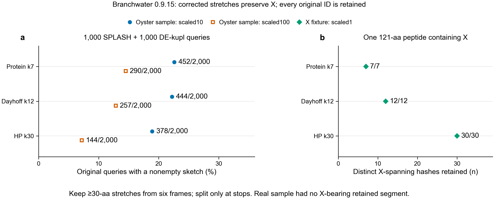

# Oyster migration evidence, 2026-10-25

The latest recovery job **49521583 passed**, running source **8d7efccb** in
9 min 14 sec with peak batch RSS 1,433,968 KiB and exit 0:0.
Seven migration scenarios produced the expected outcomes.

Job 49520265 ran source 49d75dcb on Sherlock and failed after 6 min 6 sec in the
Nextflow AUDIT process. Its upstream checks completed. Peak batch RSS was
1,426,444 KiB. Existing outputs and workers were not modified.

| Check | Result | Scope |
|---|---|---|
| Corrected translation fixtures | Passed | Lengths 29/30/31, stop-only boundaries, internal X, all six frames, coordinates and original IDs |
| Pinned Branchwater 0.9.15 X handling | Passed | In the 121-aa fixture, all 7 protein-k7, 12 Dayhoff-k12 and 30 HP-k30 X-spanning hashes were retained at scaled1 |
| Empty and duplicate-hash IDs | Passed | Explicit empty original and two nonempty originals with identical hashes remained separate |
| Corrected real-query sample | Passed hash checks | 2,000 queries, 4,659 segment/alphabet comparisons; no X-bearing retained segment in this real sample |
| Initial DNA shard | Passed independent audit | 380,867 original queries, 38 collections, eight public runs, 36 query–run pairs; original DNA hashes and exact pair/intersection equality |
| Historical preflight saved results | Passed independent audit | All four alphabets at scales10/100, complete query identities and exact pair/loss sets; retains historical stop/X protocol |
| First Nextflow execution | Failed in AUDIT | `log` resolved to `Logger[nextflow.Nextflow]` instead of the input search log; adoption, indexing and search completed |
| Production adoption | Blocked | Original build-code and Sourmash-version provenance unrecorded for historical inputs; production tests remain |

## Recovery results

The `search_log` repair passed real Nextflow 25.04.7 execution in job 49521583.
All five first-run tasks completed. All five unchanged-resume tasks were cached,
and the completion-file checksum stayed unchanged. A query change reused reference
adoption and the index while rerunning query adoption, search and audit. A deliberate
exit 75 before search recovered on resume. Truncated sketches and a mismatched
protocol failed query adoption before search. The traces and command arguments are
saved in `job49521583/summaries/`.

Historical query hashes were rebuilt from all 380,867 original DNA records for DNA,
protein, Dayhoff and HP at scales10/100. Translated hashes were independently
constructed one non-stop, non-X word at a time. These checks validate the historical
stop/X, minimum-length-equal-to-k outputs; they do not change their protocol label.

The corrected public pilot used 1,000 SPLASH extensions and 1,000 DE-kupl contigs
against complete SRR5945967. All 1,881 independently trimmed reference read records
matched the historical pilot DNA by ID and sequence checksum. New sketches used
pinned Branchwater manysketch; the pilot measured exact shared hashes directly.
It did not test translated Branchwater index/manysearch retrieval.

| Alphabet | SPLASH matches, scale10 / scale100 | DE-kupl matches, scale10 / scale100 |
|---|---:|---:|
| Protein k7 | 5 / 0 | 0 / 0 |
| Dayhoff k12 | 13 / 5 | 3 / 1 |
| HP k30 | 0 / 0 | 0 / 0 |

Each denominator is 1,000 original queries, including empty sketches. These are
candidate sequence matches, not annotation accuracy or biological validation.

The preliminary recovery job 49521117 failed before tests because tar member names
needed their `./` prefix. The archive-member fix was tested before job 49521583.
All attempts preserved earlier outputs. Evidence archives remain under
`$GROUP_SCRATCH/oyster-migration-tests-20261025-<source SHA>/evidence.tar.gz`;
the successful archive was also downloaded locally. Scratch is temporary storage.
Node-local cache paths are evidence, not a portable cross-job resume mechanism.

## Pending production work

External scheduler interruption, Slurm child-task dispatch, cross-job cache recovery,
archive-scale corrected builds, worker ownership transfer and full public/Swiss-Prot
coverage remain pending. Historical inputs lack original build-code and tool-version
provenance; their test-only manifests are rejected by the production profile.
No production rollout or old-worker cancellation occurred. The private report and
its historical coverage denominators were not changed.

## Figure

A sketch stores sampled hashes, numeric identifiers for amino-acid words.
Scaled10 keeps roughly one hash in ten; scaled100 keeps roughly one in one
hundred. All 2,000 original IDs remain in each collection, including empty
sketches. The left panel counts nonempty sketches, not biological matches or
sensitivity. The synthetic X test at right is separate because the retained
real-sample peptides contain no X. The source is `nextflow/plot_protocol_audit.py`.
The figure was visually inspected; PNG uses 256 colours and the PDF embeds Arial.
