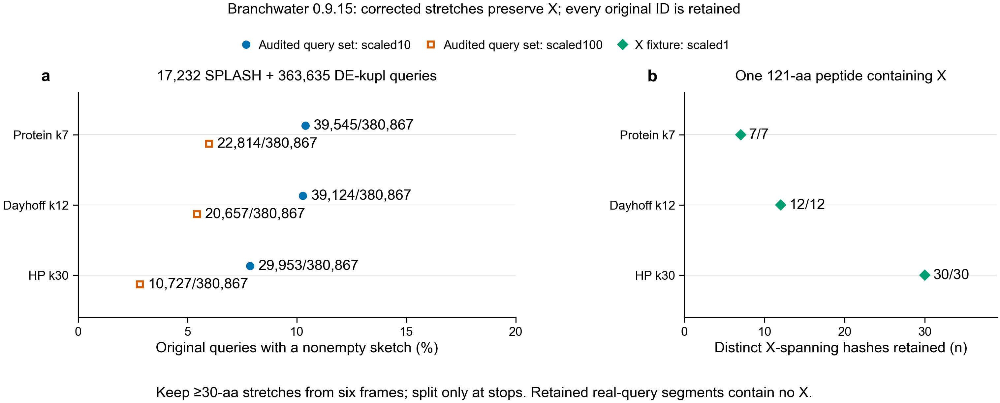

# Slurm interruption and corrected-build provenance, 2026-10-25

## Implemented

`nextflow/dispatch.nf` groups the corrected query build into one real Slurm task.
The source set is the first audited SPLASH batch (17,232 originals) plus all
363,635 selected DE-kupl contigs. This is not all full-depth SPLASH coverage.
The builder keeps chunks of at most 2,000 originals, original DNA, IDs, frame and
segment coordinates, and empty sketches. It splits six-frame translations only
at stops, preserves X, and retains stretches of at least 30 amino acids.

Each attempt writes a new `attempt-<Slurm job ID>` directory. A completion record
is written only after all chunks and source/code checksum checks pass. Old
attempts and historical worker outputs are preserved. The workflow inputs bind
the code directory and all source files into the Nextflow task hash.

The pinned Nextflow configuration preflight exposed null process resource limits
when launch parameters were overridden. Deferred closures fixed the limits.
The generated batch script requested 4 CPUs, 16 GB and four hours on normal,hns.
The earlier grouped audit peaked at 1.37 GiB. Full grouped-build runtime had no
measurement when submitted; four hours was a ceiling rather than an estimate.
The generated resource record retains the earlier traces and their checksums.

## Interruption test

Job 49525039 (source 3177eed3) ran on sh03-07n49, then was deliberately cancelled
through `scancel`. Slurm recorded cancellation; its batch step exited 143.
Nextflow marked the task FAILED with exit 143. There was no completion record.
The interrupted attempt retained 51 complete chunks covering 102,000 originals.
Its trace, command and logs were preserved before resuming.

Resume job 49525575 uses the same immutable code, inputs, launch directory and
Nextflow cache. It reruns the interrupted task in a distinct work directory.
Resume completed with exit 0 after 9 min 29 sec of Slurm runtime, with peak batch
RSS 730,348 KiB. It produced 191 chunks covering all 380,867 originals. A further
resume reused the completed task (CACHED, same task hash and native job ID),
submitted no new Slurm task, and preserved the completion-file checksum.

One cached-resume launch was attempted before the previous controller finished
finalizing. Nextflow refused its session lock and submitted no task. The check
was repeated only after the first controller exited 0. The refused log remains
preserved. This test covers task cancellation across Slurm allocations; it does
not simulate controller death, preemption or a separate task for each short step.

## Provenance

The preserved job 49521583 archive binds the corrected SRR5945967 reference to
raw-file MD5/SHA256, trimmed-file SHA256, original DNA, translation outputs and
six sketch collections. Archived build code matches commit 8d7efccb. Trim logs
record Trim Galore 0.6.10 and Cutadapt 5.2; same-job checks record Sourmash 4.9.4
and Branchwater 0.9.15 in the same explicit environment. Biopython was not recorded.
`recovered-reference-provenance.json` retains this distinction. A deliberately
altered raw FASTQ archive was rejected without writing a completion record.

Dependent job 49525633 (source be698691) independently rebuilds every corrected
query hash one amino-acid word at a time, then rebuilds the small reference with
all runtime versions, including Biopython. Its request is 4 CPUs, 16 GB and one
hour, based on the earlier eight-minute historical reconstruction and bounded
reference build. The independent audit completed with exit 0 in 5 min 44 sec, with peak batch
RSS 653,240 KiB. It reconstructed all 380,867 query
hashes at scales10/100 for protein k7, Dayhoff k12 and HP k30, preserving empty
and nonempty original IDs. The fresh SRR5945967 build records Python 3.12.15,
Biopython 1.88, Sourmash 4.9.4, Branchwater 0.9.15, Trim Galore 0.6.10 and
Cutadapt 5.2. Its 1,881 trimmed DNA records match the earlier reference, and all
12 bounded pilot measurements are unchanged.

The five artifact links in `verified-provenance.json` match their downloaded
files, and all six archived source-file hashes match the recorded build code.
This closes build-provenance gaps for these new corrected replacements. It does
not recover unknown historical build records or make unrelated archive artifacts
eligible for production adoption. The DNA-only adoption prototype still refuses
historical test-only manifests; translated production integration is pending.

Historical artifacts still have unknown original build provenance. New corrected
artifacts can replace them only within their documented source scope. These
tests do not transfer old-worker ownership or authorize relabelling old outputs.
No production rollout occurred. Full public/Swiss-Prot coverage and translated
retrieval workflow integration remain separate work.

## Local checks

Nineteen local tests passed: five translation, eight artifact validation, four
provenance/resource and two independent-word tests. The last two include 18
fixture comparisons with nonempty hashes and X. Python compilation, Black and
shell syntax also passed. Actual scheduler cancellation has been exercised. Full independent
replacement validation and cached resume passed on Sherlock.

## Figure

The left panel counts nonempty sketches among 380,867 originals. All originals
remain represented, including empty sketches. It measures hash retention, not
biological matches or sensitivity. The query set contains no retained segment
with X, so the right panel shows the separate pinned-tool synthetic fixture.
The figure uses Arial with embedded PDF fonts and a 256-colour PNG; it was
visually checked. Its source is `nextflow/plot_replacement_audit.py`.

## Preservation and future requests

The successful build, interrupted chunks and fresh-reference audit archive were
also downloaded into this local results directory. Large archives stay outside
Git; compact manifests, traces and figures are committed. Shared Scratch remains
temporary storage. The original workers and their result directories were untouched.

The launch helper derives requests from the successful grouped-build traces; only one such trace exists so far (job 49525575).
For this same 380,867-query scope it produces 4 CPUs, 4 GB and 20 minutes, using
a memory margin and runtime margin. `future-resources.config` is a generated
request for future work, not a submitted job or a replacement for the measured
16-GB/four-hour request used in this test.
