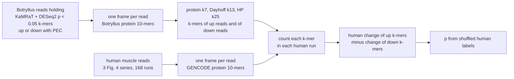

# Do Botryllus PEC k-mers move the same way in human muscle? (notebook 361)

Written 2026-11-08, before any job ran. Olga asked: are the Botryllus differentially expressed (DE)
k-mers used to look for human DE k-mers? The earlier search (`../../exports/sra_search/`) did not do
this. It asked only whether a gene's protein k-mers are present in a human run. This test asks
whether the Botryllus k-mers that went up with PEC go up in a human contrast more than the
Botryllus k-mers that went down.

## Inputs

- **Botryllus DE k-mers.** The reads that hold KaMRaT + DESeq2 p < 0.05 k-mers, with the k-mer's
  direction, from `$S/contrasts/<contrast>/search_kamrat_deseq2_p05_reads/held.reads.tsv` (job
  51347070, `../../exports/kamrat_contigs/README.md`). Three contrasts have these reads: young
  13-49 d, young 132 d and old 41-93 d, the three long PEC treatments. The 2 h and 24 h contrasts have
  no held reads and are not tested.
- **Frames.** `pec-tools best-frame`, rule `orpheum`, protein 10-mers. Botryllus reads use the new
  Botryllus proteome; human reads use GENCODE v50 translations. This is the rule used for the
  sketches in `../../exports/sra_search/`.
- **Settings.** Protein k7, Dayhoff k13 and HP k25, the three compared in figure 10 of PR 201.
- **Up and down sets.** A k-mer goes in the up set if it is in the frame of a read whose k-mer went
  up, and in the down set for down. A k-mer in both sets is dropped.
- **Human contrasts.** The three Fig. 4 RNA-seq comparisons, groups as in
  `../human/contrast_*_fig4_*.design.tsv`. "Up" in human means higher in the second group:

  | human contrast | first group | second group | samples | pairing |
  |---|---|---|---|---|
  | GSE99963 | before | after 10 days, both arms | 14 + 14 | by subject, 14 subjects |
  | GSE144304 | young | fit old | 26 + 30 | none |
  | GSE120862 | untrained | trained | 42 + 42 | by subject, 7 subjects, 6 samples each per group |

## Measure

For one Botryllus contrast, one setting and one human contrast:

1. Count each up and down k-mer in every human run's framed reads (`pec-tools count-kmers`).
   Divide by the run's number of k-mers at that setting, times 10^6, and take log2(x + 0.5).
2. Keep k-mers with a total count of at least 10 over that human contrast's runs.
3. For each human run, take the mean value over the kept up k-mers minus the mean over the kept
   down k-mers.
4. D is the human change in that per-run value: second group minus first group. Paired series use
   the mean over subjects of each subject's difference; GSE144304 uses the difference of group
   means.

D > 0 means the k-mers that went up with PEC in Botryllus go up in the human second group,
relative to the k-mers that went down. D < 0 means the opposite direction. The paper gives no
expected direction for these human groups (its Fig. 4 score is a macrophage gene score), so both
are tested.

## Null

Shuffling the human labels keeps every correlation between k-mers, so it is a fair null even though
k-mers from one gene move together.

- Paired series: flip each subject's two groups. GSE99963 has 2^14 = 16,384 flips, all used.
  GSE120862 has 2^7 = 128, all used.
- GSE144304: 10,000 random shuffles of the 56 labels.

Two-sided p = share of shuffles with |D| at least the real |D| (the real labels count as one).

## Pass rule

27 tests: 3 Botryllus contrasts x 3 settings x 3 human contrasts. A test passes at p <= 0.05 / 27 =
0.00185.

- **GSE120862 cannot pass.** With 7 subjects, the smallest possible p is 2 / 128 = 0.016. Its 9 tests
  are reported, but marked "too few subjects to decide".
- A Botryllus contrast "carries over" to a human contrast if at least 2 of its 3 settings pass with
  the same sign of D.
- Also reported, without a rule: the share of kept up k-mers, and of down k-mers, whose own human
  change is above 0.

## Limits known before running

- GSE120862 subjects P1-P4 were sequenced at 51 and 60 nt. A read of 60 nt gives at most 20
  residues, so those subjects give no HP k25 k-mers and fewer Dayhoff k13 ones.
- A pass says the Botryllus PEC direction and the human direction agree on shared protein
  k-mers. It does not say which genes, and it does not say the human change is caused by anything
  like PEC.
- Young 13-49 d has 512,253 up reads and 26,022 down reads, so its down set is small.
