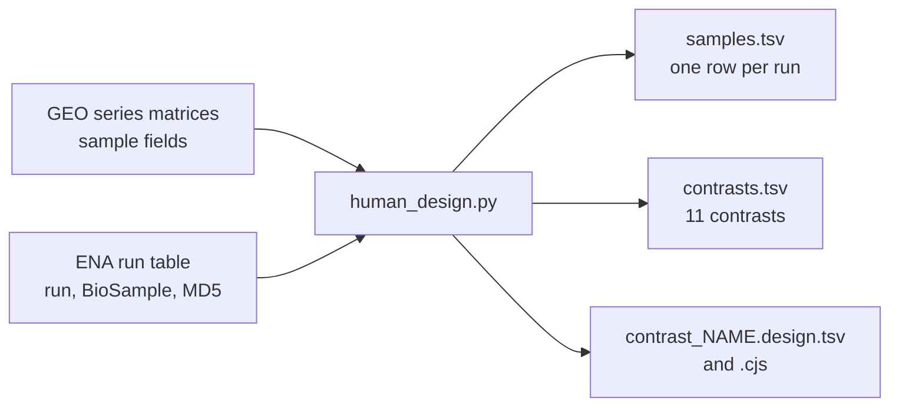

# Human contrasts for notebook 361 (written 2026-11-03, before any result)

Domen et al. 2026 name three human RNA-seq series in their data statement: GSE99963 (ref 66,
Laker et al.), GSE144304 (ref 67, van der Hoek et al.) and GSE120862 (ref 63, Popov et al.).
Olga asked for the same reference-free routes as the Botryllus contrasts on all three. Each
series is tested on its own; no test mixes series. Each contrast compares the two groups the
study itself compared.

Built by `scripts/human_design.py geo ../../exports/sra_search/paper_accession_runs.tsv .`
GEO samples are joined to ENA runs by BioSample accession; every sample has exactly one run.

## Contrasts

The shared scripts call the two groups "control" and "PEC" (pulsatile electrical current, the
Botryllus treatment). Here "control" is the study's reference group and "PEC" the other group.
"Up" in every result means higher in the second group.

| series | contrast | reference group | other group | samples | paired by subject | why this comparison |
|---|---|---|---|---|---|---|
| GSE99963 | gse99963_sed_post_vs_pre | before | after 9 days of high-fat diet | 7 + 7 | yes | Laker 2017 tests after vs before within each arm (edgeR, ~ time + subject) |
| GSE99963 | gse99963_ex_post_vs_pre | before | after 9 days of high-fat diet with resistance exercise | 7 + 7 | yes | as above, exercise arm |
| GSE144304 | gse144304_female_frail_vs_fit | fit | (pre-)frail | 15 + 11 | no | van der Hoek 2020 compares (pre-)frail with fit old adults, per sex |
| GSE144304 | gse144304_male_frail_vs_fit | fit | (pre-)frail | 15 + 13 | no | as above |
| GSE144304 | gse144304_female_old_vs_young | young | old (fit + frail) | 13 + 26 | no | de Jong 2023 (same series) compares old with young, per sex (DESeq2, p < 0.01) |
| GSE144304 | gse144304_male_old_vs_young | young | old (fit + frail) | 13 + 28 | no | as above |
| GSE120862 | gse120862_untrained_1h_ex_vs_ne | rested leg | exercised leg, 1 h after | 7 + 7 | yes | Popov 2019 compares the exercised with the rested leg at 1 h and 4 h, before and after training |
| GSE120862 | gse120862_untrained_4h_ex_vs_ne | rested leg | exercised leg, 4 h after | 7 + 7 | yes | as above |
| GSE120862 | gse120862_trained_1h_ex_vs_ne | rested leg | exercised leg, 1 h after | 7 + 7 | yes | as above, after 2 months of training |
| GSE120862 | gse120862_trained_4h_ex_vs_ne | rested leg | exercised leg, 4 h after | 7 + 7 | yes | as above |
| GSE120862 | gse120862_baseline_trained_vs_untrained | before training | after 2 months of aerobic training | 7 + 7 | yes | Popov 2019's baseline change with training; rested (NE) leg at rest only |

Choices not fixed by the papers, made the conservative way:
- GSE144304 groups are GEO's `group` field (Young, Fit, Frail; Fried criteria, as van der Hoek
  2020). GEO also has `logitgroup` (a ranking used by de Jong et al. 2023, Biol Sex Differ); it
  disagrees with `group` for some samples and is not used.
- GSE144304 old vs young pools fit and frail old adults, as de Jong 2023 (GeroScience) did.
- GSE120862 baseline: one sample per subject and condition (the rested leg), so SPLASH and the
  t-test, which treat samples as independent, do not count a subject twice.

## Settings that differ from Botryllus, and why

- Reads are single-end (all three series), so fastp runs without `--detect_adapter_for_pe` and
  nothing is interleaved. Every other setting is the Botryllus one: `--trim_poly_g
  --length_required 50`; SPLASH anchor 31, target 31, gap 0; DE-kupl k = 31, unstranded, limma;
  KaMRaT merge as in `nextflow-runs/pec-domen2026/main.nf`.
- GSE120862 subjects P1-P4 were sequenced at 60 nt (P1, P3) and 51 nt (P2, P4). SPLASH needs 62 nt
  (anchor + target) inside one read, so those reads give SPLASH no counts: in GSE120862 SPLASH
  effectively sees subjects P5-P7 only. The k-mer routes (DE-kupl, KaMRaT, k = 31) use every subject.
  The 31 + 31 setting was kept so that SPLASH is the same test as for Botryllus.
- GSE99963 libraries are stranded (TruSeq Stranded Total RNA) and GSE144304 too (NEBNext
  directional); k-mers are still counted on both strands (unstranded), as for Botryllus.
- KaMRaT + DESeq2 uses `~ pair + condition` (pair = subject) for paired contrasts and
  `~ condition` for GSE144304.

## Sources (downloaded 2026-11-03)

| file | URL | sha256 |
|---|---|---|
| geo/GSE99963_series_matrix.txt.gz | https://ftp.ncbi.nlm.nih.gov/geo/series/GSE99nnn/GSE99963/matrix/GSE99963_series_matrix.txt.gz | 0390ee58b8c58a4d2697b7d668adadc01a2409ae2045bc8c043b46e4b6c8734c |
| geo/GSE144304_series_matrix.txt.gz | https://ftp.ncbi.nlm.nih.gov/geo/series/GSE144nnn/GSE144304/matrix/GSE144304_series_matrix.txt.gz | 4d79175238dfec042c5435f953689e7611a88d8ae280784d5b0b0e99ae1c0a0c |
| geo/GSE120862-GPL16791_series_matrix.txt.gz | https://ftp.ncbi.nlm.nih.gov/geo/series/GSE120nnn/GSE120862/matrix/GSE120862-GPL16791_series_matrix.txt.gz (decompressed and recompressed) | 1629cf2cff77eef019024f34c7711fa607177e14a9b2fd36631b002e1481f7b9 |
| geo/GSE120862-GPL18573_series_matrix.txt.gz | https://ftp.ncbi.nlm.nih.gov/geo/series/GSE120nnn/GSE120862/matrix/GSE120862-GPL18573_series_matrix.txt.gz (decompressed and recompressed) | 24a874940dd06d27a30eeae93cb2b93ccdc6e0ed77f7f39c6a34bc10648005c5 |

The studies' own gene results (used in `exports/human/`), on Sherlock in `$S/human/published/in/`:

| file | URL | sha256 |
|---|---|---|
| laker_S1b.xlsx (Laker 2017, Table S1) | https://static-content.springer.com/esm/art%3A10.1038%2Fs41598-017-15420-7/MediaObjects/41598_2017_15420_MOESM2_ESM.xlsx | de9bbf3c5f10f88c14c62f03f1a5ba97afe170e6aedc3204b873b860fc5bb0ec |
| GSE99963_GeneCoverage.tsv.gz | https://ftp.ncbi.nlm.nih.gov/geo/series/GSE99nnn/GSE99963/suppl/GSE99963_GeneCoverage.tsv.gz | b04b443ba0d059f071acfb4faa3dc290364bb6ff4bafa6c2398d1012ca7d3137 |
| GSE144304_JoinedCounts.txt.gz | https://ftp.ncbi.nlm.nih.gov/geo/series/GSE144nnn/GSE144304/suppl/GSE144304_JoinedCounts.txt.gz | a0867af116e23ea5d3aa5b84f20e6d0770d832f754c1fa6839753c823b2601ac |
| GSE120862_DESeq_normalized_counts.txt.gz | https://ftp.ncbi.nlm.nih.gov/geo/series/GSE120nnn/GSE120862/suppl/GSE120862_DESeq_normalized_counts.txt.gz | 79cf9e3b59e38c259b850c3ed21eca613b5cfff8d98f7a51f1f9c0530a967eb6 |

Papers: Laker et al. 2017, Sci Rep 7:15134, https://doi.org/10.1038/s41598-017-15420-7;
de Jong et al. 2023, GeroScience 45:2367, https://doi.org/10.1007/s11357-023-00750-4;
de Jong et al. 2023, Biol Sex Differ 14:45, https://doi.org/10.1186/s13293-023-00531-w;
Popov et al. 2019, Am J Physiol Endocrinol Metab 316:E605, https://doi.org/10.1152/ajpendo.00449.2018
(abstracts and methods read through PubMed and PMC on 2026-11-03; the Popov journal page refused
access, so its supplementary tables were not read).
