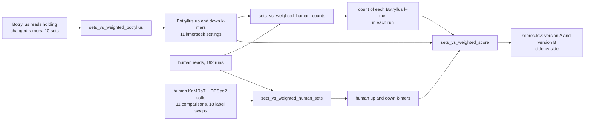

# Up and down k-mer sets against weighted k-mer counts: how it is run

The question and the rules are in `decision_rules.md`, frozen on 2026-11-11 before any run. This file
says which job makes which file. It does not change a rule.

## Inputs listed here

| file | rows | what it lists |
|---|---|---|
| `settings.tsv` | 11 | alphabet and k of each kmerseek setting |
| `botryllus_sets.tsv` | 10 | the 3 Botryllus comparisons and their 7 swaps between pairs of colonies |
| `human_runs.tsv` | 192 | every human run of the 11 comparisons (178), and 14 more that only PR 201's Fig. 4 groupings use. PR 201's list of 168 runs leaves out 24 frail GSE144304 runs |
| `human_sets.tsv` | 29 | the 11 human comparisons and their 18 label swaps, with the group each belongs to in the rules |

## Jobs (`../../slurm/`), all on Sherlock, CPU only

| job | tasks | writes under `/scratch/users/olgabot/nb361-pec/sets_vs_weighted/` |
|---|---|---|
| `sets_vs_weighted_botryllus.sbatch` | 10 | `botryllus/<set>/{up,down}.codes.tsv` |
| `sets_vs_weighted_human_counts.sbatch` | 192 | `human/<run>.counts.tsv.gz`, `human_framed/<run>.faa.gz` |
| `sets_vs_weighted_human_sets.sbatch` | 29 | `human_sets/<name>/{up,down}.<alphabet>.<k>.codes.gz` |
| `sets_vs_weighted_score.sbatch` | 1 | `results/scores.tsv`, `full_swap_check.tsv`, `pr201_check.tsv`, `sizes_b.tsv`, `tables/` |

The Botryllus job redoes the three settings of PR 201 with the eight new ones, so all 11 come from
one run of the same code. `pr201_check.tsv` then compares version A here with PR 201's numbers at
those three settings.

## What is not run yet

The size of version A's table (every human k-mer with its count in each run) needs one more count
over the framed peptides kept in `human_framed/`. Until that job exists, `sizes_b.tsv` holds version
B's sizes only.

## Checks

- On 2026-11-11 the scoring script was run on PR 201's own counts (Sherlock job 51944335, 3 settings,
  the 7 comparisons whose runs PR 201 counted). It gave PR 201's D in all 27 rows (largest
  difference 1.4e-16) with the same numbers of kept k-mers. A first try (job 51943644) stopped
  because PR 201's run list lacks 24 frail GSE144304 runs; `human_runs.tsv` here has them.

- `../../tests/test_sets_vs_weighted.py` scores a made-up example by hand and compares.
- The score job stops if exchanging up and down on the Botryllus side does not flip every score.
