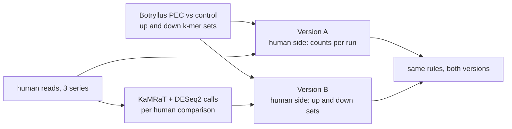

# Do up and down k-mer sets keep what the weighted k-mer counts show? Decision rules

Written 2026-11-11, before any run for this question. Status: **frozen**. Olga approved it as
written on 2026-11-11 ("Freeze them"), before any run. Nothing below changes after this.
If a rule turns out to be wrong, the notebook says so and still reports the answer under it.

Question: when each comparison keeps only two sets of k-mers, those called up and those called
down, is the match between PEC-treated Botryllus and human exercise lost, compared with keeping
every k-mer with its count?



What the paper claims (Domen et al. 2026, Fig. 4C-E legend and Methods): a score from 338 genes is
lower within 6 h of exercise and higher from 48 h on, and Botryllus shows the same two steps after
PEC, lower at 2 h and higher from 300 h. The paper never scores Botryllus against a human dataset.
The existing k-mer comparison (`../de2de/README.md`, PR 201) does, and is version A here.

## Fixed inputs

- **kmerseek settings:** 11 in all. Protein k7, Dayhoff k13 and HP k25 are the three in
  `../de2de/README.md`. Olga asked on 2026-11-11, before any run, for more Dayhoff and HP k sizes,
  and then for protein k6 and k8:

  | alphabet | letters | k sizes | why these |
  |---|---|---|---|
  | protein | 20 | 6, 7, 8 | one step each side of the existing 7; 8 residues fit every human read |
  | Dayhoff | 6 | 11, 13, 15, 17 | steps of 2 around the existing 13; 17 residues is the shortest human read (51 nt) |
  | HP (hydrophobic or polar) | 2 | 21, 23, 25, 27 | steps of 2 around the existing 25; 27 residues is the longest human read (81 nt) |

  HP below k 21 is left out: there are only 2^20, about 1 million, possible HP 20-mers, so large
  sets would share most of them by chance. A human read of n nt gives at most n / 3 residues, so
  some settings have no k-mers in some series: HP k27 only in GSE99963 (81 nt); HP k25 and above
  not in GSE120862 subjects P1-P4 (51 and 60 nt); Dayhoff k17 has one k-mer per read at 51 nt. A
  test with no k-mers is reported as missing. No other alphabet or k is added after this.
- **Botryllus comparisons (Q):** young 13-49 d, young 132 d, old 41-93 d. The 2 h and 24 h
  treatments have no reads holding changed k-mers, so the early step cannot be tested. That is a
  limit of this test, stated in the verdict.
- **Calls:** KaMRaT + DESeq2 at uncorrected p < 0.05, the test the pipeline already runs. A k-mer in
  the frame of a read holding an up k-mer goes in the up set, likewise for down. A k-mer in both
  sets is dropped. Same procedure for Botryllus and human reads.
- **Human comparisons (D)**, from `../human/contrasts.tsv`. "Up" means higher in the second group.

  | kind | comparison | why it is in this group |
  |---|---|---|
  | exercise, 48 h or more | gse99963_ex_post_vs_pre | 9 days of resistance exercise |
  | exercise, 48 h or more | gse120862_baseline_trained_vs_untrained | 2 months of training, rested leg |
  | not exercise | gse99963_sed_post_vs_pre | same diet, no exercise |
  | not exercise | gse144304_female_frail_vs_fit | frailty |
  | not exercise | gse144304_male_frail_vs_fit | frailty |
  | not exercise | gse144304_female_old_vs_young | age |
  | not exercise | gse144304_male_old_vs_young | age |
  | exercise, within 6 h (no rule) | the four gse120862 exercised vs rested leg comparisons | the paper expects the opposite direction here; reported, not judged |

  KaMRaT + DESeq2 calls are finished for all 11 human comparisons (PR 201, "Details": all three
  series done 2026-11-03), so none is left out.

## Known before running, from the PEC pull requests (read 2026-11-11: PR 197, 201, 203, 204, 207, 212, 213, 217)

- **The Botryllus calls themselves do not separate PEC from control.** DESeq2 keeps about as many
  genes at p <= 0.05 with swapped labels (about 656) as with real ones (601), and KaMRaT + DESeq2
  with swapped labels reaches as many of the paper's genes in either direction (79 against 78);
  only the direction is lost (PR 201, sections 7b and the 2026-11-05 update). So the up and down
  sets Q may hold little PEC signal, whatever is done on the human side.
- **Read depth is very uneven** in Botryllus: 108,860 to 160,736,718 reads per sample (PR 201).
- **GSE120862 baseline trained vs untrained goes against the paper** on the paper's own gene score:
  the rested leg scores lower after training (AUC 0.041, 7 + 7; PR 212). A batch difference was not
  tested. It stays in the "exercise, 48 h or more" group because training is what was compared.
- **GSE120862's direction depends on how each sample is scaled** (PR 201, 2026-11-10 update).
  Version A divides by each run's k-mer total; version B's calls use DESeq2 size factors. A and B
  can disagree there for that reason alone, and the notebook says so if they do.
- **GSE99963's exercise arm was on a high-fat diet too**, the same diet as its sedentary arm
  (PR 212). The pair "exercise arm against sedentary arm" is the cleanest pair in the ranking.
- **Arrays are out.** The five array series have 25-nt probe k-mers and HP 30-mers (PR 213), not
  the settings used here, and no Botryllus k-mers were counted in them. This test covers the
  three RNA-seq series only, and the verdict says so.
- PR 203 and PR 207 hold other Botryllus comparisons (gene counts; six time windows). They have no
  KaMRaT + DESeq2 calls and are not used.
- **Human label swaps exist** for GSE99963 and GSE144304 (3 per comparison, 18 in all; none for
  GSE120862). Version B scored against those swapped human sets is reported beside the real ones,
  with no rule, because only one "exercise, 48 h or more" comparison has swaps.

## Scores

One score per Botryllus comparison, kmerseek setting and human comparison.

- **Version A (weighted):** D, exactly as `../de2de/README.md` defines it: the human change (second
  group minus first) of the Botryllus up k-mers minus that of the down k-mers, in log2 counts per
  million k-mers, k-mers with a total count of at least 10. D > 0 is same direction.
- **Version B (sets only):**

  ```text
  same     = |Q_up ∩ D_up| + |Q_down ∩ D_down|
  reversed = |Q_up ∩ D_down| + |Q_down ∩ D_up|
  score    = (same - reversed) / (|Q_up| + |Q_down|)
  ```

  Score > 0 is same direction. `same`, `reversed` and the denominator are reported beside every
  score. A score with a denominator of 0 is reported as missing, not as 0.

## Rule 1: the match survives

Two numbers, computed the same way for A and for B.

- **Same direction:** of the tests against the two "exercise, 48 h or more" comparisons
  (3 Botryllus comparisons x 11 settings x 2 = 66 at most, fewer where a score is missing), how
  many have a score above 0.
- **Ranking:** within each Botryllus comparison and setting, every pair of one exercise comparison
  and one not-exercise comparison (2 x 5 = 10 pairs, 330 at most). The share of pairs where the
  exercise comparison has the higher score. 0.5 is what no difference gives. Ties count half. A
  pair with a missing score is left out, and the number of pairs used is reported.

Both numbers are also reported for each setting on its own, with no rule. The 11 settings read the
same reads, so they are not 11 independent tests: agreement across settings is expected, and the
verdict does not treat it as extra evidence.

The match **survives** in B if both hold:
1. B is same direction in more than half of the tests that have a score.
2. B's share of pairs is at least A's share of pairs.

**Addition (proposed by Claude, kept when Olga froze the rules as written):** if A itself is same direction in half or fewer of its
tests, or A's share of pairs is 0.5 or below, the verdict is "A shows no match, so there was nothing
to lose", not "survives". Reason: PR 201's label-swap control already found that swapped Botryllus
labels pass as often as real ones (12 of 63 against 5 of 27), and the Botryllus calls do not
separate PEC from control (section above).

## Rule 2: the control must fail

Labels are swapped on the Botryllus side only. Swapping both sides at once returns the same score,
so it would test nothing.

- **Full swap (check of the arithmetic):** every PEC label becomes control and the reverse. Up and
  down trade places, so every B score and every A score must change sign and keep its size. Any test
  where this does not happen is a bug, and the run stops.
- **Swaps between pairs of colonies (the control):** the 7 swapped KaMRaT + DESeq2 runs that already
  exist (3 for young 13-49 d, 3 for young 132 d, 1 for old 41-93 d). Mixed groups cannot carry the
  PEC direction. Each swap gets the same two numbers as Rule 1.

The control **fails, as it must,** if no swap set reaches both: same direction in more than half of
its tests, and a share of pairs at least as high as the real labels' share, in the same version.
If any swap set reaches both in version B, B "shows the match" without PEC, and the verdict for B is
**not shown**, whatever Rule 1 says. The same is reported for A.

Limit known now: 3 swaps (1 for old 41-93 d) cannot give a small p value. Real labels would beat 3
swaps by chance 1 time in 4.

No shuffled sequences and no shuffled database are used anywhere.

## Sizes (reported, no rule)

Per human comparison and Botryllus comparison, and in total, at each setting:

- A: every k-mer with a total count of at least 10, with its count in each run.
- B: the up and down sets, one row per k-mer with its direction.
- Both written as gzip-compressed TSV by the same writer. Reported: k-mers kept, bytes on disk, and
  the ratio B / A for each.
- A's table of every human k-mer does not exist yet (PR 201 counted only the Botryllus k-mers in
  human reads). Until that count is run, any A size is named `estimated_` and says how it was
  estimated; a measured column never holds an estimate.

## What needs a run

| step | exists | needs |
|---|---|---|
| Botryllus up and down sets, real and 7 swaps | at the first three settings | nothing for those |
| Botryllus up and down sets at the 8 new settings, real and 7 swaps | no | Sherlock job, about 1 min per comparison |
| Human counts of Botryllus k-mers, per run | only at the first three settings | Sherlock job at the 8 new settings (at most 19 min per run last time, 168 runs): Olga launches it |
| Human up and down sets at the 11 settings | no | Sherlock job, likely over an hour: Olga launches it |
| Every human k-mer with its count (sizes only) | no | Sherlock job: Olga launches it |
