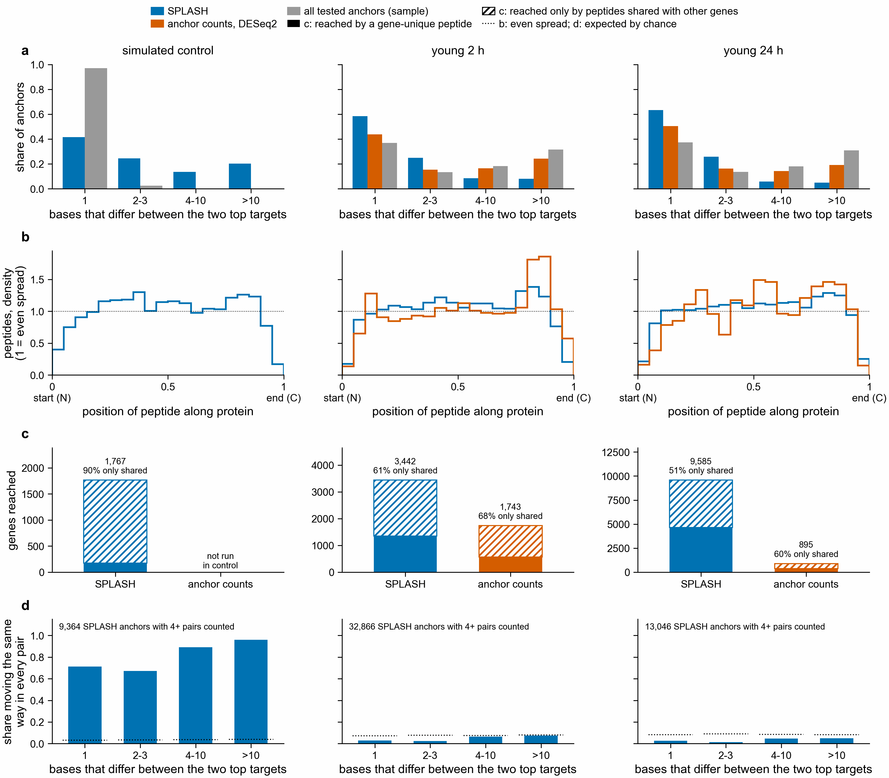

# What kind of sequence difference is each SPLASH call? (notebook 361)

Asked 2026-11-02, after `../reached_genes` showed that SPLASH reaches mostly highly expressed genes,
whatever the paper's fold change. Three questions, answered from existing outputs (no new SPLASH
runs):

- **H3, allele or isoform?** Do a SPLASH anchor's two most abundant targets differ by one or two
  bases (like a single-base allele), or by a long stretch (like a different exon)?
- **H4, position in the protein.** Do the reached peptides pile up at one end of the protein? A
  pile-up at the end (C-terminus, the 3′ end of the coding sequence) would point to a technical
  cause such as RNA degradation.
- **H5, gene families.** How many reached genes are reached only by peptides that also match other
  genes?

**a.** Share of anchors by the number of bases that differ between the anchor's two most abundant
targets (Hamming distance; a target is the 31 bases right after the 31-base anchor, counts pooled
over samples). Blue: anchors SPLASH keeps (corrected p <= 0.05). Vermillion: anchors kept by DESeq2
on anchor counts (p <= 0.05, 2-fold). Grey: a random 300,000 of all anchors SPLASH tested that
have two or more targets. **b.** Where reached peptides fall along the old gene-model protein,
0 = start (N-terminus), 1 = end (C-terminus), as density per twentieth of the protein (1 = even
spread). Each peptide is placed at the middle of its best match. A peptide has 20 or more residues,
so its middle cannot sit at the very ends, and every curve falls off in the outer bins. **c.** Genes
reached by a route. Solid: reached by at least one peptide whose matches all fall in that one gene.
Hatched: reached only by peptides that also match other genes. Numbers above the bars: all genes
reached, and the share reached only through shared peptides. **d.** Each real contrast pairs every
control sample with a PEC sample from the same colony. For each SPLASH anchor, the share of the
second target in each sample is n2 / (n1 + n2) (samples with n1 + n2 >= 10). Bars: share of anchors
whose second target moves the same way (PEC against control) in every pair counted (4 pairs or
more; a pair with no change counts as not the same way). Dotted line: the share expected if each
pair's direction were a coin toss.

## Verdicts

**H3: most SPLASH calls in the real data are single-base differences that follow the colony, not
the treatment.** Neither alleles nor isoform switches that change with PEC.

- In young 2 h and young 24 h, 58 % and 63 % of SPLASH's anchors have top targets that differ at
  one base, and 83 % and 89 % at three bases or fewer (a). Only 8.1 % and 4.9 % differ at more
  than 10 bases. In the other four contrasts, 60-69 % differ at one base.
- These one-base differences are not sequencing errors. An error target is rare next to the
  correct one: among all tested anchors of the simulated control, whose only one-base variants are
  simulated errors, the median count of the second target is 0.006 of the first. Among SPLASH's
  one-base anchors it is 0.35 (young 2 h) and 0.47 (young 24 h), and only 7.9 % and 2.3 % are
  below 0.05. Two targets at similar counts look like two alleles of one gene.
- The second target's share follows the colony pair (d). In young 2 h, the median difference
  between the control and PEC samples of one pair is 0.06, against 0.33 between samples of
  different pairs. In young 24 h it is 0.16 against 0.31. Only 3.4 % (young 2 h) and 2.6 %
  (young 24 h) of anchors move the same way in every pair, below the 7.4 % and 8.5 % expected by
  coin toss. In the simulated control, where the planted isoform switches are the only real
  change, 77 % move the same way in every pair (3.5 % expected by chance).
- So SPLASH's calls here are mostly places where colonies carry different alleles. SPLASH tests
  whether the target mix differs between samples, and different genotypes give different mixes,
  even though each pair's control and PEC samples share a genotype. This also explains why SPLASH
  reaches highly expressed genes: they have the reads to show an allele difference.
- The distance alone cannot separate alleles from isoforms. In the control, where every SPLASH
  call is in an isoform-switch gene, 42 % of anchors still differ at one base and 20 % at more than
  10. The pair test in d is what separates them.
- Anchor counts are a different kind of call. 44 % (young 2 h) and 50 % (young 24 h) of their
  anchors have one-base top targets, but these are mostly errors next to a dominant target (median
  count ratio 0.09 and 0.04). DESeq2 on anchor counts tests the anchor's total count, not its
  targets, so the target difference says little about why it was kept.
- Small insertions or deletions (4 or more bases differ, but 3 or fewer single-base edits turn one
  target into the other) are 2.5 % (young 2 h) and 1.6 % (young 24 h) of SPLASH's anchors.

**H4: no pile-up for SPLASH; a mild one toward the protein end for anchor counts.**

- SPLASH's peptides spread along the protein like the simulated control's, whose reads are spread
  evenly along each transcript (b). Last fifth of the protein: 17.9 % (young 2 h) and 18.6 %
  (young 24 h) of peptides, against 17.2 % in the control. First fifth: 15.2 % and 15.3 %, against
  15.2 %. Median position: 0.51 and 0.52, against 0.50.
- Anchor-count peptides lean toward the end: 26.4 % (young 2 h) and 20.3 % (young 24 h) in the
  last fifth, and 29.6 % and 27.7 % when each gene's peptides are weighted to count once in total
  (control, the same weighting: 17.0 %). This fits an abundance change measured near the 3′ end, as
  RNA degradation or 3′ bias would give, but it is a tilt, not a pile-up. The control has no
  anchor-count search to compare against directly.

**H5: about half or more of the reached genes rest only on peptides shared with other genes.**

| contrast | route | genes reached, all peptides | gene-unique peptides only | reached only through shared peptides |
|---|---|---|---|---|
| young 2 h | SPLASH | 3,442 | 1,349 | 2,093 (61 %) |
| young 2 h | anchor counts | 1,743 | 562 | 1,181 (68 %) |
| young 24 h | SPLASH | 9,585 | 4,653 | 4,932 (51 %) |
| young 24 h | anchor counts | 895 | 356 | 539 (60 %) |
| simulated control | SPLASH | 1,767 | 176 | 1,591 (90 %) |

In the other four contrasts, 61-71 % of genes are reached only through shared peptides
(`gene_unique_reach.tsv`). The control shows what the shared peptides add: of its 1,767 reached
genes, 108 carry a planted change (59 isoform switches, 27 raised, 22 lowered), 204 are unchanged
genes of the simulation, and 1,455 are not in the simulation at all, so they can only be reached by
matching a similar gene. Using gene-unique peptides only, 47 of 176 reached genes carry a planted
change (34 isoform switches) and 87 are not in the simulation (`control_reach_truth.tsv`). The
gene-unique rule removes most of the paralog matches but not all of them, and it loses 25 of the
59 isoform-switch genes.

## Files

- `target_distance_bins.tsv`, `target_distance_summary.tsv`: panel a for all six contrasts and the
  control, with edit distances and the second-over-first count ratio.
- `protein_position_bins.tsv`, `protein_position_summary.tsv`: panel b, per peptide and weighted
  per gene.
- `gene_unique_reach.tsv`, `control_reach_truth.tsv`: panel c and the control's reached genes by
  planted class.
- `target_share_by_pair.tsv`: panel d.

Code: `scripts/call_types.py` (Sherlock job 50781031, 2026-11-02, `slurm/16_call_types.sbatch`),
`scripts/target_share_by_pair.py` (job 50780860, `slurm/17_target_share_by_pair.sbatch`; reads
per-sample counts from SPLASH's `result_satc` with `satc_dump`), and `scripts/plot_call_types.py`.
Per-anchor tables stay on Sherlock in `$S/call_types/`.

## Limits

- Panel d uses the anchors with 4 or more pairs at 10 or more reads for the two targets: 32,866
  of 84,806 SPLASH anchors in young 2 h, 13,046 of a random 150,000 of 937,888 in young 24 h, and
  9,364 of 10,300 in the control. Anchors in weakly expressed genes are left out.
- The genotype labels in the design repeat (6996n and 6941c each appear in two pairs), so two
  pairs may share a genotype; the test uses pairs, not genotypes.
- The simulated control has no alleles, so it shows what an isoform call looks like but not what
  an allele call looks like.
- "Gene" means an old gene model g<N>. Several gene models can be copies of one gene (for
  example, two haplotypes assembled separately), so a shared peptide is not always a different
  gene family.
