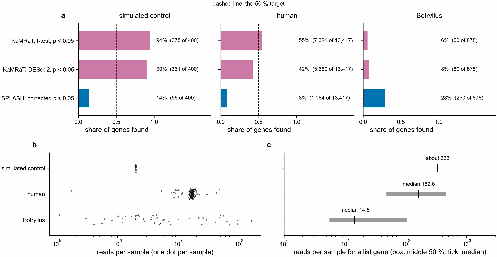

# Plan: half the paper's genes, going the paper's way, at 1/1000th of SPLASH's cost (notebook 361)

Asked 2026-11-04. Nothing below has run except the read-fraction table. Both the target and the
rules are written before any test.

## Why the control and human data look better than Botryllus

**a.** Share of genes found by three routes. Control: 400 planted genes. Human: the 12 study lists of
GSE99963 and GSE144304. Botryllus: the paper's 12 lists. Control counts a gene with no direction;
KaMRaT in human and Botryllus must go the list's way; SPLASH has no direction anywhere. **b.** Reads
per sample. **c.** Reads per sample for a gene: box, middle 50 %; tick, median. Human and Botryllus
show list genes; the control shows all its genes, counted by `pec-tools gene-counts`.

The routes work: 94 % in the control and 55 % in human for the KaMRaT t-test at p < 0.05. Botryllus
gets 6 % from the same route. Its list genes have about 11 times fewer reads than human list genes
(median 14.5 against 162.8), and its samples span 1,476-fold. Other differences may add to this:
Botryllus has far fewer samples per group, and the human route was matched to a complete proteome.
The control has fewer reads per gene than human (median 91 against 162.8), so depth alone does not
set the order: its planted 4-fold changes, even samples and lack of colony differences also make it
easier. The figure does not separate these. The 50 % target is already met in human by one route, at more
than SPLASH's cost; the target below is for Botryllus.

## Control test of the counter

`pec-tools gene-counts` on the 12 simulated samples, 2026-11-04 (job 51080985): 280 of the 300 genes
raised or lowered 4-fold got the right direction, 0 the wrong one. 24 of 2,600 unchanged genes got a
direction. 3 of 100 isoform-switch genes did, which is expected, since a gene total hides a switch.
It used 240 CPU s, 42 s on 8 threads and 55 MB. On the same samples SPLASH used 853 CPU s and 2.26 GB.

## All-reads result: stop, by the plan's rule

`pec-tools gene-counts` on all 47 samples and all reads, 2026-11-04 (job 51081669). Scored against
the paper's lists, right direction only (`all_reads/recovery.tsv`).

| rule | needed | result |
|---|---|---|
| paper's genes, right direction | 439 of 878 | 207 of 878 (24 %): fail |
| lists beating random genes | 9 of 12 | 11 of 12: pass |

| cost, all six contrasts | gene-counts | SPLASH route | ratio |
|---|---|---|---|
| CPU | 2.9 h | 12.1 h | 1/4 |
| wall time | 32 min | 3.0 h | 1/5.6 |
| peak memory | 0.44 GB | 83.6 GB | 1/190 |

This is the most genes this method finds with these settings, so under the stop rule the 1/10 and
1/100 runs were not started. It still reaches more than any other route in the right direction: 207
genes against 97 for DE-kupl with DESeq2, the next best, which covers only 10 of the lists. 131 M of
449 M read pairs (29 %) went to a gene; 317 M (71 %) had no 3 matching k-mers, and 1.2 M tied. Swapped
labels were not run. The paper's lists are uncorrected, so 439 may not be a fair target; the
reference is being rebuilt with nf-core (`nextflow-runs/pec-domen2026-nfcore/`).

## After the stop: a second rule (2026-11-05)

The summed rule above stays the pre-set test, and it failed. After reading it, `sample_mean` was added
to `scripts/gene_directions.py`, because one sample can hold half a contrast's reads. On the same
counts it gets 522 of 878 (59 %) in the paper's direction, and 11 of 12 lists beat random
(`all_reads_sample_mean/recovery.tsv`). The rule came after the score, so this is a lead, not a pass.
Limits and the nf-core comparison: `../nfcore/README.md`.

## Target

Gene counted: on one of the paper's 12 lists, and reached by a sequence going the paper's way.

| measure | needed | best today |
|---|---|---|
| paper's genes, right direction | 439 of 878 | 97 of 792 (DE-kupl DESeq2, p < 0.05); no route has more than 12 % |
| CPU, all six contrasts | 44 s | 12.1 h (SPLASH route: SPLASH, compactors, protein search) |
| wall time | 11 s | 3.0 h |
| peak memory | 84 MB | 83.6 GB |

Rules for a pass, all three needed:

1. 439 or more of the 878 genes.
2. 9 or more of the 12 lists beat 1,000 random gene sets matched on baseMean, the test in
   `scripts/paper_recovery.py`. This is needed because a method that gives every gene a direction
   would match half the list by chance.
3. Cost measured with `/usr/bin/time -v`, not estimated.

## Fewer reads alone cannot do it

The list genes are rare: their median baseMean is 14.5, and 42 % are below 10. Best case, from the
paper's own numbers (`thin_read_bound.tsv`, `scripts/thin_read_bound.py`):

| share of reads | list genes seen at all, of 878 | genes with about 10 reads per group |
|---|---|---|
| all | 878 | 824 |
| 1/10 | 859 | 391 |
| 1/100 | 609 | 157 |
| 1/1000 | 296 | 15 |

At 1/1000th of the reads, too few genes are seen at all, so the saving has to come from a cheaper
method per read. Even 1/10th of the reads falls short of 439 genes with about 10 reads per group.

Reading the reads is itself a limit. The trimmed reads are 88 GB of compressed files and 898 M
reads, so 44 CPU s would mean 20 M reads per CPU second, before any matching. I expect that to be out
of reach for any method that opens the reads. Decompression speed here has not been measured.

## Sequencing depth

Samples run from 108,860 to 160,736,718 reads, median 4.4 M. Within young 24 h they run from
301,282 to 93,965,840. So a swap that flips a pair can flip two samples of very different depth,
and a sample with few reads adds almost nothing to either group. Swapped labels are therefore
reported here but are not a pass rule. They show what noise looks like at this depth. They cannot
tell "PEC does nothing" from "too few reads to see it".

## Test, cheapest first

The method: one small `pec-tools` command, not yet written. It translates each read in six frames,
looks up protein k-mers in a small index of the old gene-model proteins, and counts reads per gene
per sample. Counts are summed per group, so shallow samples weigh little. A gene gets a direction
when it has 10 or more reads in each group or 10 or more in one and none in the other, and a 2-fold
change after scaling for each group's total reads. There is no per-sample test, because that is the
costly part and shallow samples have little to give it.

| step | what | reads | stop if |
|---|---|---|---|
| 1 | Write the command, test it on the simulated control | control only | planted direction is wrong for most found genes |
| 2 | All 47 samples, all reads: the most this method can do | all | under 439 genes or under 9 lists: stop, no thinner run can pass |
| 3 | Same with 1/10, then 1/100 of the reads | first reads of each file | stop at the first fraction that fails rules 1 or 2 |
| 4 | Report the cheapest passing run against the target | | |

Step 2 is the deciding run: it costs one Sherlock job, and if it fails, the target is out of reach
for this method. Every run writes genes, directions, and `/usr/bin/time -v` output. CPU and memory are
expected to be well above budget in step 2; that run measures the most genes, not the cost.

If steps 2 and 3 pass, cost is likely to land near 1/100 to 1/300 of SPLASH's, not 1/1000. That is an
estimate from the reading limit above, not a measurement.

## Thinned reads and swapped labels: rules written 2026-11-05, before any run

Asked 2026-11-05 after the `sample_mean` lead. Read limits and swap readings are fixed here first.
This is the second look at the same samples, so a pass still is not an independent repeat.

Thinned reads. `pec-tools gene-counts` reads the first 1/10, 1/100 and 1/1000 of each sample's read
pairs, at least one pair, with the `sample_mean` direction rule. All three run, because they are cheap
and were asked for, so step 3's stop does not apply. Reads in a file may not be in random order; that
is what a cheap run would do, so it stays. Each fraction runs twice: old gene-model proteins for the
paper's lists, new proteome for nf-core's. A run limited to one pair per sample measures index building
alone.

| fraction passes when | paper's lists (the test) | nf-core lists (reported too) |
|---|---|---|
| genes, right direction | 439 or more of 878 | 568 or more of 1,135 |
| lists beating random | 9 or more of 12 | 9 or more of 12 |
| cost | measured, with and without index building | same |

The cost target stays 44 CPU s, 11 s and 84 MB. A pass on genes that misses these is reported as a miss.

Swapped labels. The 14 designs in `design/label_swap_kamrat/manifest.tsv` flip some, not all, counted
pairs. Two questions, and neither is a pass rule (see "Sequencing depth"):

A. Does the rule still match the real lists under swapped labels? Reported as a share, by contrast.
Lists were built with the real labels, so a fall here is expected even in pure noise and proves
nothing alone.

B. Does the rule agree with DESeq2 when both get the same swapped labels? This asks whether the 54 %
only means two methods read the same counts. PyDESeq2 runs on the nf-core gene counts with each design
(same `pair` or `genotype` term), real labels included, at p <= 0.05 and 2-fold. Agreement is the share
of its genes that `sample_mean` gives the same direction, on new-proteome counts. Reading, by comparing
swapped agreement with real agreement over all genes:

- 80 % of the real agreement or more: the agreement comes from shared counts, not from PEC.
- 50 % or less: the real labels add something.
- in between: no conclusion.

### Thinned reads: result, 2026-11-05

No fraction passes (jobs 51223398, 51223401; `thin/`, `../nfcore/gain_vs_cost.png`). All reads are shown
for comparison and use the `sample_mean` rule, which was written after the summed rule failed.

| reads | paper's lists, right way | beat random | nf-core lists, right way | beat random | CPU | wall | memory |
|---|---|---|---|---|---|---|---|
| all | 522 of 878 (59 %) | 11 of 12 | 609 of 1,135 (54 %) | 11 of 12 | 2.9 h | 32 min | 0.44 GB |
| 1/10 | 316 (36 %) | 10 | 538 (47 %) | 10 | 970 s | 3.1 min | 0.44 GB |
| 1/100 | 131 (15 %) | 6 | 272 (24 %) | 8 | 102 s | 19 s | 0.44 GB |
| 1/1000 | 19 (2 %) | 2 | 34 (3 %) | 2 | 23 s | 4.6 s | 0.44 GB |

Costs are for the old gene-model proteins; the new proteome is within 15 %. Building the index alone
takes 3.6 CPU s, 2.8 s and all of the 0.44 GB, so memory does not fall with reads. Only the 1/1000 run
meets the CPU and wall targets, and it reaches 2 %. All runs miss the 84 MB target.

## Not covered

- The index is built from the old gene-model proteins, so this does not find genes outside them.
- The index-building cost is left out of the budget, as a one-time cost, like the databases in the
  baseline.
- The paper's lists come from these reads, so agreement is not an independent repeat.
