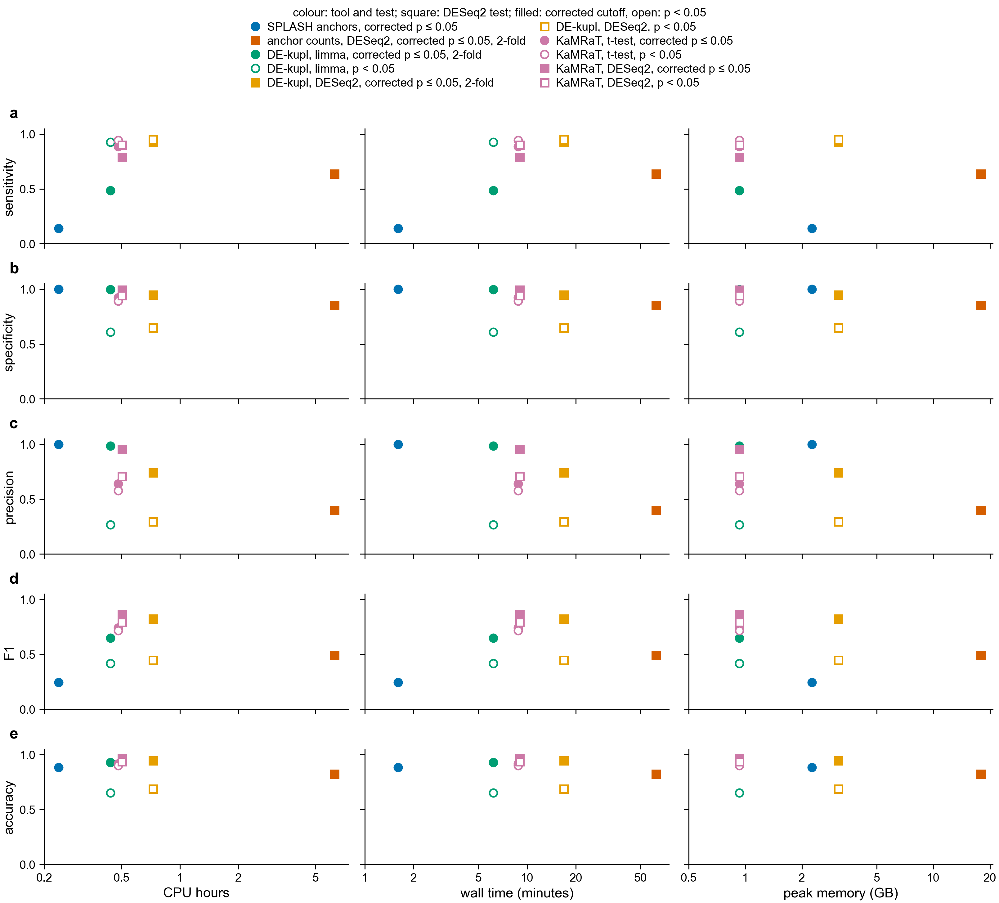

# Accuracy against cost on the simulated control (notebook 361)

Asked 2026-11-03: accuracy, F1, sensitivity and specificity against CPU hours, memory and
time for SPLASH, KaMRaT and DE-kupl.

The control has 3,000 simulated genes in 12 samples: 400 with a planted change (150 raised 4x,
150 lowered 4x, 100 with isoforms switched 9x) and 2,600 unchanged. A gene is found when a kept
sequence lies in that gene only.

- sensitivity: planted genes found / 400
- specificity: unchanged genes not found / 2,600
- precision: planted genes found / all genes found
- F1: 2 x precision x sensitivity / (precision + sensitivity)
- accuracy: (planted genes found + unchanged genes not found) / 3,000. With 2,600 of 3,000 genes
  unchanged, a route that finds nothing scores 0.87, so accuracy says little here.

| route | sensitivity | specificity | precision | F1 | accuracy | CPU hours | wall time (min) | peak memory (GB) |
|---|---|---|---|---|---|---|---|---|
| SPLASH anchors, corrected p ≤ 0.05 | 0.14 | 1.00 | 1.00 | 0.25 | 0.89 | 0.24 | 1.6 | 2.3 |
| anchor counts, DESeq2, corrected p ≤ 0.05, 2-fold | 0.64 | 0.85 | 0.40 | 0.49 | 0.83 | 6.27 | 62 | 17.9 |
| DE-kupl, limma, corrected p ≤ 0.05, 2-fold | 0.49 | 1.00 | 0.98 | 0.65 | 0.93 | 0.44 | 6.2 | 0.9 |
| DE-kupl, limma, p < 0.05 | 0.93 | 0.61 | 0.27 | 0.42 | 0.65 | 0.44 | 6.2 | 0.9 |
| DE-kupl, DESeq2, corrected p ≤ 0.05, 2-fold | 0.93 | 0.95 | 0.74 | 0.83 | 0.95 | 0.73 | 16.8 | 3.1 |
| DE-kupl, DESeq2, p < 0.05 | 0.95 | 0.65 | 0.29 | 0.45 | 0.69 | 0.73 | 16.8 | 3.1 |
| KaMRaT, t-test, corrected p ≤ 0.05 | 0.89 | 0.92 | 0.64 | 0.74 | 0.92 | 0.48 | 8.8 | 0.9 |
| KaMRaT, t-test, p < 0.05 | 0.95 | 0.89 | 0.58 | 0.72 | 0.90 | 0.48 | 8.8 | 0.9 |
| **KaMRaT, DESeq2, corrected p ≤ 0.05** | 0.79 | 0.99 | 0.96 | **0.87** | 0.97 | 0.50 | 9.0 | 0.9 |
| KaMRaT, DESeq2, p < 0.05 | 0.90 | 0.94 | 0.71 | 0.79 | 0.94 | 0.50 | 9.0 | 0.9 |

KaMRaT contigs tested with DESeq2 have the highest F1 (0.87 corrected, 0.79 at p < 0.05) at
about half a CPU hour and under 1 GB. SPLASH is cheapest and makes no false finds, but finds only
isoform switches (56 of 100) and no gene whose level alone changed. Anchor counts with DESeq2
cost the most (6.3 CPU hours, 18 GB) and have the lowest precision of the corrected routes.

Cost (`control_route_cost.tsv`, with the source of every number):
- Detection steps only, up to the kept sequences. The protein search after them is left out,
  because the control places sequences on genes directly.
- From `/usr/bin/time -v` files in `$S/contrasts/control/` and, for KaMRaT's own step, the
  Nextflow trace (2026-11-01_1549, task 126).
- KaMRaT starts from DE-kupl's k-mer counts. No separate time exists for counting alone, so
  KaMRaT is charged the whole DE-kupl limma run (counting + limma), which overstates it a little.
- The anchor-count step logged only its wall time (363 s). It is counted as 363 CPU seconds,
  as if it ran on one thread, and its memory was not recorded.
- The p < 0.05 and corrected versions of a route share one run, so they share a cost.
- One control run per route, so there is no spread to show. Real contrasts are 10-50 times
  larger; the costs there are in `../paper_recovery/README.md`.

Code: `scripts/plot_route_cost.py exports/control/control_truth_summary_p05.json
exports/control/control_route_cost.tsv exports/control/route_cost`. Numbers: `route_cost.tsv`.
