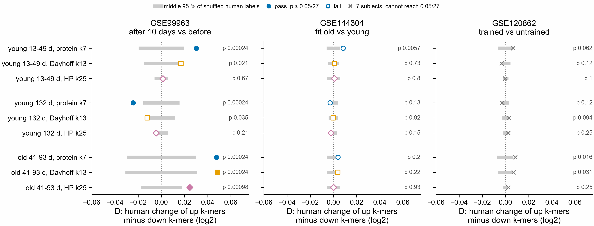

# Do Botryllus PEC k-mers move the same way in human muscle? Result (notebook 361)

Plan and pass rule, written before any job ran: `../../design/de2de/README.md`. Sherlock jobs
51590628 (Botryllus k-mers), 51590632 (human counts), 51590633 (test), 2026-11-08. Code:
`scripts/de2de_test.py`, `scripts/plot_de2de.py`, `pec-tools kmer-codes` and `count-kmers`, the
three `slurm/de2de_*.sbatch`. Numbers: `de2de_results.tsv`; D under every shuffle:
`de2de_null.tsv.gz`.

One row per Botryllus contrast and setting, one panel per human series. D is the human change
(second group minus first) of the Botryllus up k-mers minus that of the down k-mers, in log2 counts
per million k-mers. D > 0: k-mers that went up with PEC in Botryllus go up in the human second
group, relative to those that went down. Grey bar: middle 95 % of D with shuffled human labels.

## Result

By the rule, 5 of 27 tests pass, all in GSE99963 (after 10 days of high-fat diet, with or without
exercise, vs before). No test passes in GSE144304. GSE120862 cannot pass with 7 subjects; its
smallest p, 0.016, is reached once (old 41-93 d, protein k7).

| Botryllus contrast | GSE99963 passes | sign of D | carries over (2 of 3 settings, same sign) |
|---|---|---|---|
| young 13-49 d | protein k7 | + | no |
| young 132 d | protein k7 | - | no |
| old 41-93 d | protein k7, Dayhoff k13, HP k25 | + | yes |

- Only old 41-93 d carries over to a human series by the rule: GSE99963, all three settings.
- The two other contrasts disagree in sign in the same human series: young 13-49 d +0.030,
  young 132 d -0.024 (protein k7). So the Botryllus PEC direction does not give one human
  direction.
- The effects are small. The largest D is 0.048 log2, a 3 % difference between the up and the down
  k-mers. Per k-mer, 68 % of old 41-93 d up k-mers rise in GSE99963 against 62 % of down k-mers
  (protein k7).
- In GSE99963 the shuffled bars are wide (up to +/- 0.03) next to the other series. Its 14 subjects
  differ a lot from each other after vs before, so any two sets of k-mers may differ there.

## What this does and does not show

Not tested yet, and needed before reading the GSE99963 passes as a PEC signal: the Botryllus
label-swap reads. If Botryllus k-mers from swapped PEC and control labels (held reads exist for 7
swaps, `$S/label_swap/<contrast>/pairflip*/`) give a D as large in GSE99963, the passes come from
which genes the k-mers fall in, not from the PEC direction.

Other limits:
- Many held Botryllus reads get no frame and add no k-mers: of the up reads, 22,341 of 62,761 are
  framed in old 41-93 d, 49,950 of 542,582 in young 132 d and 265,701 of 512,253 in young
  13-49 d. Of the down reads: 40,190 of 84,563, 206,961 of 472,457 and 3,611 of 26,022.
- The held reads add up to about 100 bases around each KaMRaT k-mer, which were not tested for
  change themselves (`../kamrat_contigs/README.md`).

## Resources

Botryllus k-mers: under 1 min and 0.5 GB per contrast. Human counts: at most 19 min and 1.7 GB per
run. Test: 39 s and 0.8 GB. Every first attempt finished.
