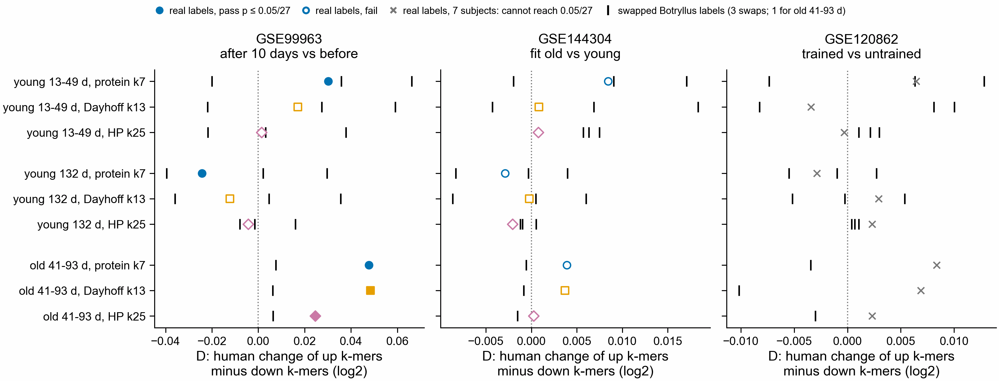

# Label-swap control of the DE-to-DE test (notebook 361)

Rule, written before the jobs finished: `../../design/de2de/README.md`, section "Label-swap
control". Sherlock jobs 51658367 (Botryllus k-mers), 51658368 (human counts), 51660815 (test),
2026-11-09. Code: `slurm/de2de_*.sbatch` with `SWAP=1` / `W=$S/de2de_swap`,
`scripts/de2de_test.py`, `scripts/plot_de2de_swap.py`. Numbers: `de2de_results.tsv` (every swap
set), `de2de_swap.tsv` (the rule, for every real pass).

Same layout as `../de2de/de2de.png`. Coloured marks: D with the real Botryllus PEC and control
labels. Black ticks: D for Botryllus reads from KaMRaT + DESeq2 runs with the labels swapped between
pairs of colonies (3 swaps for each young contrast, 1 for old 41-93 d). Each panel has its own x
scale.

## Result

Swapped labels pass as often as real ones: 12 of 63 swap tests pass (10 in GSE99963, 2 in
GSE144304), against 5 of 27 real tests (all in GSE99963). Both are 19 %.

| real pass | real D | swap D | verdict |
|---|---:|---|---|
| young 13-49 d, protein k7, GSE99963 | +0.030 | +0.036, -0.020, +0.066 | does not hold |
| young 132 d, protein k7, GSE99963 | -0.024 | +0.002, -0.040, +0.030 | does not hold |
| old 41-93 d, protein k7, GSE99963 | +0.048 | +0.008 | holds |
| old 41-93 d, Dayhoff k13, GSE99963 | +0.048 | +0.006 | holds |
| old 41-93 d, HP k25, GSE99963 | +0.025 | +0.006 | holds |

- The two young passes do not hold: swapped labels give a larger |D|, and some pass with the same
  sign.
- Old 41-93 d holds in all three settings, but against a single swap. With one swap, the real |D|
  would be the larger of the two 1 time in 2 by chance, so this is weak evidence.
- In GSE99963, Botryllus k-mer sets of any labelling often differ in their human change. That fits
  the wide shuffled range there (`../de2de/README.md`): which genes a set lands in decides D more
  than the PEC direction does.

So the DE-to-DE test does not show that the Botryllus PEC direction carries over to human muscle.
Old 41-93 d is the only lead, and testing it needs more swaps of that contrast (it has 1).

## Resources

Botryllus k-mers: under 1 min per set. Human counts: at most 12 min and 1.7 GB per run (8 GB, 2 h
asked). Test: 63 s and 1.4 GB. The first test job (51658369) failed in 17 s because `sbatch
--export` split the comma-separated list of swap sets; the list is now colon-separated.
