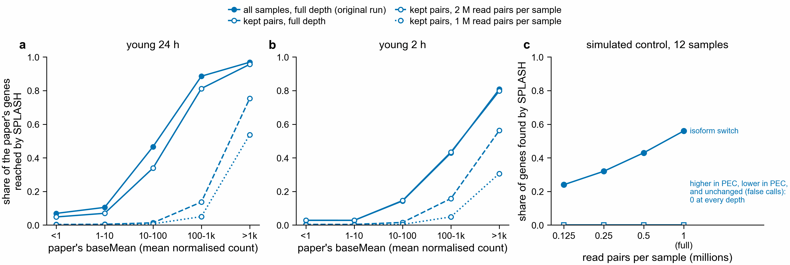

# Does SPLASH's reach come from unequal read depth? (notebook 361)

Asked 2026-11-02, after `../read_depth/` showed control samples with 2.6 to 3.4 times the reads
of PEC samples (pulsatile electrical current) in young 2 h and young 24 h.

**a, b.** Share of the paper's genes reached by SPLASH (a peptide from a kept SPLASH sequence
aligns to the gene's protein), by the paper's baseMean (DESeq2's mean normalised count).
Filled circles: the original run, all samples. Open circles, solid: the pairs kept for this test,
full depth. Dashed: every kept sample cut to 2 million read pairs. Dotted: 1 million read pairs.
**c.** Simulated control (12 samples of about 1 million read pairs, 3,100 transcripts, known
planted changes): share of planted genes SPLASH finds as samples are cut. False calls (unchanged
genes) and abundance-only changes stay at 0 at every depth.

Code: `scripts/equal_depth_submit.py`, `slurm/20_equal_depth.sbatch`,
`slurm/21_equal_depth_summary.sbatch`, `scripts/equal_depth_summary.py` (Sherlock summary job
50779540, 2026-11-02) and `scripts/plot_equal_depth.py`. Numbers: `equal_depth_counts.tsv`,
`equal_depth_reached.tsv`, `equal_depth_control.tsv`.

## Design

- Reads were cut with seqtk 1.4 (`sample -s 361`, same seed for read 1 and read 2); the 1 M set
  is drawn from the 2 M set.
- A colony pair (a PEC sample and its control clone) was dropped whole when either sample had
  fewer than 2 M pairs. young 24 h keeps 4 of 6 pairs (drops JA110/JA111 and JA129/JA130);
  young 2 h keeps 5 of 6 (drops JA123/JA124).
- "Kept pairs, full depth" separates the effect of dropping pairs from the effect of cutting depth.
- SPLASH, compactors and the protein search use the pipeline's settings.

## Results

| contrast | run | anchors tested | anchors kept | genes reached |
|---|---|---|---|---|
| young 24 h | all samples, full depth | 16,190,103 | 937,888 | 9,585 |
| young 24 h | kept pairs, full depth | 12,763,913 | 570,629 | 7,079 |
| young 24 h | kept pairs, 2 M pairs | 1,594,203 | 40,456 | 765 |
| young 24 h | kept pairs, 1 M pairs | 832,666 | 15,952 | 439 |
| young 2 h | all samples, full depth | 15,015,257 | 84,806 | 3,442 |
| young 2 h | kept pairs, full depth | 14,972,176 | 90,856 | 3,480 |
| young 2 h | kept pairs, 2 M pairs | 2,067,417 | 19,657 | 718 |
| young 2 h | kept pairs, 1 M pairs | 1,048,555 | 4,282 | 234 |

Simulated control, isoform switches found (of 100): 56 at full depth, 43 at 0.5 M pairs, 32 at
0.25 M, 24 at 0.125 M.

- Cutting to 2 M pairs keeps 11 % (young 24 h) and 21 % (young 2 h) of the genes reached at full
  depth with the same pairs.
- Cutting the control 4-fold (to 0.25 M pairs) keeps 57 % of its true isoform calls (32 of 56).
  Per transcript, 0.25 M pairs over 3,100 transcripts is roughly as deep as 2 M pairs over 20,000
  expressed genes; this is a rough match, not an exact one.
- Real calls fall about 3 to 5 times faster than true calls in the control.
- Highly expressed genes are still mostly reached at equal depth: 75 % of genes with baseMean
  above 1,000 in young 24 h and 56 % in young 2 h, at 2 M pairs.

## What this says

Most of SPLASH's reach in young 2 h and 24 h needs the deep samples: it shrinks far more than true
calls do when depth is cut. But cutting to equal depth also cuts the deepest samples up to about
17-fold, so this test cannot separate "unequal depth between groups" from "less depth overall".
The label-swap test (`../label_swap/`) separates them.

What survives at equal depth is concentrated in highly expressed genes. That fits
`../call_types/`: most SPLASH calls are one-base differences whose target mix follows the colony
pair, not PEC. Those differences need reads to be seen, so they remain where reads are plentiful.

## Limits

- Dropping the shallow pairs changes which colonies are compared.
- The per-gene depth match between the control and the real data is approximate.
