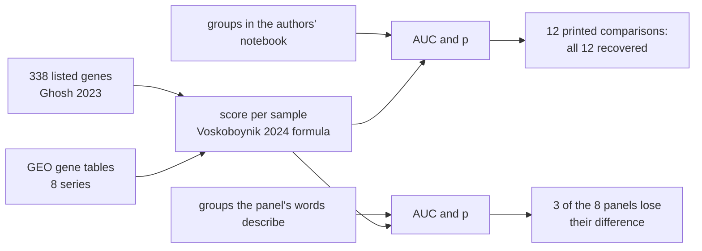
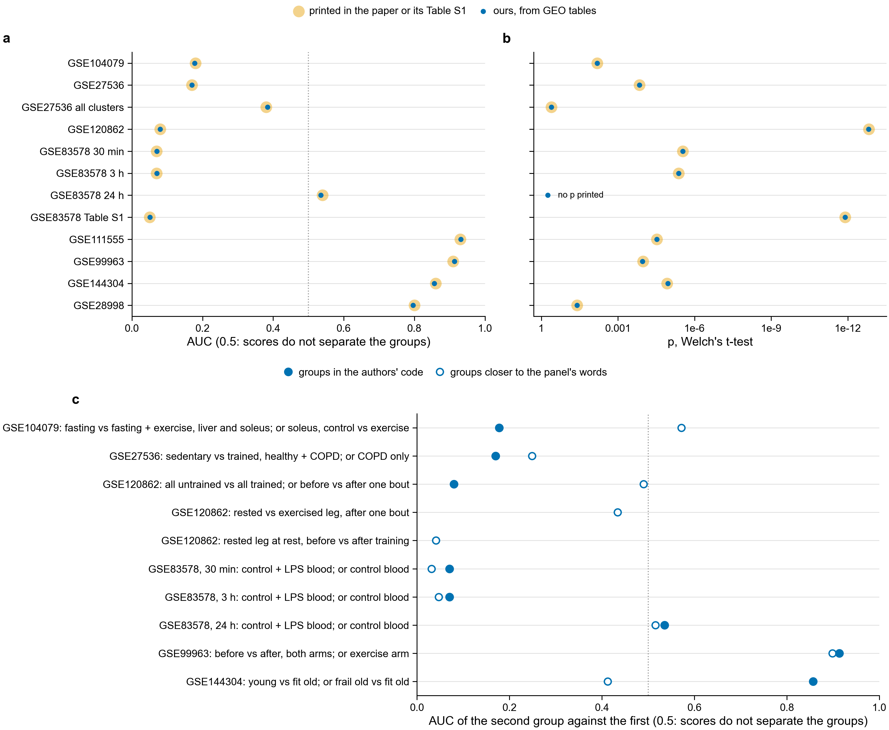
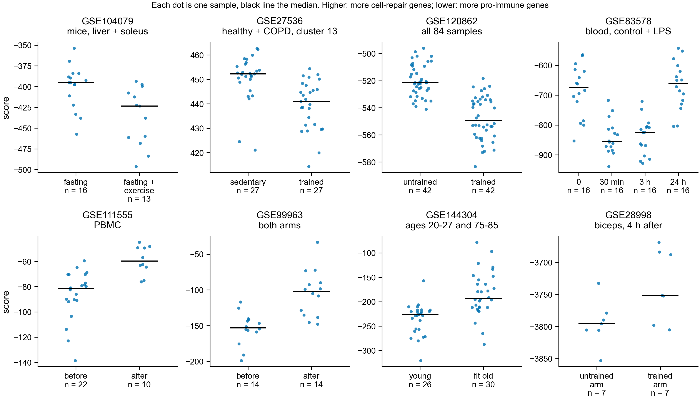

# The exercise score of Domen et al. 2026 Fig. 4C-D, redone from GEO (notebook 361)

Asked 2026-11-03: are all 8 datasets in Fig. 4C-D being used, and can the score be reproduced?





**a, b.** One row per printed comparison, 10 from Fig. 4C-D and 2 from Table S1 of Voskoboynik et
al. 2024. Large pale circle: printed number. Small dark dot: ours. **c.** Our AUC for the groups in
the authors' notebook (filled) and for groups closer to the words on the panel (open). AUC is the
area under the ROC curve: the chance that a sample of the second group scores above one of the first.
0.5 means the score does not separate the groups.



Each dot is one sample, with groups from the authors' notebook. Scores are ours. Compare them with
the score axes of the published panels.

Code: `scripts/exercise_score.py`, `scripts/plot_exercise_score.py`. Inputs and their sources:
`design/exercise_score/README.md`. Numbers: `exercise_score_comparisons.tsv` (every comparison),
`exercise_score_samples.tsv` (every sample), `exercise_score_probe_counts.tsv`.

## Result

The published numbers are recovered for all 8 datasets. All 12 printed comparisons have the printed
group sizes, the AUC rounds to the printed AUC, and p is within a factor of 2 of the printed p (the
rule in `scripts/exercise_score.py`). Nine of the 11 printed p values are within 0.3 %. GSE99963
and GSE144304 differ by 3 % and 8 %, and both match to all printed digits when SDCCAG3 is removed
(below). Mean scores also sit on the published score axes, for example about -3,800 for GSE28998
and 440 for GSE27536.

| dataset | groups in the authors' notebook | n | AUC, ours (printed) | p, ours (printed) |
|---|---|---|---|---|
| GSE104079 | alternate-day fasting vs exercised + fasting | 16, 13 | 0.178 (0.18) | 0.00655 (0.00655) |
| GSE27536 | sedentary vs trained, cluster 13 alone | 27, 27 | 0.170 (0.17) | 0.000144 (0.000144) |
| GSE120862 | untrained vs trained | 42, 42 | 0.080 (0.08) | 1.51e-13 (1.51e-13) |
| GSE83578 | time 0 vs 30 min | 16, 16 | 0.070 (0.07) | 2.9e-06 (2.9e-06) |
| GSE83578 | time 0 vs 3 h | 16, 16 | 0.070 (0.07) | 4.18e-06 (4.18e-06) |
| GSE83578 | time 0 vs 24 h | 16, 16 | 0.535 (0.54) | 0.558 (none printed) |
| GSE111555 | PBMC, before vs after training | 22, 10 | 0.932 (0.93) | 2.96e-05 (2.96e-05) |
| GSE99963 | before vs after, both arms | 14, 14 | 0.913 (0.91) | 0.000108 (0.000105) |
| GSE144304 | young vs fit old | 26, 30 | 0.856 (0.86) | 1.09e-05 (1.19e-05) |
| GSE28998 | untrained vs trained arm | 7, 7 | 0.796 (0.80) | 0.0396 (0.0396) |

This repeats the authors' arithmetic on the same public tables. It does not show the biology is
right. None of it is reference-free: all 8 inputs are tables of genes. GSE104079, GSE27536, GSE83578,
GSE111555 and GSE28998 are microarrays, so they have no reads to search.

## The panel labels and the groups differ

The groups come from `ExerciseAnalysis` in the authors' notebook. Where the words on the panel
describe something else, we also scored groups closer to those words.

| dataset | panel says | code compares | closer to the words | n | AUC | p |
|---|---|---|---|---|---|---|
| GSE120862 | untrained men, Pre vs 1 h and 4 h Post | all untrained vs all trained samples, every time point and both legs | untrained, exercised leg, before vs 1 h and 4 h after | 7, 14 | 0.490 | 0.779 |
| GSE120862 | as above | as above | untrained, 1 h and 4 h after, rested vs exercised leg | 14, 14 | 0.434 | 0.428 |
| GSE104079 | 6-week-old female mice, Pre vs 45 min Post | fasting vs exercised + fasting mice, liver and soleus pooled; GEO says 6-month-old males, and different animals in each group | soleus, control vs exercised | 7, 7 | 0.571 | 0.435 |
| GSE144304 | sedentary vs exercised, lifelong training | young adults (20-27 y, labelled Sed) vs fit old adults (75-85 y, labelled Ex) | frail old vs fit old | 24, 30 | 0.413 | 0.216 |
| GSE27536 | old COPD patients, Pre vs Post | healthy and COPD pooled, sedentary vs trained | COPD only | 15, 15 | 0.249 | 0.0365 |
| GSE83578 | Pre, 30 min, 3 h, 24 h | control and LPS-treated blood pooled | control blood, 30 min | 8, 8 | 0.031 | 0.000217 |
| GSE83578 | as above | as above | control blood, 3 h | 8, 8 | 0.047 | 0.000868 |
| GSE83578 | as above | as above | control blood, 24 h | 8, 8 | 0.516 | 0.821 |
| GSE99963 | 10 days of resistance training | both arms pooled, one of them sedentary; GEO says 9 days | exercise arm only | 7, 7 | 0.898 | 0.0101 |

- GSE120862, the strongest panel (p = 1.51e-13), is not a time-after-exercise test. One bout changes
  nothing here: AUC 0.490 before vs after in the exercised leg.
- In the same series, the rested leg at rest scores lower after 2 months of training, AUC 0.041, p
  0.00194, 7 + 7. Fig. 4D says long training raises the score. Whether this is training or a
  sequencing batch was not tested.
- GSE144304's difference comes with an age gap of about 55 years. Among old adults, fit and frail do
  not differ (p = 0.216).
- GSE83578 holds up in control blood at 30 min and 3 h.
- GSE99963 holds up in the exercise arm. The pooled sedentary arm was on the same high-fat diet.
- GSE28998 compares the untrained and trained arm 4 h after a bout, while the panel says Baseline and
  Post 12 Weeks. GSE111555 matches its panel.

Tests are Welch's t-test, as in the paper, and treat paired samples as independent. A p value from a
smaller group has less power, so a large p does not prove there is no change.

## How the score is built

```text
value of a probe in a sample = (expression - (StepMiner threshold + 0.5)) / 3 / standard deviation
cluster value = sum over the cluster's probes
score = -1 x cluster 13 + 1 x cluster 14 + 2 x cluster 3
```

StepMiner fits one step to a probe's sorted values, and the threshold lies halfway between the two
means. Threshold and standard deviation use every sample of the series, not only the two groups.
Cluster 13 has 48 genes, called pro-immune (M1). Clusters 14 and 3 have 290, called cell-repair (M2).
The weights -1, 1 and 2 come from Ghosh et al. 2023. AUC and p do not depend on the threshold; the
absolute score does.

Things the papers do not state, found from the numbers:

- The authors' text says "average"; their code sums, and the sum gives the printed axes.
- GSE27536 and GSE28998 fit only with a second log2(x + 1) on GEO's values, which are already
  log2. The first run, without it, gave AUC 0.174, p 0.000183 (GSE27536) and AUC 0.796, p 0.0386
  (GSE28998). Those also met the recovery rule. Table S1's GSE27536 row did not: AUC 0.394 against
  0.38.
- GSE144304's count table ends in five rows that are not genes (`__no_feature` and others). With
  them in the library size the first run gave AUC 0.805 and p 0.000466. Without them it gives 0.856.
- The notebook printed 124 probes for cluster 3 in GSE99963 and GSE144304; we have 125
  (`exercise_score_probe_counts.tsv`). We tried removing each cluster 3 gene in turn. Removing
  SDCCAG3 gives p 0.000105 and 1.19e-05, the printed values. Our main numbers keep the gene;
  `our_p_without_SDCCAG3` holds the other result. This was fitted to the printed p, so it is a
  likely explanation, not proof.
- GSE120862 uses `GSE120862_FPKM.txt.gz`, and GSE99963 and GSE144304 use log2(CPM + 1) from GEO's
  count tables. These choices are what the methods state and they fit. The authors' own expression
  files are on a private server: the dataset ids return nothing on the public Hegemon site.

## Limits

- Fig. 4E, the Botryllus panel, was not redone here.
- Table S1 covers 75 datasets. Only these 8 and their Table S1 rows were checked.
- GEO's tables were read on 2026-11-03. The GEO files and platform tables are not in the repository;
  `scripts/exercise_score.py` names them.
