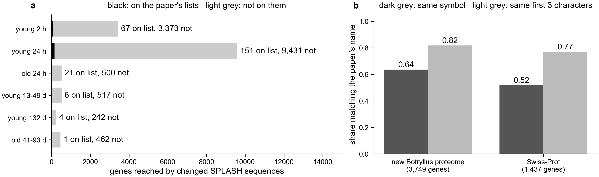

# What the reference-free routes find beyond the paper, and genes they help name (notebook 361)

Asked 2026-11-01: what more do SPLASH, KaMRaT and DE-kupl find than the paper, and which genes
can we help annotate?

**a.** Genes reached by changed SPLASH sequences in each contrast. Black: on the paper's lists
for that contrast. Light grey: not on them. **b.** Where the paper's sheet has a real gene name,
how often our name for the same gene matches it. Dark grey: same symbol. Light grey: same first
three characters (same family, loosely).

Code: `scripts/extra_genes.py` (Sherlock job 50740876, 2026-11-01) and
`scripts/plot_extra_genes.py`. Numbers: `extra_genes_summary.tsv`, `name_candidates.tsv`,
`name_check.tsv`, `gene_names_proposed.tsv`.

## DE-kupl and KaMRaT: nothing more

Both keep 0 sequences in all six real contrasts (`../kmer_methods/kmer_methods_counts.md`), so
they add no genes. Only SPLASH, and anchor counts at the paper's uncorrected cutoff, have
changed sequences to follow.

## SPLASH reaches far more genes than the paper lists

| contrast | genes reached | on the paper's lists | not on them |
|---|---|---|---|
| young 2 h | 3440 | 67 | 3373 |
| young 24 h | 9582 | 151 | 9431 |
| old 24 h | 521 | 21 | 500 |
| young 13-49 d | 523 | 6 | 517 |
| young 132 d | 246 | 4 | 242 |
| old 41-93 d | 463 | 1 | 462 |

"Reached" means a peptide of 20 or more residues from a changed SPLASH sequence aligns to the
gene's old gene-model protein (E <= 1e-5, query coverage >= 50 %). This is not evidence that the
gene's expression changed:
- In the simulated control, SPLASH found only genes with switched isoforms (56 of 100) and no
  gene whose level alone changed, with no false finds among 2,600 unchanged genes. So SPLASH's
  extra genes are best read as candidates for a change in which sequence variant (isoform,
  allele) is expressed, which a gene-level test cannot see.
- SPLASH treats every sample as independent. In young 2 h and young 24 h, where samples come in
  PEC/control pairs from the same colony, its kept sequences are likely too many.
- In young 24 h, 13 % of all genes that have an old gene-model protein are reached (the pool
  share in `../paper_recovery/paper_recovery.tsv`), so being reached is common there.

## Genes we can help name

1,625 of the reached genes have no usable name in the paper's sheet:

| paper's name | genes | name from the new Botryllus proteome | ... from 3 or more peptides | name from Swiss-Prot |
|---|---|---|---|---|
| missing (the gene ID, e.g. g4824) | 1387 | 1370 | 924 | 68 |
| a bare number (e.g. 198435002) | 231 | 231 | 180 | 12 |
| a date (Excel turned the symbol into one) | 7 | 7 | 7 | 7 |

How a name is given: each peptide that matches both the old gene and a named protein votes for
that protein's name; the gene takes the name with most votes. The new proteome names its
proteins in the ID (FUN000002_NLRC5); Swiss-Prot gives GN=. Peptides overlap, so vote counts are
not independent pieces of evidence.

The seven dates are septins, a known Excel error (SEPT7 becomes 7-Sep, read back as a date). The
date gives the original symbol, so these are also a check: g37044 "2026-09-02" (SEPT2) is SEPT2B
in the new proteome and SEPTIN2 in Swiss-Prot; g50219 "2026-09-07" (SEPT7) is SEPTIN7 in both;
g202, g19772 and g38053 "2026-09-06" (SEPT6) are SEPTIN6 in Swiss-Prot but SEPTIN11 in the new
proteome; g71572 "2026-09-03" (SEPT3) is SEPTIN7 in both; g51952 "2026-09-07" (SEPT7) is SEPT2B
and Septin1. So we confirm "a septin" for all seven, and the exact septin for 2 to 5 of them.

Eleven of these genes are on the paper's own lists, where the sheet gives only a number (or a
date), so the paper's list could not say what they are:

| gene | paper's name | new-proteome name (peptides) | Swiss-Prot | on the paper's list |
|---|---|---|---|---|
| g66138 | 198429058 | CLDN18 (378) | | young 2 h down |
| g32079 | 301626330 | PSMB4 (69) | Psmb4 | young 2 h down |
| g47901 | 198417988 | TROPONIN (23) | | young 24 h up, young 2 h down |
| g9699 | 198434644 | WFDC1 (20) | | young 24 h up |
| g49440 | 198427770 | SELP (14) | | young 132 d up |
| g51952 | 2026-09-07 | SEPT2B (11) | Septin1 | young 24 h down |
| g3217 | 198412648 | SELP (10) | | young 132 d up |
| g37775 | 27803388 | KLRD1 (9) | | young 2 h down |
| g18009 | 198411805 | GSTT2 (8) | | young 24 h up |
| g57777 | 198430959 | THSD7A (4) | | young 24 h up |
| g750 | 198430959 | adt-2 (1) | | young 2 h up |

Examples of unnamed genes, with the most peptides behind the new-proteome name: g30790 CLCA1,
g28600 APER1, g8743 RPLP2 (Swiss-Prot: ribosomal P2), g72030 and g65753 COL6A6, g33988 H1F0,
g24597 ANXA11. Bare-number genes: g58873 ADAMTS9, g47815 EPDR1, g18644 LAPTM4A, g60961
SQSTM1. The full list is `gene_names_proposed.tsv`.

How far to trust these names (panel b): where the paper's sheet has a real name, the
new-proteome name has the same symbol for 64 % of 3,749 genes and the same first three
characters for 82 %. Swiss-Prot names do worse (52 % and 77 % of 1,437), because very conserved
short peptides (actin, tubulin, ubiquitin) match identical proteins in bacteria and plants, and
the best hit is then arbitrary. Many mismatches are the same protein under another symbol (paper
ATP5B, ours atpD1, both ATP synthase beta). Of the 70 genes in `gene_names_proposed.tsv` with
both a new-proteome and a Swiss-Prot name, the two share the first three characters for 38. Names
in the new proteome are as its IDs give them, some cut short (TRANSLATIONALLYCONTROLLED,
ALPHATRY/BETATRY).

## Sequences in no old gene model

Changed sequences whose peptides match no old gene-model protein but do match the new proteome:
27,075 peptides (1,120 new-proteome proteins) in young 2 h and 140,157 (3,624) in young 24 h by
SPLASH; fewer elsewhere (`extra_genes_summary.tsv`, `peptides_no_old_gene_but_new_proteome`).
These come from genes the paper's gene models miss, so its analysis could not see them. Peptides
that match neither Botryllus set but match Swiss-Prot are fewer (1,758 in young 24 h). Many are
repeats with little sequence information (Plasmodium circumsporozoite NANP repeats,
glycine-rich and histidine-rich proteins) and should not be read as new genes; small ribosomal
proteins (eS28, eL29) and SEC61G appear too, and small genes are often missed by gene finders.

## Limits

- Only 11 of the 1,625 genes we can name are on the paper's lists. Most names help read the
  paper's sheet and our SPLASH genes, not the paper's listed results.
- A name from a 20-30 residue peptide says which protein family the gene belongs to, not which
  paralog it is.
