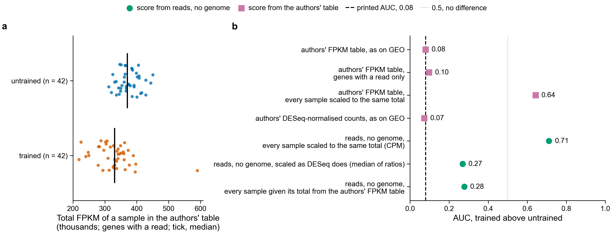

# The Fig. 4C-D score from reads, with no genome: result (notebook 361)

Plan and rules, written before any count: `../../design/fig4_score_from_reads/README.md`.
Status 2026-11-10: all four shares of the reads are counted (Sherlock head jobs 51700536 and
51707972, 14 counting tasks, 0 failed).

**Verdict: not reproduced from reads by the plan's rule, which needs all three series. Two of three
come back, with all reads or with 1/10 of them.** GSE99963 gives 0.91 (printed 0.91) and GSE144304
0.87 (printed 0.86). GSE120862 gives 0.71 against a printed 0.08, the opposite direction, at every
share of reads. That direction is set by how each sample is scaled, not by how reads are counted
(see "GSE120862" below). With 1/1000 of the reads no series comes back.

Corrected 2026-11-10: 58 genes are in both cluster 14 and cluster 3, and the formula counts such a
gene in both sums. The first version of `scripts/fig4_score_from_reads.py` counted it in cluster 3
only. Every number here is from the corrected script. The verdict did not change; AUCs moved by up
to 0.03, and GSE99963 at 1/10 of the reads moved from just outside rule 1 (0.755) to inside (0.770).

**a.** Each sample's score from the authors' gene table (PR 212); black tick, the group's median.
**b.** The same samples' score from reads counted with no genome, all reads. **c.** AUC at each share
of reads. AUC is the chance that a sample of the second group scores above one of the first; 0.5
means no difference. The yellow band is rule 1: within 0.15 of the printed AUC.

## The three rules at each share of reads

From `fig4_reads_comparisons.tsv`. Reads are the first reads of each file, not a random draw.

| series | share of reads | reads placed in a gene, median per sample | AUC from reads | printed AUC | rule 1 | rank correlation with the gene-table score (rule 2 needs 0.8) | random gene sets as far (rule 3 needs 0.05 or less) |
|---|---|---|---|---|---|---|---|
| GSE120862 | all | 26,354,151 | 0.71 | 0.08 | fails | 0.06 | 0.000 |
| GSE120862 | 1/10 | 2,634,480 | 0.67 | 0.08 | fails | 0.13 | 0.001 |
| GSE120862 | 1/100 | 264,247 | 0.61 | 0.08 | fails | 0.21 | 0.005 |
| GSE120862 | 1/1000 | 26,487 | 0.56 | 0.08 | fails | 0.26 | 0.115 |
| GSE99963 | all | 7,088,086 | 0.91 | 0.91 | passes | 0.95 | 0.835 |
| GSE99963 | 1/10 | 709,450 | 0.77 | 0.91 | passes | 0.71 | 0.763 |
| GSE99963 | 1/100 | 70,986 | 0.53 | 0.91 | fails | 0.26 | 0.182 |
| GSE99963 | 1/1000 | 7,089 | 0.46 | 0.91 | fails | -0.06 | 0.193 |
| GSE144304 | all | 9,086,096 | 0.87 | 0.86 | passes | 0.96 | 0.140 |
| GSE144304 | 1/10 | 904,545 | 0.88 | 0.86 | passes | 0.88 | 0.066 |
| GSE144304 | 1/100 | 90,352 | 0.73 | 0.86 | passes | 0.67 | 0.221 |
| GSE144304 | 1/1000 | 9,186 | 0.48 | 0.86 | fails | 0.14 | 0.786 |

1. **Rule 1, the printed AUC comes back:** 2 of 3 series with all reads or 1/10 of them; 1 of 3 with
   1/100; 0 of 3 with 1/1000.
2. **Rule 2, same samples score the same:** with all reads, 0.95 and 0.96 in the two series that
   come back, so there it is the same score sample by sample. 0.06 in GSE120862.
3. **Rule 3, the listed genes matter:** fails in the two series that come back. Random gene sets of
   the same expression do as well as the listed genes in 84 % of 1,000 draws for GSE99963 and 14 %
   for GSE144304.

The three lists hold 338 names, which are 280 different genes. 232 of them have a read in each
series with all reads (47 of the 48 in cluster 13, 110 of the 137 in cluster 14, 119 of the 153 in
cluster 3; columns `listed_genes_found_cluster_*`); the rest are left out, as the plan says.

## GSE120862: the direction is set by how each sample is scaled

Tested 2026-11-10 with `scripts/fig4_gse120862_scale_check.py`, after the result was seen, so this
explains the result and is not a planned test. Files: `gse120862_scale_check/`.

**a.** Each sample's total in the authors' FPKM table (FPKM is reads per thousand bases of gene per
million reads), over the genes that have a read. **b.** The same score computed from versions of the
values that differ only in how each sample is scaled.

| values | scaling of each sample | AUC, trained above untrained |
|---|---|---|
| authors' FPKM table, as on GEO | the authors' | 0.08 (printed 0.08) |
| authors' FPKM table, genes with a read only | the authors' | 0.10 |
| authors' FPKM table | every sample to the same total | 0.64 |
| authors' DESeq-normalised counts, as on GEO | the authors' (DESeq) | 0.07 |
| reads, no genome | every sample to the same total (CPM, the plan's choice) | 0.71 |
| reads, no genome | as DESeq scales: the median, over genes, of a sample's count divided by the gene's average | 0.27 |
| reads, no genome | each sample given its total from the authors' FPKM table | 0.28 |

1. **In the authors' tables the trained samples have a lower total.** Median total FPKM is 330,000 in
   trained samples against 370,000 in untrained ones (11 % lower); the total alone separates the
   groups with AUC 0.19. Their DESeq-normalised counts show the same (14 % lower).
2. **Scaling the authors' own table to equal totals turns the printed result round**, from 0.08 to
   0.64, with the same genes and the same formula.
3. **Scaling the reads the authors' way turns the reads' result round**, from 0.71 to 0.27 or 0.28.
   That is on the printed side of 0.5 but 0.19 or 0.20 from the printed value, so rule 1 still fails.
4. **So the disagreement is not about counting with no genome.** The score sums about 230 genes, most
   with a positive weight, so a small shift in every gene of a sample decides the sign: the
   median gene changes by 0.00 log2 units from untrained to trained in the authors' table and by
   0.07 in the reads.
   Gene by gene, the change from untrained to trained agrees between the authors' table and the
   reads (rank correlation 0.81 over 17,939 genes, `gse120862_gene_changes.tsv.gz`).
5. **Which scaling is right is not settled here.** Equal totals are pulled by a few genes with very
   many reads; DESeq's scaling is built to resist that. The share of the authors' FPKM in
   mitochondrial genes (names that start with MT-) is 30 % in trained samples against 26 % in
   untrained ones, which is the kind of change that moves totals. The plan fixed CPM before
   counting, on the grounds that "a gene's length matters little"; it did not consider that the
   total could differ between groups. In GSE99963 and GSE144304 the authors' tables are counts and
   PR 212 also used CPM, so there the two scores share one scaling.

## Is it the counting method or the number of reads? A check on the authors' tables

Added after the first counts, so not part of the plan. `scripts/fig4_gene_table_check.py` puts the
authors' own gene tables for GSE99963 and GSE144304 through the same scoring code, whole and thinned
to the number of reads this method placed in a gene (`gene_table_check/fig4_reads_comparisons.tsv`).
GSE120862 is not in this check: its gene table is FPKM, which cannot be thinned read by read.

| series | reads per sample | AUC, authors' table | AUC, from reads | printed |
|---|---|---|---|---|
| GSE99963 | whole table (7.6 M); all reads (7.1 M) | 0.92 | 0.91 | 0.91 |
| GSE99963 | as the 1/10 share (709,000) | 0.82 | 0.77 | 0.91 |
| GSE99963 | as the 1/100 share (71,000) | 0.43 | 0.53 | 0.91 |
| GSE99963 | as the 1/1000 share (7,100) | 0.44 | 0.46 | 0.91 |
| GSE144304 | whole table (13.4 M); all reads (9.1 M) | 0.86 | 0.87 | 0.86 |
| GSE144304 | as the 1/10 share (905,000) | 0.86 | 0.88 | 0.86 |
| GSE144304 | as the 1/100 share (90,000) | 0.76 | 0.73 | 0.86 |
| GSE144304 | as the 1/1000 share (9,200) | 0.65 | 0.48 | 0.86 |

1. **The scoring code is right.** On the whole tables it gives 0.918 and 0.863 against the printed
   0.91 and 0.86, and ranks samples as PR 212 does (rank correlation 0.997 and 0.992).
2. **Counting with no genome loses nothing that the number of reads does not.** At every depth the
   reads' AUC is within 0.10 of the authors' table thinned to the same depth, except the smallest
   share of GSE144304 (0.48 against 0.65). The score fades below about 1 M reads per sample
   whichever way the reads are counted.
3. **On the authors' whole tables, the listed genes are not what separates the groups in GSE99963.**
   Random gene sets of the same expression reach the listed genes' AUC in 87 % of 1,000 draws for
   GSE99963 and 9 % for GSE144304 (median random AUC 0.95 and 0.82). Every protein-coding gene with
   weight 1 gives 0.96 and 0.85 (column `auc_all_genes_weight_1`, also added after the plan). The
   panels show a shift shared by most genes. PR 213 saw the same on the microarray series.

## Cost

Measured with `/usr/bin/time -v`, three series together, 16 threads each, 0.46 GB peak memory:

| share of reads | reads read | CPU time | wall seconds, summed over the three tasks | CPU seconds per million reads |
|---|---|---|---|---|
| 1/1000 | 5.7 M | 77 s | 16 | 13 |
| 1/100 | 57.4 M | 720 s | 115 | 13 |
| 1/10 | 574 M | 1.7 h | 479 | 11 |
| all | 5,743 M | 30.9 h | 8,802 | 19 |

The plan reports the cost of the smallest share of reads at which rule 1 passes in all three
series. There is none. For the two series that come back, that share is 1/10: 1.0 CPU h for the
first 180 M of their 1,800 M reads.

The only measured alignment cost is on other reads: 70.6 CPU h for the 643.5 M Botryllus read pairs
(trim, STAR, RSEM, DESeq2), about 395 CPU seconds per million pairs. With all reads, counting with
no genome costs 19 CPU seconds per million single-end reads, about 1/20 of that. With 1/10 of the
reads of the two series that come back it is 2.1 CPU seconds per million reads sequenced, about
1/190. Neither is 1/1000, and the two were measured on different reads. A share of 1/100 of the
reads would bring the cost near 1/3000, and at that share only GSE144304 passes rule 1.

## Not done

- Which scaling of GSE120862 is the right one, and whether DESeq's scaling should replace CPM for all
  three series. That would be a new plan with its rules fixed first; the numbers above were seen
  before the scaling was tried.
- A random draw of reads in place of the first reads of each file.
- Limits in the plan's "Not covered" still hold: the five microarray panels, panel E, and whether the
  groups are the ones the panel's words describe.

## Files

- `fig4_reads_comparisons.tsv`: one row per series and share of reads, the three rules, cost.
- `fig4_reads_samples.tsv`: each sample's score from reads and from the gene table.
- `fig4_reads_random.tsv.gz`: AUC of every random gene set.
- `counts/`: the count tables the scores come from, copied from
  `/scratch/users/olgabot/nb361-pec/human/fig4_score/` on Sherlock.
- `gene_table_check/`: the same three tables for the authors' gene tables, whole and thinned.
- `gse120862_scale_check/`: the GSE120862 scaling test: one row per version, per sample and per gene, and the figure.
