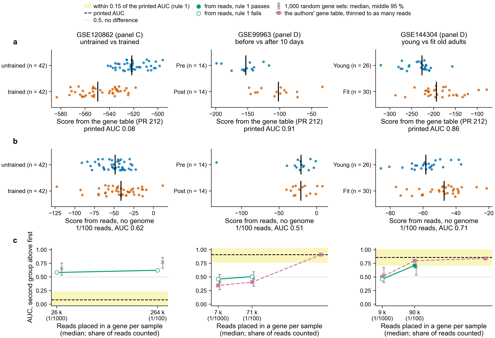

# The Fig. 4C-D score from reads, with no genome: pilot result (notebook 361)

Plan and rules, written before any count: `../../design/fig4_score_from_reads/README.md`.
Status 2026-11-09: the 1/100 and 1/1000 shares of the reads are counted (Sherlock head job 51700536,
8 tasks, 0 failed). The 1/10 share and all reads are not run yet, so **there is no verdict yet**.

**a.** Each sample's score from the authors' gene table (PR 212); black tick, the group's median.
**b.** The same samples' score from reads counted with no genome, at the largest share of reads
counted so far. **c.** AUC at each share of reads. AUC is the chance that a sample of the second
group scores above one of the first; 0.5 means no difference. The yellow band is rule 1: within
0.15 of the printed AUC.

## What the pilot shows

With 1/100 of the reads or fewer, the printed AUC does not come back in two of the three series
(`fig4_reads_comparisons.tsv`):

| series | share of reads | reads placed in a gene, median per sample | AUC from reads | printed AUC | rule 1 | rank correlation with the gene-table score (rule 2 needs 0.8) | random gene sets as far (rule 3 needs 0.05 or less) |
|---|---|---|---|---|---|---|---|
| GSE120862 | 1/100 | 264,247 | 0.62 | 0.08 | fails | 0.20 | 0.006 |
| GSE120862 | 1/1000 | 26,487 | 0.58 | 0.08 | fails | 0.22 | 0.148 |
| GSE99963 | 1/100 | 70,986 | 0.51 | 0.91 | fails | 0.21 | 0.264 |
| GSE99963 | 1/1000 | 7,089 | 0.46 | 0.91 | fails | -0.07 | 0.230 |
| GSE144304 | 1/100 | 90,352 | 0.71 | 0.86 | passes | 0.64 | 0.305 |
| GSE144304 | 1/1000 | 9,186 | 0.46 | 0.86 | fails | 0.09 | 0.862 |

In GSE120862 the score from reads goes the opposite way to the printed one (0.62 against 0.08).
The gene-table score for that series uses FPKM and this one uses CPM, as the plan says; whether
that, the few reads, or the first reads of a file being unlike the rest explains it is not known
until all reads are counted.

## Is it the counting method or the number of reads? A check on the authors' tables

Added after the first counts, so not part of the plan. `scripts/fig4_gene_table_check.py` puts the
authors' own gene tables for GSE99963 and GSE144304 through the same scoring code, whole and thinned
to the number of reads the pilot placed in a gene (`gene_table_check/fig4_reads_comparisons.tsv`).
GSE120862 is not in this check: its gene table is FPKM, which cannot be thinned read by read.

| series | reads | AUC, authors' table | AUC, from reads | printed |
|---|---|---|---|---|
| GSE99963 | all (7.6 M per sample) | 0.91 | not run yet | 0.91 |
| GSE99963 | as the 1/100 share (71,000) | 0.40 | 0.51 | 0.91 |
| GSE99963 | as the 1/1000 share (7,100) | 0.34 | 0.46 | 0.91 |
| GSE144304 | all (13.4 M per sample) | 0.84 | not run yet | 0.86 |
| GSE144304 | as the 1/100 share (90,000) | 0.80 | 0.71 | 0.86 |
| GSE144304 | as the 1/1000 share (9,200) | 0.50 | 0.46 | 0.86 |

1. **The scoring code is right.** On the whole tables it gives 0.908 and 0.838 against the printed
   0.91 and 0.86, and ranks samples as PR 212 does (rank correlation 0.995 and 0.985).
2. **Fewer reads lose the score whichever way they are counted.** The authors' table thinned to
   71,000 reads per sample gives 0.40 for GSE99963, no better than the reads' 0.51. So the pilot's
   failure is about depth, and says little yet about counting with no genome.
3. **On the authors' whole tables, the 338 genes are not what separates the groups.** Random gene
   sets of the same expression reach the listed genes' AUC in 93 % of 1,000 draws for GSE99963 and
   31 % for GSE144304 (median random AUC 0.95 and 0.82). Every protein-coding gene with weight 1
   gives 0.96 and 0.85 (column `auc_all_genes_weight_1`, also added after the plan). The panels show
   a shift shared by most genes. PR 213 saw the same on the microarray series.

## Cost

Measured with `/usr/bin/time -v`, three series together, 16 threads each, 0.46 GB peak memory:

| share of reads | reads read | CPU seconds | wall seconds, summed over the three tasks |
|---|---|---|---|
| 1/1000 | 5.7 M | 77 | 16 |
| 1/100 | 57.4 M | 720 | 115 |

That is about 13 CPU seconds per million single-end reads. The only measured alignment cost is on
other reads: 70.6 CPU h for the 643.5 M Botryllus read pairs (trim, STAR, RSEM, DESeq2), about 395
CPU seconds per million pairs. So per read, counting with no genome costs about 1/30 of alignment,
not 1/1000. A share of 1/100 of the reads would bring it under 1/1000, and at that share the score
does not come back.

## Not done

- All reads and the 1/10 share: `make run` in `nextflow-runs/pec-domen2026-fig4-score/` on Sherlock,
  about 20 CPU h. Then `scripts/fig4_score_from_reads.py` and `scripts/plot_fig4_score_from_reads.py`
  again; this README's verdict line changes then.
- The gene-table check for GSE120862.
- Limits in the plan's "Not covered" still hold: the five microarray panels, panel E, and whether the
  groups are the ones the panel's words describe.

## Files

- `fig4_reads_comparisons.tsv`: one row per series and share of reads, the three rules, cost.
- `fig4_reads_samples.tsv`: each sample's score from reads and from the gene table.
- `fig4_reads_random.tsv.gz`: AUC of every random gene set.
- `counts/`: the count tables the scores come from, copied from
  `/scratch/users/olgabot/nb361-pec/human/fig4_score/` on Sherlock.
- `gene_table_check/`: the same three tables for the authors' gene tables, whole and thinned.
