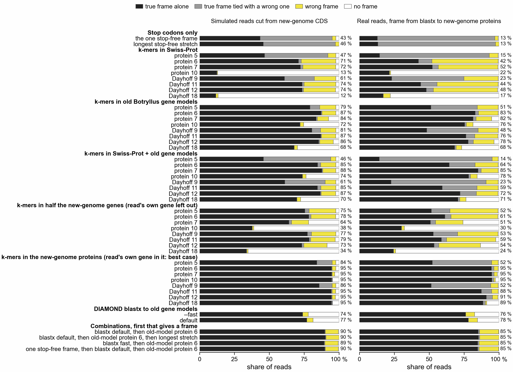

# How much of each reading frame matches Swiss-Prot, for Botryllus reads (notebook 361)

Asked 2026-11-02: show the distribution of the share of k-mers matching Swiss-Prot for each frame,
for Botryllus reads.

Each line is one group of frames. Its height at x is the share of frames in the group with at least
x of their k-mers in Swiss-Prot (UniProt's reviewed proteins). The groups are the true frame, the
two other frames on the same strand (1 or 2 nucleotides off), and the three frames on the opposite
strand. Light grey vertical lines mark the search's two cutoffs, 0.1 and 0.5. Rows are orpheum's
two default k-mer types: protein 7-mers and Dayhoff 12-mers. Dayhoff is a 6-letter alphabet that
groups amino acids by chemistry.

Reads, all with a known true frame:
- **simulated**: 39,854 reads of 150 nt cut from 1,993 new-genome Botryllus CDS (coding sequences);
- **real**: 243,938 reads from one PEC and one control run (JA113, JA123; PEC is pulsatile
  electrical current). Each read's best DIAMOND blastx hit to a new-genome protein has 95 % or
  more identity and covers 90 % or more of the read.

| reads | k-mers | frames | median share | at least 0.1 | at least 0.5 |
|---|---|---|---|---|---|
| simulated | protein 7 | true | 0.227 | 88 % | 6 % |
| simulated | protein 7 | same strand, 1 nt off | 0.116 | 56 % | 0.1 % |
| simulated | protein 7 | same strand, 2 nt off | 0.093 | 46 % | 0.1 % |
| simulated | protein 7 | opposite strand | 0.136 | 62 % | 0.5 % |
| real | protein 7 | true | 0.25 | 82 % | 18 % |
| real | protein 7 | same strand, 1 nt off | 0.167 | 70 % | 4 % |
| real | protein 7 | same strand, 2 nt off | 0.10 | 51 % | 1 % |
| real | protein 7 | opposite strand | 0.14 | 63 % | 3 % |
| simulated | Dayhoff 12 | true | 0.487 | 97 % | 49 % |
| simulated | Dayhoff 12 | same strand, 1 nt off | 0.184 | 72 % | 9 % |
| simulated | Dayhoff 12 | same strand, 2 nt off | 0.132 | 61 % | 5 % |
| simulated | Dayhoff 12 | opposite strand | 0.205 | 74 % | 12 % |
| real | Dayhoff 12 | true | 0.50 | 85 % | 51 % |
| real | Dayhoff 12 | same strand, 1 nt off | 0.278 | 74 % | 29 % |
| real | Dayhoff 12 | same strand, 2 nt off | 0.118 | 55 % | 10 % |
| real | Dayhoff 12 | opposite strand | 0.205 | 66 % | 22 % |

- The true frame is shifted right of the wrong frames in every panel. But the curves overlap a
  lot, so no single cutoff separates them. At 0.1, half or more of the wrong frames pass. At 0.5,
  only 6 % (simulated) and 18 % (real) of true frames pass with protein 7-mers.
- Wrong frames match Swiss-Prot often. A random 7-mer is in Swiss-Prot by chance more often than
  one might expect, and with Dayhoff's 6 letters a 12-mer is even less specific. Real reads have
  more conserved, highly expressed genes, so all their frames score higher.
- Wrong frames mostly contain a stop codon (61 % to 91 % of them, against 3 % to 5 % of true
  frames: reads that cover the CDS's own stop). That is why orpheum only allows stop-free frames.
  These curves include every frame, stops or not.

## Shorter k-mers: protein 5 and 6, with Dayhoff k-mers of the same information

Asked 2026-11-02. Each protein k is paired with the Dayhoff k carrying about the same bits of
sequence information per k-mer (`ortholog_analysis_utils.bits_per_kmer`): protein 5-mers 20.9 bits
with Dayhoff 9-mers 20.5; protein 6-mers 25.1 with Dayhoff 11-mers 25.1. (Above, protein 7-mers are
29.2 bits and Dayhoff 12-mers 27.3.)

| reads | k-mers | true frame: median | true frame: at least 0.5 | wrong frames: median | wrong frames: at least 0.5 |
|---|---|---|---|---|---|
| simulated | protein 5 | 1.00 | 100 % | 0.78-0.84 | 94-98 % |
| simulated | Dayhoff 9 | 1.00 | 100 % | 0.57-0.68 | 63-78 % |
| simulated | protein 6 | 0.84 | 99 % | 0.55-0.62 | 61-78 % |
| simulated | Dayhoff 11 | 0.77 | 87 % | 0.30-0.39 | 23-34 % |
| simulated | protein 7 | 0.23 | 6 % | 0.09-0.14 | 0.1-0.5 % |
| simulated | Dayhoff 12 | 0.49 | 49 % | 0.13-0.21 | 5-12 % |
| real | protein 5 | 1.00 | 100 % | 0.82-0.87 | 95-96 % |
| real | Dayhoff 9 | 1.00 | 100 % | 0.64-0.74 | 68-75 % |
| real | protein 6 | 0.84 | 97 % | 0.57-0.67 | 66-79 % |
| real | Dayhoff 11 | 0.80 | 77 % | 0.31-0.47 | 30-48 % |
| real | protein 7 | 0.25 | 18 % | 0.10-0.17 | 1-4 % |
| real | Dayhoff 12 | 0.50 | 51 % | 0.12-0.28 | 10-29 % |

("Wrong frames" is the range over the three wrong-frame groups.)

- Protein 5-mers are almost all in Swiss-Prot: there are 3.2 million possible 5-mers and Swiss-Prot
  holds about 200 million residues. So nearly every frame, right or wrong, scores high. The true
  frame still scores highest (near 1.0 against about 0.8), so "frame with the most matches" picks
  it well, but a share cutoff means nothing at this k.
- Dayhoff 11-mers separate the frames best of these settings, with the 0.5 cutoff: 87 % (simulated)
  and 77 % (real) of true frames pass, against 23-48 % of wrong frames. Protein 6-mers keep more
  true frames but let through more wrong ones.
- At equal bits, Dayhoff separates better than protein (Dayhoff 9 against protein 5, and Dayhoff
  11 against protein 6). This fits Dayhoff letters grouping amino acids that substitute for each
  other, so a Botryllus protein matches a distant Swiss-Prot relative more often, while a wrong
  frame gains less. That reason is a guess; the numbers are measured.

## Does a 0.9 cutoff on protein 5-mers work? Choosing the frame per read

Asked 2026-11-02: protein 5-mers at 0.9 or more looked good. Per frame, they are: 97 % of true
frames reach 0.9. But the search keeps one frame per read, the one with the highest share, so the
question is whether that frame is the true one. `scripts/frame_cutoff_check.py` answers this per
read, choosing among frames with no stop codon (orpheum's rule, without its low-complexity filter).
Numbers: `frame_cutoff_check.tsv` (also all six frames allowed).

| k-mers | reads | cutoff | reads kept | true frame alone best | true frame tied with a wrong one | wrong frame best |
|---|---|---|---|---|---|---|
| protein 5 | simulated | 0.9 | 98 % | 48 % | 46 % | 6 % |
| protein 5 | real | 0.9 | 99 % | 15 % | 79 % | 6 % |
| Dayhoff 9 | simulated | 0.9 | 93 % | 61 % | 23 % | 16 % |
| Dayhoff 9 | real | 0.9 | 98 % | 22 % | 53 % | 25 % |
| protein 6 | simulated | 0.5 | 98 % | 73 % | 2 % | 25 % |
| protein 6 | real | 0.5 | 99 % | 43 % | 10 % | 48 % |
| Dayhoff 11 | simulated | 0.5 | 91 % | 75 % | 2 % | 24 % |
| Dayhoff 11 | real | 0.5 | 96 % | 44 % | 12 % | 44 % |
| protein 7 | simulated | 0.5 | 7 % | 87 % | 0.2 % | 13 % |
| protein 7 | real | 0.5 | 25 % | 69 % | 1 % | 31 % |

- At protein 5-mers a 0.9 cutoff keeps almost every read, so it filters nothing, and in most real
  reads a wrong stop-free frame also scores 1.0. The true frame is rarely wrong outright (6 %), but
  it is tied for best in 79 % of real reads, so the read's frame is a coin toss among the tied
  frames. Keeping every tied frame would give the true frame and one or more wrong ones.
- No setting picks the true frame alone in more than about half of real reads, except protein
  7-mers at 0.5 (69 %), which keeps only a quarter of the reads.

Code: `scripts/frame_shares.py` ran on Sherlock on `sra_search/frame_test/scores.{protein.k7,dayhoff.k12}.tsv`
(from `pec-tools frame-scores`) and `real_blastx.tsv`. `scripts/plot_frame_shares.py` draws the figure.
Dayhoff 9 and 11 were scored with `pec-tools frame-scores` in Sherlock job 50793955. Plot:
`plot_frame_shares.py exports/frame_shares <out_stem> protein.k7 dayhoff.k12` (and
`protein.k5 dayhoff.k9 protein.k6 dayhoff.k11` for the second figure). Numbers: `frame_shares.*_summary.tsv`, `frame_shares.*_hist.tsv` (0.02 bins).

## Which way finds a read's reading frame best? (frame_methods)

Asked 2026-11-02: what is the best way to find the reading frame of a 150 nt Botryllus RNA-seq read,
most of the time? Same reads and truth as above: 39,854 simulated reads cut from new-genome CDS
(coding sequences) and 243,938 real reads whose true frame comes from a DIAMOND blastx hit to a
new-genome protein (identity at least 95 %, hit covering at least 90 % of the read). A stop-free
frame is a frame with no stop codon. The old gene models are the earlier Botryllus annotation
(72,617 proteins, `db/botznik.faa`), made independently of the new-genome proteins that define the
truth.

Each bar is one method. Black: the method picks the true frame alone. Grey: the true frame ties
with a wrong one, so the pick is a coin toss. Yellow: a wrong frame. White: no frame. The number is
the black share. k-mer methods choose, among stop-free frames, the frame with the largest share of
its k-mers found in the reference (`pec-tools frame-scores`), with no cutoff; no frame when that
share is 0.

| method | simulated: right | real: right | real: wrong | real: no frame | CPU s per M reads | wall s per M reads | peak memory |
|---|---|---|---|---|---|---|---|
| stop codons: the one stop-free frame | 43 % | 13 % | 2 % | 0.5 % | 14 | 14 | 16 MB |
| k-mers in Swiss-Prot, protein 7 (orpheum's default) | 72 % | 52 % | 43 % | 0.8 % | 30 | 31 | 1.7 GB |
| k-mers in old Botryllus gene models, protein 6 | 87 % | 83 % | 14 % | 0.5 % | 19 | 20 | 0.2 GB |
| k-mers in Swiss-Prot + old gene models, protein 7 | 88 % | 85 % | 12 % | 0.6 % | 32 | 35 | 1.7 GB |
| DIAMOND blastx to old gene models, default (16 threads) | 77 % | 78 % | 7 % | 15 % | 73 | 7.5 | 0.7 GB |
| DIAMOND blastx, --fast (16 threads) | 74 % | 76 % | 6 % | 17 % | 54 | 5.9 | 0.7 GB |
| blastx default, then old-model protein 6-mers for reads with no hit | 90 % | 85 % | 14 % | 0.2 % | 92 | 27 | 0.7 GB |
| k-mers in half the new-genome genes, read's own gene left out, protein 6 | 78 % | 61 % | 34 % | 0.8 % | 19 | 19 | 0.1 GB |
| k-mers in all new-genome proteins (read's own gene in it: best case), protein 6 | 95 % | 95 % | 3 % | 0.5 % | 21 | 21 | 0.2 GB |

The stop-codon row leaves out ties: the true frame ties with another stop-free frame in 84 % of
real reads. All 48 methods, with tied shares, are in `frame_methods.tsv`. Times are per million
reads, from GNU time on one run over all 1,039,854 test reads (simulated plus the full real subset).

**Recommendation.** Score the stop-free frames by k-mers against the organism's own proteins, here
the old Botryllus gene models, plus Swiss-Prot, at protein 7-mers. It picks the true frame alone in
85 % of real reads and 88 % of simulated reads, against 52 % and 72 % for Swiss-Prot alone, in about
30 CPU seconds and 1.7 GB per million reads on one core. Running DIAMOND blastx against the same
proteins first, and k-mers only for reads with no hit, adds nothing on real reads (85 %) and 2
points on simulated reads (90 %), for 3 times the CPU time. If only one reference fits, the old gene
models alone at protein 6-mers give 83 % and 87 % in 0.2 GB.

What the other methods show:
- Stop codons alone rarely decide. 86 % of real reads and 52 % of simulated reads have two or more
  stop-free frames; 0.5 % and 2 % have none. When there is exactly one stop-free frame it is the
  true one 93-96 % of the time, but that happens in only 14 % of real reads (45 % of simulated).
  Taking the longest stop-free stretch adds under 3 points, because it differs only for reads with
  no stop-free frame. The true frame itself has a stop in 3 % of real and 5 % of simulated reads
  (reads over the end of the CDS).
- DIAMOND blastx to the old gene models is right in 92 % of the real reads it hits, but finds no
  hit for 15 % (default) to 17 % (--fast). --fast loses 2-3 points and saves a quarter of the CPU
  time.
- The read's own gene is what makes a reference work. With every new-genome protein in the
  reference (circular: these proteins define the truth) protein 6-mers are right in 95 % of reads.
  With half the genes left out (random split, seed 361, isoforms of a gene kept together; scored on
  the 19,814 simulated and 93,518 real reads whose gene is in the left-out half), they drop to 78 %
  and 61 %, near Swiss-Prot. Related genes elsewhere in the same genome help little.
- Short k ties: protein 5-mers and Dayhoff 9-mers match nearly every frame, so the true frame ties
  with a wrong one in 13-81 % of real reads, depending on the reference.
- Long k finds nothing outside the read's own gene. A 150 nt read has 41 protein 10-mers per frame.
  The share of reads with no matching k-mer in any of the six frames, real and simulated, at protein
  10 (Dayhoff 18 in brackets): Swiss-Prot 76 % and 86 % (75 % and 84 %); old gene models 15 % and
  20 % (24 % and 25 %); Swiss-Prot + old models 12 % and 18 % (21 % and 23 %); new-genome half
  without the read's gene 66 % and 58 % (73 % and 63 %); all new-genome proteins 0 % and 0 % (7 % and
  0 %). Dayhoff 18 carries 41.0 bits per k-mer, the closest to protein 10's 41.8 (`bits_per_kmer`).
  `pec-tools` stores a k-mer as one 64-bit number, so protein k up to 14 and Dayhoff k up to 24 fit;
  10 and 18 ran without error.
- Dayhoff letters do not beat protein letters once the reference holds the organism's own proteins
  (old models, real reads: Dayhoff 11 76 %, protein 6 83 %).

Limits:
- The real-read truth is itself a DIAMOND blastx hit at 95 % identity over 90 % of the read, so it
  covers only reads that blastx places easily: 24 % of the 1.0 M real reads. Over all real reads,
  the recommended k-mer method gives a frame to 81 % and blastx to the old models to 39 %; 18 % have
  no stop-free frame at all (UTRs, non-coding RNA, or reads over the end of a CDS). Whether those
  frames are right cannot be checked here.
- The blastx method uses the same tool as the truth, which may favour it on real reads. Simulated
  reads do not have this problem and rank the methods in nearly the same order.
- The old gene models come from an earlier assembly of the same species, so they hold
  near-identical copies of most genes. For a species with no gene models of its own, expect numbers
  near the held-out half (61 % real) or Swiss-Prot (52 %).
- k-mer times include building the reference k-mer set at the start of each run (0.4-15 s); DIAMOND's
  database build for the old models took 0.3 s. Each time is from one run on a Sherlock node of the
  normal or hns partition, not repeated.

Code: `slurm/22_frame_methods_submit.sh` submits `slurm/22_frame_methods.sbatch` (Sherlock jobs
50795519 stop codons, 50795521-50795525 k-mers, 50795526 blastx, 50796391 summary).
`scripts/frame_stops.py` counts stops per frame, `scripts/frame_heldout_split.py` splits the
new-genome genes, `scripts/frame_methods.py` scores every method and reads the GNU time files, and
`scripts/plot_frame_methods.py exports/frame_shares/frame_methods.tsv exports/frame_shares/frame_methods`
draws the figure.
