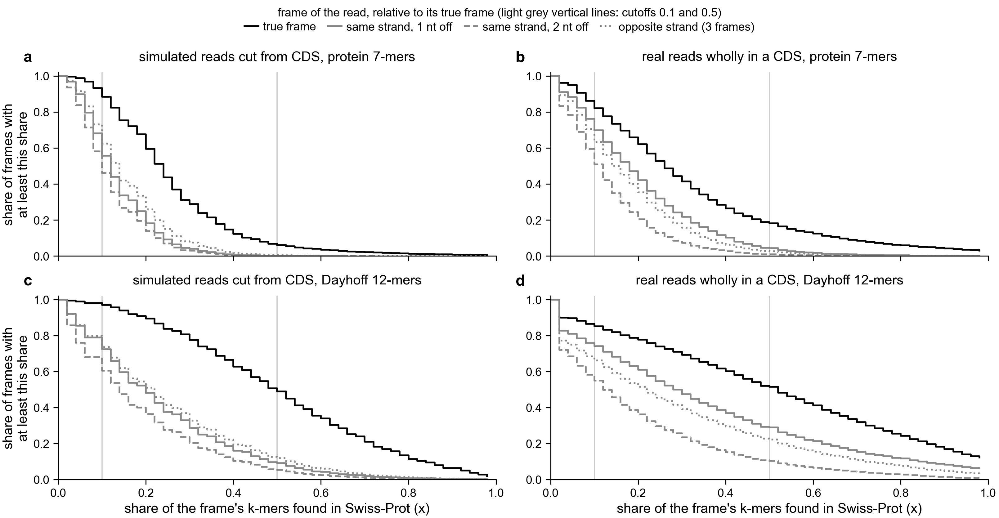
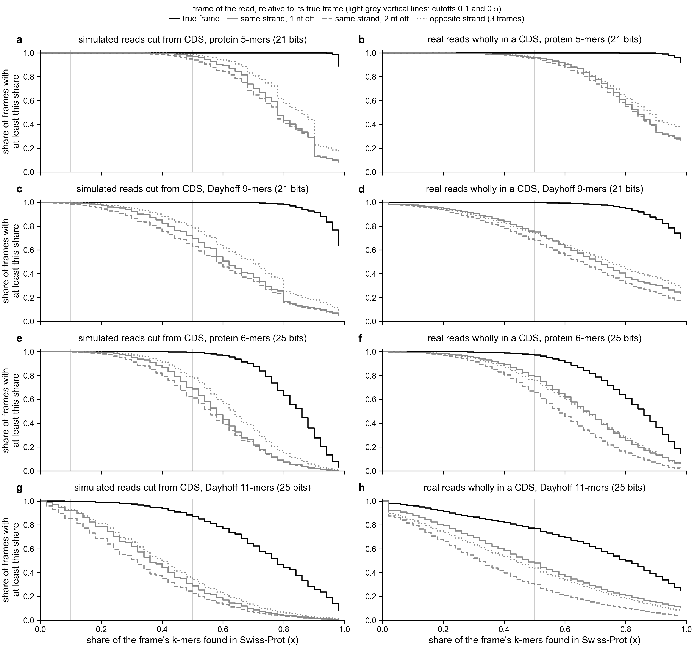

# How much of each reading frame matches Swiss-Prot, for Botryllus reads (notebook 361)

Asked 2026-11-02: show the distribution of the share of k-mers matching Swiss-Prot for each frame,
for Botryllus reads.

Each line is one group of frames. Its height at x is the share of frames in the group with at least
x of their k-mers in Swiss-Prot (UniProt's reviewed proteins). The groups are the true frame, the
two other frames on the same strand (1 or 2 nucleotides off), and the three frames on the opposite
strand. Light grey vertical lines mark the search's two cutoffs, 0.1 and 0.5. Rows are orpheum's
two default k-mer types: protein 7-mers and Dayhoff 12-mers. Dayhoff is a 6-letter alphabet that
groups amino acids by chemistry.

Reads, all with a known true frame:
- **simulated**: 39,854 reads of 150 nt cut from 1,993 new-genome Botryllus CDS (coding sequences);
- **real**: 243,938 reads from one PEC and one control run (JA113, JA123; PEC is pulsatile
  electrical current). Each read's best DIAMOND blastx hit to a new-genome protein has 95 % or
  more identity and covers 90 % or more of the read.

| reads | k-mers | frames | median share | at least 0.1 | at least 0.5 |
|---|---|---|---|---|---|
| simulated | protein 7 | true | 0.227 | 88 % | 6 % |
| simulated | protein 7 | same strand, 1 nt off | 0.116 | 56 % | 0.1 % |
| simulated | protein 7 | same strand, 2 nt off | 0.093 | 46 % | 0.1 % |
| simulated | protein 7 | opposite strand | 0.136 | 62 % | 0.5 % |
| real | protein 7 | true | 0.25 | 82 % | 18 % |
| real | protein 7 | same strand, 1 nt off | 0.167 | 70 % | 4 % |
| real | protein 7 | same strand, 2 nt off | 0.10 | 51 % | 1 % |
| real | protein 7 | opposite strand | 0.14 | 63 % | 3 % |
| simulated | Dayhoff 12 | true | 0.487 | 97 % | 49 % |
| simulated | Dayhoff 12 | same strand, 1 nt off | 0.184 | 72 % | 9 % |
| simulated | Dayhoff 12 | same strand, 2 nt off | 0.132 | 61 % | 5 % |
| simulated | Dayhoff 12 | opposite strand | 0.205 | 74 % | 12 % |
| real | Dayhoff 12 | true | 0.50 | 85 % | 51 % |
| real | Dayhoff 12 | same strand, 1 nt off | 0.278 | 74 % | 29 % |
| real | Dayhoff 12 | same strand, 2 nt off | 0.118 | 55 % | 10 % |
| real | Dayhoff 12 | opposite strand | 0.205 | 66 % | 22 % |

- The true frame is shifted right of the wrong frames in every panel. But the curves overlap a
  lot, so no single cutoff separates them. At 0.1, half or more of the wrong frames pass. At 0.5,
  only 6 % (simulated) and 18 % (real) of true frames pass with protein 7-mers.
- Wrong frames match Swiss-Prot often. A random 7-mer is in Swiss-Prot by chance more often than
  one might expect, and with Dayhoff's 6 letters a 12-mer is even less specific. Real reads have
  more conserved, highly expressed genes, so all their frames score higher.
- Wrong frames mostly contain a stop codon (61 % to 91 % of them, against 3 % to 5 % of true
  frames: reads that cover the CDS's own stop). That is why orpheum only allows stop-free frames.
  These curves include every frame, stops or not.

## Shorter k-mers: protein 5 and 6, with Dayhoff k-mers of the same information

Asked 2026-11-02. Each protein k is paired with the Dayhoff k carrying about the same bits of
sequence information per k-mer (`ortholog_analysis_utils.bits_per_kmer`): protein 5-mers 20.9 bits
with Dayhoff 9-mers 20.5; protein 6-mers 25.1 with Dayhoff 11-mers 25.1. (Above, protein 7-mers are
29.2 bits and Dayhoff 12-mers 27.3.)

| reads | k-mers | true frame: median | true frame: at least 0.5 | wrong frames: median | wrong frames: at least 0.5 |
|---|---|---|---|---|---|
| simulated | protein 5 | 1.00 | 100 % | 0.78-0.84 | 94-98 % |
| simulated | Dayhoff 9 | 1.00 | 100 % | 0.57-0.68 | 63-78 % |
| simulated | protein 6 | 0.84 | 99 % | 0.55-0.62 | 61-78 % |
| simulated | Dayhoff 11 | 0.77 | 87 % | 0.30-0.39 | 23-34 % |
| simulated | protein 7 | 0.23 | 6 % | 0.09-0.14 | 0.1-0.5 % |
| simulated | Dayhoff 12 | 0.49 | 49 % | 0.13-0.21 | 5-12 % |
| real | protein 5 | 1.00 | 100 % | 0.82-0.87 | 95-96 % |
| real | Dayhoff 9 | 1.00 | 100 % | 0.64-0.74 | 68-75 % |
| real | protein 6 | 0.84 | 97 % | 0.57-0.67 | 66-79 % |
| real | Dayhoff 11 | 0.80 | 77 % | 0.31-0.47 | 30-48 % |
| real | protein 7 | 0.25 | 18 % | 0.10-0.17 | 1-4 % |
| real | Dayhoff 12 | 0.50 | 51 % | 0.12-0.28 | 10-29 % |

("Wrong frames" is the range over the three wrong-frame groups.)

- Protein 5-mers are almost all in Swiss-Prot: there are 3.2 million possible 5-mers and Swiss-Prot
  holds about 200 million residues. So nearly every frame, right or wrong, scores high. The true
  frame still scores highest (near 1.0 against about 0.8), so "frame with the most matches" picks
  it well, but a share cutoff means nothing at this k.
- Dayhoff 11-mers separate the frames best of these settings, with the 0.5 cutoff: 87 % (simulated)
  and 77 % (real) of true frames pass, against 23-48 % of wrong frames. Protein 6-mers keep more
  true frames but let through more wrong ones.
- At equal bits, Dayhoff separates better than protein (Dayhoff 9 against protein 5, and Dayhoff
  11 against protein 6). This fits Dayhoff letters grouping amino acids that substitute for each
  other, so a Botryllus protein matches a distant Swiss-Prot relative more often, while a wrong
  frame gains less. That reason is a guess; the numbers are measured.

## Does a 0.9 cutoff on protein 5-mers work? Choosing the frame per read

Asked 2026-11-02: protein 5-mers at 0.9 or more looked good. Per frame, they are: 97 % of true
frames reach 0.9. But the search keeps one frame per read, the one with the highest share, so the
question is whether that frame is the true one. `scripts/frame_cutoff_check.py` answers this per
read, choosing among frames with no stop codon (orpheum's rule, without its low-complexity filter).
Numbers: `frame_cutoff_check.tsv` (also all six frames allowed).

| k-mers | reads | cutoff | reads kept | true frame alone best | true frame tied with a wrong one | wrong frame best |
|---|---|---|---|---|---|---|
| protein 5 | simulated | 0.9 | 98 % | 48 % | 46 % | 6 % |
| protein 5 | real | 0.9 | 99 % | 15 % | 79 % | 6 % |
| Dayhoff 9 | simulated | 0.9 | 93 % | 61 % | 23 % | 16 % |
| Dayhoff 9 | real | 0.9 | 98 % | 22 % | 53 % | 25 % |
| protein 6 | simulated | 0.5 | 98 % | 73 % | 2 % | 25 % |
| protein 6 | real | 0.5 | 99 % | 43 % | 10 % | 48 % |
| Dayhoff 11 | simulated | 0.5 | 91 % | 75 % | 2 % | 24 % |
| Dayhoff 11 | real | 0.5 | 96 % | 44 % | 12 % | 44 % |
| protein 7 | simulated | 0.5 | 7 % | 87 % | 0.2 % | 13 % |
| protein 7 | real | 0.5 | 25 % | 69 % | 1 % | 31 % |

- At protein 5-mers a 0.9 cutoff keeps almost every read, so it filters nothing, and in most real
  reads a wrong stop-free frame also scores 1.0. The true frame is rarely wrong outright (6 %), but
  it is tied for best in 79 % of real reads, so the read's frame is a coin toss among the tied
  frames. Keeping every tied frame would give the true frame and one or more wrong ones.
- No setting picks the true frame alone in more than about half of real reads, except protein
  7-mers at 0.5 (69 %), which keeps only a quarter of the reads.

Code: `scripts/frame_shares.py` ran on Sherlock on `sra_search/frame_test/scores.{protein.k7,dayhoff.k12}.tsv`
(from `pec-tools frame-scores`) and `real_blastx.tsv`. `scripts/plot_frame_shares.py` draws the figure.
Dayhoff 9 and 11 were scored with `pec-tools frame-scores` in Sherlock job 50793955. Plot:
`plot_frame_shares.py exports/frame_shares <out_stem> protein.k7 dayhoff.k12` (and
`protein.k5 dayhoff.k9 protein.k6 dayhoff.k11` for the second figure). Numbers: `frame_shares.*_summary.tsv`, `frame_shares.*_hist.tsv` (0.02 bins).
