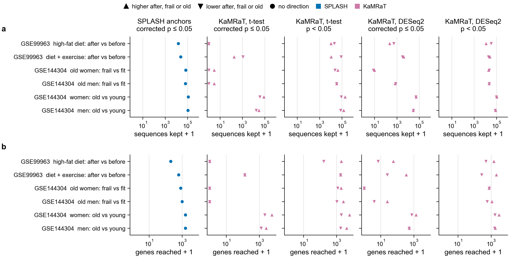
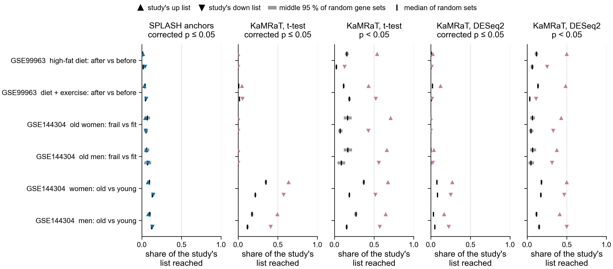

# SPLASH and KaMRaT on the human series (notebook 361)

The same reference-free routes as the Botryllus contrasts, on the human RNA-seq series that
Domen et al. 2026 name in their data statement. No genome is used until the last step, which
names the changed sequences by matching their peptides to GENCODE v50 proteins.

Status, 2026-11-03: GSE99963 (2 contrasts) and GSE144304 (4 contrasts) are done and below.
GSE120862 (5 contrasts) is still downloading; its results are not here yet.

**a**, sequences each route kept per contrast. **b**, genes those sequences reached. Up triangle:
higher after the diet, in frail or in old people; down triangle: lower; circle: SPLASH
compactors, which have no direction. Blue is SPLASH, reddish purple KaMRaT, as in the Botryllus
figures. Counts are on a log axis as count + 1, so 0 sits at the left edge.

Share of each study's up list (up triangles) and down list (down triangles) reached by each
route. Grey bar: the middle 95 % of 1,000 random gene sets matched to the list's baseMean deciles.
Black tick: their median.

Words used below:
- k-mer: a 31-letter piece of a read. Contig: overlapping k-mers joined into a longer sequence.
- SPLASH: finds 31-letter anchors whose following sequence differs between groups. Compactor: an
  anchor extended with the reads that carry it.
- KaMRaT: tests each k-mer with a t-test and joins neighbouring k-mers with similar counts into
  contigs. It runs on DE-kupl's k-mer count table. DESeq2 here means PyDESeq2 on the contigs' counts.
- corrected p: p-value after the Benjamini-Hochberg correction for testing many sequences.
- reached: a peptide of 20 or more residues from the sequence matches a GENCODE v50 protein with
  E <= 1e-5 over at least 50 % of the peptide, the Botryllus rule.
- baseMean: a gene's mean normalised read count.

## Design

`../../design/human/README.md` says what each contrast compares and why. Each series is tested on
its own. GSE99963 contrasts are after vs before, paired by subject (`~ pair + condition`).
GSE144304 is cross-sectional, so its contrasts are not paired (`~ condition`).

## Result

KaMRaT reaches every one of the 12 study lists more often than random genes at uncorrected
p < 0.05, with both tests. SPLASH reaches them about as often as random genes.

"Beat random" means a share of random sets at or above the real list of 0.05 or less; the last
column uses 0.05 / 12 = 0.004. "Wrong way" counts list genes reached only by sequences going the
other way, summed over the 12 lists, as a check of direction.

| route | lists scored | beat random | at 0.004 | list genes reached | wrong way |
|---|---|---|---|---|---|
| SPLASH compactors, corrected p <= 0.05 | 12 | 2 | 1 | 1,084 | no direction |
| KaMRaT, t-test, corrected p <= 0.05 | 12 | 6 | 6 | 4,521 | 217 |
| KaMRaT, t-test, p < 0.05 | 12 | 12 | 12 | 7,321 | 285 |
| KaMRaT, DESeq2, corrected p <= 0.05 | 12 | 10 | 10 | 2,159 | 76 |
| KaMRaT, DESeq2, p < 0.05 | 12 | 12 | 12 | 5,660 | 161 |

The two SPLASH lists are gse99963_sed down (share 0.04, random median 0.02) and
gse144304_female_old_vs_young down (0.14 against 0.13).

Laker's top genes come back in the expected direction: in the exercise arm TNC and MYBPH are in
the up genes at corrected p <= 0.05 with DESeq2. CDKN1A is up in old women by the same route. This
was a spot check of a few genes, not a test.

### Sequences kept (up / down)

SPLASH has one number because it has no direction.

| contrast | SPLASH compactors | t-test corrected | t-test p < 0.05 | DESeq2 corrected | DESeq2 p < 0.05 |
|---|---|---|---|---|---|
| gse99963_sed_post_vs_pre | 14,959 | 0 / 0 | 10,291 / 20,667 | 226 / 527 | 11,790 / 33,205 |
| gse99963_ex_post_vs_pre | 24,874 | 182 / 1,136 | 10,840 / 84,654 | 4,158 / 3,116 | 25,296 / 19,354 |
| gse144304_female_frail_vs_fit | 69,942 | 2 / 0 | 42,471 / 23,634 | 9 / 7 | 19,579 / 22,306 |
| gse144304_male_frail_vs_fit | 64,594 | 2 / 0 | 33,387 / 32,419 | 710 / 776 | 22,175 / 22,937 |
| gse144304_female_old_vs_young | 118,480 | 82,180 / 36,131 | 190,055 / 87,128 | 52,384 / 50,242 | 106,751 / 99,106 |
| gse144304_male_old_vs_young | 109,868 | 30,592 / 17,446 | 140,156 / 74,868 | 29,172 / 29,429 | 82,790 / 77,551 |

SPLASH anchors at corrected p <= 0.05, of those tested, before extension into compactors:

| contrast | anchors tested | significant | k-mers tested | contigs |
|---|---|---|---|---|
| gse99963_sed_post_vs_pre | 2,052,328 | 1,881 | 14,693,359 | 716,137 |
| gse99963_ex_post_vs_pre | 2,335,806 | 2,548 | 18,060,076 | 975,514 |
| gse144304_female_frail_vs_fit | 5,345,830 | 12,131 | 30,829,962 | 913,905 |
| gse144304_male_frail_vs_fit | 5,347,250 | 11,172 | 30,351,467 | 920,092 |
| gse144304_female_old_vs_young | 6,576,327 | 15,677 | 36,115,856 | 1,143,400 |
| gse144304_male_old_vs_young | 6,463,669 | 15,706 | 35,099,559 | 1,119,382 |

### Genes named (up / down)

Every gene, per contrast, route and direction: `human_genes.tsv`. Counts with the steps between
sequence and gene: `human_genes_summary.tsv`.

| contrast | SPLASH compactors | t-test corrected | t-test p < 0.05 | DESeq2 corrected | DESeq2 p < 0.05 |
|---|---|---|---|---|---|
| gse99963_sed_post_vs_pre | 204 | 0 / 0 | 1,925 / 166 | 56 / 6 | 1,471 / 483 |
| gse99963_ex_post_vs_pre | 608 | 132 / 128 | 1,738 / 1,711 | 348 / 24 | 2,082 / 270 |
| gse144304_female_frail_vs_fit | 813 | 0 / 0 | 1,857 / 1,192 | 0 / 0 | 756 / 770 |
| gse144304_male_frail_vs_fit | 989 | 0 / 0 | 2,521 / 1,036 | 24 / 3 | 1,128 / 577 |
| gse144304_female_old_vs_young | 1,594 | 5,713 / 2,115 | 6,028 / 1,906 | 1,365 / 757 | 3,037 / 1,697 |
| gse144304_male_old_vs_young | 1,566 | 2,570 / 1,271 | 4,045 / 1,740 | 525 / 519 | 1,783 / 1,629 |

Genes with the most sequences, KaMRaT with DESeq2 at corrected p <= 0.05:
- gse99963_ex up: XIRP2, COL6A3, FN1, TUBA3D, ACTA1, COL1A2, COL3A1, DYSF, ITGA7, MYH3.
- gse99963_ex down: ACTN3, ACTN2, MYLK2, PYGM, CMYA5, FHL3, MYH1, ART3, MT1X, OPTN.
- gse99963_sed up: EEF2, DDN, COL3A1, COL1A1, FTL, SOD2, CHRND, CTSD, NFE2L1, RPL7.
- gse144304_female_old_vs_young up: PKD1, MYH7B, MYOM2, OBSCN, MYH6, MYH8, ADAMTSL4, AHNAK, MYH1, PER1.
- gse144304_female_old_vs_young down: TTN, KTN1, NRDC, GAPDH, NNT, RNF10, SLC25A12, CMYA5, DCAF6, EIF4G2.
- gse144304_male_old_vs_young up: PKD1, MYH7B, MYOM2, OBSCN, AHNAK, ATP1A2, MYH6, USO1, C10orf71, ATP1A1.
- gse144304_male_old_vs_young down: IGFN1, RNF10, WWP1, PHKB, GAPDH, TTN, SLC25A12, ASB2, NNT, CCDC69.

SPLASH's genes with the most compactors are myosins and TTN in GSE99963, and mitochondrial genes
(MT-ND4, MT-ND5, MT-CYB, MT-CO1) in GSE144304. Why was not checked. Differences in mitochondrial
DNA between people would be one reason, since GSE144304 compares different people.

## Comparison with each study's genes

| series | source of the list | cutoff |
|---|---|---|
| GSE99963 | published: Laker 2017 Table S1 (edgeR) | FDR < 0.1, as in the table |
| GSE144304 | rebuilt here: no table of genes was found, so PyDESeq2 on the authors' GEO counts, `~ condition` | p < 0.01, de Jong 2023's cutoff |

The de Jong 2023 supplement holds figures only. Table S1 of Laker 2017 lists 1,602 genes
(sedentary arm) and 3,999 (exercise arm) at FDR < 0.1, while the paper's text says 412 and 2,617;
the table was used as published. Our rebuilt old vs young lists hold 4,754 genes in women and
3,250 in men, against 5,500 and 3,721 in de Jong 2023. Lists are limited to genes with a GENCODE
protein. All numbers: `human_compare.tsv`, `published_genes.tsv`, `published_genes_counts.txt`.

Each cell: reached/listed (share; random median; share of random sets at or above the real list).

| contrast, list | SPLASH | t-test p < 0.05 | DESeq2 corrected | DESeq2 p < 0.05 |
|---|---|---|---|---|
| gse99963_sed up | 11/758 (0.01; 0.01; 0.489) | 408/758 (0.54; 0.16; 0.000) | 19/758 (0.03; 0.00; 0.000) | 379/758 (0.50; 0.12; 0.000) |
| gse99963_sed down | 23/566 (0.04; 0.02; 0.000) | 72/566 (0.13; 0.02; 0.000) | 5/566 (0.01; 0.00; 0.000) | 143/566 (0.25; 0.06; 0.000) |
| gse99963_ex up | 59/1,823 (0.03; 0.04; 0.975) | 784/1,823 (0.43; 0.12; 0.000) | 225/1,823 (0.12; 0.02; 0.000) | 882/1,823 (0.48; 0.14; 0.000) |
| gse99963_ex down | 77/1,396 (0.06; 0.05; 0.066) | 728/1,396 (0.52; 0.19; 0.000) | 19/1,396 (0.01; 0.00; 0.000) | 157/1,396 (0.11; 0.03; 0.000) |
| gse144304_female_frail up | 9/212 (0.04; 0.07; 0.972) | 150/212 (0.71; 0.17; 0.000) | 0/212 (0.00; 0.00; 1.000) | 91/212 (0.43; 0.07; 0.000) |
| gse144304_female_frail down | 16/328 (0.05; 0.05; 0.620) | 140/328 (0.43; 0.07; 0.000) | 0/328 (0.00; 0.00; 1.000) | 108/328 (0.33; 0.05; 0.000) |
| gse144304_male_frail up | 11/203 (0.05; 0.06; 0.701) | 134/203 (0.66; 0.17; 0.000) | 8/203 (0.04; 0.00; 0.000) | 76/203 (0.37; 0.07; 0.000) |
| gse144304_male_frail down | 10/127 (0.08; 0.07; 0.455) | 71/127 (0.56; 0.09; 0.000) | 3/127 (0.02; 0.00; 0.000) | 40/127 (0.31; 0.05; 0.000) |
| gse144304_female_old up | 192/2,499 (0.08; 0.10; 1.000) | 1,688/2,499 (0.68; 0.37; 0.000) | 675/2,499 (0.27; 0.08; 0.000) | 1,249/2,499 (0.50; 0.18; 0.000) |
| gse144304_female_old down | 326/2,255 (0.14; 0.13; 0.033) | 1,164/2,255 (0.52; 0.19; 0.000) | 567/2,255 (0.25; 0.09; 0.000) | 1,057/2,255 (0.47; 0.17; 0.000) |
| gse144304_male_old up | 133/1,635 (0.08; 0.10; 0.999) | 1,058/1,635 (0.65; 0.27; 0.000) | 273/1,635 (0.17; 0.03; 0.000) | 671/1,635 (0.41; 0.12; 0.000) |
| gse144304_male_old down | 217/1,615 (0.13; 0.13; 0.132) | 924/1,615 (0.57; 0.15; 0.000) | 365/1,615 (0.23; 0.05; 0.000) | 807/1,615 (0.50; 0.15; 0.000) |

## Time and memory

From the Nextflow traces (`resources.tsv` per task, `resources_by_process.tsv`). No task failed
on memory or time. On 14 samples and 15 Gbp the pilot's SPLASH took 2 min.

| step | tasks | CPU hours, all tasks | longest wall time | largest peak memory |
|---|---|---|---|---|
| fastp | 108 | 4.43 | 2 min | 1.2 GB |
| GENCODE sketches and indexes | 1 | 1.70 | 14 min | 4.2 GB |
| SPLASH | 6 | 4.09 | 5 min | 10.7 GB |
| compactors | 6 | 3.59 | 6 min | 33.3 GB |
| DE-kupl counting + limma | 6 | 35.12 | 67 min | 57.1 GB |
| KaMRaT index, t-test, merge | 6 | 2.78 | 36 min | 7.7 GB |
| KaMRaT t-test p < 0.05 + DESeq2 | 6 | 6.29 | 11 min | 15.5 GB |
| protein search | 24 | 4.04 | 10 min | 31.1 GB |

Most of the time was queueing, not computing: the first two-series run was stopped after 3 h 49
min with five KaMRaT steps and searches left. The 128 GB and 96 GB asks for the last two steps waited over 90 min, so
they were lowered to 32 and 48 GB. DE-kupl's peak is close to its 64 GB ask; a sort step there
uses the memory it is given.

## Limits

- Reads trimmed: GSE99963 keeps 376,524,523 of 409,065,149 (92.05 %), GSE144304 1,423,552,856 of
  1,432,260,279 (99.39 %).
- Compactors differ from Botryllus: one k-mer per segment instead of two (`--num_kmers 1`),
  because no human read is long enough for two. See `../../design/human/README.md`.
- SPLASH and KaMRaT's t-test treat samples as independent, so in the paired GSE99963 contrasts
  their p-values do not use the pairing. Only the DESeq2 route does.
- GSE99963 run SRR5678750 has 179,404 reads, about 1 % of the others, and stays in the sedentary
  arm.
- SPLASH tests the mix of sequences after an anchor, not abundance, so a study's gene list
  is not the list it should recover.
- Our routes and the studies' lists use the same reads, and the GSE144304 lists were rebuilt here.
  Agreement is corroboration, not an independent repeat.
- A random set matched on baseMean controls for expression level only. Long genes and families
  with close relatives offer more peptides, so they are easier to reach.
- A gene can be reached through a close relative: paralogs such as the myosins are not told apart.
- At p < 0.05 about 1 tested sequence in 20 passes by chance. No label-swap control has been run
  on the human contrasts.
- GSE99963 and GSE144304 only. In GSE120862, subjects P1-P4 have 51 or 60 nt reads, too short for
  SPLASH, so its SPLASH results will rest on subjects P5-P7.
