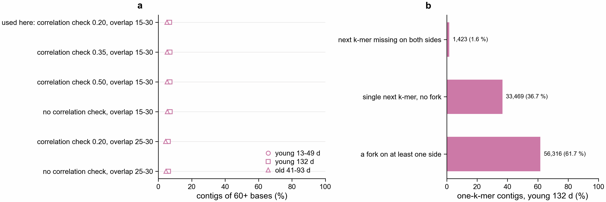
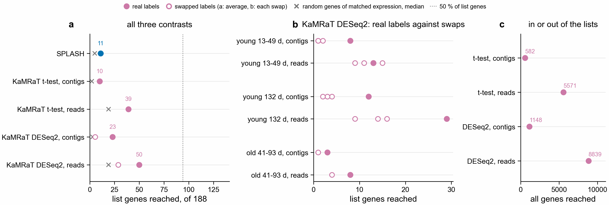

# Why KaMRaT contigs are short, and what could lengthen them (notebook 361)

Asked 2026-11-06. Job 51337178 (merge settings), `scripts/kamrat_merge_lengths.py`,
`scripts/kamrat_kmer_neighbours.py`, `scripts/plot_kamrat_merge_settings.py`,
`slurm/kamrat_merge_settings.sbatch`. Numbers: `lengths.*.tsv`, `young_132d.neighbours.tsv`,
`merge_settings_and_forks.tsv`.

**a.** Share of all contigs with 60+ bases, the shortest that can hold a peptide of 20 residues. Each
mark is one contrast. Circles sit behind the squares. **b.** Contigs of one k-mer in young 132 d, by the
k-mers one base further along in the table KaMRaT indexed, either strand.

- Selection is not the cause. Before the p < 0.05 cut, 43 to 49 % of contigs are one k-mer and 5 to 11 %
  have 60+ bases, in all six contrasts.
- Merge settings are not the cause. Across six settings in the three small contrasts, the share with
  60+ bases moves by about 1 point. Removing the correlation check adds almost nothing. The six
  settings use the same k-mer table, so k stays 31.
- Missing k-mers are rarely the cause. Only 1.6 % of one-k-mer contigs in young 132 d have no next
  k-mer on either side. 61.7 % have a fork, two or more possible next k-mers on one side. A merge stops
  at a fork. These forks sit in k-mers with high counts: a median top count of 112 in any sample when
  both sides fork, against 8 when one side has no next k-mer.
- The other 36.7 % have a single next k-mer and still did not merge. The likely reason is that the next
  k-mer forks, but this was not checked.

This was measured in one contrast. Whether the forks come from repeats, sequence variants or
sequencing errors was not tested.

## Options

| option | why it could help | cost and risk |
|---|---|---|
| Replace each kept k-mer with the reads holding it (tested below; not worth extending) | A read is up to 150 bases, crosses forks and always passes 60 bases | One pass over the reads. Reads add sequence around the k-mer, and may join different copies of a repeat |
| Assemble those reads (rnaSPAdes or Trinity) | Longer than one read | Slower, and low-count genes may not assemble |
| Count k-mers at k=61 | Every k-mer can hold a peptide, and longer k-mers fork less | Recounts all reads, and shallow samples lose more k-mers because a read has fewer of them |
| Drop k-mers far below their neighbour's count | Removes forks caused by sequencing errors | Cheap, but only helps if errors cause the forks, and may lose variants |

## Test: replace kept contigs with the reads holding their k-mers

Asked 2026-11-06. Job 51347070 (`slurm/kamrat_reads.sbatch`, `pec-tools reads-holding`), scored by job
51350750 (`scripts/kamrat_reads_score.py`). Numbers are in `reads/`.

**a.** Genes of the six lists of the three small contrasts reached going the same way as the list.
**b.** The same for KaMRaT + DESeq2 by contrast, real labels against each label swap. **c.** All genes
reached, in or out of the lists.

| route | list genes reached, of 188 | random genes, median | swapped labels, average | all genes reached | lists beating random, of 6 |
|---|---|---|---|---|---|
| t-test, contigs | 10 | 2 | not run | 582 | 3 |
| t-test, reads | 39 | 19 | not run | 5,571 | 3 |
| DESeq2, contigs | 23 | 3 | 5.3 | 1,148 | 4 |
| DESeq2, reads | 50 | 19 | 28.7 | 8,839 | 4 |

- Reads reach more list genes and lose none. The share rises from 5 to 21 % with the t-test and from
  12 to 27 % with DESeq2. Both stay below the 50 % target, and SPLASH reaches 11 here.
- Most of the gain is not specific to PEC. Reads add 27 list genes with DESeq2 on real labels and 23 on
  average with swapped labels, so real labels lead swapped ones by 17.7 genes with contigs and 21.3
  with reads. In young 13-49 d one swap (15) beats the real labels (13).
- Reads reach 8 to 10 times as many genes overall, but only 2 to 4 times as many list genes. Random
  genes of matched expression rise as well, from 2-3 to 19. The number of lists beating random does
  not change.
- Direction gets less reliable. With DESeq2, reads reach 24 more list genes only in the opposite
  direction, against 3 with contigs.

**Recommendation: do not extend this to the three large contrasts.** The extra genes mostly come from
reaching more genes of any kind, and they would not bring the route to 50 %.

Added cost: finding the reads took about 20 s and at most 350 MB per contrast and route. Translating
and searching the old gene models took 2 to 41 min on 16 CPUs, at most 44 GB. The 41 min run had 6.6 M
peptides, against 3,538 from contigs.

Choices not specified in the request: a contig takes at most 100 distinct reads per sample, the first in
file order, so a run of A's cannot pull in every read. A read holding k-mers of an up and a down contig
counts for both. Mates are not added. 0 to 5 % of contigs had no read; why was not checked.

Limits: these are the three smallest contrasts, with 188 list genes and 1 to 3 swaps each. The t-test
route has no swaps. How much the 100-read limit changes the result was not tested.
