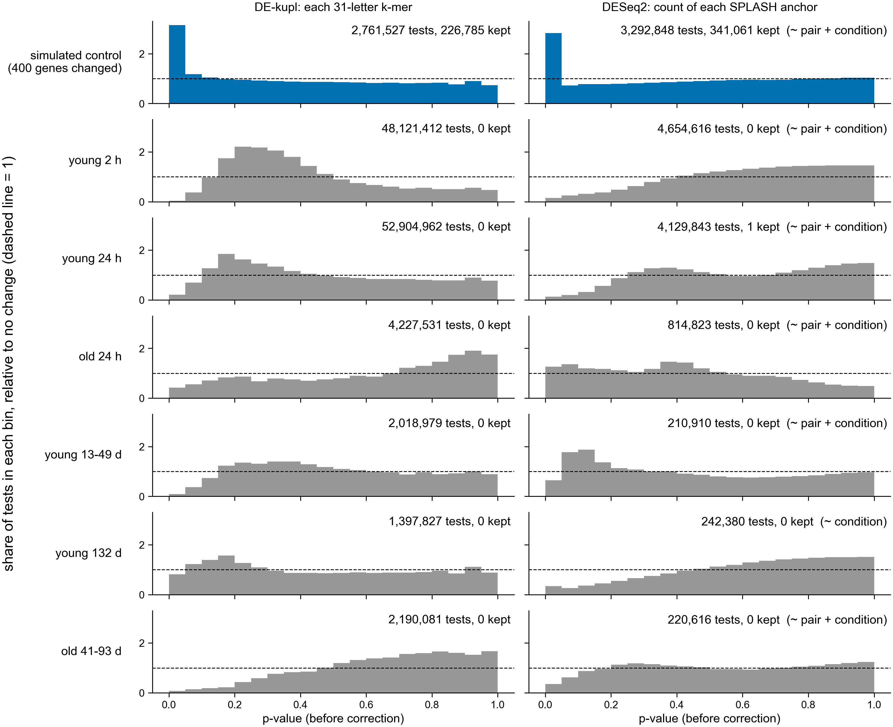

# DE-kupl and KaMRaT: significant k-mers per contrast

Run: `nextflow-runs/pec-domen2026`, Sherlock head job 50675765, finished 2026-11-01 11:41
(15 tasks, 0 failed). Counts read from `$SCRATCH/nb361-pec/contrasts/<contrast>/` on
2026-11-01.

- DE-kupl: rows in `dekupl_limma/DEkupl_result/control_vs_PEC_kmer_counts/diff-counts.tsv.gz`
  (k-mers kept by DE-kupl's limma test) and `merged-diff-counts.tsv.gz` (those k-mers joined
  into contigs).
- KaMRaT: from `kamrat_ttest/summary.txt` and `contigs_all.tsv.gz`. A k-mer is kept when its
  t-test p-value, corrected for the number of k-mers tested (Benjamini-Hochberg), is 0.05 or
  less. "Smallest corrected p" is the smallest `rep-value` over all contigs.

| contrast | DE-kupl k-mers kept | DE-kupl contigs | KaMRaT k-mers tested | KaMRaT k-mers kept | KaMRaT smallest corrected p |
|---|---:|---:|---:|---:|---:|
| control (simulated, known answer) | 10419 | 405 | 2761527 | 196784 | not read |
| young_2h | 0 | 0 | 48121412 | 0 | 1 |
| young_24h | 0 | 0 | 52904962 | 0 | not read |
| old_24h | 0 | 0 | 4227531 | 0 | 0.999995 |
| young_13_49d | 0 | 0 | 2018979 | 0 | not read |
| young_132d | 0 | 0 | 1397827 | 0 | 0.212515 |
| old_41_93d | 0 | 0 | 2190081 | 0 | not read |

Both k-mer methods keep k-mers in the control, where 400 genes were changed 4x or 9x, and
keep none in any of the six real contrasts. So the KaMRaT searches on the real contrasts
had no contigs to search, and their outputs are empty.

Not yet checked: whether the real contrasts have too few samples for a per-k-mer test across
millions of k-mers, or whether the changes the paper reports are too small to pass at any
k-mer. Comparing with the SPLASH and anchor-count results is the next step.

## All four methods, and whether the k-mer tests lack power (added 2026-11-01)

Made by `scripts/power_check.py` (Sherlock job 50700733 and a rerun with histograms) and
`scripts/plot_power_check.py`. Numbers: `power_check.tsv`, `power_check_hist.tsv`.

Sequences kept at corrected p <= 0.05, out of the number tested:

| contrast | DE-kupl k-mers | KaMRaT k-mers | DESeq2 anchors, ~ pair + condition | DESeq2 anchors, ~ condition | SPLASH anchors | paper's genes at corrected p <= 0.05 and 2-fold |
|---|---|---|---|---|---|---|
| control (simulated) | 226785 of 2761527 | 196784 | 341061 of 3292848 | 331564 | 10300 of 3308551 | (no paper list) |
| young_2h | 0 of 48121412 | 0 | 0 of 4654616 | 0 | 84806 of 15015257 | 0 up, 0 down |
| young_24h | 0 of 52904962 | 0 | 1 of 4129843 | 0 | 937888 of 16190103 | 0 up, 1 down |
| old_24h | 0 of 4227531 | 0 | 0 of 814823 | 0 | 30037 of 814823 | 0 up, 0 down |
| young_13_49d | 0 of 2018979 | 0 | 0 of 210910 | 0 | 20582 of 336165 | 0 up, 0 down |
| young_132d | 0 of 1397827 | 0 | not fitted (no pairs) | 0 of 242380 | 8940 of 259779 | 7 up, 4 down |
| old_41_93d | 0 of 2190081 | 0 | 0 of 220616 | 0 | 12754 of 348069 | 0 up, 0 down |

DE-kupl's 226785 here counts every k-mer with corrected p <= 0.05; its own output keeps
10419 after its other filters (table above). The paper's last column is from its SI Dataset S1
DESeq2 tables (`exports/paper/paper_list_summary.json`). The paper's named lists use
uncorrected p <= 0.05, not corrected p.

What this shows:

1. All three abundance tests (DE-kupl, KaMRaT, anchor-count DESeq2) keep nothing in the real
   contrasts. So does the paper's own gene-level DESeq2 in 4 of 6 contrasts. Only SPLASH keeps
   anchors. In the control SPLASH found only the isoform-switch genes (56 of 100) and no gene
   whose level alone changed, so SPLASH's anchors are not a stand-in for the paper's lists.
2. The number of tests is not the reason. Correcting the control's DE-kupl p-values as if it
   had as many tests as each real contrast still keeps 81714 k-mers (at young_24h's
   52.9 M tests) to 269742 (at young_132d's 1.4 M).
3. The real p-values have no spike near 0. In the control, the first bin holds 2.8 to 3.1 times
   what chance gives. In the real contrasts it holds 0.0 to 0.8 times, except DESeq2 ~ pair +
   condition in old_24h (1.3). So there are fewer small p-values than chance gives: the
   changes between control and PEC are no larger than the differences between replicate
   samples in the same group. Signal sitting just under the cutoff would show as a spike.
4. A caveat on point 2: the simulated control has no colony-to-colony differences, so its
   replicates vary less than real colonies do. Point 2 shows the number of tests is not the
   limit; it does not show the real data have enough samples.

Not yet checked: why the bulk of the real p-values sits between 0.1 and 0.5 for DE-kupl
(young_2h, young_24h). One candidate: DESeq2's size factors for young_2h run from 0.11 (JA124) to
15.5 (JA102), a 140-fold range in library depth or make-up, which the k-mer tests may not
correct for in the same way.
