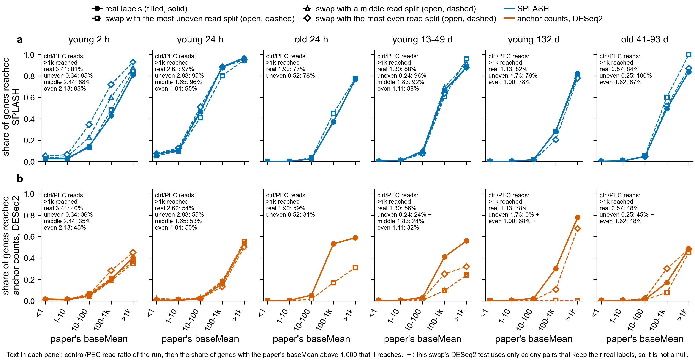

# Label swap: do the routes reach as many genes when PEC and control labels are shuffled? (notebook 361)

Asked 2026-11-02, after `../equal_depth/` could not tell whether SPLASH's reach in young 2 h and
young 24 h comes from unequal read depth between the groups (control samples have 2.6 to 3.4
times the reads of PEC samples) or from depth in general.

The test: run the same routes again with some PEC (pulsatile electrical current) and control
labels swapped. A swapped run mixes treated and untreated samples in each group, so whatever it
finds cannot be the effect of PEC. If the real labels reach many more genes than the swaps, the
reach reflects PEC. If the swaps reach as many, the reach reflects differences between samples
or colonies that have nothing to do with PEC. Swaps were picked by their control/PEC read ratio,
so a swap with the same depth split as the real labels shows what the depth split alone gives.

**a.** SPLASH (a k-mer tool that keeps 31-letter anchors whose following sequence differs
between groups; kept at corrected p <= 0.05). **b.** Anchor counts tested with DESeq2 (a test of
read counts), kept at uncorrected p <= 0.05 and 2-fold. In both, kept sequences are extended
into compactors (anchor plus the reads that carry it), translated and matched to the old
gene-model proteins; a gene is reached when an alignment is supported (E <= 1e-5, query coverage
>= 50 %). x: the paper's baseMean (DESeq2's mean normalised count per gene). y: share of the
paper's genes in that bin that are reached. Filled circles, solid line: real labels. Open
markers, dashed: swaps. "+" in row b: that swap is not a null (see Limits).

## How the swaps were made

`scripts/make_label_swaps.py` (rule written down before any swapped run, 2026-11-02), designs in
`design/label_swap/`, list in `design/label_swap/manifest.tsv`:

- Paired contrasts (young 2 h, young 24 h, old 24 h; each colony gives one PEC and one control
  sample): swap the labels inside half of the pairs (3 of 6, or 1 of 2), so every pair still has
  one sample of each.
- Unpaired contrasts (young 13-49 d, young 132 d, old 41-93 d): move about half of each group to
  the other group, keeping the group sizes.
- From the possible swaps, keep the one with the most uneven control/PEC read ratio, the most
  even one and, where 10 or more swaps were possible, the middle one.

Each swap ran through the pipeline's SPLASH and anchor-count routes (`main.nf --label_swap`,
head job 50779664, finished 2026-11-02 11:05). `scripts/label_swap_reach.py` counted the genes
reached (Slurm job 50912653, 2026-11-03; the earlier table in that folder was written at 06:16,
before the run ended, and is kept on Sherlock as `label_swap/reach.stale_20261102_0616`).
Numbers: `label_swap_runs.tsv`, `label_swap_bins.tsv`. Figure: `scripts/plot_label_swap_reach.py`.

## Result

SPLASH reaches about as many genes with swapped labels as with the real ones, in every contrast:
the 14 swaps reach 68 % to 203 % of the real labels' genes, and their share of highly expressed
paper genes (baseMean > 1,000) is 4 points lower to 16 points higher than the real labels'.

| contrast | run | control/PEC reads | anchors kept | genes reached | paper genes with baseMean > 1,000 reached |
|---|---|---|---|---|---|
| young 2 h | real | 3.41 | 84,806 | 3,442 | 240/297 |
| young 2 h | swap, most uneven | 0.34 | 97,685 | 3,469 | 251/297 |
| young 2 h | swap, middle | 2.44 | 144,822 | 5,111 | 260/297 |
| young 2 h | swap, most even | 2.13 | 270,527 | 6,982 | 276/297 |
| young 24 h | real | 2.62 | 937,888 | 9,585 | 310/320 |
| young 24 h | swap, most uneven | 2.88 | 594,175 | 8,272 | 304/320 |
| young 24 h | swap, middle | 1.65 | 914,641 | 9,986 | 308/320 |
| young 24 h | swap, most even | 1.01 | 1,074,990 | 10,534 | 304/320 |
| old 24 h | real | 1.90 | 30,037 | 521 | 69/90 |
| old 24 h | swap | 0.52 | 34,444 | 632 | 70/90 |
| young 13-49 d | real | 1.30 | 20,582 | 523 | 22/25 |
| young 13-49 d | swaps | 0.24-1.83 | 13,864-27,403 | 366-574 | 22-24/25 |
| young 132 d | real | 1.13 | 8,940 | 246 | 56/68 |
| young 132 d | swaps | 1.00-1.73 | 6,128-10,091 | 168-239 | 53-54/68 |
| old 41-93 d | real | 0.57 | 12,754 | 463 | 26/31 |
| old 41-93 d | swaps | 0.25-1.62 | 12,742-21,450 | 455-472 | 27-31/31 |

- In young 2 h the swap with a depth split as uneven as the real one (3.4-fold, here with PEC
  deeper) reaches 3,469 genes, the real labels 3,442. The most even swap keeps 3 times as many
  anchors (270,527) and reaches twice as many genes (6,982). So the unequal depth between groups
  does not make SPLASH's reach; a more even split reaches more.
- In young 24 h the three swaps reach 8,272 to 10,534 genes, the real labels 9,585.
- So SPLASH's kept anchors here reflect differences between samples (most of them one-base
  differences that follow the colony, `../call_types/`), not PEC. Reaching a gene with SPLASH is
  not evidence that PEC changed it.

Anchor counts tested with DESeq2 (row b), looking only at swaps that are a fair null (see Limits):

| contrast | run | control/PEC reads | anchors kept | genes reached | paper genes with baseMean > 1,000 reached |
|---|---|---|---|---|---|
| young 2 h | real | 3.41 | 34,741 | 1,743 | 120/297 |
| young 2 h | 3 swaps | 0.34-2.44 | 32,665-47,193 | 1,210-1,632 | 104-134/297 |
| young 24 h | real | 2.62 | 26,245 | 895 | 172/320 |
| young 24 h | 3 swaps | 1.01-2.88 | 37,437-49,021 | 944-2,018 | 161-177/320 |
| old 24 h | real | 1.90 | 51,565 | 560 | 53/90 |
| old 24 h | swap | 0.52 | 13,218 | 192 | 28/90 |
| young 13-49 d | real | 1.30 | 6,772 | 175 | 14/25 |
| young 13-49 d | swap, most even; middle | 1.11; 1.83 | 6,099; 1,880 | 112; 44 | 8/25; 6/25 |
| old 41-93 d | real | 0.57 | 3,940 | 101 | 15/31 |
| old 41-93 d | swap, most even | 1.62 | 5,997 | 164 | 15/31 |

- In young 2 h and young 24 h, the two contrasts with 6 colony pairs, the swaps keep about as
  many anchors as the real labels or more (young 2 h 32,665-47,193 against 34,741; young 24 h
  37,437-49,021 against 26,245). In young 2 h they reach 69-94 % of the real labels' genes, in
  young 24 h 105-225 %. The anchor-count route barely separates PEC from swapped labels there.
- In old 24 h (2 pairs, one colony) the real labels keep 3.9 times the anchors of the one swap
  (51,565 against 13,218) and reach 2.9 times the genes (560 against 192). In young 13-49 d the
  real labels reach more genes than both fair swaps (175 against 112 and 44). With one or two
  swaps per contrast this is not a test with a p-value.

Verdict: with swapped labels SPLASH reaches 68 % to 203 % of the genes it reaches with the real
labels (young 2 h 3,469 to 6,982 against 3,442; young 24 h 8,272 to 10,534 against 9,585), so
its reach does not measure PEC. The anchor-count route reaches at most
a little more than its swaps in the two young contrasts with 6 pairs; it reaches more with the real labels only
in old 24 h and young 13-49 d, each from one or two swaps.

## Limits

- **Some anchor-count swaps are not a null.** The anchor-count DESeq2 design is `~ pair +
  condition` (young 132 d: `~ genotype + condition`). A pair (or genotype) with both samples in
  the same group drops out of the condition test, so only pairs holding one PEC and one control
  sample count. In 4 swaps every such pair kept its real labels, so the "swap" is the real test on
  fewer pairs (marked "+"): young 13-49 d most uneven, young 132 d both swaps, old 41-93 d most
  uneven. They are left out of the second table. young 13-49 d middle is the opposite of young
  13-49 d most uneven: both rest on the one pair JA152/JA154, with the labels flipped in the
  middle swap, so they keep the same 1,880 anchors with the opposite direction. The swap rule in
  `make_label_swaps.py` checked only that the design could be fitted; it did not check that the
  swap flipped a counted pair. SPLASH does not use pairs, so every SPLASH swap is a fair null.
- One to three swaps per contrast, chosen by read ratio, not at random. They show what swapped
  labels give, not the spread of all swaps; there is no p-value.
- "Genes reached" counts every old gene-model gene with a supported alignment, not only genes on
  the paper's lists.
- old 24 h is 2 control and 2 PEC samples from one colony.
