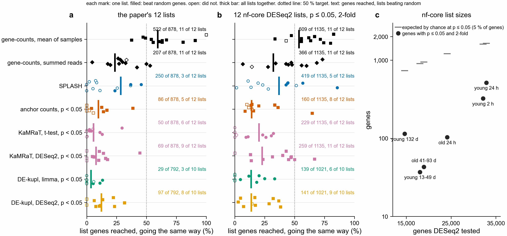

# Routes scored against a real nf-core run (notebook 361)

Asked 2026-11-04: score the routes against nf-core/rnaseq (STAR + RSEM) on the April 2024 genome and
nf-core/differentialabundance with DESeq2, not only against the paper's lists.

**a, b.** Share of list genes reached going the list's way (SPLASH has no direction). One mark per
list, filled if it beat 1,000 random gene sets matched on baseMean. Thick bar: all lists together.
Dotted line: the 50 % target. **c.** Size of the nf-core lists against what chance alone would give
at p <= 0.05.

Code: `nextflow-runs/pec-domen2026-nfcore/`, `scripts/nfcore_recovery.py`,
`scripts/plot_nfcore_recovery.py`. Numbers: `recovery.tsv`, `summary.tsv`, `list_sizes.tsv`,
`routes_vs_paper_and_nfcore.tsv`. Jobs: nf-core 51207126, scoring 51207129, gene-counts 51213030,
sample-mean scoring 51216691 (2026-11-05).

## nf-core itself finds almost nothing

After correction (padj < 0.05, 2-fold), nf-core keeps 2 genes across all six contrasts, both down in
young 2 h. So the corrected reference is not usable, and every number below uses the paper's own
cutoff, uncorrected p <= 0.05 and 2-fold: 1,135 genes in 12 lists.

At p <= 0.05 DESeq2 has 0.2 to 1.6 % of tested genes, under the 5 % chance alone would give
(`list_sizes.tsv`). So the size of these lists is no evidence that PEC changed them. Reads per sample
are few and uneven (median 534,000 counted reads), which may explain it; this was not tested.

| route | nf-core lists, right way | beat random | paper's lists, right way | beat random |
|---|---|---|---|---|
| gene-counts, mean of samples | 609 of 1,135 (54 %) | 11 of 12 | 522 of 878 (59 %) | 11 of 12 |
| SPLASH (no direction) | 419 of 1,135 (37 %) | 5 of 12 | 250 of 878 (28 %) | 3 of 12 |
| gene-counts, summed reads | 366 of 1,135 (32 %) | 11 of 12 | 207 of 878 (24 %) | 11 of 12 |
| KaMRaT, DESeq2, p < 0.05 | 259 of 1,135 (23 %) | 11 of 12 | 69 of 878 (8 %) | 9 of 12 |
| KaMRaT, t-test, p < 0.05 | 229 of 1,135 (20 %) | 6 of 12 | 50 of 878 (6 %) | 6 of 12 |
| anchor counts, p < 0.05 | 160 of 1,135 (14 %) | 8 of 12 | 86 of 878 (10 %) | 5 of 12 |
| DE-kupl, DESeq2, p < 0.05 | 141 of 1,021 (14 %) | 9 of 10 | 97 of 792 (12 %) | 8 of 10 |
| DE-kupl, limma, p < 0.05 | 139 of 1,021 (14 %) | 6 of 10 | 29 of 792 (4 %) | 3 of 10 |

The two sets of lists use different genes: nf-core uses the April 2024 genome and proteome, the paper
the old gene models. gene-counts was run on each. 1,983 of 44,727 nf-core genes have no protein and
cannot be reached. DE-kupl has 10 lists because young 132 d is not usable for it.

## Why the second gene-counts rule exists

gene-counts summed reads across a group's samples. Only 10 of the 1,135 list genes got the wrong
direction with that rule (366 right), so the loss was genes given no direction. One sample holds up
to 51 % of a contrast's reads (JA102 in young 2 h), so the sum follows that sample. The `sample_mean`
rule in `scripts/gene_directions.py` scales each sample to reads per million, then compares group
means. In a small test table, a gene with the same reads in both groups, in a contrast with a spike
in one deep sample, got a false "up" from the sum and no direction from the mean.

On the simulated control the mean rule gets 292 of 300 planted genes right and 0 wrong, with 25 of
2,600 unchanged genes given a direction. The summed rule got 280, 0 and 24.

## Limits

- **The mean rule was written after the summed rule's score was read.** Only the summed rule was
  fixed in advance, and it failed. The mean rule's 59 % is a lead to test again, not a pass.
- **It is not independent.** gene-counts and DESeq2 count the same reads, per gene, in the same
  samples, and both look at a change in scaled counts. Agreement shows gene-counts gives similar
  answers to STAR + RSEM without a genome. It does not show PEC changed these genes.
- **It gives many genes a direction.** 34,138 of 140,726 gene-and-contrast pairs (24 %), so 1.8 % of
  those are on an nf-core list. The random gene test allows for this, but the rule is no gene finder.
  It has no test of spread between samples.
- **Swapped labels were not run for it.**
- **Cost is not 1/1000.** gene-counts took 3.3 CPU h, 36 min and 0.43 GB against the SPLASH route's
  12.1 h, 3.0 h and 83.6 GB: about 1/4 the CPU, 1/5 the time, 1/190 the memory. No thinned reads have
  been tried.
