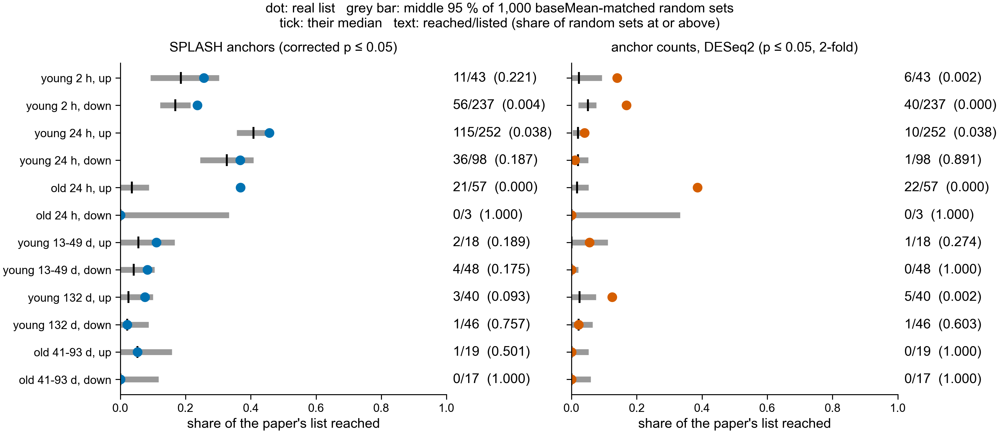

# Recovering the paper's gene lists (notebook 361)

The paper's named lists (SI Dataset S1, sheets "annotated DE all groups young/old") were made at
uncorrected p <= 0.05 and |log2 fold change| > 1 on its own reference-based DESeq2. This folder
asks how many genes on each list our reference-free channels reach, against a null fixed in
`design/ANALYSIS_PLAN.md` (2026-10-30) before the comparison was run.

How a gene is reached: a channel's sequences are extended into compactors, translated, matched
by sourmash to the old gene-model proteins (`botznik`, gene IDs g<N>), and kept when the
alignment check supports the match (E <= 1e-5, query coverage >= 50 %). The null: 1,000 random
gene sets of the list's size, drawn from the genes in the paper's DESeq2 sheet of that contrast,
matching the list's count in each baseMean decile. Both list and pool are limited to genes with an
old gene-model protein (all listed genes have one). Code: `scripts/paper_recovery.py`, figure
`scripts/plot_paper_recovery.py`.

## Result, 2026-11-01

Numbers: `paper_recovery.tsv`, written by the pipeline's `paper_recovery` process (Nextflow run
of 2026-11-01, head job 50702717). Both channels were scored in one run with the same random
seed (361). A share of random sets of 0.000 means none of the 1,000 reached the real share
(below 0.001).

### SPLASH anchors (corrected p <= 0.05)

SPLASH has no direction, so its reached genes are compared with the up list and the down list
alike.

| list | reached | real share | null median (95 % range) | random sets at or above |
|---|---|---|---|---|
| young 2 h up | 11/43 | 0.26 | 0.19 (0.09-0.30) | 0.221 |
| young 2 h down | 56/237 | 0.24 | 0.17 (0.12-0.22) | 0.004 |
| young 24 h up | 115/252 | 0.46 | 0.41 (0.36-0.46) | 0.038 |
| young 24 h down | 36/98 | 0.37 | 0.33 (0.24-0.41) | 0.187 |
| old 24 h up | 21/57 | 0.37 | 0.04 (0.00-0.09) | 0.000 |
| old 24 h down | 0/3 | 0.00 | 0.00 (0.00-0.33) | 1.000 |
| young 13-49 d up | 2/18 | 0.11 | 0.06 (0.00-0.17) | 0.189 |
| young 13-49 d down | 4/48 | 0.08 | 0.04 (0.00-0.10) | 0.175 |
| young 132 d up | 3/40 | 0.07 | 0.03 (0.00-0.10) | 0.093 |
| young 132 d down | 1/46 | 0.02 | 0.02 (0.00-0.09) | 0.757 |
| old 41-93 d up | 1/19 | 0.05 | 0.05 (0.00-0.16) | 0.501 |
| old 41-93 d down | 0/17 | 0.00 | 0.00 (0.00-0.12) | 1.000 |

Three of 12 lists are reached more often than baseMean-matched random genes (share of random sets
at or above 0.05 or less): old 24 h up, young 2 h down and young 24 h up. At a Bonferroni cut of
0.05/12 = 0.004, old 24 h up and young 2 h down remain.

### Anchor counts, DESeq2, at the paper's cutoff (p <= 0.05, |log2FC| > 1)

The anchors whose anchor-count DESeq2 fit passes the paper's own cutoff (primary design
~ pair + condition; young 132 d ~ genotype + condition) were extended into compactors
(process `compactors_nominal`) and matched to proteins like the SPLASH channel. Each anchor has a
direction, so the up list is compared only with genes reached by up anchors, and the down list
with down anchors.

| contrast | anchors fitted | kept | up | down | compactors |
|---|---|---|---|---|---|
| young_2h | 4654616 | 34741 | 7509 | 27232 | 25367 |
| young_24h | 4129843 | 26245 | 8372 | 17873 | 36107 |
| old_24h | 814823 | 51565 | 18068 | 33497 | 53007 |
| young_13_49d | 210910 | 6772 | 5699 | 1073 | 2799 |
| young_132d | 244983 | 12998 | 6056 | 6942 | 1968 |
| old_41_93d | 220616 | 3940 | 3048 | 892 | 1811 |

| list | reached | real share | null median (95 % range) | random sets at or above |
|---|---|---|---|---|
| young 2 h up | 6/43 | 0.14 | 0.02 (0.00-0.09) | 0.002 |
| young 2 h down | 40/237 | 0.17 | 0.05 (0.02-0.08) | 0.000 |
| young 24 h up | 10/252 | 0.04 | 0.02 (0.00-0.04) | 0.038 |
| young 24 h down | 1/98 | 0.01 | 0.02 (0.00-0.05) | 0.891 |
| old 24 h up | 22/57 | 0.39 | 0.02 (0.00-0.05) | 0.000 |
| old 24 h down | 0/3 | 0.00 | 0.00 (0.00-0.33) | 1.000 |
| young 13-49 d up | 1/18 | 0.06 | 0.00 (0.00-0.11) | 0.274 |
| young 13-49 d down | 0/48 | 0.00 | 0.00 (0.00-0.02) | 1.000 |
| young 132 d up | 5/40 | 0.12 | 0.03 (0.00-0.07) | 0.002 |
| young 132 d down | 1/46 | 0.02 | 0.02 (0.00-0.07) | 0.603 |
| old 41-93 d up | 0/19 | 0.00 | 0.00 (0.00-0.05) | 1.000 |
| old 41-93 d down | 0/17 | 0.00 | 0.00 (0.00-0.06) | 1.000 |

Five of 12 lists are reached more often than random genes: young 2 h up and down, young 24 h up,
old 24 h up and young 132 d up. At the Bonferroni cut of 0.004, four remain (all but young 24 h
up). This channel reaches far fewer genes than SPLASH (0.03 to 2 % of the pool, against 0.3 to 13 %
for SPLASH), so its null sits near zero, and a list that is reached at all stands out. It reaches
fewer listed genes in young 24 h (10 of 252, against 115 for SPLASH), but it reaches them in the
same direction as the paper, which SPLASH cannot test.

Limits:
- old 24 h is 2 control and 2 PEC samples from one colony, so it is low power and says nothing
  beyond that colony (ANALYSIS_PLAN.md).
- SPLASH treats every sample as independent, so its anchors in young 2 h and young 24 h, where
  samples come in pairs, are likely too many.
- The paper's lists and our channels come from the same reads. Agreement is corroboration, not
  an independent repeat.
- Reaching a gene means a peptide of 20 or more residues matched its protein. A gene family with
  close paralogs can be reached through a paralog.
- Neither channel is full reproduction: most listed genes are not reached, and the lists themselves did
  not pass correction in the paper's own DESeq2 (0 genes at corrected p <= 0.05 in 4 of 6
  contrasts).

The DE-kupl and KaMRaT channels are not included at the paper's cutoff: their outputs keep only
corrected p-values (KaMRaT) or no fold change for every k-mer (DE-kupl's raw p-value file).
