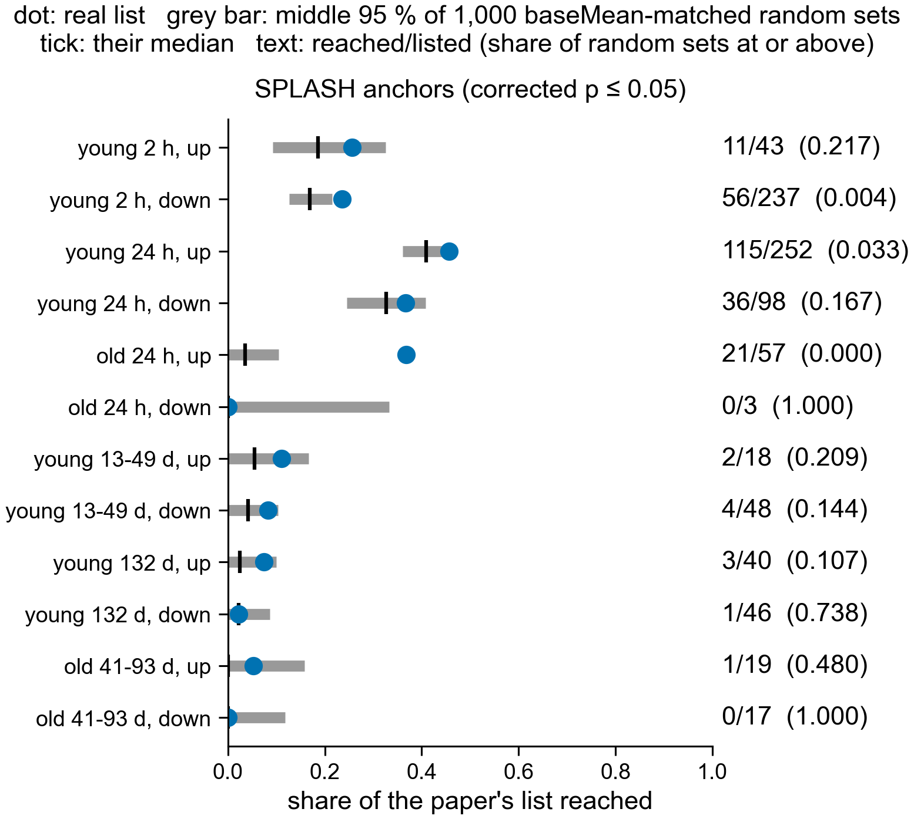

# Recovering the paper's gene lists (notebook 361)

The paper's named lists (SI Dataset S1, sheets "annotated DE all groups young/old") were made at
uncorrected p <= 0.05 and |log2 fold change| > 1 on its own reference-based DESeq2. This folder
asks how many genes on each list our reference-free channels reach, against a null fixed in
`design/ANALYSIS_PLAN.md` (2026-10-30) before the comparison was run.

How a gene is reached: a channel's sequences are extended into compactors, translated, matched
by sourmash to the old gene-model proteins (`botznik`, gene IDs g<N>), and kept when the
alignment check supports the match (E <= 1e-5, query coverage >= 50 %). The null: 1,000 random
gene sets of the list's size, drawn from the genes in the paper's DESeq2 sheet of that contrast,
matching the list's count in each baseMean decile. Both list and pool are limited to genes with an
old gene-model protein (all listed genes have one). Code: `scripts/paper_recovery.py`, figure
`scripts/plot_paper_recovery.py`.

## SPLASH anchors (corrected p <= 0.05), 2026-11-01

Numbers: `paper_recovery_splash.tsv` (Sherlock job 50702242). SPLASH has no direction, so its
reached genes are compared with the up list and the down list alike.

| list | reached | real share | null median (95 % range) | random sets at or above |
|---|---|---|---|---|
| young 2 h up | 11/43 | 0.26 | 0.19 (0.09-0.33) | 0.217 |
| young 2 h down | 56/237 | 0.24 | 0.17 (0.13-0.22) | 0.004 |
| young 24 h up | 115/252 | 0.46 | 0.41 (0.36-0.46) | 0.033 |
| young 24 h down | 36/98 | 0.37 | 0.33 (0.24-0.41) | 0.167 |
| old 24 h up | 21/57 | 0.37 | 0.04 (0.00-0.11) | 0.000 |
| old 24 h down | 0/3 | 0.00 | 0.00 (0.00-0.33) | 1.000 |
| young 13-49 d up | 2/18 | 0.11 | 0.06 (0.00-0.17) | 0.209 |
| young 13-49 d down | 4/48 | 0.08 | 0.04 (0.00-0.10) | 0.144 |
| young 132 d up | 3/40 | 0.08 | 0.03 (0.00-0.10) | 0.107 |
| young 132 d down | 1/46 | 0.02 | 0.02 (0.00-0.09) | 0.738 |
| old 41-93 d up | 1/19 | 0.05 | 0.00 (0.00-0.16) | 0.480 |
| old 41-93 d down | 0/17 | 0.00 | 0.00 (0.00-0.12) | 1.000 |

Three of 12 lists are reached more often than baseMean-matched random genes (share of random sets
at or above below 0.05): old 24 h up (21 of 57 against a null median of 2), young 2 h down and
young 24 h up. The other 9 are within the null. No correction for testing 12 lists was made; at
a Bonferroni cut of 0.05/12 = 0.004, old 24 h up and young 2 h down remain.

Limits:
- old 24 h is 2 control and 2 PEC samples from one colony, so it is low power and says nothing
  beyond that colony (ANALYSIS_PLAN.md).
- SPLASH treats every sample as independent, so its anchors in young 2 h and young 24 h, where
  samples come in pairs, are likely too many.
- The paper's lists and our channels come from the same reads. Agreement is corroboration, not
  an independent repeat.
- Reaching a gene means a peptide of 20 or more residues matched its protein. A gene family with
  close paralogs can be reached through a paralog.
- This is not full reproduction: most listed genes are not reached, and the lists themselves did
  not pass correction in the paper's own DESeq2 (0 genes at corrected p <= 0.05 in 4 of 6
  contrasts).

## Anchor counts, DESeq2, at the paper's cutoff

Pending: pipeline process `compactors_nominal` extends the anchors whose anchor-count DESeq2 fit
passes uncorrected p <= 0.05 and |log2FC| > 1 (primary design: ~ pair + condition; young_132d
~ genotype + condition), `search` matches them, and `paper_recovery` reruns both channels into
`$SCRATCH/nb361-pec/paper_recovery/`. Anchors kept (count on 2026-11-01):

| contrast | anchors fitted | kept | up | down |
|---|---|---|---|---|
| young_2h | 4654616 | 34741 | 7509 | 27232 |
| young_24h | 4129843 | 26245 | 8372 | 17873 |
| old_24h | 814823 | 51565 | 18068 | 33497 |
| young_13_49d | 210910 | 6772 | 5699 | 1073 |
| young_132d | 244983 | 12998 | 6056 | 6942 |
| old_41_93d | 220616 | 3940 | 3048 | 892 |

The DE-kupl and KaMRaT channels are not included at the paper's cutoff: their outputs keep only
corrected p-values (KaMRaT) or no fold change for every k-mer (DE-kupl's raw p-value file).
