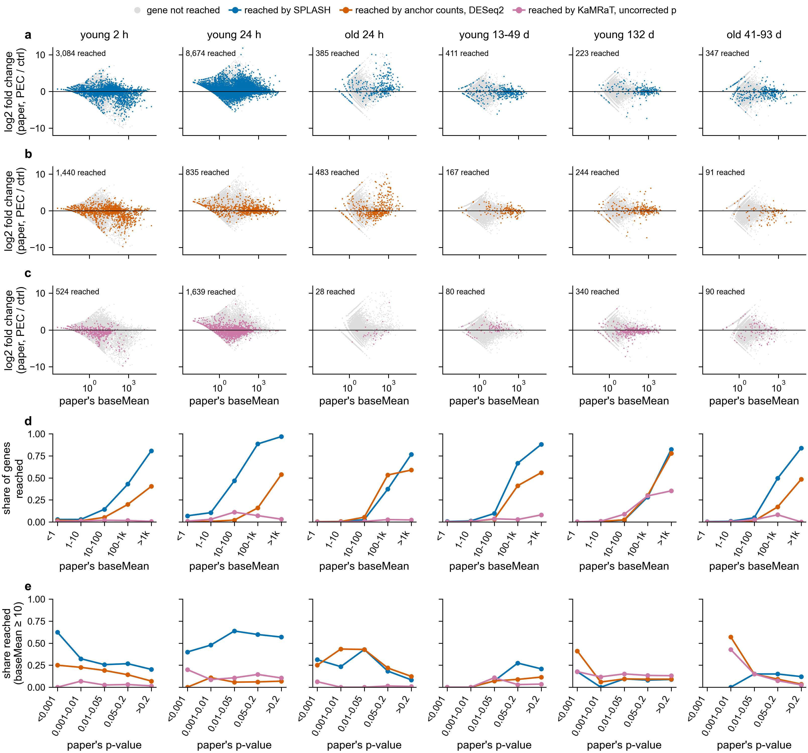

# Do the k-mer routes find the paper's most changed genes? (notebook 361)

Asked 2026-11-02: do SPLASH, DESeq2 on anchor counts, or KaMRaT find the most differentially
expressed genes, and what kinds of genes do they find?

**a-c.** One dot per gene with the paper's baseMean > 0. x: the paper's baseMean (mean normalised
count). y: the paper's DESeq2 log2 fold change, PEC over control. Light grey: not reached. Blue (a):
reached by SPLASH. Vermillion (b): reached by DESeq2 on anchor counts (p <= 0.05, 2-fold). Reddish
purple (c): reached by KaMRaT at uncorrected p <= 0.05, 2-fold (see "KaMRaT at uncorrected p").
**d.** Share of genes reached in each baseMean bin. **e.** Among genes with baseMean >= 10, share
reached in bins of the paper's p-value. The bins below p = 0.001 hold only 1 to 17 genes per contrast.

Code: `scripts/reached_genes.py` (Sherlock job 50777735, 2026-11-02; rerun with KaMRaT as job
50780421) and `scripts/plot_reached_vs_paper_de.py`. Numbers: `reached_genes.tsv` (one row per
contrast, route and gene) and `reached_vs_paper_de_bins.tsv` (the numbers behind d and e).

A gene is reached when one of the route's peptides (20 or more residues) aligns to its old
gene-model protein with E <= 1e-5 and query coverage >= 50 %, the same rule as `../paper_recovery`.

## KaMRaT and DE-kupl

Both ran in all six real contrasts (KaMRaT 1.2 t-test, DE-kupl 1.3.5 limma and DESeq2) and kept
0 k-mers after correction, so they reach no genes. In the simulated control they kept 196,784
(KaMRaT) and 226,785 (DE-kupl limma) k-mers.
KaMRaT at the uncorrected cutoff is in the next section.

## KaMRaT at uncorrected p

Asked 2026-11-02: which genes does KaMRaT reach at the same uncorrected cutoff as the anchor-count
route (p <= 0.05 and 2-fold)?

KaMRaT 1.2 writes only its corrected p. `scripts/select_kamrat_nominal.py` recomputes the
uncorrected p with KaMRaT's own test, read from its source (`Scorer::LogTtestScore`, tag v1.2.0):
a Welch t-test (unequal variances) on log2(count + 1), PEC against control. The counts are the
per-sample columns of `kamrat_ttest/contigs_all.tsv.gz`: for each contig, the mean over its k-mers
of KaMRaT's normalised counts (each sample scaled so its k-mer counts sum to 1e9). KaMRaT itself
tests each k-mer and gives a contig its k-mers' smallest p; those per-k-mer values were not kept,
so here each contig is tested once on its mean counts. Fold change is the PEC mean minus the
control mean of log2(count + 1). Kept: p <= 0.05 and |log2 fold change| >= 1.

Check on the simulated control, where KaMRaT's corrected p is not all 1: for the 618 contigs made
of one k-mer (so the counts are exactly that k-mer's), the recomputed p is never above KaMRaT's
corrected p, and the two rank the contigs the same way (Spearman 0.99999999).

The kept contigs went through the same peptide search as every other route (peptides of 20 or more
residues, sourmash, parasail). This ran as a standalone job, `slurm/16_kamrat_nominal.sbatch`
(Sherlock job 50779357, 2026-11-02), with the same commands as the new `kamrat_nominal` process and
`kamrat_nominal` search source in `nextflow-runs/pec-domen2026/main.nf`; it wrote to the same
folders (`contrasts/<c>/kamrat_nominal`, `contrasts/<c>/search_kamrat_nominal`), so a later
pipeline run finds them. Each contrast took under 2 minutes. Table: `kamrat_nominal_table.tsv`
(`scripts/kamrat_nominal_table.py`).

| contrast | contigs tested | p <= 0.05 | and 2-fold (up / down in PEC) | peptides | genes reached | paper up list reached | paper down list reached |
|---|---|---|---|---|---|---|---|
| young 2 h | 4,442,363 | 29,301 | 28,703 (1,504 / 27,199) | 5,153 | 631 | 1 of 43 | 9 of 237 |
| young 24 h | 6,432,394 | 118,268 | 106,099 (1,094 / 105,005) | 17,700 | 1,751 | 11 of 252 | 29 of 98 |
| old 24 h | 643,205 | 164 | 150 (35 / 115) | 127 | 28 | 1 of 57 | 0 of 3 |
| young 13-49 d | 272,062 | 762 | 634 (268 / 366) | 526 | 87 | 2 of 18 | 0 of 48 |
| young 132 d | 186,160 | 17,798 | 14,463 (9,727 / 4,736) | 3,475 | 391 | 1 of 40 | 6 of 46 |
| old 41-93 d | 331,434 | 1,567 | 1,512 (452 / 1,060) | 670 | 101 | 1 of 19 | 0 of 17 |

For comparison, the paper-list genes reached (up list / down list) by anchor counts: young 2 h 7 / 42,
young 24 h 10 / 1, old 24 h 23 / 0, young 13-49 d 1 / 3, young 132 d 6 / 2, old 41-93 d 0 / 0; by
SPLASH: 11 / 56, 115 / 36, 21 / 0, 2 / 4, 3 / 1, 1 / 0. A listed gene counts as reached in either
direction. "Genes reached" counts every gene model hit; the panels count fewer (524 in young 2 h)
because they show only genes in the paper's sheet with baseMean > 0.

What this shows:

- At the uncorrected cutoff KaMRaT does keep contigs, from 150 (old 24 h) to 106,099 (young 24 h),
  but most contigs are short: only 1,518 of young 2 h's 28,703 give a peptide of 20 residues.
- Unlike SPLASH and anchor counts, KaMRaT does not favour highly expressed genes (d). In young 24 h
  it reaches 11.1 % of genes with baseMean 10-100 and 3.1 % of genes above 1,000, where SPLASH
  reaches 46.6 % and 96.9 %. In young 2 h it reaches at most 1.9 % of any expression bin.
- It reaches few of the paper's listed genes, except young 24 h's down list (29 of 98, against 1
  for anchor counts and 36 for SPLASH).
- In young 2 h and young 24 h almost every kept contig is lower in PEC (27,199 of 28,703 and
  105,005 of 106,099). These are the two contrasts where control samples have 2.6
  to 3.4 times the reads of PEC samples (`../read_depth`). KaMRaT scales each sample to the same
  total, but a k-mer seen a few times in a deep control sample can be absent from a shallow PEC
  sample, and log2(0 + 1) = 0 then looks like a large drop. This one-sidedness is likely a depth
  effect, not biology; it was not tested further.

## What decides whether a gene is reached: its expression, not its fold change

- Reach rises steeply with expression (c). In young 24 h, SPLASH reaches 7 % of genes with
  baseMean below 1 and 97 % of genes above 1,000; anchor counts reach 1 % and 54 %.
- Reach barely depends on the paper's p-value once expression is held above 10 (d). In young 24 h,
  SPLASH reaches 40 to 64 % in every p-value bin. Only young 2 h shows a trend: SPLASH reaches 62 %
  of the 8 genes with p < 0.001 and 20 % of genes with p > 0.2.
- In a and b, the reached genes sit at the high-expression end, spread over all fold changes. The
  genes with the largest fold changes are mostly lowly expressed and mostly not reached.

So neither route picks out the paper's most changed genes. Both pick out highly expressed genes,
which have the most reads, so any small difference in their k-mers passes a test.

## What kinds of genes

Gene names from the paper's sheet, genes with baseMean >= 10 and a real name, tallied by name
prefix (a rough grouping, not a GO analysis):

| group (name prefix) | young 2 h, SPLASH | young 24 h, anchor counts | all expressed genes | genes with baseMean >= 100 |
|---|---|---|---|---|
| ribosome, translation (RPL, RPS, EEF, EIF) | 7.2 % | 17.7 % | 2.5 % | 8.7-9.7 % |
| cytoskeleton, muscle (ACT, TUB, MYH, MYL, TPM, TNN, ...) | 4.1 % | 10.8 % | 1.5 % | 3.3-3.4 % |
| mitochondria, energy (ATP5, COX, NDUF, UQCR, ...) | 2.8 % | 3.0 % | 1.3 % | 3.2-3.8 % |

SPLASH's genes look like highly expressed genes in general. Anchor counts in young 24 h have more
ribosome and cytoskeleton genes than even the highly expressed set: these are large families of
similar genes, so an anchor shared by several paralogs can reach all of them.

Where the paper's own small p-values are, both routes do reach some of the paper's top genes. In
young 2 h, both reach Cldn1, Mfge8, HMCN1, Uqcrc2, GSTM4 and TPM1 (paper p 0.0006 to 0.005, all
lower in PEC). In young 24 h, both reach COL12A1 and KLK6 (higher in PEC).

## Limits

- "Reached" is a peptide match, not a measured change in that gene.
- The p-value bins in d use the paper's uncorrected p-values; the paper's corrected p-values keep
  almost nothing (see `../kmer_methods/kmer_methods_counts.md`).
