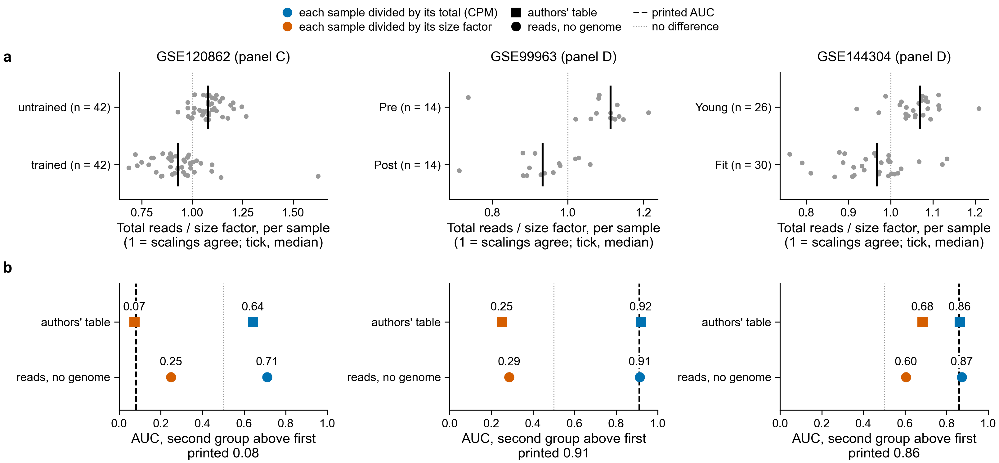
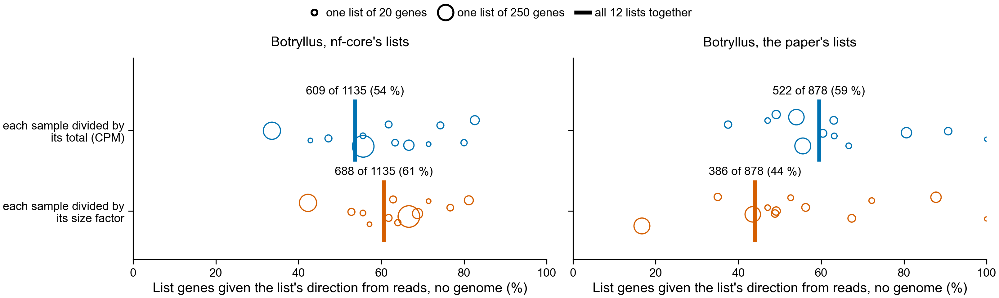

# One way of scaling a sample, tried everywhere reads are counted: result (notebook 361)

Plan and rules, written and pushed before anything here was rescored:
`../../design/sample_scaling/README.md`. Run 2026-11-10; Botryllus scoring is Sherlock job 51857328
(51 s, 0.8 GB).

**Result: scaling by size factor is not a fix. It changes the answer in every data set, and in each
one it moves the result toward whichever reference was scaled the same way.**

- Human, Fig. 4C-D score: with size factors, 0 of 3 series give the printed AUC, from reads or from
  the authors' own count tables. With totals (CPM) it was 2 of 3. No one scaling gives all three.
- Botryllus, up or down per gene: agreement with nf-core's lists goes up (54 % to 61 %) and
  agreement with the paper's lists goes down (59 % to 44 %). The plan asked for both to go up.

"Total" below means each sample's counts divided by its total (counts per million, CPM). "Size
factor" means divided by its DESeq2 `poscounts` size factor, which follows the typical gene and not
the few genes with the most reads.

## Human: the direction of the Fig. 4C-D score follows the scaling in all three series

**a.** Each sample's total reads divided by its size factor, from reads counted with no genome (all
reads). At 1 the two scalings treat the sample alike. **b.** AUC of the score, the chance that a
sample of the second group scores above one of the first, with all reads.

| series | printed AUC | authors' table, total | authors' table, size factor | reads, total | reads, size factor |
|---|---|---|---|---|---|
| GSE120862 | 0.08 | 0.64 | 0.07 | 0.71 | 0.25 |
| GSE99963 | 0.91 | 0.92 | 0.25 | 0.91 | 0.29 |
| GSE144304 | 0.86 | 0.86 | 0.68 | 0.87 | 0.60 |

Files: `human_auc_by_scaling.tsv`, `human_sample_totals.tsv`, `fig4_reads/` (reads, all four shares
of reads, size factor), `fig4_gene_tables/` (authors' count tables, size factor). The total columns
are from `../fig4_score_from_reads/`. For GSE120862 the authors' table is their FPKM table scaled to
equal totals (total) and their DESeq-normalised counts as on GEO (size factor), from
`../fig4_score_from_reads/gse120862_scale_check/`.

1. **Each printed AUC comes back only under the scaling its GEO table already had.** GSE120862 is on
   GEO scaled by DESeq and prints 0.08; its size-factor column gives 0.07. GSE99963 and GSE144304
   are on GEO as counts, were scored as CPM, and print 0.91 and 0.86; their total columns give 0.92
   and 0.86.
2. **The known-answer check of the plan (row B) fails for both count tables.** With size factors the
   authors' own tables give 0.25 and 0.68, more than 0.15 from the printed 0.91 and 0.86. By the
   plan, the reads' size-factor results for those two series are then not read as a test of counting
   with no genome. They are in the table because they move the same way as the authors' tables.
3. **In all three series the second group has a lower total for its size factor** (panel a): median
   0.93 against 1.08 (GSE120862, trained against untrained), 0.93 against 1.11 (GSE99963, after
   against before), 0.97 against 1.07 (GSE144304, fit old against young). That ratio alone separates
   the groups with AUC 0.11, 0.08 and 0.13. So CPM raises every gene of the second group by about
   10 to 20 %, and the score, which adds up about 230 genes with mostly positive weights, follows.
4. **Rule 1 by share of reads, size factor:** no series passes at any share
   (`fig4_reads/fig4_reads_comparisons.tsv`). GSE120862 gives 0.25, 0.30, 0.43 and 0.57 from all
   reads down to 1/1000.
5. **Reads and authors' tables still agree with each other under either scaling** (columns 3 against
   5, and 4 against 6, differ by 0.01 to 0.18). The disagreement is between scalings, not between
   counting with and without a genome.

What this means for the question "is Fig. 4C-D reproduced": the panel's separation of the groups in
these three series depends on how samples were scaled, and the three series were not scaled the same
way. A genome-free method can match each panel only by copying that panel's scaling.

## Botryllus: closer to nf-core, further from the paper

One circle per list (up or down, in each of six contrasts), sized by the number of genes in it; the
bar is all 12 lists together. Rule `size_factor_mean` of `scripts/gene_directions.py` is the
`sample_mean` rule with size factors in place of totals; the cutoffs (10 reads, 2-fold) are the same.

| lists | total (`sample_mean`) | size factor (`size_factor_mean`) | lists that beat 1,000 random gene sets |
|---|---|---|---|
| nf-core's, p <= 0.05 and 2-fold | 609 of 1,135 (54 %) | 688 of 1,135 (61 %) | 11 of 12, then 12 of 12 |
| the paper's | 522 of 878 (59 %) | 386 of 878 (44 %) | 11 of 12, then 11 of 12 |
| simulated control, planted genes right | 292 of 300, 0 wrong | 292 of 300, 0 wrong | unchanged genes given a direction: 25, then 15, of 2,600 |

Files: `botryllus_lists_by_scaling.tsv`, `botryllus/` (the scoring tables and each sample's factor),
`control/`. The `sample_mean` numbers were rerun in the same job and match the earlier ones.

1. **By the plan's rule, scaling is not the cause of the gap**: one share went up and one went down.
2. **The nf-core run used `poscounts` size factors, and the rule now agrees with it more.** The gain
   is in the two largest lists, down at 24 h (267 to 320 of 480) and down at 2 h (100 to 126 of 298).
3. **The loss against the paper is almost all one list**: up at 24 h in young colonies, 140 of 252
   with totals and 42 of 252 with size factors. nf-core's own list for that contrast has 35 genes up.
   So that list of the paper's exists under one scaling and mostly not under the other.
   `nextflow-runs/botryllus-pec-young/README.md` (PR 207) already found that the size-factor setting
   changes the number of genes at 2 h from 686 to 171.
4. **The two young contrasts at 2 h and 24 h have very uneven samples**: the largest size factor is
   174 and 171 times the smallest (`botryllus/factors_new_proteome.tsv`), against 2 to 8 times in
   the other four contrasts.

## The size factors themselves

`scripts/pec_analysis_utils.py::poscounts_size_factors`, tested in `tests/test_sample_scaling.py`.
PyDESeq2 0.5.4 leaves out genes whose only counts are single reads; the R code of DESeq2, as read,
does not. The function follows R. With those genes left out as well it matches PyDESeq2 exactly on
all six contrasts and both proteomes; with them kept, factors differ from PyDESeq2's by up to 29 %
in these shallow samples (job output, and `scripts/sample_scaling_factors.py`). It was not run
against R DESeq2 itself.

For GSE99963 the result also depends on which size factor is used: the default factor (genes with a
read in every sample) gives 0.54 from the authors' table where `poscounts` gives 0.25. The plan fixed
`poscounts`; this one comparison was run after its result was seen.

## Limits

- The plan was written after GSE120862 was known to turn with the scaling. Everything else was
  scored after the plan was pushed (commit a328a63c).
- Nothing here says which scaling is right. It says the two disagree, by how much, and in which
  direction.
- The k-mer transfer test (`de2de_test.py`) still uses CPM, as the plan says.
- PR 212 (score from the authors' tables) and PR 213 (microarrays) are not changed.
