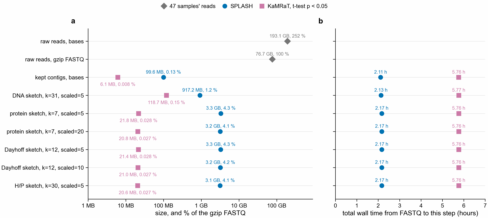
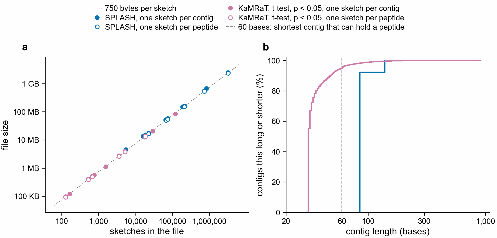
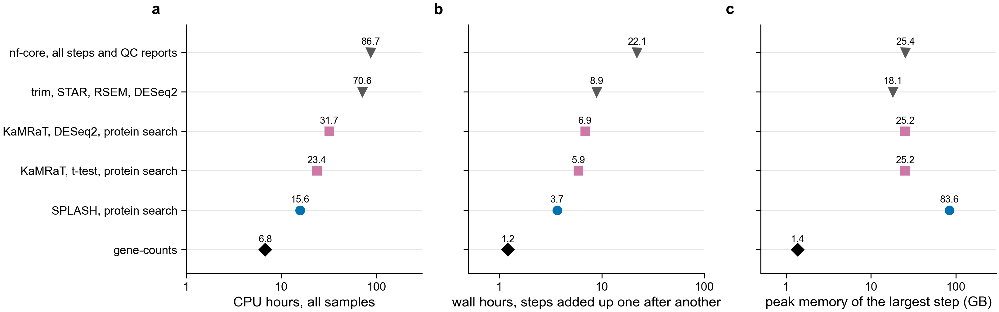

# Data size at each step (notebook 361)

## Why SPLASH and KaMRaT change in opposite ways

**a.** Each point is one contrast, route and sketch setting. **b.** Contig lengths, six contrasts
together. Numbers: `sketch_size_vs_count.tsv`, `contig_lengths.tsv`. Code: `scripts/plot_sketch_counts.py`,
`scripts/contig_lengths.py` (run on Sherlock 2026-11-06).

A sketch file is about 750 bytes per sketch (710 to 820 across routes and settings), so its size
follows the number of sketches, not the number of bases. A DNA file has one sketch per contig, and a
protein, Dayhoff or H/P file has one per peptide of 20+ residues.

| | contigs | mean length | contigs of 60+ bases | peptides | peptides per contig |
|---|---|---|---|---|---|
| SPLASH | 1,116,488 | 89 | 1,116,488 (100 %) | 4,285,316 | 3.8 |
| KaMRaT | 167,860 | 37 | 8,744 (5.2 %) | 28,333 | 0.17 |

A peptide of 20 residues needs 60 bases. Every SPLASH contig is long enough, and each gives 3.8
peptides, so its protein files are 3.6 times its DNA file. Only 5.2 % of KaMRaT contigs are long
enough, so its protein files are about 1/5 of its DNA file. Those long KaMRaT contigs give 3.2 peptides each,
close to SPLASH's rate. Contigs get 9 to 19 times bigger as DNA sketches because a 37 to 89 base contig
is stored in about 750 bytes.

## Size and time at each step

Measured 2026-11-05 by `scripts/route_sizes.py` (job 51207173) and `scripts/sketch_settings.py` (job
51225670). Figure: `scripts/plot_route_sizes.py`. Numbers: `raw_fastq.tsv`, `route_sizes.tsv`,
`sketch_settings.tsv`, `fastp_time.tsv`, `sizes_by_step_botryllus.tsv`.

Botryllus, 47 samples, six contrasts added up. A contig kept in two contrasts counts twice. % is of the
gzip FASTQ. Total time runs from the FASTQ to that step: fastp trimming, then the route's steps to
contigs, then that one sketch, one after the other.

| step | SPLASH | % | total wall, CPU | KaMRaT (t-test, p < 0.05) | % | total wall, CPU |
|---|---|---|---|---|---|---|
| kept contigs, bases | 99.6 MB | 0.13 | 2.11 h, 10.5 h | 6.1 MB | 0.008 | 5.76 h, 23.1 h |
| DNA sketch, k=31, scaled=5 | 917 MB | 1.2 | 2.13 h, 10.5 h | 119 MB | 0.15 | 5.77 h, 23.1 h |
| protein sketch, k=7, scaled=5 | 3.31 GB | 4.3 | 2.17 h, 10.6 h | 21.8 MB | 0.028 | 5.76 h, 23.1 h |
| protein sketch, k=7, scaled=20 | 3.18 GB | 4.1 | 2.17 h, 10.6 h | 20.8 MB | 0.027 | 5.76 h, 23.1 h |
| Dayhoff sketch, k=12, scaled=5 | 3.27 GB | 4.3 | 2.17 h, 10.6 h | 21.4 MB | 0.028 | 5.76 h, 23.1 h |
| Dayhoff sketch, k=12, scaled=10 | 3.21 GB | 4.2 | 2.17 h, 10.6 h | 21.0 MB | 0.027 | 5.76 h, 23.1 h |
| H/P sketch, k=30, scaled=5 | 3.14 GB | 4.1 | 2.17 h, 10.6 h | 20.6 MB | 0.027 | 5.76 h, 23.1 h |

For reference: FASTQ gzip 76.7 GB (100 %), bases 193.1 GB (252 %), 643.5 M read pairs, of which fastp
kept about 70 % (449 M), the number used in `../cheap_route/README.md`. SPLASH keeps
1,116,488 contigs and 4,285,316 peptides of 20+ residues; KaMRaT keeps 167,860 and 28,333.

- **Correction:** the first version of this table gave 1.69 GB, 1.64 GB and 1.47 GB for SPLASH sketches.
  That summed the sketch members of one zip holding all three types and left out the zip's own index and
  manifest. The numbers here are each setting's whole zip on disk, which is what a user stores.
- A higher scaled cuts k-mers, not the file. Protein k-mers fall from 17.4 M to 4.3 M at scaled=20, and
  Dayhoff from 13.4 M to 6.8 M at scaled=10, but the SPLASH zips shrink by 4 % and 2 %. Each peptide
  has its own sketch, about 740 bytes, and nearly all of that is the sketch's wrapping. The k-mers
  alone at 8 bytes each would be 35 MB at protein scaled=20. One sketch per contrast should be far
  smaller. That was worked out, not tested, and such a sketch cannot say which peptide matched.
- Sketching adds little time. All sketches take under 4 min in total per setting; trimming takes 0.61 h
  and getting to contigs 1.50 h (SPLASH) or 5.15 h (KaMRaT), and that KaMRaT time holds DE-kupl's
  limma test, so it is an upper limit. Peptide translation is left out.
- Contigs are uncompressed bases set against a gzip file, so their % is not like for like.
- The DNA sketches were made only to measure this. The search uses protein, Dayhoff and H/P.

Human: FASTQ gzip is 175.3 GB for GSE120862, 59.8 GB for GSE144304 and 19.8 GB for GSE99963, all
samples of each series. Contigs and peptides per contrast are in `route_sizes.tsv`. Peptide counts
are 0 there where the peptide files were not kept, and the human sketch zips were not kept, so human
sketch sizes are not measured.

## Against alignment and DESeq2

Asked 2026-11-06: is the time in the figure above total wall time, and is the k-mer route cheaper than
alignment plus DESeq2? `scripts/alignment_route_cost.py` adds the alignment route from the nf-core
traces in `/scratch/users/olgabot/nb361-pec/nfcore/` (jobs 51082907, 51207126). Numbers:
`alignment_vs_kmer_cost.tsv`, `alignment_vs_kmer_cost.by_process.tsv`.

The times above are neither a real waiting time nor one job's time. Each step uses its own threads, and
the steps' wall times are added as if they ran one after the other. All routes here start at the FASTQ
and include trimming: nf-core used the routes' fastp-trimmed reads, so fastp's 3.5 CPU h and 0.61 h are
added to its rows. The KaMRaT and SPLASH rows include the protein search, which the figure above
leaves out, so they are larger than its 5.76 h and 2.11 h. SPLASH has no search record for young 132 d.

| route | CPU h | wall h, added up | peak GB |
|---|---|---|---|
| nf-core, all steps and QC reports | 86.7 | 22.1 | 25.4 |
| trim, STAR, RSEM, DESeq2 | 70.6 | 8.9 | 18.1 |
| KaMRaT, DESeq2, protein search | 31.7 | 6.9 | 25.2 |
| KaMRaT, t-test, protein search | 23.4 | 5.9 | 25.2 |
| SPLASH, protein search | 15.6 | 3.7 | 83.6 |
| gene-counts | 6.8 | 1.2 | 1.4 |

- nf-core ran 47 samples side by side, so a user waited less than its added-up time: 3.6 h with at least
  one task running for all of it, 2.5 h for indexes, STAR and RSEM, both without fastp. The k-mer routes were not
  timed this way, so there is no matching waiting time for them.
- STAR is 62.1 of the 86.7 CPU h. The 18.1 GB is building the STAR index; alignment itself peaks at 12.8 GB.
- DE-kupl's k-mer counting and limma test are 17.6 of KaMRaT's 23.4 CPU h, and the limma test is not
  needed by KaMRaT. KaMRaT's index, t-test and merge take 2.1 h on one CPU.
- gene-counts is a lead, not a replacement: see `../nfcore/README.md`. It also needs a proteome.
- Salmon, a usual fast alignment-free tool, has run only as a pilot on 2 samples (job 51349345,
  `nextflow-runs/pec-domen2026-nfcore/README.md`), so it has no row here yet. kallisto was not run.
