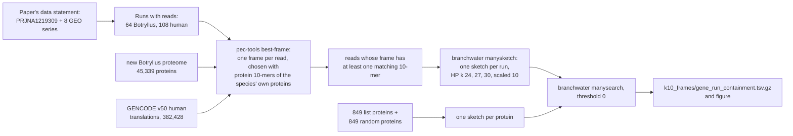
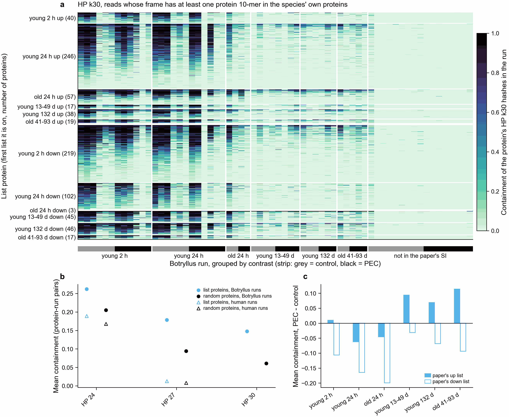
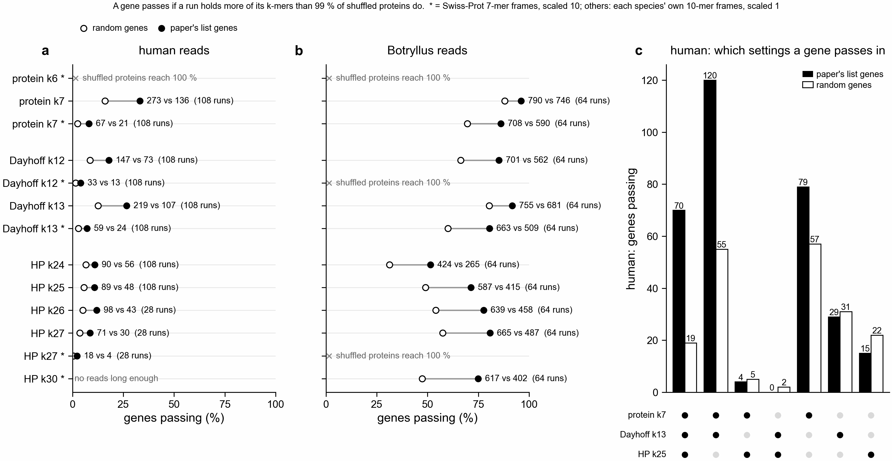

# Read search of the paper's datasets for the paper's PEC genes (notebook 361)

This is the "Shazam" step of notebook 361: look for the proteins of the genes on Domen et al.
2026's PEC lists in the raw reads of the sequencing datasets the paper names, using sourmash
protein-alphabet sketches. It asks whether a gene's protein k-mers are present in a run's
reads. It does not measure expression.



## Status (2026-11-03)

Done: frames from protein 10-mers, sketches and the containment search for all 172 runs, the
collected table and the figure, all in `k10_frames/`. The sections after "Frames from protein
10-mers" describe the earlier plan (Swiss-Prot 7-mer frames at share cutoffs 0.1 and 0.5, six
alphabet-k settings). Its search, Slurm job 50793573, finished on Sherlock
(`$S/sra_search/search_all`) but was not collected, because the plan changed; its files are
kept.

## Frames from protein 10-mers (2026-11-03)



**a**, containment of each list protein's HP 30-mers in each Botryllus run (white: the protein
has no hash at this setting). **b**, mean containment over protein-run pairs at each HP k, for
list proteins (sky blue) and length-matched random proteins (black), in Botryllus runs (filled
circles) and human runs (open triangles). No human point at HP k30: no human read is long
enough. **c**, per contrast, mean containment of the paper's up list (filled) and down list
(open) in PEC runs minus control runs, HP k30. HP is the 2-letter alphabet that writes each
amino acid as hydrophobic or polar. Containment is the share of a protein's sketched k-mers
found in the run.

### What changed and why

Olga's plan of 2026-11-03. The earlier search chose each read's frame by its protein 7-mers in
Swiss-Prot (UniProt's reviewed proteins). On Botryllus reads of known frame
(`../frame_shares/README.md`, "Which way finds a read's reading frame best?"), that picks the
true frame alone in 52 % of real reads and 72 % of reads cut from coding sequences (CDS).
Protein 10-mers against the new Botryllus proteome pick it in 95 % of both. That 95 % is a best
case: the test reads' own genes are in this proteome. With the read's gene left out it falls to
30 % (real) and 38 % (simulated), and most such reads get no 10-mer match, so they are dropped
rather than given a wrong frame.

- **Frame rule** (unchanged apart from k and reference; `pec-tools best-frame`, rule
  `orpheum`): a read whose nucleotide complexity (fastp's measure) is below 0.3 gets no frame;
  a frame is allowed only if it has no stop codon and is not a low-complexity peptide (distinct
  10-mers at most half its windows); the allowed frame with the most protein 10-mers in the
  reference wins (first in frame order on ties).
- **References.** Botryllus runs: the new-genome proteins, `$S/db/new_genome/protein.fasta`
  (45,339 proteins, 11,729,709 distinct 10-mers, sha256
  `843407c15dacecc88d9c88c982e77c0ca835a6bd1330fd4abf635b5df547d855`; the same file the
  frame-method test used). Human runs: GENCODE release 50 (the latest on 2026-11-03),
  `ftp://ftp.ebi.ac.uk/pub/databases/gencode/Gencode_human/release_50/gencode.v50.pc_translations.fa.gz`,
  382,428 translations, 156,684,458 residues, 13,569,110 distinct 10-mers; sha256 of the .gz
  `5d6408c3a1c22d864c96a55367cf5b69f1031dea1fe2cd6d03e366ae3fc56a45` (its MD5 matched the
  release's MD5SUMS). Stored at `$S/db/gencode_v50/`.
- **Kept reads.** A read is kept when its chosen frame has at least one matching 10-mer. No
  share cutoff (best-frame runs with cutoff 0, so output files are named `ge0`).
- **Search.** HP k = 24, 27 and 30 only, scaled 10, the same 1,698 queries as before
  (`$S/sra_search/queries/queries.faa`), threshold 0 so every protein-run pair is a row.
- Code: `slurm/26_sra_k10_frame_sketch.sbatch` (frame and sketch per run),
  `slurm/27_sra_search_hp_k10frames.sbatch` (search), `scripts/sra_k10_frames_table.py` (per-run
  table), `scripts/sra_collect.py`, `scripts/plot_sra_containment.py`. Outputs on Sherlock:
  `$S/sra_search/k10_frames/<run>/` and `$S/sra_search/search_hp_k10frames/`; code copy in
  `$S/sra_search/code_k10`.

### Reads kept per run

Per run in `k10_frames/k10_frames.tsv`; totals per species in `k10_frames/k10_frames_by_species.tsv`.
Each read is counted once, at the first step that drops it. The two mates of a Botryllus read
pair are counted separately.

| dataset | runs | reads | low-complexity read | no allowed frame | no 10-mer match | kept | kept per run (min, median, max) |
|---|---|---|---|---|---|---|---|
| PRJNA1219309 (Botryllus) | 64 | 911.0 M | 3.3 % | 24.0 % | 30.2 % | 42.6 % | 1.4 %, 42.8 %, 56.3 % |
| GSE99963 (human) | 28 | 409.1 M | 0.1 % | 2.5 % | 42.1 % | 55.2 % | 30.8 %, 56.0 %, 65.1 % |
| GSE144304 (human) | 80 | 1,432.3 M | 0.1 % | 6.9 % | 38.8 % | 54.2 % | 50.5 %, 54.3 %, 57.6 % |

Two Botryllus runs keep very few reads: JA117 (1.4 %) and JA116 (2.9 %), both old 24 h. In both,
89-90 % of reads have no allowed frame (every frame has a stop codon or is a repeat). The earlier
Swiss-Prot rule dropped the same share (92-93 % with no allowed frame, a number that then also
held the low-complexity reads). JA134 (not in the paper's SI, 7,208 reads) keeps 3.0 % and
JA151 (young 13-49 d) 6.1 %.

### Windows per kept read

A window is one stretch of k residues, the unit that is hashed: residues - k + 1 per read, or 0
when the read is shorter than k. Median over runs:

| dataset | residues per kept read | windows at k24 | k27 | k30 | kept reads with a k24 window | k27 | k30 |
|---|---|---|---|---|---|---|---|
| Botryllus | 31.3 | 9.5 | 7.5 | 5.8 | 69 % | 59 % | 51 % |
| GSE99963 | 26.4 | 3.4 | 0.38 | 0 | 100 % | 38 % | 0 % |
| GSE144304 | 24.7 | 1.7 | 0 | 0 | 100 % | 0 % | 0 % |

So at HP k27 only the 28 GSE99963 runs can be searched among the human runs (the 80 GSE144304
sketches are empty), and at HP k30 no human run can (`k10_frames/unsearchable.tsv`).

### Cost

From GNU `/usr/bin/time -v` per step (`k10_frames/k10_frames.tsv`) and sacct. Slurm jobs: pilot
50912910 (JA113 and SRR10970512), all runs 50913725 (array of 172, 32 at a time, 8 GB and 4 h
each; the two pilot runs were skipped as done), search 50913728.

| step | runs | CPU hours | CPU s per Gbp | peak memory (GNU time) | longest wall time |
|---|---|---|---|---|---|
| frame choice, Botryllus | 64 (90.8 Gbp) | 2.31 | 92 | 0.21 GB | 23 min (JA102) |
| frame choice, human | 108 (142.0 Gbp) | 4.87 | 124 | 0.21 GB | 6.7 min |
| manysketch, 3 HP settings | 172 | 1.01 | - | 0.53 GB | - |
| query sketch + manysearch, 3 HP settings, 8 threads | 1 job | 0.21 (sacct) | - | 0.93 GB | 6 min |
| sra_collect.py | 1 | - | - | 0.80 GB | - |

Slurm's own peak memory (sacct MaxRSS) per sketch task is higher, up to 4.8 GB for JA102. It
also counts the kept-peptide file in the node's disk cache; the programs themselves never used
more than 0.53 GB. The 10-mer reference sets take about 0.2 GB, against 1.8 GB for the earlier
Swiss-Prot 7-mers.

### Containment

`k10_frames/containment_by_setting.tsv` (per species), `k10_frames/containment_summary.tsv`
(per dataset and condition), `k10_frames/gene_run_containment.tsv` (the numbers in panels b
and c), and every protein-run pair in `k10_frames/gene_run_containment.tsv.gz`.

| HP k | runs | list proteins: mean | random: mean | list: pairs with any hash | random: pairs with any hash |
|---|---|---|---|---|---|
| 24 | Botryllus | 0.262 | 0.205 | 64 % | 61 % |
| 27 | Botryllus | 0.178 | 0.094 | 48 % | 39 % |
| 30 | Botryllus | 0.147 | 0.061 | 37 % | 25 % |
| 24 | human | 0.189 | 0.168 | 93 % | 92 % |
| 27 | human (GSE99963 only) | 0.013 | 0.008 | 25 % | 20 % |

The median containment is 0 at HP k27 and k30 in both species, so the table and panel b give
means.

- In Botryllus runs, list proteins have about twice the containment of random proteins at HP
  k27 and k30 (0.178 against 0.094, 0.147 against 0.061). At HP k24 the gap is small (0.262
  against 0.205). There are only 2^24 = 16.8 million HP 24-mers, and the larger runs hold tens
  of millions of windows, so many matches can happen by chance.
- In human runs, list and random Botryllus proteins score alike at HP k24 (93 % and 92 % of
  pairs with a matching hash), as chance matches would. HP k27 finds little (25 % and 20 %).
- Panel c: in all 6 contrasts the paper's down-list proteins have lower containment in PEC runs
  than in control runs (-0.03 to -0.20). The up-list proteins are higher in PEC in 4 of 6
  (young 2 h +0.01, young 13-49 d +0.09, young 132 d +0.07, old 41-93 d +0.11) and lower in
  young 24 h (-0.06) and old 24 h (-0.05). The old 24 h down list has 3 proteins. Containment
  is presence, and PEC and control runs differ in depth, so this is a direction check only.

### Limits

- Containment is presence of a protein's HP k-mers in a run's reads, not expression.
- The 95 % right-frame rate holds for reads from genes in the reference. Reads from genes
  missing from the new proteome, or human genes missing from GENCODE, mostly find no 10-mer and
  are dropped, so they cannot add to containment.
- HP k24 may be near chance level for runs this large, so k27 and k30 are the settings that
  separate list from random proteins, and they search Botryllus runs only (plus k27 on the
  GSE99963 runs).
- Each read is sketched alone, so a k-mer must fit inside one read's frame; in the median
  Botryllus run 31 % of kept reads are shorter than 24 residues and add no window at any setting.

## Which datasets were searched, and why

The paper's Data, Materials, and Software Availability statement (PMC full text, read on
2026-11-02) names one BioProject and eight GEO series. `paper_accessions.tsv` lists them with
where they are named; `paper_accession_runs.tsv` has every run from ENA's filereport API.

| accession | what the paper says it is | data | runs | Gbp | searched? |
|---|---|---|---|---|---|
| PRJNA1219309 | this study's Botryllus RNA-seq | RNA-seq | 64 | 196.4 | yes, all 64 runs |
| GSE99963 | human exercise data (Laker et al.) | RNA-seq | 28 | 33.1 | yes |
| GSE144304 | human exercise data (van der Hoek et al.) | RNA-seq | 80 | 108.9 | yes |
| GSE120862 | human exercise data (Popov et al.) | RNA-seq | 84 | 250.7 | no: over the 200 Gbp limit on its own |
| GSE104079 | mouse exercise data (Marosi et al.) | microarray | 0 | - | no reads |
| GSE27536 | human exercise data (Turan et al.) | microarray | 0 | - | no reads |
| GSE83578 | human exercise data (Abbasi et al.) | microarray | 0 | - | no reads |
| GSE111555 | human exercise data (da Silva et al.) | microarray | 0 | - | no reads |
| GSE28998 | human exercise data (Gordon et al.) | microarray | 0 | - | no reads |

All 64 Botryllus runs were already trimmed by fastp on Sherlock (`$S/trimmed/<sample>_{1,2}.fastq.gz`),
so none had to be downloaded; 17 of them are tiny runs the paper's SI does not use
(`not_in_SI`, 282 to 21,166 read pairs, plus sample 5553). The two human series together are
142 Gbp (under the 200 Gbp limit). They were downloaded untrimmed from ENA
(`slurm/21_sra_download.sbatch`: resumable `curl -C -`, retries, a speed floor, and an MD5 check;
the first attempt saved an HTTP error page for 32 runs, caught by the MD5 check, and was rerun
with `--fail`). The eight GEO series appear only in the Data Availability statement: "The human and mouse
exercise data have been published (43) and are publicly available with Gene Expression Omnibus
ids: ..." Their analysis is in ref 43, and the paper shows it in Fig. 4C-D ("adopted from (43)").
The human runs are a cross-species check: the Botryllus list proteins are not
expected to share many exact k-mers with human reads.

## Queries

`scripts/sra_build_queries.py`: the 878 rows of `exports/paper/paper_named_lists.tsv` name 823
distinct genes (g<N>, the old gene models the paper used). Every botznik protein of each gene is a
query: 849 proteins. A gene on several lists keeps all of them (`paper_list` column, joined by
`;`). The control is 849 botznik proteins from genes on no list, one per list protein, drawn at
random (seed 361) from the 25 non-list proteins nearest in length. Median length is 285 residues
in both sets.

## Frame choice for the reads

Olga asked for orpheum translate against Swiss-Prot, keeping the frame with the most matches,
instead of keeping every six-frame stretch of 30 or more residues.

- **orpheum itself.** orpheum 1.0.4 is not on bioconda. It installed from PyPI into
  `$S/env_orpheum` (Python 3.8, khmer, and sourmash 2.3.1, because it imports
  `sourmash._minhash`, which sourmash 3 removed), but its `--csv` and `--parquet` options fail with
  the installed click. It ran on a 1-in-50 sample of the test reads (20,798 reads): 9.1 CPU-s for
  2.29 Mbp, about 4,000 CPU-s per Gbp, or about 100 CPU-hours for the 90.8 Gbp of trimmed
  Botryllus reads.
- **pec-tools best-frame** (`pec-tools/src/best_frame.rs`) applies orpheum's rule as a compiled
  loop: a read whose nucleotide complexity (fastp's measure, as orpheum uses it) is below 0.3 gets
  no frame; a frame can be chosen only if it has no stop codon and is not a low-complexity peptide
  (distinct 7-mers at most half its windows); among those, the frame with the most 7-mers found
  in Swiss-Prot wins (first frame on ties; ties are counted). The share is matching 7-mers over
  all 7-mer windows of the frame. Alphabet and k are orpheum's defaults: protein, k = 7. Swiss-Prot
  is `$S/db/swissprot.faa` (575,748 proteins, 89,732,459 distinct 7-mers). It runs at about 100
  CPU-s per Gbp of reads (97.5 on the largest run, JA102).
- **Agreement with orpheum** (`orpheum_vs_pectools.tsv`, the same 20,798 reads, cutoff 0.5): every
  read orpheum kept, pec-tools kept too. Of the real reads lying wholly in a CDS, orpheum kept 1,172
  of 4,952 (865 with the right frame) and pec-tools 1,306 (913 right). pec-tools keeps slightly
  more because orpheum's Bloom filter and its share over distinct k-mers differ in detail.
- The low-complexity rules matter: before they were added, 86 % of the reads with any Swiss-Prot
  match in runs JA116 and JA117 (old 24 h) had all their 7-mers in Swiss-Prot, and the most common
  such peptides were simple repeats (PNPNPN..., LTLTLT..., LGLGLG...;
  `slurm/25_full_match_reads.sbatch`).

## Frame choice tested on Botryllus genes

Figure: `frame_choice_botryllus_test.{png,svg,pdf}`; numbers: `frame_choice_botryllus_test.tsv`,
`frame_test_summary.tsv` (every setting, rule, read source, gene set and cutoff) and
`frame_test_hist.tsv`. Code: `slurm/20_sra_frame_test.sbatch`, `scripts/sra_frame_test_prepare.py`,
`scripts/sra_frame_test_score.py`, `scripts/plot_frame_test.py`.

- **Truth set.** The new Botryllus gene models Olga supplied: `$S/db/new_genome/cds.fasta` and
  `protein.fasta`, 45,339 records each (headers repeat between isoforms of one gene, so records
  are paired by order). cds.fasta sha256
  `82da01b1835c50180d90c8c0437d823e35ce385b0c55ef9f1dadb3780ac91b40`. 45,338 of 45,339 CDS
  translate (standard code, final stop removed) to exactly their protein; the one that does not
  was dropped.
- **Paper-list genes.** The paper's genes are old gene models (g<N>); they were linked to new
  genes by a DIAMOND 2.2.8 blastp of the 849 list proteins against protein.fasta (best hit with
  identity >= 90 % over >= 80 % of the old protein): 630 proteins link, to 591 new genes. 1,409
  other new genes were drawn at random (seed 361), 2,000 genes in all.
- **Reads cut from CDS.** 20 evenly spaced 150-nt reads per gene on a random strand (the trimmed
  reads are mostly 150 nt), 39,854 reads with known frame.
- **Real reads.** The first 250,000 read pairs of JA113 (PEC) and JA123 (control), both mates,
  1,000,000 reads, placed by DIAMOND blastx against all 45,338 checked proteins (identity >= 95 %).
  243,938 reads lie wholly in a CDS (hit over >= 90 % of the read), 109,431 partly (they run into
  a UTR, an intron or a neighbour; the frame of their coding part is known), and 646,631 have no
  such hit (UTRs, non-coding RNA, other genes); those have no known frame.

Result for protein k = 7, orpheum's rule:

| reads | right frame | no frame or no Swiss-Prot match | right-frame reads kept at >= 0.1 | at >= 0.5 |
|---|---|---|---|---|
| cut from CDS (39,854) | 73.4 % | 2.5 % | 92.3 % | 7.9 % |
| real, wholly in a CDS (243,938) | 54.5 % | 0.8 % | 96.5 % | 31.9 % |

- Choosing the frame by Swiss-Prot 7-mers is weak for Botryllus: the chosen frame is wrong for a
  quarter of reads cut from CDS and for nearly half of real coding reads. Wrong frames get many
  chance matches: Swiss-Prot holds 89.7 million of the 1.28 billion possible 7-mers, and a wrong
  frame of a Botryllus read often has 10 or more of its 44 7-mers in it (checked by brute force on
  three reads).
- **A cutoff does not separate right frames from wrong ones** until it throws most reads away
  (panel c): among kept reads, the share with the right frame stays at 74-76 % (cut from CDS) and
  54-55 % (real) for cutoffs up to 0.2.
- **0.5 throws away most right-frame Botryllus reads**: 92.1 % of those cut from CDS and 68.1 % of
  real ones. The cutoff used here is therefore **0.1**, which keeps 92.3 % and 96.5 % of
  right-frame reads. Olga's **0.5** is run as a second, labelled setting.
- Paper-list and random genes behave alike (right frame 74.3 % and 73.0 % of reads cut from CDS).
- Other settings (same table): Dayhoff k = 12 gives 74.1 % and 50.6 % right, and at 0.5 keeps
  56.6 % and 77.1 % of right-frame reads, so it is the setting to use if a 0.5 cutoff must stay.
  Protein k = 5 and k = 6 are not useful: 97.6 % of all possible 5-mers and 53 % of 6-mers are in
  Swiss-Prot, so nearly every window matches.

`frame_matches.{png,svg,pdf}` (numbers in `frame_matches.tsv`, `frame_matches_hist.tsv`) shows,
for every run, the share of the chosen frame's 7-mers in Swiss-Prot, the number of matching
7-mers, and the reads kept at each step.

## Alphabets and k sizes

The k for Dayhoff and protein were matched to HP k = 27 and k = 30 by bits per k-mer, with the
real Shannon entropy of each alphabet's letters under the amino-acid background
(`bits_per_kmer` and `entropy_per_symbol` in `notebooks/ortholog_analysis_utils.py`):

| alphabet | bits per letter | k nearest to HP k27 (27.0 bits) | k nearest to HP k30 (30.0 bits) |
|---|---|---|---|
| HP | 1.000 | 27 (27.0 bits) | 30 (30.0 bits) |
| Dayhoff | 2.278 | 12 (27.3 bits) | 13 (29.6 bits) |
| protein | 4.176 | 6 (25.1 bits; k7 has 29.2) | 7 (29.2 bits) |

So the six settings are HP 27 / Dayhoff 12 / protein 6 and HP 30 / Dayhoff 13 / protein 7.
(The project's usual pairing HP 30 / Dayhoff 12 / protein 7 puts Dayhoff 12 nearer HP 27.)
Every run and query is sketched at scaled 10.

## Botryllus list genes in human reads, by alphabet (2026-11-08)



The paper's Botryllus list genes (823) and baseMean-matched random Botryllus genes (848) were searched
against every human and Botryllus run. A gene passes in a species if, in some run, its share of k-mers
found is above what 99 % of shuffled copies of the same proteins reach, with at least 2 shared hashes.
Scripts: `scripts/sra_alphabet_reach.py`, `scripts/plot_sra_alphabet_overlap.py`. Tables:
`alphabet_overlap.tsv`, `alphabet_overlap.overlap.tsv`, `alphabet_reach/`, `hp24_27_reach/`,
`pd_k10_reach/`.

Two sketching methods are shown. Rows marked * use the old one:

- Own frames, no mark: protein k7, Dayhoff k12, k13 and HP k24 to 27. Reading frames chosen with each
  species' own protein 10-mers, scaled 1 (HP: jobs 51358172, 51553711, 51553712; protein and Dayhoff:
  jobs 51564143, 51564147, table `pd_k10_reach/`).
- * protein k6, k7, Dayhoff k12, k13, HP k27, k30: frames chosen with Swiss-Prot 7-mers, scaled 10
  (job 51357984). Kept only to show how much the method changes the count.

The method matters a lot. In human reads, protein k7 passes 273 list genes the new way and 67 the old
way; HP k27 passes 71 and 18. The two methods differ in frame rule, scaled and cutoff together, so the
gap cannot be put down to one of them. Only the rows without * can be ranked against each other.

Human reads, new method:

| setting | runs | list genes passing (of 823) | random genes passing (of 848) | list minus random |
|---|---:|---:|---:|---:|
| protein k7 | 108 | 273 | 136 | 137 |
| Dayhoff k12 | 108 | 147 | 73 | 74 |
| Dayhoff k13 | 108 | 219 | 107 | 112 |
| HP k24 | 108 | 90 | 56 | 34 |
| HP k25 | 108 | 89 | 48 | 41 |
| HP k26 | 28 | 98 | 43 | 55 |
| HP k27 | 28 | 71 | 30 | 41 |

Old method, for comparison: protein k7 * 67 against 21, Dayhoff k12 * 33 against 13, Dayhoff k13 *
59 against 24, HP k27 * 18 against 4.

- **Protein k7 reaches the most list genes:** 273 of 823 (33 %), twice the 136 random genes. Every
  alphabet passes about twice as many list genes as random genes, so none is more specific than the
  others; protein k7 is just the most sensitive.
- **HP k25 against k24 to 27:** k25 is the largest HP k that can still search all 108 human runs.
  At k26 and above, only the 28 GSE99963 runs have reads long enough.
- **Protein k6 and the Botryllus rows marked x:** shuffled proteins reach 100 % containment, so the
  cutoff is 1.0 and nothing can pass. That is a limit of this cutoff, not a sign that no gene reaches.
  With the new method, Botryllus Dayhoff k12 has a cutoff of 0.61 and can pass genes.
- **HP k30 in human:** not run, because no human read holds 30 residues in a frame.

Do the alphabets find the same genes? In human, 317 list genes pass in at least one of protein k7,
Dayhoff k13 or HP k25 (all new method), and 191 random genes do.

| passes in | list genes | random genes |
|---|---:|---:|
| all three | 70 | 19 |
| two of three | 124 | 62 |
| one only | 123 | 110 |
| of these, HP k25 only | 15 | 22 |

Genes that pass in two or more alphabets are mostly list genes: 194 against 81 random. Genes that pass
in one alphabet alone are close to chance, 123 against 110. HP k25 alone adds 15 list genes against 22
random, so HP finds almost nothing that protein or Dayhoff miss: 74 of its 89 list genes also pass in
protein k7.

In Botryllus reads, most random genes pass too (for example protein k7: 708 list, 590 random). That
only says the genes are expressed in Botryllus. It says nothing about PEC.

Not tested: whether a human pass is a real human homolog of the Botryllus gene. That needs the
matching human reads aligned back to a human protein.

## Cost

Predicted before the full run, from the 2-run pilot (JA113 and JA123, 0.99 Gbp of trimmed reads):
frame choice about 100-200 CPU-s per Gbp and manysketch (six settings, cutoff 0.1) about 90
CPU-s per Gbp, so roughly 5-10 CPU-hours for the Botryllus runs and the same again for the
human runs, with the largest run (JA102, 15.7 Gbp) taking about an hour. Measured
(`frame_matches.tsv`, from `/usr/bin/time` per run):

| runs | Gbp read | frame choice, CPU-h | CPU-s per Gbp | manysketch at 0.1, CPU-s per Gbp | peak memory |
|---|---|---|---|---|---|
| 64 Botryllus | 90.8 | 2.63 | 104 | 51 | 1.8 GB (frame), 1.9 GB (manysketch, JA102, first pass) |
| 108 human | 142.0 | 6.11 | 155 | 94 | 1.8 GB (frame), at most 1.2 GB (manysketch) |

JA102 took 2,127 CPU-s for the frame step and about 25 min of wall time for manysketch.

## Limits

- Containment is presence of a protein's k-mers in a run's reads, not expression. A gene
  expressed at a low level in a deep run can have higher containment than a highly expressed
  gene in a shallow run; reads per run differ by up to 100-fold here.
- The frame choice is wrong for about a quarter to a half of Botryllus coding reads (above).
  Wrong-frame k-mers rarely match the query proteins, so this mostly lowers containment.
- Scaled 10 keeps about 1 in 10 k-mers: a 285-residue protein has about 25 HP k30 hashes, and a
  short protein can have none at some settings. A protein with no hash at a setting is
  "unsearchable" there (empty containment, listed in `unsearchable.tsv`), not absent.
- Each read is sketched alone, so a k-mer must fit inside one read's chosen frame. A 150-nt
  Botryllus read gives at most 50 residues, which holds 21 HP k30 windows. The human reads average
  76 nt (GSE144304, at most 25 residues) and 81 nt (GSE99963, at most 27 residues), so they
  have no HP k30 window and at most one HP k27 window per read: in practice the human runs are
  searchable only with Dayhoff and protein k-mers.

## How to rerun

On Sherlock, with `S=/scratch/users/olgabot/nb361-pec`, the code copied to `$S/sra_search/code`
and `cd $S/sra_search`. Pass `CUTOFFS` through the environment: `--export=ALL,CUTOFFS=0.1,0.5`
splits at the comma and silently runs only 0.1.

```bash
export PEC_ROOT=$S PEC_CODE=$S/sra_search/code CUTOFFS=0.1,0.5
sbatch -p normal,hns --export=ALL --output=logs/%x.%j.out code/slurm/20_sra_frame_test.sbatch
sbatch -p normal,hns --export=ALL --array=0-107%4 code/slurm/21_sra_download.sbatch
sk=$(sbatch -p normal,hns --parsable --export=ALL --array=0-171%32 --mem=16G --time=08:00:00 code/slurm/22_sra_sketch_run.sbatch)
QUERIES=queries/queries.faa TAG=all sbatch -p normal,hns --export=ALL --dependency=afterok:$sk code/slurm/23_sra_search.sbatch
# after the search:
$S/env/bin/python code/scripts/sra_collect.py search_all queries/query_map.tsv runs.tsv search_all/out 0.1
# on the laptop, after copying search_all/out:
python scripts/plot_sra_containment.py exports/sra_search/gene_run_containment.tsv.gz \
  exports/sra_search/containment_by_setting.tsv 0.1 exports/sra_search/gene_run_containment
```

Frames from protein 10-mers (2026-11-03), with the code copied to `$S/sra_search/code_k10` and
pec-tools built there:

```bash
cd $S/sra_search
export PEC_ROOT=$S PEC_CODE=$S/sra_search/code_k10
sk=$(sbatch -p normal,hns -A ayeletv --parsable --export=ALL --array=0-171%32 --mem=8G --time=04:00:00 code_k10/slurm/26_sra_k10_frame_sketch.sbatch)
sbatch -p normal,hns -A ayeletv --export=ALL --dependency=afterok:$sk code_k10/slurm/27_sra_search_hp_k10frames.sbatch
# after the search, on a compute node (the login node kills it):
srun -p normal,hns -A ayeletv -c 2 --mem=16G -t 00:30:00 $S/env/bin/python code_k10/scripts/sra_collect.py \
  search_hp_k10frames queries/query_map.tsv runs.tsv search_hp_k10frames/out 0
$S/env/bin/python code_k10/scripts/sra_k10_frames_table.py runs.tsv k10_frames k10_frames/k10_frames.tsv
# on the laptop, after copying those outputs to exports/sra_search/k10_frames:
python scripts/plot_sra_containment.py exports/sra_search/k10_frames/gene_run_containment.tsv.gz \
  exports/sra_search/k10_frames/containment_by_setting.tsv 0 exports/sra_search/k10_frames/gene_run_containment \
  "reads whose frame has at least one protein 10-mer in the species' own proteins"
```
