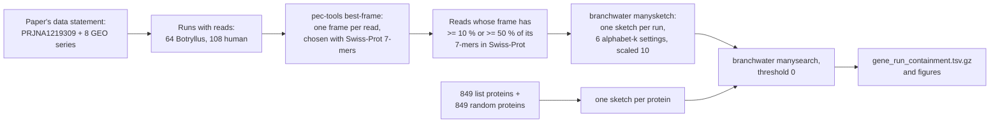

# Read search of the paper's datasets for the paper's PEC genes (notebook 361)

This is the "Shazam" step of notebook 361: look for the proteins of the genes on Domen et al.
2026's PEC lists in the raw reads of the sequencing datasets the paper names, using sourmash
protein-alphabet sketches. It asks whether a gene's protein k-mers are present in a run's
reads. It does not measure expression.



## Status (2026-11-02)

Done: queries, the run table, frame choice and sketches for all 172 runs (64 Botryllus, 108
human) at cutoffs 0.1 and 0.5, the frame test on Botryllus genes, and the per-run frame figure.
Not done: the containment search. Slurm job 50793573 (HP 27/30, Dayhoff 12/13, protein 6/7)
was running when Sherlock became unreachable and work was paused for a new plan from Olga
(frames chosen with protein k = 10 against the new Botryllus proteome and GENCODE, and a search
at HP k = 24, 27 and 30 only). `gene_run_containment.tsv.gz` and
`gene_run_containment.{png,svg,pdf}` are therefore not here yet; the commands to make them are
at the end of this file.

## Which datasets were searched, and why

The paper's Data, Materials, and Software Availability statement (PMC full text, read on
2026-11-02) names one BioProject and eight GEO series. `paper_accessions.tsv` lists them with
where they are named; `paper_accession_runs.tsv` has every run from ENA's filereport API.

| accession | what the paper says it is | data | runs | Gbp | searched? |
|---|---|---|---|---|---|
| PRJNA1219309 | this study's Botryllus RNA-seq | RNA-seq | 64 | 196.4 | yes, all 64 runs |
| GSE99963 | human exercise data (Laker et al.) | RNA-seq | 28 | 33.1 | yes |
| GSE144304 | human exercise data (van der Hoek et al.) | RNA-seq | 80 | 108.9 | yes |
| GSE120862 | human exercise data (Popov et al.) | RNA-seq | 84 | 250.7 | no: over the 200 Gbp limit on its own |
| GSE104079 | mouse exercise data (Marosi et al.) | microarray | 0 | - | no reads |
| GSE27536 | human exercise data (Turan et al.) | microarray | 0 | - | no reads |
| GSE83578 | human exercise data (Abbasi et al.) | microarray | 0 | - | no reads |
| GSE111555 | human exercise data (da Silva et al.) | microarray | 0 | - | no reads |
| GSE28998 | human exercise data (Gordon et al.) | microarray | 0 | - | no reads |

All 64 Botryllus runs were already trimmed by fastp on Sherlock (`$S/trimmed/<sample>_{1,2}.fastq.gz`),
so none had to be downloaded; 17 of them are tiny runs the paper's SI does not use
(`not_in_SI`, 282 to 21,166 read pairs, plus sample 5553). The two human series together are
142 Gbp (under the 200 Gbp limit). They were downloaded untrimmed from ENA
(`slurm/21_sra_download.sbatch`: resumable `curl -C -`, retries, a speed floor, and an MD5 check;
the first attempt saved an HTTP error page for 32 runs, caught by the MD5 check, and was rerun
with `--fail`). The eight GEO series appear only in the Data Availability statement: "The human and mouse
exercise data have been published (43) and are publicly available with Gene Expression Omnibus
ids: ..." Their analysis is in ref 43, and the paper shows it in Fig. 4C-D ("adopted from (43)").
The human runs are a cross-species check: the Botryllus list proteins are not
expected to share many exact k-mers with human reads.

## Queries

`scripts/sra_build_queries.py`: the 878 rows of `exports/paper/paper_named_lists.tsv` name 823
distinct genes (g<N>, the old gene models the paper used). Every botznik protein of each gene is a
query: 849 proteins. A gene on several lists keeps all of them (`paper_list` column, joined by
`;`). The control is 849 botznik proteins from genes on no list, one per list protein, drawn at
random (seed 361) from the 25 non-list proteins nearest in length. Median length is 285 residues
in both sets.

## Frame choice for the reads

Olga asked for orpheum translate against Swiss-Prot, keeping the frame with the most matches,
instead of keeping every six-frame stretch of 30 or more residues.

- **orpheum itself.** orpheum 1.0.4 is not on bioconda. It installed from PyPI into
  `$S/env_orpheum` (Python 3.8, khmer, and sourmash 2.3.1, because it imports
  `sourmash._minhash`, which sourmash 3 removed), but its `--csv` and `--parquet` options fail with
  the installed click. It ran on a 1-in-50 sample of the test reads (20,798 reads): 9.1 CPU-s for
  2.29 Mbp, about 4,000 CPU-s per Gbp, or about 100 CPU-hours for the 90.8 Gbp of trimmed
  Botryllus reads.
- **pec-tools best-frame** (`pec-tools/src/best_frame.rs`) applies orpheum's rule as a compiled
  loop: a read whose nucleotide complexity (fastp's measure, as orpheum uses it) is below 0.3 gets
  no frame; a frame can be chosen only if it has no stop codon and is not a low-complexity peptide
  (distinct 7-mers at most half its windows); among those, the frame with the most 7-mers found
  in Swiss-Prot wins (first frame on ties; ties are counted). The share is matching 7-mers over
  all 7-mer windows of the frame. Alphabet and k are orpheum's defaults: protein, k = 7. Swiss-Prot
  is `$S/db/swissprot.faa` (575,748 proteins, 89,732,459 distinct 7-mers). It runs at about 100
  CPU-s per Gbp of reads (97.5 on the largest run, JA102).
- **Agreement with orpheum** (`orpheum_vs_pectools.tsv`, the same 20,798 reads, cutoff 0.5): every
  read orpheum kept, pec-tools kept too. Of the real reads lying wholly in a CDS, orpheum kept 1,172
  of 4,952 (865 with the right frame) and pec-tools 1,306 (913 right). pec-tools keeps slightly
  more because orpheum's Bloom filter and its share over distinct k-mers differ in detail.
- The low-complexity rules matter: before they were added, 86 % of the reads with any Swiss-Prot
  match in runs JA116 and JA117 (old 24 h) had all their 7-mers in Swiss-Prot, and the most common
  such peptides were simple repeats (PNPNPN..., LTLTLT..., LGLGLG...;
  `slurm/25_full_match_reads.sbatch`).

## Frame choice tested on Botryllus genes

Figure: `frame_choice_botryllus_test.{png,svg,pdf}`; numbers: `frame_choice_botryllus_test.tsv`,
`frame_test_summary.tsv` (every setting, rule, read source, gene set and cutoff) and
`frame_test_hist.tsv`. Code: `slurm/20_sra_frame_test.sbatch`, `scripts/sra_frame_test_prepare.py`,
`scripts/sra_frame_test_score.py`, `scripts/plot_frame_test.py`.

- **Truth set.** The new Botryllus gene models Olga supplied: `$S/db/new_genome/cds.fasta` and
  `protein.fasta`, 45,339 records each (headers repeat between isoforms of one gene, so records
  are paired by order). cds.fasta sha256
  `82da01b1835c50180d90c8c0437d823e35ce385b0c55ef9f1dadb3780ac91b40`. 45,338 of 45,339 CDS
  translate (standard code, final stop removed) to exactly their protein; the one that does not
  was dropped.
- **Paper-list genes.** The paper's genes are old gene models (g<N>); they were linked to new
  genes by a DIAMOND 2.2.8 blastp of the 849 list proteins against protein.fasta (best hit with
  identity >= 90 % over >= 80 % of the old protein): 630 proteins link, to 591 new genes. 1,409
  other new genes were drawn at random (seed 361), 2,000 genes in all.
- **Reads cut from CDS.** 20 evenly spaced 150-nt reads per gene on a random strand (the trimmed
  reads are mostly 150 nt), 39,854 reads with known frame.
- **Real reads.** The first 250,000 read pairs of JA113 (PEC) and JA123 (control), both mates,
  1,000,000 reads, placed by DIAMOND blastx against all 45,338 checked proteins (identity >= 95 %).
  243,938 reads lie wholly in a CDS (hit over >= 90 % of the read), 109,431 partly (they run into
  a UTR, an intron or a neighbour; the frame of their coding part is known), and 646,631 have no
  such hit (UTRs, non-coding RNA, other genes); those have no known frame.

Result for protein k = 7, orpheum's rule:

| reads | right frame | no frame or no Swiss-Prot match | right-frame reads kept at >= 0.1 | at >= 0.5 |
|---|---|---|---|---|
| cut from CDS (39,854) | 73.4 % | 2.5 % | 92.3 % | 7.9 % |
| real, wholly in a CDS (243,938) | 54.5 % | 0.8 % | 96.5 % | 31.9 % |

- Choosing the frame by Swiss-Prot 7-mers is weak for Botryllus: the chosen frame is wrong for a
  quarter of reads cut from CDS and for nearly half of real coding reads. Wrong frames get many
  chance matches: Swiss-Prot holds 89.7 million of the 1.28 billion possible 7-mers, and a wrong
  frame of a Botryllus read often has 10 or more of its 44 7-mers in it (checked by brute force on
  three reads).
- **A cutoff does not separate right frames from wrong ones** until it throws most reads away
  (panel c): among kept reads, the share with the right frame stays at 74-76 % (cut from CDS) and
  54-55 % (real) for cutoffs up to 0.2.
- **0.5 throws away most right-frame Botryllus reads**: 92.1 % of those cut from CDS and 68.1 % of
  real ones. The cutoff used here is therefore **0.1**, which keeps 92.3 % and 96.5 % of
  right-frame reads. Olga's **0.5** is run as a second, labelled setting.
- Paper-list and random genes behave alike (right frame 74.3 % and 73.0 % of reads cut from CDS).
- Other settings (same table): Dayhoff k = 12 gives 74.1 % and 50.6 % right, and at 0.5 keeps
  56.6 % and 77.1 % of right-frame reads, so it is the setting to use if a 0.5 cutoff must stay.
  Protein k = 5 and k = 6 are not useful: 97.6 % of all possible 5-mers and 53 % of 6-mers are in
  Swiss-Prot, so nearly every window matches.

`frame_matches.{png,svg,pdf}` (numbers in `frame_matches.tsv`, `frame_matches_hist.tsv`) shows,
for every run, the share of the chosen frame's 7-mers in Swiss-Prot, the number of matching
7-mers, and the reads kept at each step.

## Alphabets and k sizes

The k for Dayhoff and protein were matched to HP k = 27 and k = 30 by bits per k-mer, with the
real Shannon entropy of each alphabet's letters under the amino-acid background
(`bits_per_kmer` and `entropy_per_symbol` in `notebooks/ortholog_analysis_utils.py`):

| alphabet | bits per letter | k nearest to HP k27 (27.0 bits) | k nearest to HP k30 (30.0 bits) |
|---|---|---|---|
| HP | 1.000 | 27 (27.0 bits) | 30 (30.0 bits) |
| Dayhoff | 2.278 | 12 (27.3 bits) | 13 (29.6 bits) |
| protein | 4.176 | 6 (25.1 bits; k7 has 29.2) | 7 (29.2 bits) |

So the six settings are HP 27 / Dayhoff 12 / protein 6 and HP 30 / Dayhoff 13 / protein 7.
(The project's usual pairing HP 30 / Dayhoff 12 / protein 7 puts Dayhoff 12 nearer HP 27.)
Every run and query is sketched at scaled 10.

## Cost

Predicted before the full run, from the 2-run pilot (JA113 and JA123, 0.99 Gbp of trimmed reads):
frame choice about 100-200 CPU-s per Gbp and manysketch (six settings, cutoff 0.1) about 90
CPU-s per Gbp, so roughly 5-10 CPU-hours for the Botryllus runs and the same again for the
human runs, with the largest run (JA102, 15.7 Gbp) taking about an hour. Measured
(`frame_matches.tsv`, from `/usr/bin/time` per run):

| runs | Gbp read | frame choice, CPU-h | CPU-s per Gbp | manysketch at 0.1, CPU-s per Gbp | peak memory |
|---|---|---|---|---|---|
| 64 Botryllus | 90.8 | 2.63 | 104 | 51 | 1.8 GB (frame), 1.9 GB (manysketch, JA102, first pass) |
| 108 human | 142.0 | 6.11 | 155 | 94 | 1.8 GB (frame), at most 1.2 GB (manysketch) |

JA102 took 2,127 CPU-s for the frame step and about 25 min of wall time for manysketch.

## Limits

- Containment is presence of a protein's k-mers in a run's reads, not expression. A gene
  expressed at a low level in a deep run can have higher containment than a highly expressed
  gene in a shallow run; reads per run differ by up to 100-fold here.
- The frame choice is wrong for about a quarter to a half of Botryllus coding reads (above).
  Wrong-frame k-mers rarely match the query proteins, so this mostly lowers containment.
- Scaled 10 keeps about 1 in 10 k-mers: a 285-residue protein has about 25 HP k30 hashes, and a
  short protein can have none at some settings. A protein with no hash at a setting is
  "unsearchable" there (empty containment, listed in `unsearchable.tsv`), not absent.
- Each read is sketched alone, so a k-mer must fit inside one read's chosen frame. A 150-nt
  Botryllus read gives at most 50 residues, which holds 21 HP k30 windows. The human reads average
  76 nt (GSE144304, at most 25 residues) and 81 nt (GSE99963, at most 27 residues), so they
  have no HP k30 window and at most one HP k27 window per read: in practice the human runs are
  searchable only with Dayhoff and protein k-mers.

## How to rerun

On Sherlock, with `S=/scratch/users/olgabot/nb361-pec`, the code copied to `$S/sra_search/code`
and `cd $S/sra_search`. Pass `CUTOFFS` through the environment: `--export=ALL,CUTOFFS=0.1,0.5`
splits at the comma and silently runs only 0.1.

```bash
export PEC_ROOT=$S PEC_CODE=$S/sra_search/code CUTOFFS=0.1,0.5
sbatch -p normal,hns --export=ALL --output=logs/%x.%j.out code/slurm/20_sra_frame_test.sbatch
sbatch -p normal,hns --export=ALL --array=0-107%4 code/slurm/21_sra_download.sbatch
sk=$(sbatch -p normal,hns --parsable --export=ALL --array=0-171%32 --mem=16G --time=08:00:00 code/slurm/22_sra_sketch_run.sbatch)
QUERIES=queries/queries.faa TAG=all sbatch -p normal,hns --export=ALL --dependency=afterok:$sk code/slurm/23_sra_search.sbatch
# after the search:
$S/env/bin/python code/scripts/sra_collect.py search_all queries/query_map.tsv runs.tsv search_all/out 0.1
# on the laptop, after copying search_all/out:
python scripts/plot_sra_containment.py exports/sra_search/gene_run_containment.tsv.gz \
  exports/sra_search/containment_by_setting.tsv 0.1 exports/sra_search/gene_run_containment
```
