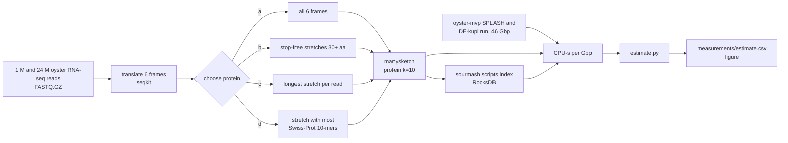
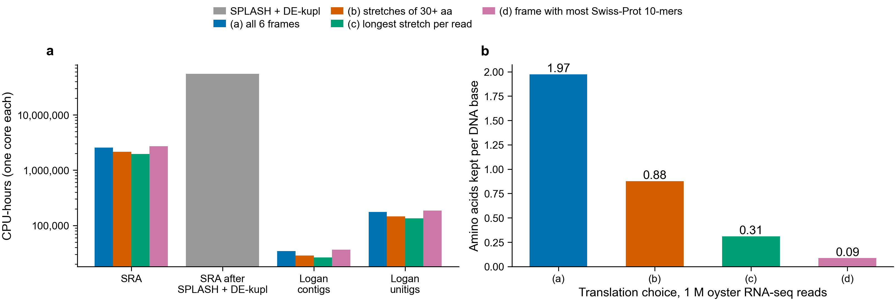

# Cost of protein-sketching the SRA, SPLASH/DE-kupl output, and Logan

This estimates what it would take to build sourmash branchwater protein sketches (protein
k=10) and their RocksDB indexes for three collections, under four ways of turning DNA into
protein. Every rate comes from a job run on Sherlock (hns nodes, AMD EPYC 7543), one core
per tool. The rates are measured; the totals are those rates times the collection sizes.

**a**, CPU-hours to translate and sketch each collection (log scale). Grey is SPLASH plus
DE-kupl run on every BioProject before sketching; their output is so small that sketching
it does not show. **b**, amino acids each choice keeps per DNA base of 1 M oyster reads.

## Results

The choice of translation barely changes compute (within 1.4x), because six-frame
translation is most of the cost and every choice has to do it. The choice changes storage
by 38x. Running SPLASH and DE-kupl on every BioProject first costs 21x more than sketching
all of the SRA directly, almost all of it DE-kupl.

| Collection | Choice | CPU-hours | Days on 1,000 cores | Days on 10,000 cores | Sketches, scaled 1000 | RocksDB, scaled 1000 | RocksDB, scaled 100 |
|---|---|---:|---:|---:|---:|---:|---:|
| SRA, 66.9 Pbp | a, all 6 frames | 2.55 M | 106 | 10.6 | 65 TB | 195 TB | 1.97 PB |
| | b, 30+ aa stretches | 2.14 M | 89 | 8.9 | 27 TB | 80 TB | 796 TB |
| | c, longest stretch | 1.97 M | 82 | 8.2 | 12 TB | 37 TB | 369 TB |
| | d, most Swiss-Prot 10-mers | 2.70 M | 113 | 11.3 | 1.7 TB | 5.2 TB | 45 TB |
| SRA after SPLASH + DE-kupl per BioProject | any | 54.9 M (SPLASH 3.1 M, DE-kupl 51.8 M, sketching under 2,000) | 2,286 | 229 | under 0.04 TB | under 0.12 TB | under 1.2 TB |
| Logan contigs, 0.90 Pbp | a | 34,000 | 1.4 | 0.14 | 13 TB | 40 TB | 397 TB |
| | b | 29,000 | 1.2 | 0.12 | 5.9 TB | 18 TB | 177 TB |
| | c | 26,000 | 1.1 | 0.11 | 2.1 TB | 6.3 TB | 63 TB |
| | d | 36,000 | 1.5 | 0.15 | 0.6 TB | 1.8 TB | 18 TB |
| Logan unitigs, 4.59 Pbp | a | 175,000 | 7.3 | 0.7 | 68 TB | 204 TB | 2.0 PB |
| | d | 186,000 | 7.7 | 0.8 | 3.0 TB | 9.0 TB | 90 TB |

The SRA rows use the public SRA of December 2024, 66.9 petabases (Pbp), from
[arXiv 2505.06395](https://arxiv.org/abs/2505.06395). It grew 33% in 2024 (Logan's December
2023 copy was 50.3 Pbp), so in October 2026 it is about 113 Pbp: multiply every SRA row by
1.7. Logan sizes are from the [Logan paper](https://pmc.ncbi.nlm.nih.gov/articles/PMC12424806/).
Building the RocksDB index adds 145,000 CPU-hours for the SRA under (a) at scaled 100 and
about a tenth of that at scaled 1000 (column `index_build_cpu_h_scaled100`).

### Measured rates

CPU-seconds per gigabase (Gbp) of DNA, one core:

| Step | CPU-s per Gbp | Peak memory | Measured on |
|---|---:|---:|---|
| Decompress FASTQ.GZ | 10 | 2 MB | whole DW1 read-1 file, 3.6 Gbp |
| Translate 6 frames (seqkit) | 82 | 58 MB | 1 M reads, 0.15 Gbp |
| manysketch, choice a / b / c / d | 46 / 23 / 14 / 8 | 0.13 GB | 1 M reads |
| Swiss-Prot 10-mer lookup for (d) | 46, assumed | 0.93 GB table | see note 2 |
| **Total, a / b / c / d** | **137 / 115 / 106 / 146** | | |
| sourmash `sketch translate` (Python), choice a only | 211 to 250 | 0.46 GB | 1 M reads; whole file |
| SPLASH (8 threads) | 166 | 25 GB | oyster-mvp, 6 libraries, 46 Gbp |
| DE-kupl (32 threads) | 2,786 | 22 GB | same run |
| `sourmash scripts index`, RocksDB | 0.79 per MB of sketch | 0.48 GB | whole-file sketch |

What each choice keeps from 1 M reads: (a) 1.97 amino acids per base, (b) 0.88, (c) 0.31,
(d) 0.09. Only 28% of the oyster reads had any 10-mer found in Swiss-Prot, so (d) drops
72% of reads.

### Memory, disk and network

- Sketching takes under 0.5 GB per process; choice (d) adds a sorted table of Swiss-Prot's
  115.7 M distinct 10-mers, 0.93 GB as 64-bit integers.
- `sourmash scripts index` loads every sketch into memory before writing the index, so an
  SRA-scale index must be built as many shards (for example one per 1 TB of sketches).
- SPLASH peaked at 25 GB on 46 Gbp with 8 threads, but was killed at 128 GB with 32 threads
  on the same input (job 49203558), and its compactor step was killed at 192 GB on the
  Botryllus pec-young project (job 49841447). The largest BioProjects will not fit one node.
- The SRA is about 27 PB as stored. Over a 10 Gbit/s link that is 250 days; at 100 Gbit/s,
  25 days. A run over all of it has to stream the reads where they are stored (AWS us-east-1,
  the SRA open-data bucket), as Logan did, and not copy them. Logan contigs are 315 TB
  (3 days at 10 Gbit/s); unitigs 2.18 PB (20 days).

## What this does not cover

1. **Reading .sra files.** The read cost is `zcat` of a FASTQ.GZ. Getting reads out of the
   SRA's own format (`fasterq-dump`) is slower and was not measured. For scale, Logan spent
   30 M CPU-hours on 50.3 Pbp (0.6 CPU-hours per Gbp, 16x this whole pipeline), but that
   includes assembly.
2. **Choice (d) is priced as a compiled lookup**, charged the same as hashing all six frames
   once more. The Python version used here to count what (d) keeps took 4,590 CPU-s per Gbp
   (31x the whole compiled (d) pipeline); a run at that speed would need 85 M CPU-hours for the SRA.
   Orpheum itself was not run.
3. **Sketch size depends on depth.** Sketching all 24 M reads of the library gave 6.8x the
   hashes of the first 1 M reads, for 24x the bases. SRA storage uses the whole-library
   rate, measured on one RNA-seq library; metagenomes have more distinct sequence and will
   be larger. Logan contigs are not redundant within a sample, so their storage counts one
   hash per `scaled` amino acids, an upper bound.
4. **Logan amino-acid fractions come from 150 bp reads.** On long contigs, (b) keeps a larger
   share (stop-free stretches are not cut by the read end) and (c) keeps only one stretch
   per contig, however many genes it holds.
5. **SPLASH and DE-kupl are priced as if every base of the SRA were in a BioProject they can
   run on.** DE-kupl needs two labelled groups of samples, and both tools were built for
   RNA-seq, so a real run would cover less of the SRA and cost less. What they keep is tiny:
   27.6 Mbp from 46.1 Gbp (0.06%). DE-kupl contigs have a median length of 48 bases
   (16 amino acids) and SPLASH compactors 85, so (b) keeps only 24% of those bases.

## Files

- `bench.sbatch`: 1 M reads, four choices, SPLASH and DE-kupl output lengths (job 49952740).
- `bench_full.sbatch`: whole read-1 file, and RocksDB indexes (job 49957505).
- `frames.py`: writes the four choices as protein FASTA and counts what each keeps.
- `estimate.py`: turns `measurements/` into `measurements/estimate.csv`, `rates.json` and
  the figure. Run from the repo root.
- Other measurements used: the oyster-mvp SPLASH and DE-kupl `/usr/bin/time` logs
  (`$SCRATCH/oyster-mvp-20261023/timing/`), and notebook 299 (PR 170), whose
  `sourmash sketch translate` of 46.8 M ocean genes ran at about 300 CPU-s per GB per
  setting, close to the 211 to 250 measured here.
