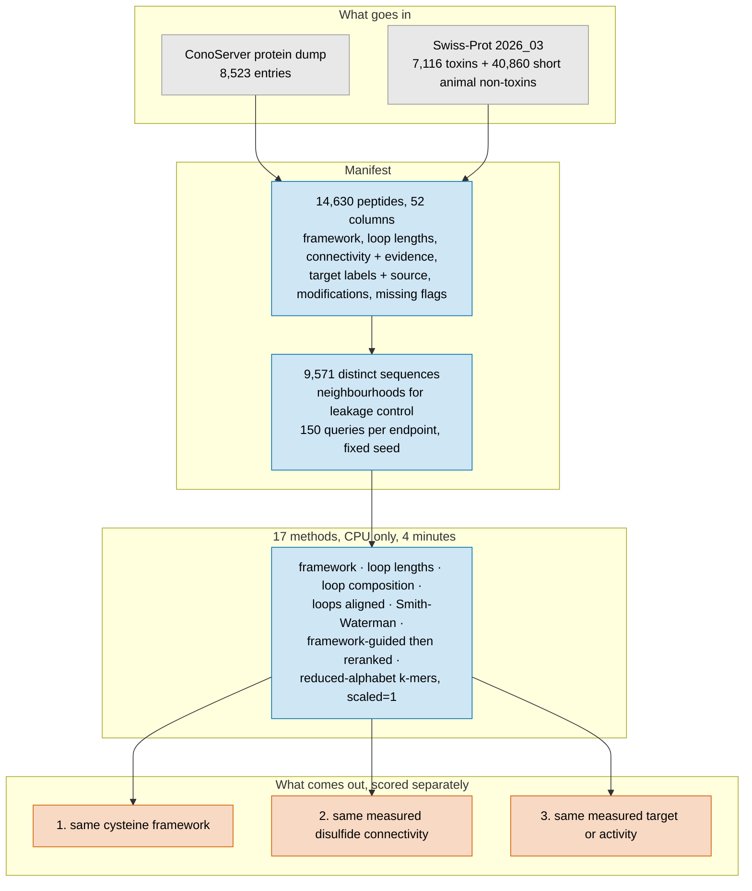

> [!NOTE]
> Written by Claude Code (Opus 5) at olgabot's request. Posted from her account, so replies here are to Claude, not to her.

Grey = what goes in. Blue = what is built and run. Orange = the three things measured separately.

## The question, and why the answer has three parts

Can retrieving venom peptides by their cysteine framework and then reranking the survivors
by full sequence comparison find more useful relationships than framework matching alone,
or than ordinary sequence comparison alone?

"Useful" hides three different claims, and this pilot refuses to let them stand in for each
other. A similar cysteine framework, a similar experimentally supported fold, and the same
experimentally supported target are three separate labels with three separate evidence
columns, and a method is never credited with one on the strength of another.

The short answer: **on target and activity, no** — framework-guided retrieval beats
framework matching by a factor of ten but loses to plain Smith-Waterman, because its filter
throws away most of the true positives before anything is ranked. **On measured disulfide
connectivity, yes** — there the filter costs nothing and the pipeline wins.

## The numbers

Precision in the top 10, averaged over queries, with the query's own family removed from
the reference:

| | same target or activity | same measured connectivity | both called knottin |
|---|---|---|---|
| chance | 0.097 | 0.011 | 0.106 |
| framework alone | **0.019** | 0.016 | 0.054 |
| whole-sequence Smith-Waterman | **0.458** | 0.090 | 0.537 |
| same cysteine count, then reranked | 0.259 | **0.139** | **0.548** |
| framework with loop slack 2, then reranked | 0.197 | 0.136 | 0.457 |

150, 143 and 150 queries. Framework matching alone is **worse than chance** for target:
two peptides on the same scaffold are no more likely to act on the same target than two
peptides drawn at random.

## Where the framework-guided pipeline loses

Not in the reranking, which is good. Requiring the same cysteine count drops 80% of the
true positives before ranking; requiring the loops to match within two residues drops 97%.
Counted over only the true positives that survive the filter, the pipeline reaches a recall
of 0.28 in the top 10 where Smith-Waterman reaches 0.007. It ranks what it sees far better
and sees almost nothing.

Inside a framework class it is the best thing here: among same-framework peptides with
labels known on both sides, it puts a true positive above a hard negative 65% of the time
on target and 74% on connectivity. Framework matching alone scores 0.48 and 0.53, a coin
toss, because it gives every same-framework peptide the same score.

## What a two-class cysteine reading cannot see

cys2 writes 71% of the 4,567 cysteine-rich toxins as a string at least one other peptide
also has: 4,567 peptides collapse onto 2,024 strings. cys_hp3 drops that to 30%, dayhoff6
to 15%, protein20 to zero.

Panel b is the pair the regression test pins: conotoxin Mr6.14 (cone snail) and nemertide
alpha-8 (ribbon worm), different phyla, different families, 27% of the weaker peptide's
self-alignment score, the same framework, the same loop lengths, one cys2 string. One has
a measured sodium-channel activity; the other has no measured target at all.
`tests/test_venom_retrieval.py` keeps the two-class representation unable to separate them.

## Technical detail

**Deliverables.** `analysis/venom-retrieval/` holds a CLI
(`python -m venom_retrieval manifest|splits|collisions|run|evaluate|all`), the config
(`config/pilot.json`), a Makefile and 31 tests. Outputs are in
`tables/venom_retrieval/pilot/`: the manifest, the fixed splits, the collision report, the
feature counts, the per-query ranked results and the summary. `config.used.json` is written
beside them on every run.

**Manifest**, 14,630 peptides, one row each:

- mature peptide and the precursor it was cut from, with `mature_boundary_source`,
  `mature_boundary_inferred` and `mature_boundary_inference`. 7,531 boundaries were derived
  rather than read, and each one says in words how.
- framework, inter-cysteine loop lengths, both terminal lengths.
- disulfide connectivity written by cysteine index, with `connectivity_evidence` separating
  a measured bond (764 peptides) from one carried over by similarity (3,779). Nothing
  infers connectivity from cysteine order.
- target and activity labels, multilabel, each prefixed by the database that states it.
  UniProt keywords and ConoServer pharmacological families are kept in separate namespaces
  and never translated into each other.
- modifications with positions (3,507 peptides, 2,484 C-terminally amidated), kept as
  metadata and never written into the sequence. Every method here is blind to them.
- `framework_missing`, `connectivity_missing`, `fold_missing`, `target_missing`. A missing
  label is unknown: such a peptide is neither a true positive nor a hard negative.
- controls in the same table: 1,248 non-toxin cysteine-rich animal peptides and 3,590
  non-toxin peptides of the same lengths without the cysteines.

**Splits.** Exact duplicate sequences collapsed (14,630 → 9,571). Then a neighbourhood per
peptide: similar above a 0.5 BLOSUM62 score ratio, or the same gene family in the same
database's vocabulary. Transitive grouping was tried first and chained 88% of the peptides
into one group, so it was dropped. 485 peptides have no neighbour, and for 41 queries the
held-out reference is therefore the same set as the ordinary one; they are kept rather than
dropped, because excluding peptides for having no close relative selects against exactly
the isolated peptides the question is about.

**Methods.** The first five are an ablation ladder, each knowing one more thing than the
last: framework as a label, loop lengths, loop composition with order dropped, loops
aligned loop to loop with affine gaps, whole-sequence Smith-Waterman. Then the two
framework-guided variants, and ten reduced-alphabet k-mer settings fixed in advance. No
alphabet search. No sketch subsampling: every k-mer of every peptide is kept, which is what
`scaled=1` means in kmerseek, and `feature_counts.csv` records how many that is.

A method that cannot compare a pair returns nothing rather than a bad score, and a true
positive it never saw is counted as an end-to-end miss, not excused.

**Scope.** CPU only on the laptop, about four minutes, no kmerseek binary and no Nextflow.
Method C here is kmerseek's alphabets and k-mer sets compared in Python — no index, no
region chaining, no E-values — so it is not evidence about kmerseek itself. A real kmerseek
run belongs on Sherlock through `nextflow-runs/cys-frameworks`.

Generic strobemers are deliberately not implemented: nothing here points to a retrieval
failure they would plausibly fix. The framework-guided pipeline's problem is that its
filter is too strict, not that its seeds are too rigid.

**Reuse.** `notebooks/cys_framework_utils.py` (framework strings, loop lengths, the
falsification regex) and `notebooks/hp_conservation_utils.py` (alphabet residue classes)
are imported by path rather than copied, so the two cannot drift apart. cys2 is checked
against kmerseek's own test vector for omega-conotoxin MVIIA.

Stacked on PR 145, which this branch takes `cys_framework_utils.py` and the cys-frameworks
tables from.

🤖 Generated with [Claude Code](https://claude.com/claude-code)
