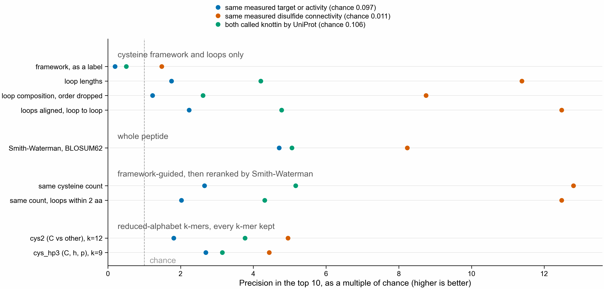
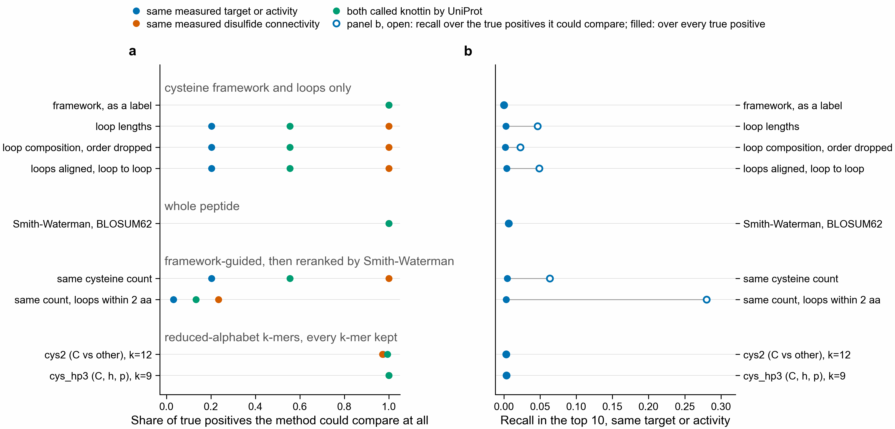
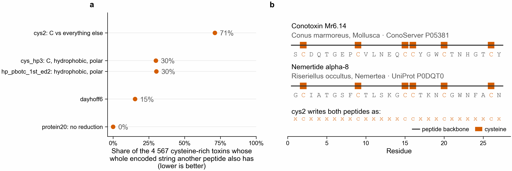

# Does a cysteine framework help you find useful venom peptides?

The question this pilot answers: can retrieving venom peptides by their cysteine framework
and then reranking the survivors by full sequence comparison find more useful
relationships than framework matching alone, or than ordinary sequence comparison alone?

The answer depends on what "useful" means, and that is the point. Three things are easy to
treat as one and are not:

1. a similar cysteine framework,
2. a similar experimentally supported fold,
3. the same experimentally supported molecular target or activity.

Each is measured separately here, with its own label, its own evidence column and its own
true positives. A win on the first says nothing about the other two.



## What came out

Over 9,571 distinct peptides, with the query's own family removed from the reference, at a
review budget of ten hits per query:

| | same target or activity | same measured connectivity | both called knottin |
|---|---|---|---|
| chance | 0.097 | 0.011 | 0.106 |
| framework alone | **0.019** | 0.016 | 0.054 |
| whole-sequence Smith-Waterman | **0.458** | 0.090 | 0.537 |
| same cysteine count, then reranked | 0.259 | **0.139** | **0.548** |
| framework with loop slack 2, then reranked | 0.197 | 0.136 | 0.457 |

Precision in the top 10, averaged over queries (150, 143 and 150 queries).

**Framework matching alone is worse than picking at random** for the target endpoint:
0.019 against a chance rate of 0.097. Two peptides built on the same cysteine scaffold are
no more likely to act on the same target than two peptides picked out of the database. The
framework is a scaffold label, not an activity label, and the measurement says so.

**Framework-guided retrieval plus reranking beats framework matching by a factor of ten
to fourteen** on target, and by eight on connectivity. The reranking step is doing real
work.

**It still loses to plain sequence comparison on target**: 0.259 against 0.458. The reason
is not the reranking, which is good, but the filter in front of it. Requiring the same
cysteine count throws away 80% of the true positives before anything is ranked, and
requiring the loops to match within two residues throws away 97%. Counted over only the
true positives that survived the filter, the framework-guided pipeline reaches a recall of
0.28 in the top 10 where plain sequence comparison reaches 0.007 — it ranks what it sees
far better, and it sees almost nothing.



**On the fold endpoint the order flips.** For peptides whose disulfide connectivity was
measured, the cysteine-count filter loses nothing at all — two peptides can only share a
connectivity pattern if they have the same number of cysteines — and the pipeline reaches
0.139 against plain sequence comparison's 0.090. This is the one endpoint where the
framework is a free and correct filter rather than a costly one.

**Inside a framework class, reranking is what separates hits from near misses.** Among
reference peptides sharing the query's framework, with labels known on both sides, the
framework-guided pipeline ranks a true positive above a hard negative 65% of the time on
target and 74% on connectivity. Framework matching alone scores 0.48 and 0.53, which is a
coin toss, because it gives every same-framework peptide the same score and cannot order
them at all.

## Scaffold retrieval is not fold evidence, and neither is target evidence

- **Useful scaffold retrieval**: yes. Framework matching reaches a precision of 0.978 at
  the framework endpoint against a chance rate of 0.065, and loop-anchored alignment 0.730.
  That is close to tautological, since at this endpoint the framework is the label.
- **Evidence for fold retrieval**: partial, and only on 143 queries whose connectivity was
  measured experimentally. The framework-guided pipeline beats sequence comparison by half
  again on that endpoint. The knottin endpoint is a curator's fold name rather than a
  measurement, and there the two are a tie (0.548 against 0.537).
- **Evidence for target or activity retrieval**: no. Framework-guided retrieval is well
  above chance but well below plain sequence comparison, and framework matching alone is
  below chance.

## What a two-class cysteine alphabet cannot see



Reading a peptide as cysteine-versus-everything-else writes 71% of the 4,567 cysteine-rich
toxins as a string that at least one other peptide also has: 4,567 peptides collapse onto
2,024 distinct strings. Giving the residues in between even two classes (`cys_hp3`, k=12) drops
that to 30%, and six classes (`dayhoff6`, k=10) to 15%. The two-class alphabet is also read at
k=12. The k differs between rows, so the drop is not from the class count alone. The 20-letter
alphabet (`protein20`, k=6) has no collisions.

Panel b is the pair the regression test pins: conotoxin Mr6.14 from a cone snail and
nemertide alpha-8 from a ribbon worm, different phyla, different families, 27% of the
weaker peptide's self-alignment score. They have the same framework, the same loop
lengths, and one cysteine-versus-other string. Every framework-level and loop-length
method here must tie them; only the methods that read the residues can tell them apart.
One of them has a measured sodium-channel activity and the other has no measured target at
all, so they are not interchangeable in any sense that matters.

`tests/test_venom_retrieval.py` keeps this pair as a regression test: the two-class
representation must stay unable to separate them.

## Running it

```bash
cd analysis/venom-retrieval
make data     # ConoServer and two Swiss-Prot searches, about 90 MB
make all      # manifest, splits, collisions, run, evaluate: about 4 minutes
make test     # 31 tests including the regression pair
python make_figures.py
```

CPU only, on the laptop, no Nextflow and no kmerseek binary. Method C here is kmerseek's
alphabets and its k-mer sets at `scaled=1`, compared in Python. That is not a kmerseek
search: there is no index, no region chaining and no E-value. For peptides of 10 to 60
residues a sketch would keep one or two k-mers per peptide, so every k-mer is kept and
nothing is subsampled; `../../tables/venom_retrieval/pilot/feature_counts.csv` records how many that is. A real
kmerseek index and search belong on Sherlock, through the cys-frameworks pipeline in
`nextflow-runs/cys-frameworks`.

## What is in the manifest

`../../tables/venom_retrieval/pilot/manifest.parquet`, 14,630 peptides before duplicate removal, from ConoServer's
protein dump and two Swiss-Prot searches (release 2026_03). One row per peptide, with:

- the mature peptide and the precursor it was cut from, plus `mature_boundary_source`,
  `mature_boundary_inferred` and `mature_boundary_inference`. 7,531 boundaries were derived
  rather than read from an annotation, and each one says in words how.
- species, taxonomy, and the gene family with the database that named it. ConoServer's
  superfamilies and UniProt's family strings are kept in separate namespaces, because a
  ConoServer identifier looks like a UniProt accession and is not one.
- the cysteine framework, the inter-cysteine loop lengths, and the lengths of the two
  terminal stretches.
- the disulfide connectivity written by cysteine index, with `connectivity_evidence`
  separating a measured bond (764 peptides) from one carried over by similarity (3,779),
  and `connectivity_complete` saying whether every cysteine is accounted for. Nothing here
  infers connectivity from cysteine order.
- the target and activity labels, multilabel, each prefixed by the database that states
  it. No translation between UniProt's keywords and ConoServer's pharmacological families:
  the Greek letters are kept as ConoServer writes them rather than mapped to receptors by
  hand.
- modifications with their positions in the mature peptide (3,507 peptides, 2,484 of them
  with a C-terminal amide), kept as metadata and never written into the sequence. Every
  method compared here reads an amidated peptide and the same chain without the amide as
  one string; `n_modifications` is what tells a reader where that matters.
- `framework_missing`, `connectivity_missing`, `fold_missing` and `target_missing`. A
  missing label is unknown. A reference peptide with no target label is neither a true
  positive nor a hard negative and is left out of both.

Controls are in the same table, under `control_class`: 1,248 non-toxin cysteine-rich
animal peptides (defensins, protease inhibitors, EGF-like modules) and 3,590 non-toxin
peptides of the same length range without the cysteines. Peptides with the same framework
and different measured targets are not a separate set; they are the hard negatives the
evaluation counts per query.

## Splits

Exact duplicate sequences are collapsed first: 14,630 peptides hold 9,571 distinct mature
sequences. Then each peptide gets a neighbourhood — every peptide similar to it above a
0.5 BLOSUM62 score ratio, and every peptide stating the same gene family in the same
database's vocabulary. The `held_out_family` reference removes the query's whole
neighbourhood, so a hit has to come from somewhere else.

Transitive groups were tried first and chained 88% of the 9,571 peptides into one group;
at a 0.5 score ratio over peptides this short there is almost always a chain whose ends are
unrelated. Neighbourhoods ask only about each query's own distance, so nothing chains. The
cost is that two peptides inside one reference set may be near-duplicates of each other,
which inflates how many true positives a query has but cannot leak the query itself.

Query sets are 150 peptides per endpoint, no two of them neighbours, drawn with a fixed
seed (`config/pilot.json`). A query whose reference holds no true positive is dropped
rather than scored as a zero, which is why the connectivity endpoint reports 143.

485 of the 9,571 peptides have no neighbour at all, and for 41 of the queries the
held-out-family reference is therefore the same set as the ordinary one. Those queries
make the held-out numbers slightly easier than a strict reading of "another family"
would, and they are not excluded, because dropping a peptide for having no close relative
would select against exactly the isolated peptides the question is about.

## What this pilot does not answer

- Whether a real kmerseek index, with region chaining and E-values, behaves like the
  k-mer containment measured here. It may not.
- Whether the target endpoint's labels are complete enough. 4,417 of 14,630 peptides carry
  one, and an unlabelled peptide is unknown, not inactive.
- Whether 764 peptides with a measured connectivity are enough families to generalise
  from. They are reported as a descriptive result, not as a claim about peptides in
  general.
- Anything about modifications. Every method here is blind to them by construction.

Generic strobemers are deliberately not implemented. Nothing in these results points to a
retrieval failure that spaced or gapped seeds would plausibly fix: the framework-guided
pipeline's problem is that its filter is too strict, not that its seeds are too rigid.
