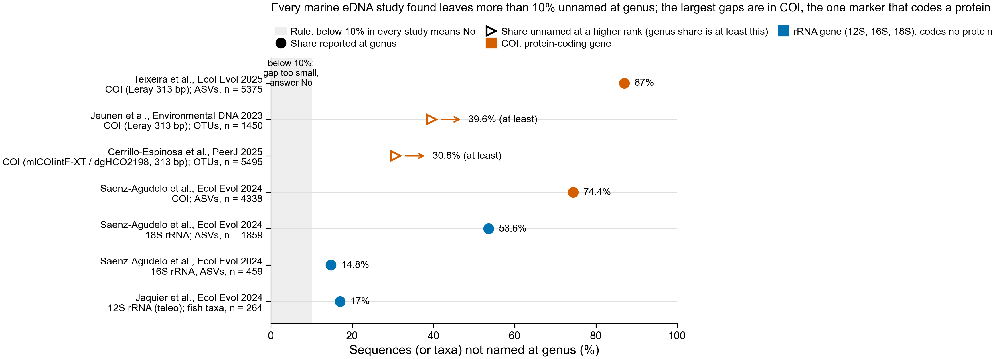

# eDNA monitoring: is there a buyer, and where would protein-level naming matter?

Prompt 3 of three. Every number below was read on 2026-10-18 from the source next to it.
"Search only" means the number came from a search-result summary and the page itself
could not be opened; those are listed again under "Checked and not checked". Nothing here
is from memory. The rule in step 5 was written before the search and is not changed.

Figure: one row per study and marker. Filled dot: the paper reports the share not named at genus.
Open triangle with arrow: the paper reports the share not named at a higher rank (any
rank, or phylum), so the share not named at genus is at least that. Grey band: the
step 3 rule, below 10% in every study means No. Data:
[unassigned_at_genus_studies.tsv](unassigned_at_genus_studies.tsv); code:
[edna_market_unassigned_figure.py](../../scripts/edna_market_unassigned_figure.py).

## Answer

**Worth a conversation if the price is multiplied by one provider's sample count, as step 5 says; but the method reaches only COI
amplicons and shotgun reads, not the 12S, 16S and 18S data most buyers pay for.**

- Step 1: buyers exist and pay posted prices. No kill.
- Step 2: every provider whose method could be read names reads with a DNA reference
  database and a DNA classifier. None uses protein. No kill.
- Step 3: all five marine studies leave more than 10% unnamed at genus for every marker
  reported (14.8% to 87%; two of the five are lower bounds). COI rows: 30.8% to 87%. No kill.
- Step 4: 12S, 16S and 18S are rRNA genes and code no protein. COI does. qPCR assays name
  one species and leave nothing unnamed. So protein k-mers reach COI metabarcoding and
  shotgun data only.
- Step 5: priced like Wilderlab's USD 68 step between its basic and comprehensive panels,
  USD 50,000 a year takes 736 samples. Wilderlab runs about 8,700 to 20,000 or more a year,
  and every panel it lists includes COI. The rule passes only if 736 samples a year buy
  the pass; that uptake is assumed, not shown, and USD 68 is a panel step, not an add-on.

The rule may be the wrong rule: it asks only whether the money could add up, not whether
anyone would buy, or whether a protein pass names COI reads at genus at all. That is Prompt 2's question. The result
is still reported under the rule.

## 1. Who pays today, with a count

| Group | Count | Source (year) | Price one named provider posts |
|---|---|---|---|
| Agencies with published eDNA guidance or standards | 5 found: US Fish and Wildlife Service, best-practice guide (2023); National eDNA Reference Centre, Australia, protocol guide (2022); Natural England, great crested newt method WC1067 (2014); CSA Group, Canada, standard W214:21 (2021, search only); CEN, Europe, EN 17805:2023 (2023, search only; one listing says withdrawn 15 Jul 2026, successor prEN ISO 17805 in progress) | [FWS](https://fws.gov/media/environmental-dna-edna-best-management-practices-project-planning-deployment-and-application); [De Brauwer et al. 2022](https://research.csiro.au/environomics/wp-content/uploads/sites/187/2022/08/Environmental-DNA-protocol-development-guide-for-biomonitoring.pdf); SureScreen page below says its analysis "strictly follows WC1067"; CSA and CEN: search only | — |
| UK agencies using eDNA for statutory monitoring | 5: Environment Agency, SEPA, Natural Resources Wales, Natural England, NatureScot (lake fish, Water Framework Directive); "the first example of eDNA metabarcoding being adopted for statutory monitoring anywhere in the world" | [University of Hull, REF 2021 impact case study](https://results2021.ref.ac.uk/impact/176d8575-398b-4ae2-8bdf-ac0e12c79021/pdf) | Not found for these agencies |
| Developers needing a protected-species survey (England) | Count of buyers not found. The test they buy: great crested newt eDNA (qPCR, one species) | SureScreen, Cellmark pages below | SureScreen GBP 140 (10 working days) to GBP 380 (same day) per analysis, + kit GBP 30; Cellmark GBP 170 to 270 per kit |
| New Zealand local government | Count of councils not found. Wilderlab: "We do tens of thousands of samples per year for them" | [Farmers Weekly NZ, 20 Jun 2023](https://www.farmersweekly.co.nz/technology/waterway-e-dna-testing-service-wins-innovation-award/) | Wilderlab USD 114 basic, USD 182 comprehensive per extract |
| US federal agencies buying eDNA lab work | 29 federal awards to one provider (Jonah Ventures), USD 814K in all, 2022-2025; the 8 that name eDNA in the title were USD 13K to 106K each; one: USD 64K for 3,840 seawater eDNA libraries (Department of Commerce, Sep 2024) | [govconinabox, Jonah Ventures profile](https://govconinabox.com/explore/contractors/profile/jonah-ventures-llc-uh7dcs) | Not posted |
| Water utilities required to monitor with eDNA | Not found | — | — |
| Offshore wind developers required to monitor with eDNA | Not found as a requirement. eDNA appears as a survey in environmental statements (East Anglia TWO, Appendix 22.4; search only) | search only | Not posted |
| Aquaculture operators monitoring pathogens | 995 seawater sites for salmon and rainbow trout in Norway, 31 Dec 2025. eDNA is not required there; pathogen labs use real-time PCR | [Fiskeridirektoratet key figures 2025, Table 9](https://www.fiskeridir.no/english/aquaculture/statistics-for-aquaculture/booklets/_/attachment/inline/890c957c-fbef-4a3e-8a7e-d4301089d599:ce284c1041b73547e4e7e0bb90e1537b19ccfe91/nokkeltall-havbruk-2025-eng.pdf) | Not found |
| Conservation NGOs | 1 programme found: Freshwater Habitats Trust PondNet, 380 ponds a year by eDNA in England since 2015, funded by Defra and Natural England since 2018 | [PondNet](https://freshwaterhabitats.org.uk/projects/pondnet-edna-surveys/) | Not posted |

Read across: most money found is for one-species qPCR (newts, fish pathogens) and for
fish metabarcoding of UK lakes (the case study does not name the marker). The New Zealand councils buy Wilderlab's multi-marker
panels, which include COI.

## 2. Who sells it, and how they name reads

| Provider | What they sell | Price per sample (posted) | Turnaround | Level reported | How reads are named |
|---|---|---|---|---|---|
| [Wilderlab](https://wilderlab.co/extracts) (NZ) | Metabarcoding panels: 12S, 16S, COI, 18S-V9, 16S-V5, ITS, trnL, 28S, D-loop ([assay table](https://wilderlab.co/directions)) | Extract analysis: basic NZD 192 / USD 114; comprehensive NZD 307 / USD 182 | Not stated on the price page | Lowest rank possible; genus at most for the 18S-V9 and bacterial 16S-V5 assays | [Methods v2.1.0](https://s3.ap-southeast-2.amazonaws.com/wilderlab.resources/methods/Wilderlab_metabarcoding_methods_2.1.0.pdf), four steps: exact match to a curated database; then lowest common ancestor on exact GenBank and BOLD matches (RDP for the bacterial 16S assay only); then the same allowing one mismatch; then SINTAX (a DNA k-mer classifier) at >0.99, genus at most. DNA database, DNA classifier |
| [SureScreen Scientifics](https://www.surescreenscientifics.com/forensic-ecology/great-crested-newt/) (UK) | Great crested newt eDNA analysis (Natural England method WC1067) | GBP 140 / 180 / 240 / 380 for 10 / 5 / 2 / same day; kit GBP 30; add a second species GBP 35 | 10 working days to same day | Species | One-species assay; no read naming |
| [Cellmark](https://www.greatcrestednewtedna.co.uk/) (UK) | Great crested newt eDNA | GBP 170 / 220 / 270 per kit for 10 / 5 / 2 days (from GBP 155 for 20+ kits) | 10 days to next day | Species | One-species assay |
| [NatureMetrics](https://www.naturemetrics.com/gcn) (UK) | eDNA across vertebrates, invertebrates, bacteria, fungi | Not posted | Not posted | "the species present" | Not found ("proprietary") |
| Jonah Ventures (US) | Metabarcoding, qPCR, source tracking | Not posted. Federal award: USD 64K for 3,840 libraries (my arithmetic: about USD 17 per library, library prep and sequencing only) | Not found | Not found | Not found |
| [Genidaqs](https://genidaqs.com/commercial-rate-list/) (US) | MiFish metabarcoding (MiSeq), qPCR | Units only (per 48 samples; per sample up to 6 or 16); no amounts | qPCR 48 h option | qPCR: species | Not found |
| [Texas A&M Corpus Christi Genomics Core](https://www.tamucc.edu/science/research/genomics/services-and-pricing.php) (university) | eDNA / metabarcoding / amplicon libraries, one locus | External USD 23.63 (96 samples) or 120.80 (8 samples); water extraction USD 14.13; bioinformatics USD 115 per hour (FY 2027-2028) | Not stated | Not stated | Not stated |
| [University of Maine CORE](https://umaine.ilab.agilent.com/service_center/show_external/4980?name=environmental-dna-edna) (university) | eDNA extraction, qPCR, MinION amplicon runs | External: extraction USD 13; qPCR single probe USD 35; MinION amplicon run USD 450 (6 barcodes) | Not stated | Not stated | Not stated |
| SPYGEN (France) | 12S teleo fish metabarcoding, filtration capsules | Not found | Not found | Species, genus or family by percent identity | In a study with a SPYGEN co-author ([Jaquier et al. 2024](https://doi.org/10.1002/ece3.11337)): ecotag (OBITools) against EMBL. DNA database, DNA classifier |

Every method that could be read is a marker-gene DNA reference database plus a DNA
classifier (SINTAX, BLAST-style lowest common ancestor, ecotag). That is two of the nine
(Wilderlab, SPYGEN). Two sell one-species qPCR, which names no reads. For the other five
the method was not found.

## 3. Where DNA naming fails, measured

Five marine metabarcoding studies, 2023-2025 (the figure above). Four are from seawater;
Teixeira 2025 is from organisms on reef monitoring plates.

| Study | Habitat | Marker | Share not named at genus |
|---|---|---|---|
| [Teixeira et al. 2025, Ecol Evol](https://doi.org/10.1002/ece3.71544) | Red Sea, Arabian Gulf, Gulf of Oman reefs; annelid sequences | COI | 87% of 5,375 ASVs (55% class or phylum + 12% order + 20% family) |
| [Jeunen et al. 2023, Environmental DNA](https://doi.org/10.1002/edn3.500) | Ross Sea, seawater and sponges | COI | at least 39.6% (574 of 1,450 OTUs named at no rank) |
| [Cerrillo-Espinosa et al. 2025, PeerJ](https://doi.org/10.7717/peerj.19249) | Gulf of California, 0 to over 200 m | COI | at least 30.8% (1,694 of 5,495 OTUs named only above phylum, or in SAR groups with no settled phylum) |
| [Saenz-Agudelo et al. 2024, Ecol Evol](https://doi.org/10.1002/ece3.10999) | Chile, mesophotic reefs | COI, 18S, 16S | 74.4% (COI, 4,338 ASVs), 53.6% (18S, 1,859 ASVs), 14.8% (16S, 459 ASVs), not named at genus with confidence 0.8 or more (Table 3) |
| [Jaquier et al. 2024, Ecol Evol](https://doi.org/10.1002/ece3.11337) | West Indian Ocean reefs, fish | 12S | 17.0% of 264 fish taxa (45 named only at family or above) |

ASV and OTU: one distinct sequence, or a cluster of near-identical ones. Not every study
counts the same thing (sequences, clusters, taxa), so the rows are not one scale. The
rule was "if every study reports under 10%, No". None does. Within the one study that
reports three markers side by side (Saenz-Agudelo), COI leaves the most unnamed.

## 4. Would protein-level naming help eDNA at all

- **Metabarcoding.** 12S, 16S and 18S are ribosomal RNA genes (Wilderlab lists its assays
  as mt12S, mt16S, 18S-V9, 16S-V5); ITS is a spacer between them; trnL is a tRNA gene.
  None codes a protein, so protein k-mers reach none of these reads. COI (cytochrome c
  oxidase subunit I) is a protein-coding gene; the common Leray fragment is 313 bp, about
  104 codons.
- **qPCR.** A one-species test (newts, pathogens) gives yes or no; there are no reads to
  name.
- **Shotgun.** In one 2026 seawater shotgun study, [Gómez-Repollés et al.](https://doi.org/10.3897/mbmg.10.164232)
  assigned only 0.78% of reads to any superkingdom with BLASTn against GenBank nt. How much
  of a read pool can code protein depends on whose DNA it is: in 50 bacterial and archaeal
  genomes, non-coding DNA was 5% to 50% of the genome ([Rogozin et al. 2002, via BioNumbers 105749](https://bionumbers.hms.harvard.edu/bionumber.aspx?id=105749));
  in the human genome, protein-coding exons are about 1.5% ([NHGRI](https://www.genome.gov/genetics-glossary/Exome)).
  So in shotgun eDNA the protein-coding reads are mostly microbial; for an animal, most of
  its reads come from DNA that codes no protein. The share for a typical eDNA shotgun
  dataset as a whole: not found.
- **So:** the buyers in step 1 mostly use qPCR or rRNA metabarcoding. The method reaches
  COI metabarcoding and shotgun data only. It is a COI-and-shotgun tool, not a general
  eDNA tool.

## 5. Price and the number

- **Price anchor.** No metabarcoding provider found posts an add-on for unnamed reads. The
  nearest posted price step: Wilderlab charges USD 68 more per sample for its
  comprehensive panel than its basic one (182 - 114). This is a step between panel tiers,
  not an add-on, and it buys extra assays (plants, microbes, 18S), not COI: the COI assay
  is already in the basic panel ([methods Table 1](https://s3.ap-southeast-2.amazonaws.com/wilderlab.resources/methods/Wilderlab_metabarcoding_methods_2.1.0.pdf)).
  SureScreen's GBP 35 second-species add-on is for qPCR, where nothing is left unnamed, so
  it is not used.
- **Throughput.** Wilderlab: "tens of thousands of samples per year" for local government
  (Farmers Weekly, 2023); the smallest reading of that phrase is 20,000. Its running
  totals give a lower rate: "over 23,000" ([AIM2Flourish](http://aim2flourish.com/innovations/valuing-nature-and-biodiversity-with-edna), undated)
  and "over 50,000" by 9 Oct 2024 ([eDNA conference bio](https://ednaconference.com.au/5671)),
  founded 2019. 50,000 over the 5.77 years from 1 Jan 2019 is about 8,700 a year on
  average. Both are used.
- **Which samples the pass could reach.** Every panel Wilderlab lists includes its COI
  assay (CI, aquatic insects and other invertebrates), so every panel sample has COI reads.
- **Arithmetic** (multiplication, not a forecast):
  - samples needed for USD 50,000 a year: 50,000 / 68 = 735.3, so **736**;
  - that is 736 / 20,000 = **3.7%**, or 736 / 8,663 = **8.5%**, of Wilderlab's yearly samples;
  - if every sample bought it: 20,000 x 68 = USD 1,360,000, or 8,663 x 68 = USD 589,084.
- **Rule** (fixed before the search): worth a conversation if one provider's pass reaches
  USD 50,000 a year at a price they already charge for an add-on. Step 5 of the prompt
  says to multiply the price by one provider's sample count; done that way, both counts
  clear USD 50,000 by more than ten times. **Under that reading: worth a conversation.**
  Read strictly, it does not yet pass: no add-on price exists, and nothing here shows
  that 736 samples a year would be bought. The four questions in step 6 are what would
  show it.
- **What the number leaves out.** Whether a protein pass names COI reads at genus was not
  tested here (Prompt 2).

## 6. Five people to call

| Role asked for | Person | Why them (source) |
|---|---|---|
| eDNA provider, head of bioinformatics | Shaun Wilkinson, founder and CEO, Wilderlab | Author of Wilderlab's methods document; the pipeline uses his `insect` R package to sort reads by sample barcode ([methods](https://s3.ap-southeast-2.amazonaws.com/wilderlab.resources/methods/Wilderlab_metabarcoding_methods_2.1.0.pdf); [bio](https://ednaconference.com.au/5671)). A named head of bioinformatics at any provider: not found |
| Agency scientist who wrote eDNA guidance | Katherine Bockrath, US Fish and Wildlife Service | Listed first among the authors on the FWS page for the 2023 eDNA best-practice guide; first author of its chapter 6 ([FWS](https://fws.gov/media/environmental-dna-edna-best-management-practices-project-planning-deployment-and-application)) |
| Marine eDNA academic with a recent survey | Gert-Jan Jeunen, University of Otago | Ross Sea COI survey, 40% of OTUs unnamed (Jeunen et al. 2023); author of the CRABS reference-database tool used there (Shaun Wilkinson is a co-author of that paper) |
| Aquaculture health lab | PatoGen AS, Ålesund, Norway | Real-time PCR tests for fish pathogens ([company profile](https://www.medical-xprt.com/companies/patogen-analyse-as-74942)). A named person: not found |
| Branchwater or sourmash maintainer | Luiz Irber (top branchwater contributor), with C. Titus Brown, UC Davis (top sourmash contributor) | GitHub contributor lists for sourmash-bio/branchwater and sourmash-bio/sourmash, read 2026-10-18 |

Script, the same four questions for all five:

1. What share of your reads go unnamed at genus, and for which markers?
2. What do you do with them now?
3. Would a genus-level name for them change a report or a decision? Which one?
4. What would you pay per sample for that name?

## Checked and not checked

Checked (page opened on 2026-10-18): every price in step 2 except the two marked search
only; the five studies in step 3 (full text read for all but Jeunen 2023, where the
journal PDF was read); the Wilderlab methods PDF; Gómez-Repollés 2026 (PDF); BioNumbers
105749; NHGRI exome page; Fiskeridirektoratet Table 9; PondNet; FWS guide page; Australian
guide title page; Hull REF case study; Farmers Weekly; eDNA conference bio; govconinabox.

Not checked:
- Search only, page not opened: CSA W214:21 (2021; publisher page returned 403 and 404);
  CEN EN 17805:2023 and its withdrawal; East Anglia TWO appendix. (SureScreen kit and
  add-on prices, the AIM2Flourish total and the PatoGen profile were search only in the
  first draft; the checker opened them and they say what the report says.)
- Natural England's WC1067 year (2014) is from a search summary; the SureScreen page names
  the method but not its year.
- Wilderlab's older methods (v2.1.0, 2023) list an rbcL assay, a protein-coding plant
  gene, in the comprehensive panel only; the current assay page does not list it. Not
  followed up.
- A Wilderlab yearly figure of "around 15,000 samples a year" (Capital Mag, Dec 2023)
  appeared in a search summary but the page could not be opened, so it is not used. It
  is lower than the 20,000 used in step 5; at 15,000, 736 samples would be 4.9%.
- Counts of water utilities, offshore wind developers or NGOs required or paying for
  eDNA: not found. No market-report figures were used, so the two-publisher rule did not
  come up.
- Whether translated COI separates genera better or worse than COI DNA: not tested.
  This decides whether the step 5 money is reachable, and is the first thing Prompt 2
  should measure.
- No comparator was run and no shuffled control, because this prompt runs no method. The
  "same data, same machine" and "shuffled controls" rules apply to Prompt 2.
- The second-agent check is below.

## Second-agent check

See [second_agent_check.md](second_agent_check.md): a separate agent reopened every
source and redid every sum. Its held / failed table is part of this deliverable.
