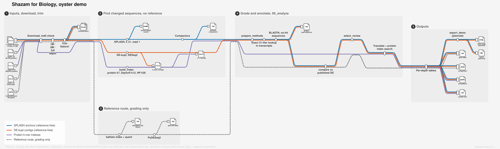
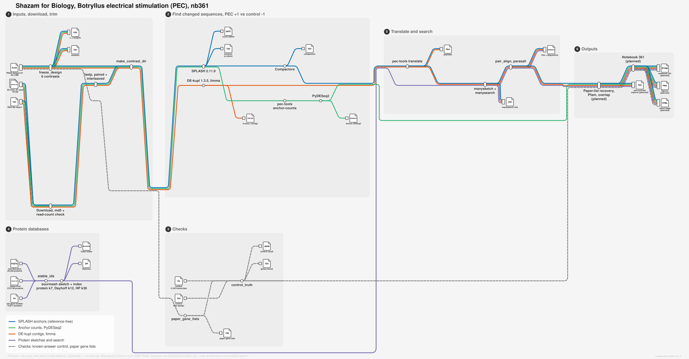

# Shazam for Biology: workflow metro maps

Two metro maps, one per chat working on "Shazam for Biology". Each map shows the input
files, the step that reads each of them, and the files that come out, with their file types.
Both maps were drawn on 2026-10-23 from what each chat reported. They show the plan as of
that day, including steps not built yet.

The numbers on the maps (protein counts, file sizes, index sizes, gene counts) were copied
from the chats. None of them is printed by code or a log in this repo, and the analysis code
is not on this branch, so they are unchecked.

How to read them:

- A coloured line is one route the data takes. The same colour means the same route in both
  maps: blue for SPLASH anchors, orange for DE-kupl contigs, purple for the protein
  databases and search, dashed grey for checks that need a reference or a known answer.
  Green, for SPLASH anchor counts tested with PyDESeq2, appears only in the PEC map.
- A circle on a line is a step (a tool or script).
- A file icon is a file. The icon shows the file type (TSV, FASTQ.GZ, ...), and the text
  under it says what the file holds. An icon at the start of a line is an input. An icon
  on a short side branch is an in-between file that the next step reads.
- "(planned)" means the step or file is not built yet.

## Oyster demo

Branch `olgabot/oyster-shazam-mvp`, not pushed and no PR on 2026-10-23. Code in
`analysis/oyster-mvp/`, data on Sherlock in `$SCRATCH/oyster-mvp-20261023`. Six oyster
mantle RNA-seq libraries (Zhang 2019, PRJNA524442), wild vs breed. The run looks for changed
sequences without a reference, then uses the oyster_v9 reference only to grade them.



## Botryllus electrical stimulation (PEC), notebook 361

PR 201, branch `olgabot/nb361-pec-splash-reproduction`. Code in
`analysis/pec-domen2026-splash/`, data on Sherlock in `$SCRATCH/nb361-pec`. This run
reproduces Domen et al. 2026 PNAS: 47 of 64 RNA-seq runs (PRJNA1219309), six PEC vs
control contrasts, plus a control set with a known answer.



## Rebuilding the maps

The `.mmd` files are the source. They are rendered with
[nf-metro](https://github.com/seqeralabs/nf-metro) 2.1.0 in the nf-core style
([nf-core workflow schematics](https://nf-co.re/docs/community/brand/workflow-schematics)):

```bash
pip install 'nf-metro==2.1.0'
nf-metro render docs/shazam-workflows/shazam_oyster_mvp_metro.mmd -o docs/shazam-workflows/shazam_oyster_mvp_metro.svg -o docs/shazam-workflows/shazam_oyster_mvp_metro.png --mode light
```

Do the same for `shazam_pec_nb361_metro.mmd`.

The SVG and PNG files are generated from the `.mmd` files. The README shows the SVG; the
PNG is the same picture at a fixed size. After any `.mmd` edit, render both again, or the
pictures no longer match the source.
