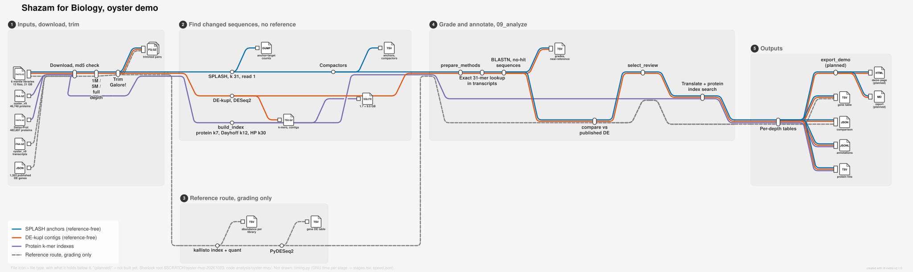
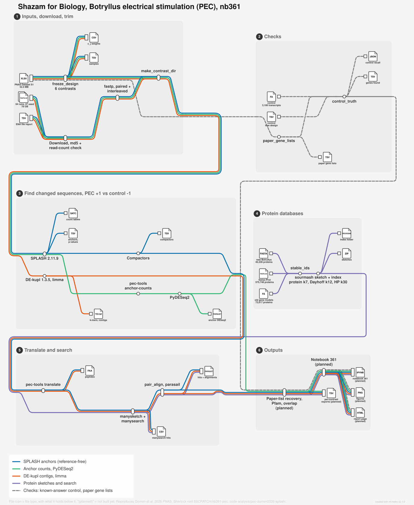

# Shazam for Biology: workflow metro maps

Two metro maps, one per chat working on "Shazam for Biology". Each map shows the input
files, the step that reads each of them, and the files that come out, with their file types.
The oyster map was drawn on 2026-10-23 from what its chat reported, and shows the plan as
of that day, including steps not built yet. The PEC map was drawn on 2026-10-23, redrawn
on 2026-10-31 from the pipeline's process list, given a KaMRaT station on 2026-11-01, and
drawn by hand the same day (see its section below).

The numbers on the maps (protein counts, file sizes, index sizes, gene counts) were copied
from the chats. None of them is printed by code or a log in this repo, and the analysis code
is not on this branch, so they are unchecked.

How to read them:

- A coloured line is one route the data takes. The same colour means the same route in both
  maps: blue for SPLASH anchors, orange for DE-kupl contigs, purple for the protein
  databases and search, dashed grey for checks that need a reference or a known answer.
  Green, for SPLASH anchor counts tested with PyDESeq2, and pink, for KaMRaT contigs,
  appear only in the PEC map.
- A circle on a line is a step (a tool or script). The PEC map marks steps differently; see its section.
- A file icon is a file. The icon shows the file type (TSV, FASTQ.GZ, ...), and the text
  under it says what the file holds. An icon at the start of a line is an input. An icon
  on a short side branch is an in-between file that the next step reads.
- "(planned)" means the step or file is not built yet.

## Oyster demo

Branch `olgabot/oyster-shazam-mvp`, not pushed and no PR on 2026-10-23. Code in
`analysis/oyster-mvp/`, data on Sherlock in `$SCRATCH/oyster-mvp-20261023`. Six oyster
mantle RNA-seq libraries (Zhang 2019, PRJNA524442), wild vs breed. The run looks for changed
sequences without a reference, then uses the oyster_v9 reference only to grade them.



## Botryllus electrical stimulation (PEC), notebook 361

PR 201, branch `olgabot/nb361-pec-splash-reproduction`. Code in
`analysis/pec-domen2026-splash/`, data on Sherlock in `$SCRATCH/nb361-pec`. This run
reproduces Domen et al. 2026 PNAS: 47 of 64 RNA-seq runs (PRJNA1219309), six PEC vs
control contrasts, plus a control set with a known answer.

Since 2026-10-30 these steps run as one Nextflow pipeline, `nextflow-runs/pec-domen2026/`
(on PR 201). The map has one step for each of its 10 processes: `download`, `fastp`,
`simulate_control`, `splash`, `compactors`, `anchor_counts`, `dekupl`, `kamrat`, `search`
and `control_truth`. Steps marked "(script)" or "(planned)" are not pipeline processes.
The sample design and the protein indexes are made before the run (`freeze_design`,
`06_db_sketch`), so they appear as input files.

`simulate_control` makes the known-answer control: 12 samples (6 control, 6 PEC, 1 M read
pairs each) simulated from the 3,100 control transcripts, with 150 genes raised 4x, 150
lowered 4x, 100 isoform pairs switched 9x and 2,600 unchanged. Those reads go through the
same fastp, SPLASH, anchor-count and DE-kupl steps as the real runs, and `control_truth`
scores what each step found.

`kamrat` (KaMRaT 1.2) reads DE-kupl's table of k-mer counts, tests each k-mer for a
difference between PEC and control with a t-test, joins the k-mers into longer contigs, and
keeps the k-mers with a corrected p-value of 0.05 or less and the contigs whose best k-mer
passes that cut. Its contigs go to `search`, and its k-mers go to `control_truth`.

This map is drawn by a script, `draw_pec_nb361_metro.py`, not by nf-metro. On 2026-11-01,
nf-metro 2.1.0 could not draw the map once the link from `kamrat` to `control_truth` was
added: about 1,000 layouts failed, and the few that drew had tangled lines. The script
places every line, step and file by hand, so every link of the pipeline is drawn.

How to read the PEC map:

- A white mark on the lines is a step. A line through a step means the step reads that
  data.
- A thin grey link joins a file to the step that reads or writes it.
- The map reads left to right, in four sections: reads, finding changed sequences,
  protein search and scoring the control, and the paper's gene lists.

The SVG is 1200 x 540, and the PNG is the same picture at 2400 x 1080.



## Rebuilding the maps

The oyster map comes from `shazam_oyster_mvp_metro.mmd`. It is rendered with
[nf-metro](https://github.com/seqeralabs/nf-metro) 2.1.0 in the nf-core style
([nf-core workflow schematics](https://nf-co.re/docs/community/brand/workflow-schematics)):

```bash
pip install 'nf-metro==2.1.0'
nf-metro render docs/shazam-workflows/shazam_oyster_mvp_metro.mmd -o docs/shazam-workflows/shazam_oyster_mvp_metro.svg -o docs/shazam-workflows/shazam_oyster_mvp_metro.png --mode light
```

The PEC map comes from `draw_pec_nb361_metro.py`. The PNG needs resvg-py:

```bash
pip install 'resvg-py==0.5.0'
python docs/shazam-workflows/draw_pec_nb361_metro.py docs/shazam-workflows/shazam_pec_nb361_metro.svg docs/shazam-workflows/shazam_pec_nb361_metro.png
```

After the pipeline changes, check that the PEC map still has one step for each process,
and no others. The script compares its list of steps with the `process` blocks of
`main.nf` and exits with an error if they differ. Run it from a checkout that has PR 201,
because `nextflow-runs/pec-domen2026/main.nf` is not on this branch. On 2026-11-01, against
`main.nf` at PR 201 commit `e62d9e3`, it printed "OK: 10 of 10 processes ... have a step on
the map".

```bash
python docs/shazam-workflows/draw_pec_nb361_metro.py --check-processes nextflow-runs/pec-domen2026/main.nf
```

The README shows the SVG; the PNG is the same picture at a fixed size. After any edit to
the `.mmd` file or the script, render both again, or the pictures no longer match the
source.
