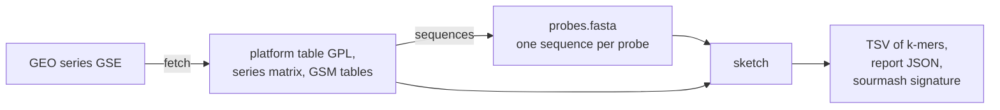

# geo2kmers

geo2kmers turns microarray data from GEO (the NCBI Gene Expression Omnibus) into one k-mer table per
sample, so array data can be set beside k-mer sketches made from RNA-seq. A k-mer is a stretch of k
letters. A sketch is a list of k-mers, here with a weight for each. A probe is one spot on an array.
Most probes have a known sequence; the platform table counts empty spots and controls as probes too. It runs on a CPU; nothing needs a GPU.



## What comes from GEO and what is computed

| value | kind | from what |
|---|---|---|
| intensity | from GEO | the sample's VALUE column, or a channel column on two-colour arrays. Usually a scanner reading, but the submitter's software may have computed it |
| detection call | from GEO | a detection column in the sample table, when there is one. It is the array software's call |
| background | computed here | the 5th percentile of that array's intensities |
| threshold | computed here | the median of that array's intensities |
| `intensity_weight` | computed here | max(0, intensity - background), summed over the probes that hold the k-mer |

An intensity is not a count. It is on a scale of its own for each array, it stops rising when the
scanner saturates, and it may include background. So the weight column is called `intensity_weight`.

## Install

```bash
conda env create -f environment.yml
```

The commands run with `python -m geo2kmers` from this folder.

## Commands

### fetch

```bash
python -m geo2kmers fetch GSE2183 --outdir data/GSE2183
```

Downloads the platform table, the series matrix and, when needed, the GSM (sample) tables, over HTTPS
from GEO. Files already on disk are not downloaded again. `provenance.json` records the accession, the
date and each file's URL and SHA-256 checksum. `samples.tsv` lists the samples and how many channels
each has. Add `--sample-tables` to get GSM tables for a one-colour series too; only they hold detection
calls. A series with several platforms needs `--gpl`. `provenance.json` is rewritten on each `fetch`, so
its date is that of the latest `fetch` command. Its checksums show whether the files are unchanged.

### sequences

```bash
export NCBI_EMAIL=you@example.org
python -m geo2kmers sequences data/GSE2183/GPL1799.txt --out data/GSE2183/probes.fasta
```

- A probe's sequence comes from the platform's SEQUENCE column if the row has one.
- Otherwise it comes from NCBI, using the row's GenBank accession (columns GB_ACC, GB_LIST and similar).
  Requests go in batches of 200 with at least 0.34 seconds between them, or 0.11 seconds if
  `NCBI_API_KEY` is set. NCBI asks for a contact address, so the tool reads it from `NCBI_EMAIL` and
  stops if it is not set. If NCBI does not answer, the batch is tried again up to 5 times, then the command
  stops. Fetched sequences are kept in `genbank_cache.fasta`.
- For an Affymetrix platform with no SEQUENCE column it stops and suggests the Bioconductor probe package
  that holds the 25-letter probes, such as `hgu133plus2probe`. That name is worked out from the platform
  title and not checked, and on newer arrays it can be wrong: Human Gene 1.0 ST's package is
  `hugene10stv1probe`, but the tool suggests `hugene10stprobe`. It stops even if the table has a GenBank
  column, because that record is the gene the probes target, not the probes. It does not guess sequences.
- Only the first accession in a cell is used, and NCBI returns the latest version of the record.
- A GenBank record longer than `--max-genbank-nt` (default 5000) is not used, because a record that long
  is often a genome or chromosome, not the clone on the slide. Long mRNAs pass that length too: 24 rows of
  human array GPL1211 do, up to 14731 nt (`results/frame_test/array_summary.tsv`), so raise the limit for
  an array of full-length clones. The probe is listed as record_too_long and has no sequence, so it adds
  no k-mers.

`probe_sequence_source.tsv` has one row per probe: probe_id, source (gpl_sequence, genbank_fetch,
record_too_long or missing) and length_nt. For record_too_long, length_nt is the record's length.

### land

```bash
python -m geo2kmers land --fasta probes.fasta --proteome proteins.fasta.gz --out landing.tsv
```

Finds the protein each probe lands on, with the rule the platform's probe length calls for (below). On 25-letter
arrays, name each probe `<probe set>/<number>`, and the table gives probe sets.

### sketch

```bash
python -m geo2kmers sketch --fasta data/GSE2183/probes.fasta \
  --intensities data/GSE2183/GSE2183_series_matrix.txt.gz \
  --sample GSM39421 --channel ch2 --k 31 --alphabet dna --mode weighted --out GSM39421.tsv
```

`--intensities` takes a series matrix, one GSM table, or a folder of GSM tables, plain or gzipped. A probe's
name in the FASTA is its whole header, or the header's first word if the intensity table has no such name.

Alphabets:
- `dna`: every k-mer of each probe in canonical form, meaning the smaller of the k-mer and its reverse
  complement. Windows holding a letter other than A, C, G or T are skipped.
- `protein`: the probe is translated in all six frames with the standard genetic code. A stretch is the
  part of a frame between two stop codons, or between a stop and an end of the frame. The longest stretch
  of the six frames is cut into k-mers, and the rest of the probe is not used. If two are equally long,
  the lower frame wins, then the earlier stretch. A codon with an unknown letter becomes X and no k-mer
  crosses it.
- `dayhoff`: the same, with each amino acid written as its group of six: a (C), b (A G P S T), c (D E N Q),
  d (H K R), e (I L M V), f (F W Y). Amino acids in one group often replace each other in evolution.
- `hp`: the same, with each amino acid written as h (hydrophobic: A F G I L M P V W Y) or p (polar:
  C D E H K N Q R S T). The dayhoff and hp groups are the ones sourmash 4.9.4 uses; `tests/test_units.py`
  checks our hashes against sourmash's own.

The longest stretch needs no reference, so it works for any species, but it is not always the protein.
It is in the annotated frame for 7157 of 7958 human sequences, or 89.9 %, and in non-coding probes it is
just the longest gap between stops (`results/frame_test/longest_stretch_GPL1211.tsv`).

With `--proteome`, a proteome picks the stretch instead. It must have at least 100 amino acids, not
counting X, and at least 90 % of its k-mers must be in the proteome, at the same alphabet and k as the sketch. If several
pass, the longest is used. A probe with no passing stretch adds no k-mers. Give the array's own species:
a proteome from another species picks almost nothing on the mussel array, in any alphabet (below).

```bash
python -m geo2kmers sketch --fasta data/GSE2183/probes.fasta \
  --intensities data/GSE2183/gsm --sample GSM39421 --channel ch2 --k 10 --alphabet protein \
  --mode weighted --out GSM39421.tsv --proteome proteins.fasta.gz
```

`--proteome` takes one or more FASTA files, gzipped or not, and works up to k = 14 for protein, 24 for
dayhoff and 63 for hp. It does not apply to `dna`. `<out>.frames.tsv` lists each probe's stretch: frame (0 to
2 read the given strand, 3 to 5 the other), start and length in amino acids, and the share in the proteome,
empty with no proteome. `proteome-index` saves a proteome's k-mers for one alphabet and k in a `.npz` file,
and `--proteome` also takes that file, which is what makes many sketches fast. In the workflow, set `--proteome`
to absolute paths joined by commas: one PROTEOME_INDEX task reads the proteome for each alphabet and k, and every
sketch reads its file.

If no probe gives a k-mer, the command stops with an error rather than write an empty table.

The proteome rule above needs long probes. A frame of a probe of n nt holds floor(n / 3) residues, so it
has floor(n / 3) - k + 1 k-mers:

| probe length | residues per frame | k-mers at k = 12 | rule chosen from the platform's median length |
|---|---:|---:|---|
| 25 nt (Affymetrix) | 8 | 0 | `probe_set`: a probe set is the group of probes reported as one value. A probe lands with one k-mer at k = 7, and a probe set lands on a protein when 3 different probes land on it. `geo2kmers land` does this, and `sketch` stops and says so |
| 50 nt (Illumina) | 16 | 5 | `short_oligo`: the longest frame with no stop, with at least half its k-mers in the proteome at k = 7 |
| 60 nt (Agilent) | 20 | 9 | `short_oligo` |
| 100 nt or more | 33 or more | 22 or more | `long_probe`: the rule above |

`PLATFORM_RULES` in `geo2kmers/sketch.py` holds these numbers and the reason for each. `--k` sets k, and the
setting column of each table keeps tables of different k apart. `probe_summary.tsv` gives the median probe
length as `probe_length`, with `residues_per_frame`. `sketch_summary.tsv` gives `landing_share`: the probes
with at least one k-mer in the proteome, in any frame, divided by all probes in the intensity table. Most expression probes sit at
the 3' end of a transcript and many are in untranslated sequence, so this share can be well below 1.

These protein, dayhoff and hp sketches differ from what sourmash makes when it translates DNA itself. Sourmash
keeps all six frames, while this tool keeps one stretch. So do not compare them with RNA-seq sketches made by sourmash's own translation without
allowing for that difference.

Modes:
- `present`: the output is the set of k-mers from expressed probes. A probe is expressed if the sample
  table's detection call says so. A call of P passes, and a detection p value of 0.05 or less passes.
  Only the column names listed in `geo2kmers/sketch.py` count, and a column named Detection that holds
  numbers is ignored, because arrays differ in what such a number means. With no detection column, a
  probe is expressed if its intensity is above that array's median. The command prints which rule it used.
  The median and the 5th percentile are taken over every probe with a number, empty spots and controls
  included. A probe whose intensity is not a number is left out of the sketch.
- `weighted`: each probe's weight is max(0, intensity - background). A k-mer's `intensity_weight` is
  the sum of the weights of its probes. A k-mer that occurs twice in a probe adds that probe's weight
  twice, so the sum of `intensity_weight` over all k-mers equals the sum over probes of probe weight
  times number of k-mers in the probe. K-mers of probes with weight 0 stay in the TSV with weight 0.

Outputs: a TSV with columns kmer, alphabet, k, setting, intensity_weight (left out in `present` mode, where
the table is a plain set) and n_probes, where setting is kmerseek's name for the alphabet and k, such as protein20_k10, and
n_probes counts the probes holding the k-mer. `geo2kmers/sketch_schema.md` defines this format, and `sketch`
checks each table against it. kmerseek's read sketches are expected to follow the same file, with `count` as
the value column. A table never has both value columns. The other outputs are `<out>.report.json`, with
every count and the rule used, and, if sourmash is installed, `<out>.sig`.

The signature keeps every k-mer (scaled = 1). In `weighted` mode a sourmash abundance must be a whole
number, so each weight is rounded: abundance = max(1, floor(weight + 0.5)). A k-mer with weight 0 is
left out of the signature. These abundances are rounded intensities, not read counts.

## Two-colour arrays

A two-colour array hybridises two samples to one slide, each with its own dye. GEO reports each dye as
a channel. Which dye is ch1 can change between samples: in GSE2183 ch1 is Cy5 on GSM39421 and GSM39423
and Cy3 on the other two.
On these arrays the series matrix holds a log ratio between the channels, not an intensity. So the
tool refuses it, and `fetch` also downloads the GSM tables, which hold each channel's signal. Choose
one with `--channel ch1` or `--channel ch2`. If it cannot find the column, name it with `--column`.
Negative numbers in the chosen column, on any array, stop the command, because the column is then not a
plain intensity. It may be a log ratio, or a difference such as Affymetrix Average Difference, as in
GSM575. This tool does not sketch either.
All-positive values below 32 print a warning that they may be logarithms; the command then carries on.
The tool cannot otherwise tell a log scale from an intensity. It uses the signal column as GEO gives it
and does not subtract GEO's local background columns. `--channel` and `--column` on a one-colour series
matrix stop the command, since they would do nothing there.

## Workflow

`main.nf` runs fetch, sequences and sketch for every sample of a series, one process per step, and one
sketch per channel on two-colour arrays. Each process runs an inline Python script through an absolute
interpreter path in its first line, because a `conda` directive does not reliably reach an inline
script. Each process has its own path: `--python_fetch`, `--python_sequences` and `--python_sketch`.
The default paths are on Sherlock, so change them on another machine. Set `NCBI_EMAIL` first if
sequences must come from NCBI. `--gpl` and `--sample_tables` pass those options to `fetch`.

```bash
nextflow run main.nf -profile small --gse GSE2183 --outdir results/GSE2183
```

Every process retries up to 3 times when the exit status is empty, `Integer.MAX_VALUE` or in 128 to 143,
which mean something outside the task killed it. Any other failure stops the run with an error. The
test run below did not need a retry. A separate test killed FETCH on purpose: killed every time, it ran 4
times and the run stopped. A task that exited 1 stopped the run after one try (`results/GSE2183/failure_test.log`).
`tests/test_workflow.py` now holds these checks.

The workflow's SUMMARISE task runs `summarise.py`, which writes `sketch_summary.tsv` and `probe_summary.tsv`,
and the workflow writes `wall_time.txt` when it ends. These scripts are not part of it: `frame_test.py` writes
the frame tests, and `array_tables.py` writes `array_summary.tsv`, `longest_stretch_GPL1211.tsv` and
`longest_vs_proteome.tsv`. `whole_genome_record_share_before_fix.tsv` came from `summarise.py` as of
commit caef3fcc, when those records were still kept.

## Result on a real series

GSE2183 is a mussel series, described in `tests/README.md`. The run in `results/GSE2183/` used a 4 CPU,
16 GB job with no GPU and no scheduler inside it, on a compute node of the Sherlock cluster, with the
environment built from `environment.yml`. All numbers below come from the file named beside them, in
that folder. The sketches themselves are too large to keep here.

- 67 tasks ran, each on the first try, with exit status 0 (`geo2kmers.trace.txt`).
- The run took 99 seconds (`wall_time.txt`), under the 10 minutes set for this test.
- The platform has 3840 probes. 3344 got a sequence from GenBank, 30 point to a whole genome record and
  so have no sequence, and 466 have no accession. The 3344 are 1672 distinct sequences,
  each spotted twice. Lengths run from 101 to 650 nt, median 512
  (`probe_summary.tsv`). These lengths are computed from GenBank records, not measured on the slide.
- Each of the 4 samples has 2 channels, so 8 channels at 4 alphabets and 2 modes make 64 sketches
  (`sketch_summary.tsv`).
- DNA k = 31, `weighted`: 693847 distinct k-mers in every sketch. The set is the same because an array
  has a fixed set of probes; only the weights differ (`sketch_summary.tsv`).
- DNA k = 31, `present`: 1717 to 1807 probes pass the median rule, giving 382592 to 443823 distinct
  k-mers (`sketch_summary.tsv`).
- The median is 0 in GSM39424 ch1, and background is 0 in 7 of the 8 channels. Between 148 and 2008 of
  the 3840 probes have intensity exactly 0 (`sketch_summary.tsv`). GEO's table does not say why.
- Protein k = 10, `weighted`, longest stretch: all 3344 probes give k-mers, 163538 distinct. The platform
  record for GPL1799 says each probe is a short tag from the 3' end of an mRNA, because the non-coding end
  is the least conserved part of a gene and so cross-hybridises least with related genes. So many of these
  k-mers are probably not from a protein (`sketch_summary.tsv`).
- The same with the species' own proteome: 652 of the 3344 probes give k-mers, 45727 distinct. That run
  took 124 seconds, in 70 tasks. Three of them read the proteome, for 39 to 40 seconds and at most 1.5 GB each,
  and each sketch task then takes a few seconds (`results/GSE2183_proteome/geo2kmers.trace.txt`).
  With this proteome, `landing_share` is 0.6167 at protein k = 10 (`results/GSE2183_proteome/sketch_summary.tsv`).
  (`results/GSE2183_proteome/`).
- 30 spots (15 clones) list accession AY484747, which NCBI titles "Mytilus edulis mitochondrion, complete
  genome". The platform table names one gene for each clone, such as Mitochondrial-ND6, and one clone
  says Nuclear-RNA 18S. So the record is not what was spotted, and no sequence for these clones
  is known. They are left out. When they were kept, they held 25.9 % of the DNA k = 31 windows and 68.2 %
  to 79.8 % of the weight sum (`whole_genome_record_share_before_fix.tsv`).

## Picking a reading frame with a proteome

`frame_test.py` asks whether a frame can be picked instead of dropping every frame with a stop codon. A
frame is one of the six translations. A stretch is the part of a frame between two stop codons. A frame
or stretch passes if it has at least 10 k-mers and at least 90 % of them are in the proteome. It tests
the 1672 distinct sequences, and three shuffles of each as a chance control (`frame_test.tsv`).

| Proteome | alphabet, k | sequences with a passing frame | with a passing stretch | shuffled, stretch (mean) |
|---|---|---:|---:|---:|
| Human and mouse (GENCODE v50, vM39) | protein, 10 | 7 | 22 | 0.0 |
| Human and mouse | hp, 30 | 19 | 26 | 1.3 |
| Pacific oyster (UP000005408) | protein, 10 | 8 | 24 | 0.0 |
| Pacific oyster | hp, 30 | 27 | 34 | 0.0 |
| Same species (UP000596742) | protein, 10 | 272 | 456 | 0.0 |
| Same species | hp, 30 | 434 | 484 | 0.3 |

So human and mouse pick a frame for at most 26 of 1672 sequences at these settings, and at most 30 at any
setting where no shuffled sequence passes (`mussel_vs_human_mouse.tsv`), even though 420 share at least one
protein 10-mer with them. The same-species proteome reaches 456 to 484. The other sequences may be
non-coding, missing from that proteome, different from it by enough letters to fall under 90 %, or too
short to give 10 k-mers; this test cannot tell which. Protein k = 5 and hp k = 15
or 20 are no use: almost every shuffled sequence passes as well. This led to `--proteome`, described under sketch.

Dayhoff does not rescue a proteome from another species. On the mussel array, oyster proteins pass 32
sequences at dayhoff k = 15 and 23 at k = 19, against 24 at protein k = 10. Dayhoff k = 12 passes 67, but 6
shuffled sequences pass too (`mussel_vs_oyster.tsv`, with `mussel_vs_human_mouse.tsv` and
`mussel_vs_same_species.tsv`). So dayhoff k = 19 is in the workflow's default for comparing sketches, not
for picking frames. No comparison between sketches has been run yet.

`results/frame_test/frame_choice_human_mussel.png`, drawn by `figure_frames.py`, shows the two main results.

Where the proteome picks a stretch of 100 amino acids or more, the plain longest stretch is in the same
frame for 316 of 326 mussel sequences, 1667 of 1821 mouse and 6002 of 6484 human (`longest_vs_proteome.tsv`).

The same test on two arrays whose species is in GENCODE (`results/frame_test/`). GPL1211 is a human array
of full-length clones, median 1668 nt; GPL738 is a mouse EST array, median 562 nt. Each was tested against
its own species only (`array_summary.tsv`, `frame_test_GPL1211.tsv`, `frame_test_GPL738.tsv`). The GPL1211
sequences were made with no length limit, so its 24 long rows are in; to repeat this use `--max-genbank-nt 20000`.

| Array | distinct sequences | with a stop-free frame | passing frame | passing stretch | shuffled, stretch (mean) |
|---|---:|---:|---:|---:|---:|
| Human GPL1211, protein k = 10 | 8845 | 38 | 1072 | 7025 | 0.0 |
| Human GPL1211, hp k = 30 | 8845 | 38 | 2844 | 6573 | 3.0 |
| Mouse GPL738, protein k = 10 | 8432 | 1556 | 1374 | 2704 | 0.0 |
| Mouse GPL738, hp k = 30 | 8432 | 1556 | 1876 | 2475 | 2.3 |

A whole frame passes less often than a stretch, because the parts of it outside the coding region do not
match; the stretch holding the protein does. The gap is widest on the human array at protein k = 10. The chosen stretch was checked on GPL1211 against the coding region NCBI
annotates on 7958 of its sequences (`frame_truth.tsv`). At protein k = 10, 6563 have a passing stretch, and
the longest passing stretch is in the true frame for 6147, or 93.7 %. If the longest stretch must be at
least 100 amino acids, that rises to 98.7 %, on 6111 sequences (`frame_truth_by_length.tsv`). GPL738 has no
such check. Frames are only as right as NCBI's annotation of each record.

## A test against a published figure

**The result does not show that this method recovers the signature.** Domen et al. 2026 (PNAS) Fig. 4C-D scores
exercise datasets on a list of 280 macrophage genes, called 338 in the paper because some are listed twice, and
reports an AUC for each: the chance that a post-exercise sample scores above a pre-exercise one, where 0.5 means
no difference. `fig4.nf` tries to get the same answer with no gene annotation: probes land on the proteins of
those genes through protein k-mers alone. `fig4/README.md` describes the method and the files in `results/fig4/`.

| Series | comparison | published AUC | planned score | second score |
|---|---|---:|---:|---:|
| GSE104079 | as in the authors' code | 0.18 | 0.495 | **0.322** |
| GSE27536 | as in the authors' code | 0.17 | **0.277** | **0.277** |
| GSE83578 | 30 min | 0.07 | 0.340 | **0.094** |
| GSE83578 | 3 h | 0.07 | 0.266 | **0.105** |
| GSE83578 | 24 h | 0.54 | **0.648** | **0.598** |
| GSE111555 | 18 weeks | 0.93 | **0.786** | **0.900** |
| GSE28998 | 12 weeks | 0.80 | 0.531 | 0.592 |

Bold means on the same side of 0.5 as the published AUC and within 0.15 of it, the rule fixed before running
(`auc.tsv`). The planned score is the M2 proteins' mean minus the M1 proteins' mean, where M1 and M2 are the
paper's two groups of genes. The second score was added after the plan: it puts the weights of Ghosh et al.
2023 on sums, which PR 212 found the published code does. For GSE27536 both scores use M1 alone and are the
same number.

Chance explains these counts as well as the method does (`chance_test.tsv`, 1000 draws):

| score | comparisons passing | if the landings mean nothing (random features) | if the gene groups mean nothing (shuffled labels) |
|---|---:|---|---|
| planned | 3 of 7 | 1.31 on average, 3 or more in 12.8 % of draws | 1.34 on average, 3 or more in 14.0 % |
| second | 6 of 7 | 1.56 on average, 6 or more in 0.0 % of draws | 4.87 on average, 6 or more in 19.3 % |

So the planned score is not separated from chance. The second score beats random features but not shuffled
labels: the proteins that landed move together after exercise, whichever gene group they are given. Most of that
score's passes come from its weights, not from which genes are M1 or M2. Single passes need care too. GSE83578 at 24 h
passes in 43.5 % of random draws on the planned score, because its published 0.54 is close to no difference
(`chance_by_comparison.tsv`).

The rule also asked that a series have a landing share of at least 0.2, and none does: they run from 0.0079 to
0.0354, because the denominator is every probe with a sequence and the proteome is 262 proteins (`platforms.tsv`).
So no series qualified, and the task passes under that rule without testing anything. That part of the rule
was the wrong one, and the tables above are the real result. GSE120862, GSE99963 and GSE144304 are RNA-seq, which
geo2kmers does not cover. The groups are those in the authors' code, which PR 212 found differ from what some
panels say. GSE104079 is mouse, landing on human proteins.

## Limits

- Chance and repeats land too. Landing on backward proteins, which code for nothing, gives 22 landings on GPL13912
  against 81 real ones, 7 against 316 on GPL570, 16 against 433 on GPL13667, and 2353 against 3484 on GPL17586
  (`results/fig4/platforms.tsv`).
- On arrays with overlapping probes, such as GPL17586, a probe set can pass the 3 probe rule on one k-mer. Its
  landings with fewer than 5 different k-mers agree with the platform's gene names 0 times in 2227; those with 5 or
  more agree 277 times in 721. The older arrays agree 77.1 % (GPL570) and 84.7 % (GPL13667) of the time, and
  old and new gene names count as disagreement (`results/fig4/annotation_control.tsv`).
- The sequence fetched for a GenBank accession is the whole record, which need not be exactly what was
  spotted on the slide. On GSE2183, 3344 spots use the EST record of the clone, the closest sequence
  published. A record under the length limit that is not the clone would not be caught.
- A short-oligo platform from another maker, with a GenBank column and no SEQUENCE column, gets the whole
  GenBank record with no warning. Only Affymetrix platforms are stopped.
- Probes sharing an accession add their weights, so a sequence spotted twice weighs twice as much.
- Weights from different arrays are on different scales, and no normalisation between arrays is done.
- The sketches have not yet been compared with an RNA-seq sketch.

## Tests

```bash
python -m pytest tests
```

`tests/README.md` describes the test series and the known-answer checks. `tests/test_helpers.py` runs each
script on small files whose answers are worked out by hand, apart from `figure_frames.py` and `fig4/plot.py`,
which it only runs or skips. `tests/test_workflow.py` reads `main.nf`. `fig4.nf` has no test of its own.

The tests that run `main.nf` are skipped unless asked for, because they need Nextflow and the network, and
take a few minutes. They check the sketch count, that a proteome is read once for each alphabet and k, that a
killed task is retried, and that a failed task stops the run. Run them on a machine meant for it:

```bash
GEO2KMERS_TEST_NEXTFLOW=1 python -m pytest tests/test_workflow.py
```
