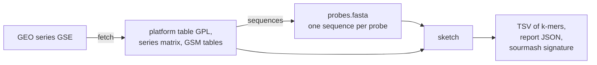
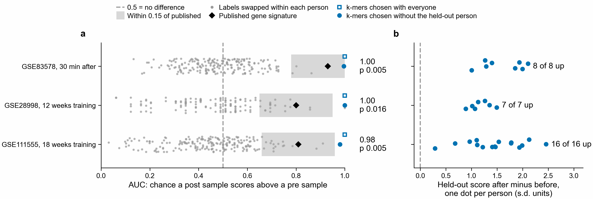
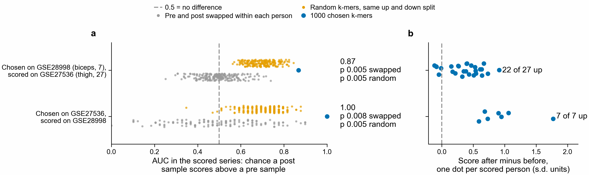
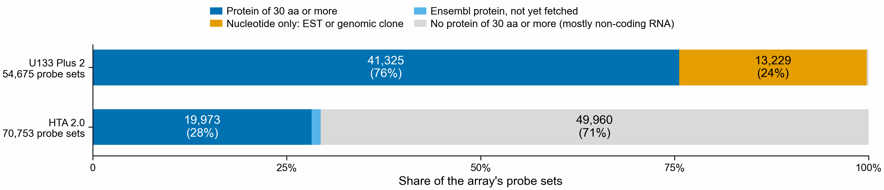
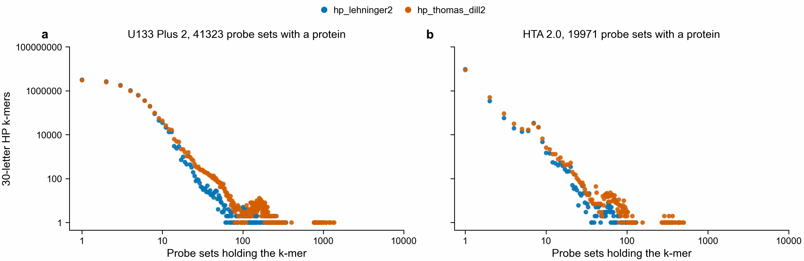
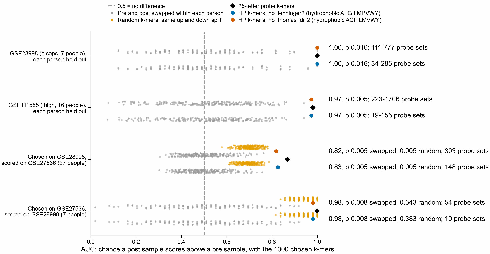
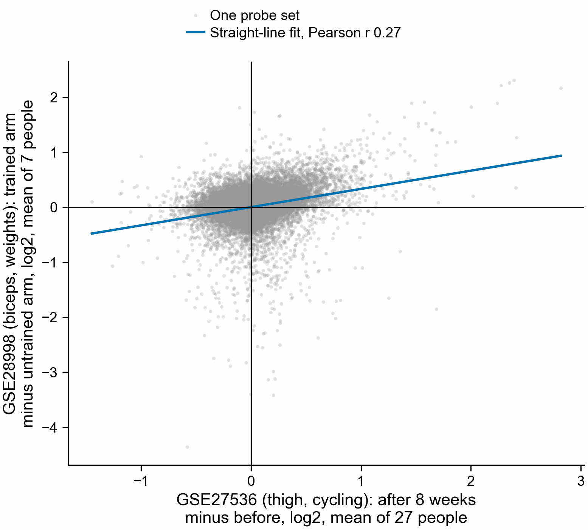

# geo2kmers

geo2kmers turns microarray data from GEO (the NCBI Gene Expression Omnibus) into one k-mer table per
sample, so array data can be set beside k-mer sketches made from RNA-seq. A k-mer is a stretch of k
letters. A sketch is a list of k-mers, here with a weight for each. A probe is one spot on an array.
Most probes have a known sequence; the platform table counts empty spots and controls as probes too. It runs on a CPU; nothing needs a GPU.



## What comes from GEO and what is computed

| value | kind | from what |
|---|---|---|
| intensity | from GEO | the sample's VALUE column, or a channel column on two-colour arrays. Usually a scanner reading, but the submitter's software may have computed it |
| detection call | from GEO | a detection column in the sample table, when there is one. It is the array software's call |
| background | computed here | the 5th percentile of that array's intensities |
| threshold | computed here | the median of that array's intensities |
| `intensity_weight` | computed here | max(0, intensity - background), summed over the probes that hold the k-mer |

An intensity is not a count. It is on a scale of its own for each array, it stops rising when the
scanner saturates, and it may include background. So the weight column is called `intensity_weight`.

## Install

```bash
conda env create -f environment.yml
```

The commands run with `python -m geo2kmers` from this folder.

## Commands

### fetch

```bash
python -m geo2kmers fetch GSE2183 --outdir data/GSE2183
```

Downloads the platform table, the series matrix and, when needed, the GSM (sample) tables, over HTTPS
from GEO. Files already on disk are not downloaded again. `provenance.json` records the accession, the
date and each file's URL and SHA-256 checksum. `samples.tsv` lists the samples and how many channels
each has. Add `--sample-tables` to get GSM tables for a one-colour series too; only they hold detection
calls. A series with several platforms needs `--gpl`. `provenance.json` is rewritten on each `fetch`, so
its date is that of the latest `fetch` command. Its checksums show whether the files are unchanged.

### sequences

```bash
export NCBI_EMAIL=you@example.org
python -m geo2kmers sequences data/GSE2183/GPL1799.txt --out data/GSE2183/probes.fasta
```

- A probe's sequence comes from the platform's SEQUENCE column if the row has one.
- Otherwise it comes from NCBI, using the row's GenBank accession (columns GB_ACC, GB_LIST and similar).
  Requests go in batches of 200 with at least 0.34 seconds between them, or 0.11 seconds if
  `NCBI_API_KEY` is set. NCBI asks for a contact address, so the tool reads it from `NCBI_EMAIL` and
  stops if it is not set. If NCBI does not answer, the batch is tried again up to 5 times, then the command
  stops. Fetched sequences are kept in `genbank_cache.fasta`.
- For an Affymetrix platform with no SEQUENCE column it stops and suggests the Bioconductor probe package
  that holds the 25-letter probes, such as `hgu133plus2probe`. That name is worked out from the platform
  title and not checked, and on newer arrays it can be wrong: Human Gene 1.0 ST's package is
  `hugene10stv1probe`, but the tool suggests `hugene10stprobe`. It stops even if the table has a GenBank
  column, because that record is the gene the probes target, not the probes. It does not guess sequences.
- Only the first accession in a cell is used, and NCBI returns the latest version of the record.
- A GenBank record longer than `--max-genbank-nt` (default 5000) is not used, because a record that long
  is often a genome or chromosome, not the clone on the slide. Long mRNAs pass that length too: 24 rows of
  human array GPL1211 do, up to 14731 nt (`results/frame_test/array_summary.tsv`), so raise the limit for
  an array of full-length clones. The probe is listed as record_too_long and has no sequence, so it adds
  no k-mers.

`probe_sequence_source.tsv` has one row per probe: probe_id, source (gpl_sequence, genbank_fetch,
record_too_long or missing) and length_nt. For record_too_long, length_nt is the record's length.

### land

```bash
python -m geo2kmers land --fasta probes.fasta --proteome proteins.fasta.gz --out landing.tsv
```

Finds the protein each probe lands on, with the rule the platform's probe length calls for (below). On 25-letter
arrays, name each probe `<probe set>/<number>`, and the table gives probe sets.

### sketch

```bash
python -m geo2kmers sketch --fasta data/GSE2183/probes.fasta \
  --intensities data/GSE2183/GSE2183_series_matrix.txt.gz \
  --sample GSM39421 --channel ch2 --k 31 --alphabet dna --mode weighted --out GSM39421.tsv
```

`--intensities` takes a series matrix, one GSM table, or a folder of GSM tables, plain or gzipped. A probe's
name in the FASTA is its whole header, or the header's first word if the intensity table has no such name.

Alphabets:
- `dna`: every k-mer of each probe in canonical form, meaning the smaller of the k-mer and its reverse
  complement. Windows holding a letter other than A, C, G or T are skipped.
- `protein`: the probe is translated in all six frames with the standard genetic code. A stretch is the
  part of a frame between two stop codons, or between a stop and an end of the frame. The longest stretch
  of the six frames is cut into k-mers, and the rest of the probe is not used. If two are equally long,
  the lower frame wins, then the earlier stretch. A codon with an unknown letter becomes X and no k-mer
  crosses it.
- `dayhoff`: the same, with each amino acid written as its group of six: a (C), b (A G P S T), c (D E N Q),
  d (H K R), e (I L M V), f (F W Y). Amino acids in one group often replace each other in evolution.
- `hp`: the same, with each amino acid written as h (hydrophobic: A F G I L M P V W Y) or p (polar:
  C D E H K N Q R S T). The dayhoff and hp groups are the ones sourmash 4.9.4 uses; `tests/test_units.py`
  checks our hashes against sourmash's own.

The longest stretch needs no reference, so it works for any species, but it is not always the protein.
It is in the annotated frame for 7157 of 7958 human sequences, or 89.9 %, and in non-coding probes it is
just the longest gap between stops (`results/frame_test/longest_stretch_GPL1211.tsv`).

With `--proteome`, a proteome picks the stretch instead. It must have at least 100 amino acids, not
counting X, and at least 90 % of its k-mers must be in the proteome, at the same alphabet and k as the sketch. If several
pass, the longest is used. A probe with no passing stretch adds no k-mers. Give the array's own species:
a proteome from another species picks almost nothing on the mussel array, in any alphabet (below).

```bash
python -m geo2kmers sketch --fasta data/GSE2183/probes.fasta \
  --intensities data/GSE2183/gsm --sample GSM39421 --channel ch2 --k 10 --alphabet protein \
  --mode weighted --out GSM39421.tsv --proteome proteins.fasta.gz
```

`--proteome` takes one or more FASTA files, gzipped or not, and works up to k = 14 for protein, 24 for
dayhoff and 63 for hp. It does not apply to `dna`. `<out>.frames.tsv` lists each probe's stretch: frame (0 to
2 read the given strand, 3 to 5 the other), start and length in amino acids, and the share in the proteome,
empty with no proteome. `proteome-index` saves a proteome's k-mers for one alphabet and k in a `.npz` file,
and `--proteome` also takes that file, which is what makes many sketches fast. In the workflow, set `--proteome`
to absolute paths joined by commas: one PROTEOME_INDEX task reads the proteome for each alphabet and k, and every
sketch reads its file.

If no probe gives a k-mer, the command stops with an error rather than write an empty table.

The proteome rule above needs long probes. A frame of a probe of n nt holds floor(n / 3) residues, so it
has floor(n / 3) - k + 1 k-mers:

| probe length | residues per frame | k-mers at k = 12 | rule chosen from the platform's median length |
|---|---:|---:|---|
| 25 nt (Affymetrix) | 8 | 0 | `probe_set`: a probe set is the group of probes reported as one value. A probe lands with one k-mer at k = 7, and a probe set lands on a protein when 3 different probes land on it. `geo2kmers land` does this, and `sketch` stops and says so |
| 50 nt (Illumina) | 16 | 5 | `short_oligo`: the longest frame with no stop at k = 7. `sketch` needs at least half its k-mers in the proteome, and `land` needs at least half on one protein |
| 60 nt (Agilent) | 20 | 9 | `short_oligo` |
| 100 nt or more | 33 or more | 22 or more | `long_probe`: the rule above |

`PLATFORM_RULES` in `geo2kmers/sketch.py` holds these numbers and the reason for each. `--k` sets k, and the
setting column of each table keeps tables of different k apart. `probe_summary.tsv` gives the median probe
length as `probe_length`, with `residues_per_frame`. `sketch_summary.tsv` gives `landing_share`: the probes
with at least one k-mer in the proteome, in any frame, divided by all probes in the intensity table. Most expression probes sit at
the 3' end of a transcript and many are in untranslated sequence, so this share can be well below 1.

These protein, dayhoff and hp sketches differ from what sourmash makes when it translates DNA itself. Sourmash
keeps all six frames, while this tool keeps one stretch. So do not compare them with RNA-seq sketches made by sourmash's own translation without
allowing for that difference.

Modes:
- `present`: the output is the set of k-mers from expressed probes. A probe is expressed if the sample
  table's detection call says so. A call of P passes, and a detection p value of 0.05 or less passes.
  Only the column names listed in `geo2kmers/sketch.py` count, and a column named Detection that holds
  numbers is ignored, because arrays differ in what such a number means. With no detection column, a
  probe is expressed if its intensity is above that array's median. The command prints which rule it used.
  The median and the 5th percentile are taken over every probe with a number, empty spots and controls
  included. A probe whose intensity is not a number is left out of the sketch.
- `weighted`: each probe's weight is max(0, intensity - background). A k-mer's `intensity_weight` is
  the sum of the weights of its probes. A k-mer that occurs twice in a probe adds that probe's weight
  twice, so the sum of `intensity_weight` over all k-mers equals the sum over probes of probe weight
  times number of k-mers in the probe. K-mers of probes with weight 0 stay in the TSV with weight 0.

Outputs: a TSV with columns kmer, alphabet, k, setting, intensity_weight (left out in `present` mode, where
the table is a plain set) and n_probes, where setting is kmerseek's name for the alphabet and k, such as protein20_k10, and
n_probes counts the probes holding the k-mer. `geo2kmers/sketch_schema.md` defines this format, and `sketch`
checks each table against it. kmerseek's read sketches are expected to follow the same file, with `count` as
the value column. A table never has both value columns. The other outputs are `<out>.report.json`, with
every count and the rule used, and, if sourmash is installed, `<out>.sig`.

The signature keeps every k-mer (scaled = 1). In `weighted` mode a sourmash abundance must be a whole
number, so each weight is rounded: abundance = max(1, floor(weight + 0.5)). A k-mer with weight 0 is
left out of the signature. These abundances are rounded intensities, not read counts.

## Two-colour arrays

A two-colour array hybridises two samples to one slide, each with its own dye. GEO reports each dye as
a channel. Which dye is ch1 can change between samples: in GSE2183 ch1 is Cy5 on GSM39421 and GSM39423
and Cy3 on the other two.
On these arrays the series matrix holds a log ratio between the channels, not an intensity. So the
tool refuses it, and `fetch` also downloads the GSM tables, which hold each channel's signal. Choose
one with `--channel ch1` or `--channel ch2`. If it cannot find the column, name it with `--column`.
Negative numbers in the chosen column, on any array, stop the command, because the column is then not a
plain intensity. It may be a log ratio, or a difference such as Affymetrix Average Difference, as in
GSM575. This tool does not sketch either.
All-positive values below 32 print a warning that they may be logarithms; the command then carries on.
The tool cannot otherwise tell a log scale from an intensity. It uses the signal column as GEO gives it
and does not subtract GEO's local background columns. `--channel` and `--column` on a one-colour series
matrix stop the command, since they would do nothing there.

## Workflow

`main.nf` runs fetch, sequences and sketch for every sample of a series, one process per step, and one
sketch per channel on two-colour arrays. Each process runs an inline Python script through an absolute
interpreter path in its first line, because a `conda` directive does not reliably reach an inline
script. Each process has its own path: `--python_fetch`, `--python_sequences` and `--python_sketch`.
The default paths are on Sherlock, so change them on another machine. Set `NCBI_EMAIL` first if
sequences must come from NCBI. `--gpl` and `--sample_tables` pass those options to `fetch`.

```bash
nextflow run main.nf -profile small --gse GSE2183 --outdir results/GSE2183
```

Every process retries up to 3 times when the exit status is empty, `Integer.MAX_VALUE` or in 128 to 143,
which mean something outside the task killed it. Any other failure stops the run with an error. The
test run below did not need a retry. A separate test killed FETCH on purpose: killed every time, it ran 4
times and the run stopped. A task that exited 1 stopped the run after one try (`results/GSE2183/failure_test.log`).
`tests/test_workflow.py` now holds these checks.

The workflow's SUMMARISE task runs `summarise.py`, which writes `sketch_summary.tsv` and `probe_summary.tsv`,
and the workflow writes `wall_time.txt` when it ends. These scripts are not part of it: `frame_test.py` writes
the frame tests, and `array_tables.py` writes `array_summary.tsv`, `longest_stretch_GPL1211.tsv` and
`longest_vs_proteome.tsv`. `whole_genome_record_share_before_fix.tsv` came from `summarise.py` as of
commit caef3fcc, when those records were still kept.

## Result on a real series

GSE2183 is a mussel series, described in `tests/README.md`. The run in `results/GSE2183/` used a 4 CPU,
16 GB job with no GPU and no scheduler inside it, on a compute node of the Sherlock cluster, with the
environment built from `environment.yml`. All numbers below come from the file named beside them, in
that folder. The sketches themselves are too large to keep here.

- 67 tasks ran, each on the first try, with exit status 0 (`geo2kmers.trace.txt`).
- The run took 99 seconds (`wall_time.txt`), under the 10 minutes set for this test.
- The platform has 3840 probes. 3344 got a sequence from GenBank, 30 point to a whole genome record and
  so have no sequence, and 466 have no accession. The 3344 are 1672 distinct sequences,
  each spotted twice. Lengths run from 101 to 650 nt, median 512
  (`probe_summary.tsv`). These lengths are computed from GenBank records, not measured on the slide.
- Each of the 4 samples has 2 channels, so 8 channels at 4 alphabets and 2 modes make 64 sketches
  (`sketch_summary.tsv`).
- DNA k = 31, `weighted`: 693847 distinct k-mers in every sketch. The set is the same because an array
  has a fixed set of probes; only the weights differ (`sketch_summary.tsv`).
- DNA k = 31, `present`: 1717 to 1807 probes pass the median rule, giving 382592 to 443823 distinct
  k-mers (`sketch_summary.tsv`).
- The median is 0 in GSM39424 ch1, and background is 0 in 7 of the 8 channels. Between 148 and 2008 of
  the 3840 probes have intensity exactly 0 (`sketch_summary.tsv`). GEO's table does not say why.
- Protein k = 10, `weighted`, longest stretch: all 3344 probes give k-mers, 163538 distinct. The platform
  record for GPL1799 says each probe is a short tag from the 3' end of an mRNA, because the non-coding end
  is the least conserved part of a gene and so cross-hybridises least with related genes. So many of these
  k-mers are probably not from a protein (`sketch_summary.tsv`).
- The same with the species' own proteome: 652 of the 3344 probes give k-mers, 45727 distinct. That run
  took 124 seconds, in 70 tasks. Three of them read the proteome, for 39 to 40 seconds and at most 1.5 GB each,
  and each sketch task then takes a few seconds (`results/GSE2183_proteome/geo2kmers.trace.txt`).
  With this proteome, `landing_share` is 0.6167 at protein k = 10 (`results/GSE2183_proteome/sketch_summary.tsv`).
  (`results/GSE2183_proteome/`).
- 30 spots (15 clones) list accession AY484747, which NCBI titles "Mytilus edulis mitochondrion, complete
  genome". The platform table names one gene for each clone, such as Mitochondrial-ND6, and one clone
  says Nuclear-RNA 18S. So the record is not what was spotted, and no sequence for these clones
  is known. They are left out. When they were kept, they held 25.9 % of the DNA k = 31 windows and 68.2 %
  to 79.8 % of the weight sum (`whole_genome_record_share_before_fix.tsv`).

## Picking a reading frame with a proteome

`frame_test.py` asks whether a frame can be picked instead of dropping every frame with a stop codon. A
frame is one of the six translations. A stretch is the part of a frame between two stop codons. A frame
or stretch passes if it has at least 10 k-mers and at least 90 % of them are in the proteome. It tests
the 1672 distinct sequences, and three shuffles of each as a chance control (`frame_test.tsv`).

| Proteome | alphabet, k | sequences with a passing frame | with a passing stretch | shuffled, stretch (mean) |
|---|---|---:|---:|---:|
| Human and mouse (GENCODE v50, vM39) | protein, 10 | 7 | 22 | 0.0 |
| Human and mouse | hp, 30 | 19 | 26 | 1.3 |
| Pacific oyster (UP000005408) | protein, 10 | 8 | 24 | 0.0 |
| Pacific oyster | hp, 30 | 27 | 34 | 0.0 |
| Same species (UP000596742) | protein, 10 | 272 | 456 | 0.0 |
| Same species | hp, 30 | 434 | 484 | 0.3 |

So human and mouse pick a frame for at most 26 of 1672 sequences at these settings, and at most 30 at any
setting where no shuffled sequence passes (`mussel_vs_human_mouse.tsv`), even though 420 share at least one
protein 10-mer with them. The same-species proteome reaches 456 to 484. The other sequences may be
non-coding, missing from that proteome, different from it by enough letters to fall under 90 %, or too
short to give 10 k-mers; this test cannot tell which. Protein k = 5 and hp k = 15
or 20 are no use: almost every shuffled sequence passes as well. This led to `--proteome`, described under sketch.

Dayhoff does not rescue a proteome from another species. On the mussel array, oyster proteins pass 32
sequences at dayhoff k = 15 and 23 at k = 19, against 24 at protein k = 10. Dayhoff k = 12 passes 67, but 6
shuffled sequences pass too (`mussel_vs_oyster.tsv`, with `mussel_vs_human_mouse.tsv` and
`mussel_vs_same_species.tsv`). So dayhoff k = 19 is in the workflow's default for comparing sketches, not
for picking frames. No comparison between sketches has been run yet.

`results/frame_test/frame_choice_human_mussel.png`, drawn by `figure_frames.py`, shows the two main results.

Where the proteome picks a stretch of 100 amino acids or more, the plain longest stretch is in the same
frame for 316 of 326 mussel sequences, 1667 of 1821 mouse and 6002 of 6484 human (`longest_vs_proteome.tsv`).

The same test on two arrays whose species is in GENCODE (`results/frame_test/`). GPL1211 is a human array
of full-length clones, median 1668 nt; GPL738 is a mouse EST array, median 562 nt. Each was tested against
its own species only (`array_summary.tsv`, `frame_test_GPL1211.tsv`, `frame_test_GPL738.tsv`). The GPL1211
sequences were made with no length limit, so its 24 long rows are in; to repeat this use `--max-genbank-nt 20000`.

| Array | distinct sequences | with a stop-free frame | passing frame | passing stretch | shuffled, stretch (mean) |
|---|---:|---:|---:|---:|---:|
| Human GPL1211, protein k = 10 | 8845 | 38 | 1072 | 7025 | 0.0 |
| Human GPL1211, hp k = 30 | 8845 | 38 | 2844 | 6573 | 3.0 |
| Mouse GPL738, protein k = 10 | 8432 | 1556 | 1374 | 2704 | 0.0 |
| Mouse GPL738, hp k = 30 | 8432 | 1556 | 1876 | 2475 | 2.3 |

A whole frame passes less often than a stretch, because the parts of it outside the coding region do not
match; the stretch holding the protein does. The gap is widest on the human array at protein k = 10. The chosen stretch was checked on GPL1211 against the coding region NCBI
annotates on 7958 of its sequences (`frame_truth.tsv`). At protein k = 10, 6563 have a passing stretch, and
the longest passing stretch is in the true frame for 6147, or 93.7 %. If the longest stretch must be at
least 100 amino acids, that rises to 98.7 %, on 6111 sequences (`frame_truth_by_length.tsv`). GPL738 has no
such check. Frames are only as right as NCBI's annotation of each record.

## A test against a published figure

**The result does not show that this method recovers the signature.** Domen et al. 2026 (PNAS) Fig. 4C-D scores
exercise datasets on a list of 280 macrophage genes, called 338 in the paper because some are listed twice, and
reports an AUC for each: the chance that a post-exercise sample scores above a pre-exercise one, where 0.5 means
no difference. `fig4.nf` tries to get the same answer with no gene annotation: probes land on the proteins of
those genes through protein k-mers alone. `fig4/README.md` describes the method and the files in `results/fig4/`.

| Series | comparison | published AUC | planned score | second score |
|---|---|---:|---:|---:|
| GSE104079 | as in the authors' code | 0.18 | 0.495 | **0.322** |
| GSE27536 | as in the authors' code | 0.17 | **0.277** | **0.277** |
| GSE83578 | 30 min | 0.07 | 0.340 | **0.094** |
| GSE83578 | 3 h | 0.07 | 0.266 | **0.105** |
| GSE83578 | 24 h | 0.54 | **0.648** | **0.598** |
| GSE111555 | 18 weeks, authors' groups | 0.93 | **0.786** | **0.900** |
| GSE111555 | 18 weeks, corrected groups | 0.809 | **0.762** | **0.875** |
| GSE28998 | 12 weeks | 0.80 | 0.531 | 0.592 |

Bold means on the same side of 0.5 as the published AUC and within 0.15 of it, the rule fixed before running
(`auc.tsv`). GSE111555 has two rows for one comparison, explained below, so the counts are out of 7 either way. The planned score is the M2 proteins' mean minus the M1 proteins' mean, where M1 and M2 are the
paper's two groups of genes: each group counts equally, however many genes it has. `accuracy.png` calls this the group-average score. The second score, called the weighted-sum score there, was added after the plan: it puts the weights of Ghosh et al.
2023 on sums, which PR 212 found the published code does. For GSE27536 both scores use M1 alone and are the
same number.

Chance explains the planned score's count as well as the method does. For the second score, shuffled labels
do not rule out chance, and random features do (`chance_test.tsv`, 1000 draws):

| score | comparisons passing | if the landings mean nothing (random features) | if the gene groups mean nothing (shuffled labels) |
|---|---:|---|---|
| planned | 3 of 7 | 1.31 on average, 3 or more in 12.8 % of draws | 1.34 on average, 3 or more in 14.0 % |
| second | 6 of 7 | 1.56 on average, 6 or more in none of the 1000 draws | 4.87 on average, 6 or more in 19.3 % |

So the planned score is not separated from chance. The second score beats random features but not shuffled
labels. Random features are the easier test to beat: they are drawn from the whole array with no match on
expression level, so beating them is not evidence for the method. Shuffled labels are the fair test. The proteins that landed move together after exercise, whichever gene group they are given, so most of
that score's passes do not depend on which genes are M1 or M2. Single passes need care too. GSE83578 at 24 h
passes in 43.5 % of random draws on the planned score, because its published 0.54 is close to no difference
(`chance_by_comparison.tsv`).

The 7 comparisons are not 7 separate tests. GSE27536 and GSE28998 use one platform and have the same landing
table, and the three GSE83578 comparisons share one pre group. The chance test keeps the GSE83578 comparisons
tied together, with one shuffle for the series, but shuffles GSE27536 and GSE28998 separately. Tying those two
as well would make passes come together more often, so the share of draws with 6 or more would more likely rise
above 19.3 % than fall below it. That would not help the second score. The change was not measured.

Five of the 7 comparisons follow the same people, which `auc.tsv` does not use (`results/fig4/pairing.tsv`, from
`fig4/pairing.py`). GSE27536 has 27 people before and after, GSE28998 has the trained and untrained arm of 7
people, and GSE83578 has 8 people, each giving a control and an LPS-treated sample at every time, so its 16
samples per group are 8 people. In GSE111555, all 16 people are in both groups once six samples are corrected (below); `pairing.tsv` shows the authors' groups, 10 of 16. GSE104079 is unpaired, because
each mouse had one treatment, but its groups pool liver and soleus. The AUC compares groups, so these rows say
nothing about change within one person, and the Mann-Whitney p values treat samples from one person as unrelated.
No verdict uses those p values.

Six GSE111555 samples are in the wrong group in the authors' code, and in ours until now. The samples 1Pb,
2Pb, 3Pb, 6Pb, 7Pb and 8Pb are blood cells from after training, but GEO's source field says pretraining. Four
things show this, and the other 136 samples in the series all agree between title and source. Their titles say
posttraining and their files are named `b`, the after-training letter. Each one's VO2peak, the fitness
measure, equals the after-training value from that man's muscle or blood sample, not his baseline value
(`gse111555_labels.tsv`). Each man also has a baseline PBMC sample, so the source field would give him two
baselines in a before-and-after study. We found no paper that describes this array set. GEO links none, and
Dias et al. 2015, from the same lab, reports 13 policemen recruits and 18 weeks of running on a different
array. We read only that paper's abstract. Sun et al. 2025 used GSE111552, these same samples, as 16 against
16. GEO's record still has the wrong field, and the authors have not been asked.

Correcting the groups changes the published number too. The authors' 22 vs 10 gives 0.93, and PR 212 reproduces
it at 0.932. PR 212's own sample scores on the corrected 16 vs 16 give 0.809, p 0.0031 in place of 2.96e-05, so the
printed 0.93 is partly a result of the six samples. `results/fig4/corrected_labels/` reruns `fig4.nf` with that
0.809 as the reference. Both of our scores stay within 0.15 of it, so the counts stay 3 of 7 and 6 of 7. Holding
the reference at 0.93 on the corrected groups would compare different samples on the two sides. If done anyway,
the planned score's 0.762 fails and the second score's 0.875 passes. Using 0.809 was decided after seeing that,
so it is a judgement, not part of the rule fixed before running. It is not a number the paper printed.

With the corrected groups the chance test (1000 draws) gives 3 or more passes in 18.1 % of random-feature draws
and 18.2 % of shuffled-label draws for the planned score, up from 12.8 % and 14.0 %. For the second score, 6 or
more stays at none of the draws and 19.3 %. Neither score separates from chance any better than before.

The rule also asked that a series have a landing share of at least 0.2, and none does. The nearest number is
`share_of_probes_with_a_kmer_in_proteome` in `platforms.tsv`: of the probes with a sequence, the share with at
least one k-mer in the proteome, before the landing rule is applied. It runs from 0.0079 to 0.0354, because the
proteome is 262 proteins. The share that truly land is lower still, so none reaches 0.2 either way. This is not
the `landing_share` that `sketch` reports, which divides by all probes in the intensity table.
So no series qualified, and the task passes under that rule without testing anything. That part of the rule
was the wrong one, and the tables above are the real result. GSE120862, GSE99963 and GSE144304 are RNA-seq, which
geo2kmers does not cover. The groups are those in the authors' code, which PR 212 found differ from what some
panels say. GSE104079 is mouse, landing on human proteins.


### KaMRaT and SPLASH on the raw probes

KaMRaT tests 25-letter k-mers between pre and post, which is the k-mer form of differential expression. SPLASH finds
15-letter anchors whose next 10 letters change between samples, which is how alternative splicing looks. Both ran on each
sample's raw probe intensities with no gene annotation (`fig4/README.md`).

| comparison | pre and post share scan days | k-mers changed, of tested | most in 5 shuffles | SPLASH anchors changed | most in 100 shuffles |
|---|---|---:|---:|---:|---:|
| GSE83578, 30 min | yes | 68554 of 504943 | 0 | 43 | 0 |
| GSE111555, 18 weeks | yes | 765052 of 5335617 | 1 | 6709 | 0 |
| GSE28998, 12 weeks | yes | 102 of 594532 | 1 | 5 | 4 |
| GSE83578, 24 h | mostly not | 0 of 504943 | 0 | 0 | 1 |
| GSE83578, 3 h | mostly not | 75733 of 504943 | 0 | 51 | 2 |
| GSE27536 | mostly not | 25726 of 594532 | 0 | 17 | 2 |
| GSE104079, 45 min | no, separate slides | 978716 of 1969729 | 767371 | 2138 | 2494 |

A false discovery rate of 5 % sets each count. Large counts in the three lower rows cannot be told from a batch
difference, because their pre and post samples were mostly run on different days or slides. In GSE104079 the one shuffle
that nearly repeated the slide split found 767371 k-mers, and the other four found none. The GSE111555 groups are the
corrected ones. Thirty of its 6709 anchors sit inside one gene cluster, the case closest to alternative splicing. Most
anchors cross gene clusters, so they may reflect expression, not splicing. Counts of hits on signature proteins are in
`summary.tsv`, but a 7-letter landing can happen by chance, and no control was run for them. These counts say that the
groups differ. They do not test the published score.

### Held-out AUC from probe k-mers

Can probe k-mers tell post from pre in a person they were not chosen on? For each person in turn, the 1000 k-mers with
the lowest KaMRaT p-value were chosen on the other people, and the left-out person's samples were scored with them
(`fig4/held_out_plan.md`, written before any AUC was run). Chance is the same steps after swapping pre and post within
each person.



| comparison | people | held-out AUC | p | people higher after | published AUC |
|---|---:|---:|---:|---:|---:|
| GSE83578, 30 min | 8 | 0.996 | 0.005 | 8 | 0.93 |
| GSE28998, 12 weeks | 7 | 1.000 | 0.016 | 7 | 0.80 |
| GSE111555, 18 weeks | 16 | 0.980 | 0.005 | 16 | 0.809 |

Each p is the lowest the test allows: 1 in 201 for 200 swaps, and 2 in 128 for GSE28998, whose 7 people allow only 128
arrangements. With 100 or 10000 k-mers the AUCs are 0.965 to 1.000. The published AUCs are turned so that 1 means
post above pre (0.07 for GSE83578 30 min becomes 0.93). This beats the published score, but it is a weaker test: the
published genes were fixed before these series, while these k-mers were chosen on other people of the same series and
the same array. A difference shared by most people of a series, such as a batch, would carry over to the left-out
person. The next section tests k-mers on a second series.

KaMRaT's false discovery correction divides by rank + 1 and never adjusts the top k-mer, so its adjusted values are
about half the standard Benjamini-Hochberg ones at the top. That is why it reports 102 k-mers for GSE28998 where the
standard method gives 100. Its ranking by p-value is unaffected and matches ours.

The 30 GSE111555 SPLASH anchors that sit inside one gene cluster fall in 18 clusters
(`results/fig4/held_out/GSE111555.anchor_genes.tsv`). Twelve anchors are in 10 protein-coding genes: TTN (3 anchors),
CLPTM1L, HRC, HSPG2, GIGYF2, MRPL23, STX3, DUSP5, MAGEC1 and VCX. The other 18 are in non-coding clusters, five of
them in linc-BRD9-1. None is a signature gene. Only 2 anchors include a probe across an exon-exon junction; the other
28 compare probes within exons, which a change in which part of a transcript is kept or a probe's own response could
also explain. Each probe's pre and post share of its anchor is in `GSE111555.anchor_probes.tsv`.

### Probe k-mers chosen on one series and scored on another

The 1000 probe k-mers that best separate pre from post in one U133 Plus 2 series also separate pre from post in the
other, in both directions, better than random k-mers do. The rules are in `fig4/cross_series_plan.md`, written before
the run. GSE28998 is biceps of 7 people before and after 12 weeks of resistance training; GSE27536 is thigh muscle of 27
people, 12 healthy and 15 with COPD, before and after 8 weeks of endurance training. No HTA 2.0 series has a partner here.



| Chosen on | Scored on | AUC | p, labels swapped | p, random k-mers | Random k-mers, median AUC | People higher after |
|---|---|---:|---:|---:|---:|---:|
| GSE28998 | GSE27536 | 0.868 | 0.005 | 0.005 | 0.698 | 22 of 27 |
| GSE27536 | GSE28998 | 1.000 | 0.008 | 0.005 | 0.714 | 7 of 7 |

Each k-mer keeps the direction it moved in the series it was chosen on, and is standardised over all samples of the
scored series, without labels. The random sets have as many k-mers going up as the chosen set. Random k-mers already
reach a median AUC of 0.70 and 0.71, so much of the change after training is shared by most probes on this array, in both
series; the chosen k-mers beat all 200 random sets. The count of people higher after is not better than random k-mers
(p 0.19 and 0.09), only the AUC is. With 100 k-mers, GSE28998 to GSE27536 gives 0.706, which random k-mers match
(p 0.14). 27 k-mers constant in every sample of a series were dropped; that rule was added after the first run, where
they left random sets in GSE28998 without an AUC, and is recorded in the plan. This is one pair of series on one array,
which differ in muscle, training and health, so it shows the change carries over but not which part of it does.

KaMRaT's contigs are short: 81 % to 98 % of contigs from each comparison's 10000 top k-mers are one 25-letter k-mer on
the Affymetrix arrays, and the longest is 84 letters (`results/fig4/contig_lengths/contig_lengths.png`), because each
Affymetrix probe is 25 letters (`results/fig4/probe_lengths/probe_lengths.png`). SPLASH ran without its compactor
step, so it gives anchors and targets of 15 and 10 letters, not contigs.

### Full-length proteins behind each probe set

Array probes are too short for a 30-amino-acid hydrophobic-polar (HP) k-mer, and few sit in coding sequence. A probe
set measures its transcript wherever its probes sit, so the protein of the transcript it names can carry its value.
The rules are in `fig4/probe_protein_plan.md`, written before the first fetch.



| Array | Probe sets | Protein of 30 aa or more | Nucleotide only (EST or genomic clone) | No protein-coding source |
|---|---:|---:|---:|---:|
| U133 Plus 2 | 54,675 | 41,325 (76 %) | 13,229 (24 %) | 121 |
| HTA 2.0 | 70,753 | 19,973 (28 %) | 0 | 49,960 (71 %), and 820 with an Ensembl protein not yet fetched |

On U133 Plus 2, 40,001 probe sets get proteins through the RefSeq mRNAs their annotation lists, 692 through a
full-length cDNA they were designed on, 443 through another GenBank mRNA and 189 through RefSeq model mRNAs. 12,975
were designed on ESTs with no protein annotated, and 254 on genomic clones of up to 340 kb; these keep their nucleotide
sequence, untranslated. On HTA 2.0, 46,555 transcript clusters name only non-coding RNAs (lincRNA, antisense, snoRNA,
pseudogene), so no protein exists for them. The value is the RNA's, not the protein's, and a probe set pools the
isoforms that share its probes. Probe set to sequence pairs are in `results/fig4/probe_proteins/probe_set_proteins.tsv.gz`;
the 40,990 + 776 proteins and 12,884 EST sequences are on Sherlock in
`/scratch/users/olgabot/geo2kmers-fig4/ho/sources/fetched{,_est}/`.

### 30-letter HP k-mers from the probe-set proteins

Each protein above was cut into every 30-residue window and written in two hydrophobic-polar (HP) alphabets, as
kmerseek defines them: `hp_lehninger2` (kmerseek's default `hp`; hydrophobic `AFGILMPVWY`) and `hp_thomas_dill2`
(hydrophobic `ACFILMVWY`). Each k-mer takes the series matrix value (the authors' RMA, log2) of the probe sets whose
proteins hold it, averaged when there are several. The rules are in `fig4/hp_table_plan.md`, written before the run.



| Array | Alphabet | Probe sets with a k-mer | Distinct 30-letter HP k-mers | In one probe set | In 2 or more | Most probe sets for one k-mer |
|---|---|---:|---:|---:|---:|---:|
| U133 Plus 2 | hp_lehninger2 | 41,323 | 10,107,953 | 3,209,983 (32 %) | 6,897,970 | 342 |
| U133 Plus 2 | hp_thomas_dill2 | 41,323 | 9,656,563 | 3,000,225 (31 %) | 6,656,338 | 1356 |
| HTA 2.0 | hp_lehninger2 | 19,971 | 10,000,664 | 9,485,991 (95 %) | 514,673 | 129 |
| HTA 2.0 | hp_thomas_dill2 | 19,971 | 9,559,808 | 8,833,022 (92 %) | 726,786 | 500 |

Most U133 k-mers sit in two or more probe sets because U133 has several probe sets per gene, and each names the same
gene's RefSeq mRNAs, so they hold the same proteins. HTA 2.0 has one transcript cluster per gene, so 92 % to 95 % of its
k-mers sit in one. The most shared k-mers on both arrays are runs of 29 or 30 polar residues; `hp_thomas_dill2` counts G and P as polar, so it has more of them. The table has three parts per
series, on Sherlock in `/scratch/users/olgabot/geo2kmers-fig4/ho/sources/hp/` because the shared-k-mer matrices are
0.2 to 1 GB each: `<array>.<alphabet>.kmers.npz` (each k-mer and the probe sets holding it),
`<series>.probe_set_values.tsv.gz`, and `<series>.<alphabet>.shared_kmers.tsv.gz` (the sample matrix for k-mers in two
or more probe sets). The counts are in `results/fig4/hp_tables/`.

### Held-out and cross-series tests on the HP k-mers

The same two tests as above, run on the 30-letter HP k-mers instead of the 25-letter probe k-mers, under rules written
before the run (`fig4/hp_tests_plan.md`). HP k-mers held by the same probe sets have the same values, so they are tested
once and counted as many times as there are such k-mers; a test checks that this gives the same scores as testing each
k-mer. Values are the authors' RMA values, already log2, used as they are.



| Test | Probe k-mers AUC | hp_lehninger2 AUC (p) | hp_thomas_dill2 AUC (p) | Probe sets behind the 1000 HP k-mers | Verdict |
|---|---:|---|---|---|---|
| GSE28998, each person held out | 1.00 | 1.00 (0.016) | 1.00 (0.016) | 34-285 and 111-777 | works in new people |
| GSE111555, each person held out | 0.98 | 0.97 (0.005) | 0.97 (0.005) | 19-155 and 223-1706 | works in new people |
| Chosen on GSE28998, scored on GSE27536 | 0.87 | 0.83 (0.005, 0.005) | 0.82 (0.005, 0.005) | 148 and 303 | carries over |
| Chosen on GSE27536, scored on GSE28998 | 1.00 | 0.98 (0.008, 0.383) | 0.98 (0.008, 0.343) | 10 and 54 | not informative: random k-mers reach 0.96, near the ceiling (the rule written first says fails) |

For held-out tests, p is against labels swapped within each person; GSE28998 has 7 people, so 0.016 (2 of 128) is
the lowest p it can give. For cross-series tests the two p values are against swapped labels and against random k-mers.
The held-out ranges are the fewest and most probe sets over the people left out.

With 1000 k-mers, the HP k-mers' AUCs are at most 0.05 below the probe k-mers' in every test, for both alphabets.
With 100 k-mers they are not: chosen on GSE28998 and scored on GSE27536, the 100 HP k-mers come from 3 probe sets and
give AUC 0.49 with both alphabets (p 0.60 against swapped labels), where the 100 probe k-mers give 0.71. Three of four
tests pass at 1000 k-mers. The fourth cannot tell either way, though under the rule written first it fails, where the probe k-mers
passed: chosen on GSE27536, random HP k-mers that went up in GSE27536
also score GSE28998 at a median AUC of 0.96 (random probe k-mers: 0.71), so the 1000 chosen ones (0.98) do no better
than random sets: 38 % and 34 % of random sets score as high. With 10000 k-mers the chosen ones (1.00) do beat random
sets (p 0.005 for both alphabets), but the rule uses 1000. Of the 1000 chosen HP k-mers, 1000 (`hp_lehninger2`) and
997 (`hp_thomas_dill2`) went up after training, and they come from only 10 and 54 probe sets. Results are in `results/fig4/hp_held_out/` and `results/fig4/hp_cross_series/`; `fig4_held_out.nf --hp` reruns them.

**What GSE28998 is.** It is not before and after in time. Seven people trained one arm with weights for 12 weeks; a
week later both arms did the same bout, and both biceps were biopsied 4 h after it (GEO's overall design). Its "pre"
is the untrained arm and its "post" the trained arm of the same person, on the same day. Pre and post were scanned on
the same days. GSE27536 (thigh, 8 weeks of cycling, 12 healthy people and 15 with COPD) is from another lab and paper,
so the two series are not related. But their changes agree gene by gene: over the 41,325 U133 probe sets with a
protein, the Pearson r between GSE27536's after-minus-before and GSE28998's trained-minus-untrained is 0.27. Several probe
sets measure one gene, so r was also computed over the 19,584 groups of probe sets with the same proteins: 0.29, with a
95 % bootstrap interval over groups of 0.26 to 0.33. Spearman's r, on ranks, is 0.15, so part of the agreement comes
from the probe sets that changed most.
Probe sets that went up in GSE27536 average +0.041 log2 in GSE28998, and those that went down average -0.019. There
is no shift of the whole GSE28998 array: in each person 47 % to 52 % of probe sets are higher in the trained arm.
This shared training response is one likely reason random k-mers that went up in GSE27536 also score GSE28998 well.
It does not explain on its own why random HP k-mers reach 0.96 where random probe k-mers reach 0.71, since both carry
it. Three other differences were not tested: the random HP sets are all k-mers that went up (as the chosen ones did),
while the random probe sets were 879 up and 121 down; the HP test reads the authors' RMA values and the probe test raw
intensities; and how many probe sets the random HP sets come from was not recorded. The random-k-mer chance test
assumes random k-mers carry no training signal, which is not true here, so it is strict in that direction. `fig4/series_agreement.py` writes these numbers and the figure to `results/fig4/series_agreement/`.



## Limits

- `land` is for probes under 100 nt: it stops on longer ones and points to `sketch --proteome`.
- Chance and repeats land too. Landing on backward proteins, which code for nothing, gives 22 landings on GPL13912
  against 81 real ones, 7 against 316 on GPL570, 16 against 433 on GPL13667, and 2353 against 3484 on GPL17586
  (`results/fig4/platforms.tsv`).
- On arrays with overlapping probes, such as GPL17586, a probe set can pass the 3 probe rule on one k-mer. Its
  landings with fewer than 5 different k-mers agree with the platform's gene names 0 times in 2227; those with 5 or
  more agree 277 times in 721. The older arrays agree 77.1 % (GPL570) and 84.7 % (GPL13667) of the time, and
  old and new gene names count as disagreement (`results/fig4/annotation_control.tsv`).
- The sequence fetched for a GenBank accession is the whole record, which need not be exactly what was
  spotted on the slide. On GSE2183, 3344 spots use the EST record of the clone, the closest sequence
  published. A record under the length limit that is not the clone would not be caught.
- A short-oligo platform from another maker, with a GenBank column and no SEQUENCE column, gets the whole
  GenBank record with no warning. Only Affymetrix platforms are stopped.
- Probes sharing an accession add their weights, so a sequence spotted twice weighs twice as much.
- Weights from different arrays are on different scales, and no normalisation between arrays is done.
- The sketches have not yet been compared with an RNA-seq sketch.

## Tests

```bash
python -m pytest tests
```

`tests/README.md` describes the test series and the known-answer checks. `tests/test_helpers.py` runs the
helper scripts on small files whose answers are worked out by hand. It only checks that `figure_frames.py` runs
and that `fig4/chance.py` gives a table of the right shape, and it does not run `fig4/plot.py`.
`tests/test_workflow.py` reads `main.nf`. `fig4.nf` has no test of its own.

The tests that run `main.nf` are skipped unless asked for, because they need Nextflow and the network, and
take a few minutes. They check the sketch count, that a proteome is read once for each alphabet and k, that a
killed task is retried, and that a failed task stops the run. Run them on a machine meant for it:

```bash
GEO2KMERS_TEST_NEXTFLOW=1 python -m pytest tests/test_workflow.py
```
