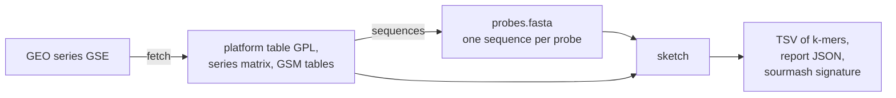

# geo2kmers

geo2kmers turns microarray data from GEO (the NCBI Gene Expression Omnibus) into one k-mer table per
sample, so array data can be set beside k-mer sketches made from RNA-seq. A k-mer is a stretch of k
letters. A sketch is a list of k-mers, here with a weight for each. A probe is one spot on an array.
Most probes have a known sequence; the platform table counts empty spots and controls as probes too. It runs on a CPU; nothing needs a GPU.



## What is measured and what is computed

| value | kind | from what |
|---|---|---|
| intensity | measured | GEO: the sample's VALUE column, or a channel column on two-colour arrays |
| detection call | measured | GEO: a detection column in the sample table, when there is one |
| background | computed | the 5th percentile of that array's intensities |
| threshold | computed | the median of that array's intensities |
| `intensity_weight` | computed | max(0, intensity - background), summed over the probes that hold the k-mer |

An intensity is not a count. It is on a scale of its own for each array, it stops rising when the
scanner saturates, and it includes background. So the weight column is called `intensity_weight`.

## Install

```bash
conda env create -f environment.yml
```

The commands run with `python -m geo2kmers` from this folder.

## Commands

### fetch

```bash
python -m geo2kmers fetch GSE2183 --outdir data/GSE2183
```

Downloads the platform table, the series matrix and, when needed, the GSM (sample) tables, over HTTPS
from GEO. Files already on disk are not downloaded again. `provenance.json` records the accession, the
date and each file's URL and SHA-256 checksum. `samples.tsv` lists the samples and how many channels
each has. Add `--sample-tables` to get GSM tables for a one-colour series too; only they hold detection
calls. A series with several platforms needs `--gpl`. `provenance.json` is rewritten on each `fetch`, so
its date is that of the latest `fetch` command. Its checksums show whether the files are unchanged.

### sequences

```bash
export NCBI_EMAIL=you@example.org
python -m geo2kmers sequences data/GSE2183/GPL1799.txt --out data/GSE2183/probes.fasta
```

- A probe's sequence comes from the platform's SEQUENCE column if the row has one.
- Otherwise it comes from NCBI, using the row's GenBank accession (columns GB_ACC, GB_LIST and similar).
  Requests go in batches of 200 with at least 0.34 seconds between them, or 0.11 seconds if
  `NCBI_API_KEY` is set. NCBI asks for a contact address, so the tool reads it from `NCBI_EMAIL` and
  stops if it is not set. Fetched sequences are kept in `genbank_cache.fasta`.
- For an Affymetrix platform with no SEQUENCE column it stops and names the Bioconductor probe package
  that holds the 25-letter probes, such as `hgu133plus2probe`. It stops even if the table has a GenBank
  column, because that record is the gene the probes target, not the probes. It does not guess sequences.
- Only the first accession in a cell is used, and NCBI returns the latest version of the record.
- A GenBank record longer than `--max-genbank-nt` (default 5000) is not used. A record that long is a
  genome or chromosome, not the clone on the slide. The probe is listed as record_too_long and has no
  sequence, so it adds no k-mers.

`probe_sequence_source.tsv` has one row per probe: probe_id, source (gpl_sequence, genbank_fetch,
record_too_long or missing) and length_nt. For record_too_long, length_nt is the record's length.

### sketch

```bash
python -m geo2kmers sketch --fasta data/GSE2183/probes.fasta \
  --intensities data/GSE2183/GSE2183_series_matrix.txt.gz \
  --sample GSM39421 --channel ch2 --k 31 --alphabet dna --mode weighted --out GSM39421.tsv
```

`--intensities` takes a series matrix, one GSM table, or a folder of GSM tables.

Alphabets:
- `dna`: every k-mer of each probe in canonical form, meaning the smaller of the k-mer and its reverse
  complement. Windows holding a letter other than A, C, G or T are skipped.
- `protein`: the probe is translated in all six frames with the standard genetic code. A frame with a
  stop codon anywhere is dropped, and each remaining frame is cut into k-mers. A codon with an unknown
  letter becomes X and no k-mer crosses it.
- `hp`: the same, with each amino acid then written as h (hydrophobic: A F G I L M P V W Y) or p (polar:
  C D E H K N Q R S T). Those groups are the ones sourmash 4.9.4 uses; `tests/test_units.py` checks our
  hashes against sourmash's own.

A 25 nt probe gives at most 8 amino acids in a frame, so protein k must be 8 or less on short-probe
arrays. If no probe gives a k-mer, the command stops with an error rather than write an empty table.
Long probes do not solve the problem by themselves; see the result below.

These protein and hp sketches differ from what sourmash makes when it translates DNA itself. Sourmash
keeps all six frames, while this tool drops any frame with a stop codon. So do not compare them with
RNA-seq sketches made by sourmash's own translation without allowing for that difference.

Modes:
- `present`: the output is the set of k-mers from expressed probes. A probe is expressed if the sample
  table's detection call says so. A call of P passes, and a detection p value of 0.05 or less passes.
  Only the column names listed in `geo2kmers/sketch.py` count, and a column named Detection that holds
  numbers is ignored, because arrays differ in what such a number means. With no detection column, a
  probe is expressed if its intensity is above that array's median. The command prints which rule it used.
  The median and the 5th percentile are taken over every probe with a number, empty spots and controls
  included. A probe whose intensity is not a number is left out of the sketch.
- `weighted`: each probe's weight is max(0, intensity - background). A k-mer's `intensity_weight` is
  the sum of the weights of its probes. A k-mer that occurs twice in a probe adds that probe's weight
  twice, so the sum of `intensity_weight` over all k-mers equals the sum over probes of probe weight
  times number of k-mers in the probe. K-mers of probes with weight 0 stay in the TSV with weight 0.

Outputs: a TSV with columns kmer, intensity_weight (or presence) and n_probes, where n_probes counts
the probes holding the k-mer; `<out>.report.json` with every count and the rule used; and, if sourmash
is installed, `<out>.sig`.

The signature keeps every k-mer (scaled = 1). In `weighted` mode a sourmash abundance must be a whole
number, so each weight is rounded: abundance = max(1, floor(weight + 0.5)). A k-mer with weight 0 is
left out of the signature. These abundances are rounded intensities, not read counts.

## Two-colour arrays

A two-colour array hybridises two samples to one slide, each with its own dye. GEO reports each dye as
a channel. Which dye is ch1 can change between samples: in GSE2183 ch1 is Cy5 on GSM39421 and GSM39423
and Cy3 on the other two.
On these arrays the series matrix holds a log ratio between the channels, not an intensity. So the
tool refuses it, and `fetch` also downloads the GSM tables, which hold each channel's signal. Choose
one with `--channel ch1` or `--channel ch2`. If it cannot find the column, name it with `--column`.
Negative numbers in the chosen column, on any array, stop the command, because they mean a log ratio.
All-positive values below 32 print a warning that they may be logarithms; the command then carries on.
The tool cannot otherwise tell a log scale from an intensity. It uses the signal column as GEO gives it
and does not subtract GEO's local background columns. `--channel` and `--column` on a one-colour series
matrix stop the command, since they would do nothing there.

## Workflow

`main.nf` runs fetch, sequences and sketch for every sample of a series, one process per step, and one
sketch per channel on two-colour arrays. Each process runs an inline Python script through an absolute
interpreter path in its first line, because a `conda` directive does not reliably reach an inline
script. Each process has its own path: `--python_fetch`, `--python_sequences` and `--python_sketch`.
The default paths are on Sherlock, so change them on another machine. Set `NCBI_EMAIL` first if
sequences must come from NCBI. `--gpl` and `--sample_tables` pass those options to `fetch`.

```bash
nextflow run main.nf -profile small --gse GSE2183 --outdir results/GSE2183
```

Every process retries up to 3 times when the exit status is empty, `Integer.MAX_VALUE` or in 128 to 143,
which mean something outside the task killed it. Any other failure stops the run with an error. This
retry rule was not triggered in the test run.

`summarise.py` is not part of the workflow. It turns a finished run into the summary tables quoted below.

## Result on a real series

GSE2183 is a mussel series, described in `tests/README.md`. The run in `results/GSE2183/` used a 4 CPU,
16 GB job with no GPU and no scheduler inside it, on a compute node of the Sherlock cluster, with the
environment built from `environment.yml`. All numbers below come from the file named beside them, in
that folder. The sketches themselves are too large to keep here.

- 50 tasks ran, each on the first try, with exit status 0 (`geo2kmers.trace.txt`).
- The run took 70 seconds (`wall_time.txt`), under the 10 minutes set for this test.
- The platform has 3840 probes. 3344 got a sequence from GenBank, 30 point to a whole genome record and
  so have no sequence, and 466 have no accession. The 3344 are 1672 distinct sequences,
  so most sequences are spotted more than once. Lengths run from 101 to 650 nt, median 512
  (`probe_summary.tsv`). These lengths are computed from GenBank records, not measured on the slide.
- Each of the 4 samples has 2 channels, so 8 channels at 3 alphabets and 2 modes make 48 sketches
  (`sketch_summary.tsv`).
- DNA k = 31, `weighted`: 693847 distinct k-mers in every sketch. The set is the same because an array
  has a fixed set of probes; only the weights differ (`sketch_summary.tsv`).
- DNA k = 31, `present`: 1717 to 1807 probes pass the median rule, giving 382592 to 443823 distinct
  k-mers (`sketch_summary.tsv`).
- The median is 0 in GSM39424 ch1, and background is 0 in 7 of the 8 channels. Between 148 and 2008 of
  the 3840 probes have intensity exactly 0 (`sketch_summary.tsv`). GEO's table does not say why.
- Protein k = 10 and hp k = 30, `weighted`: 2578 of the 3344 probes have zero usable frames. So 766
  probes supply all the protein k-mers, and 762 all the hp k-mers, since 4 more are too short for k = 30
  (`probes_with_no_kmer` in `sketch_summary.tsv`). The platform record for GPL1799 explains why: each
  probe is a short tag from the 3' end of an mRNA, chosen because that end is mostly non-coding. So
  the protein and hp sketches see only a small part of this array.
- 30 spots (15 clones) list accession AY484747, which NCBI titles "Mytilus edulis mitochondrion, complete
  genome". The platform table names one gene for each clone, such as Mitochondrial-ND6, and one clone
  says Nuclear-RNA 18S. So the record is not what was spotted, and no sequence for these clones
  is known. They are left out. When they were kept, they held 25.9 % of the DNA k = 31 windows and 68.2 %
  to 79.8 % of the weight sum (`whole_genome_record_share_before_fix.tsv`).

## Picking a reading frame with a proteome

`frame_test.py` asks whether a frame can be picked instead of dropping every frame with a stop codon. A
frame is one of the six translations. A stretch is the part of a frame between two stop codons. A frame
or stretch passes if it has at least 10 k-mers and at least 90 % of them are in the proteome. It tests
the 1672 distinct sequences, and three shuffles of each as a chance control (`frame_test.tsv`).

| Proteome | alphabet, k | sequences with a passing frame | with a passing stretch | shuffled, stretch (mean) |
|---|---|---|---:|---:|---:|
| Human and mouse (GENCODE v50, vM39) | protein, 10 | 7 | 22 | 0.0 |
| Human and mouse | hp, 30 | 19 | 26 | 1.3 |
| Pacific oyster (UP000005408) | protein, 10 | 8 | 24 | 0.0 |
| Pacific oyster | hp, 30 | 27 | 34 | 0.0 |
| Same species (UP000596742) | protein, 10 | 272 | 456 | 0.0 |
| Same species | hp, 30 | 434 | 484 | 0.3 |

So human and mouse pick a frame for at most 26 of 1672 sequences on this array, even though 420 share at
least one protein 10-mer with them. The same-species proteome reaches 456 to 484. The other sequences
are either non-coding or missing from that proteome; this test cannot tell which. Protein k = 5 and hp k = 15
or 20 are no use: almost every shuffled sequence passes as well. The frame rule in `sketch` has not been
changed.

The same test on two arrays whose species is in GENCODE (`results/frame_test/`). GPL1211 is a human array
of full-length clones, median 1668 nt; GPL738 is a mouse EST array, median 562 nt. Each was tested against
its own species only (`array_summary.tsv`, `frame_test_GPL1211.tsv`, `frame_test_GPL738.tsv`).

| Array | distinct sequences | with a stop-free frame today | passing frame | passing stretch | shuffled, stretch (mean) |
|---|---:|---:|---:|---:|---:|
| Human GPL1211, protein k = 10 | 8845 | 38 | 1072 | 7025 | 0.0 |
| Human GPL1211, hp k = 30 | 8845 | 38 | 2844 | 6573 | 3.0 |
| Mouse GPL738, protein k = 10 | 8432 | 1556 | 1374 | 2704 | 0.0 |
| Mouse GPL738, hp k = 30 | 8432 | 1556 | 1876 | 2475 | 2.3 |

A whole frame rarely passes, because the parts of it outside the coding region do not match. The stretch
holding the protein does. The chosen stretch was checked on GPL1211 against the coding region NCBI
annotates on 7958 of its sequences (`frame_truth.tsv`). At protein k = 10, 6563 have a passing stretch, and
the longest passing stretch is in the true frame for 6147, or 93.7 %. If the longest stretch must be at
least 100 amino acids, that rises to 98.7 %, on 6111 sequences (`frame_truth_by_length.tsv`). GPL738 has no
such check. Frames are only as right as NCBI's annotation of each record.

## Limits

- The sequence fetched for a GenBank accession is the whole record, which need not be exactly what was
  spotted on the slide. On GSE2183, 3344 spots use the EST record of the clone, the closest sequence
  published. A record under the length limit that is not the clone would not be caught.
- Probes sharing an accession add their weights, so a sequence spotted twice weighs twice as much.
- Weights from different arrays are on different scales, and no normalisation between arrays is done.
- The sketches have not yet been compared with an RNA-seq sketch.

## Tests

```bash
python -m pytest tests
```

`tests/README.md` describes the test series and the known-answer checks.
