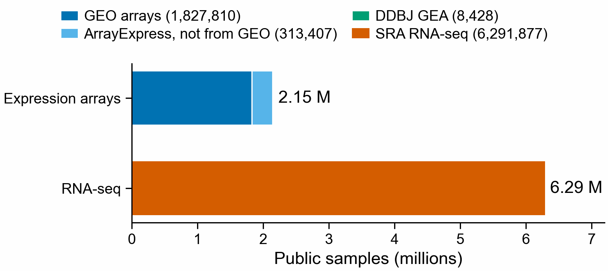
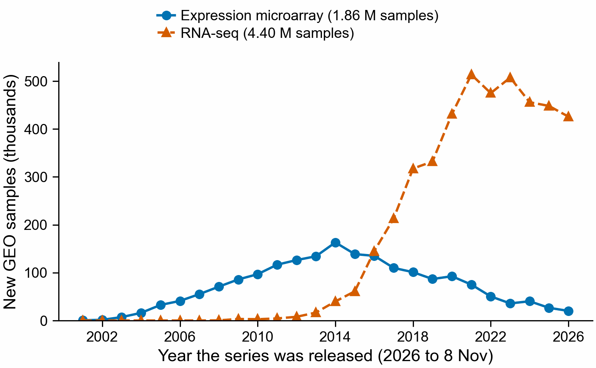

# How many public gene-expression samples are there?

Counted 2026-11-08, to size what geo2kmers could reach. Public expression-array samples
total 2,149,645. SRA has 6,291,877 public RNA-seq samples, 2.93 times as many, so adding
arrays to RNA-seq gives 34% more samples.

| Source | Samples | How counted |
|---|---:|---|
| GEO expression arrays | 1,827,810 | GSMs on an array platform with sample type RNA (`geo_counts.py platform`) |
| ArrayExpress, not from GEO | 313,407 | Each study's own "Sample count", for the 9,455 RNA array studies not named E-GEOD (356,392), minus 8 meta-datasets rebuilt from GEO data (42,985) (`arrayexpress_counts.py`) |
| DDBJ GEA | 8,428 | Expression-array assays in all 770 public studies, from the ChatGPT census; too small to see in the figure |
| **Expression arrays, total** | **2,149,645** | |
| SRA RNA-seq | 6,291,877 | Distinct public sample accessions with assay type RNA-Seq (the `strict_RNA_seq` cohort; the `broad_transcriptomic` cohort has 7,057,286, which would give 3.28 times), NCBI's SRA metadata tables of 2026-11-06 (`sra_2026-11-06/`, from the ChatGPT census; not rerun here) |

In GEO alone, expression arrays peaked at 163,151 new samples in 2014. RNA-seq passed
them in 2016 and added 431,000 to 514,000 a year from 2020 to 2025 (2026 is partial:
425,845 up to 8 November). GEO's RNA-seq series hold
4,400,422 unique samples.

## What these numbers are not

- **Not the same unit on both sides.** The array total adds GEO GSMs, ArrayExpress
  per-study sample counts and DDBJ GEA assays. The RNA-seq number counts distinct SRA
  sample accessions, so many runs and single-cell libraries collapse into one. GEO's
  4.40 M RNA-seq GSMs are GEO records, not a subset of the 6.29 M SRA samples, so the
  ratio is a rough size comparison only.
- **Records, not people or specimens.** A sample can be a pool, a replicate, or a
  single-cell library of thousands of cells.
- **The array total includes microRNA arrays.** About 192,000 GEO samples are microRNA
  or other non-coding RNA arrays (mostly Toray 3D-Gene serum cancer-screening studies).
  The RNA-seq count leaves out microRNA-seq (193,139 SRA experiments). Put microRNA in
  both totals or in neither before quoting the ratio.
- **Two GEO array totals.** By platform and sample type: 1,827,810. By series type
  ("expression profiling by array"): 1,859,152 unique GSMs, of which 71,724 also sit in
  an RNA-seq series. The platform count is used because it cannot include sequencing.
- **ArrayExpress overlap is only partly removed.** E-GEOD studies and 8 known GEO
  meta-datasets are out. Large studies such as E-MTAB-799, E-MTAB-800 (about 8,100
  samples each) and E-TABM-185 (5,896) were not checked for GEO reuse; at most about
  22,000 samples are at stake.
- **Not counted:** controlled-access archives (dbGaP arrays, EGA, JGA), and SRA's
  252,416 controlled RNA-seq samples.

## Files

| File | What |
|---|---|
| `geo_counts.py` | GEO platform counts, GEO unique GSMs per series type and year, SRA experiment counts (E-utilities) |
| `arrayexpress_counts.py` | ArrayExpress RNA array studies outside E-GEOD, and each one's sample count (BioStudies API). The search stops at 10,000 hits, which is why only the non-GEO set is listed |
| `make_figures.py` | `counts/census_summary.json` and both figures |
| `counts/` | Every number above, as JSON |
| `sra_2026-11-06/` | The SRA sample count, its script and the list of metadata files it read (ChatGPT census; its helper `sra_census.py` is not included) |

Rebuild the summary and figures: `python geo2kmers/census/make_figures.py`.
