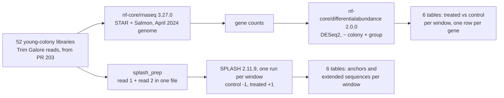
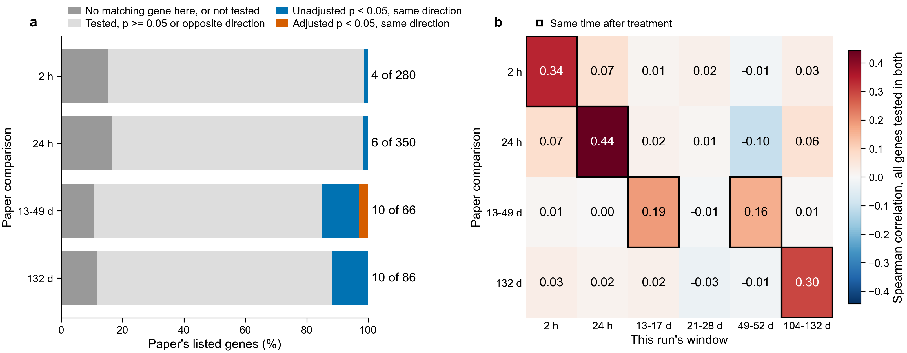
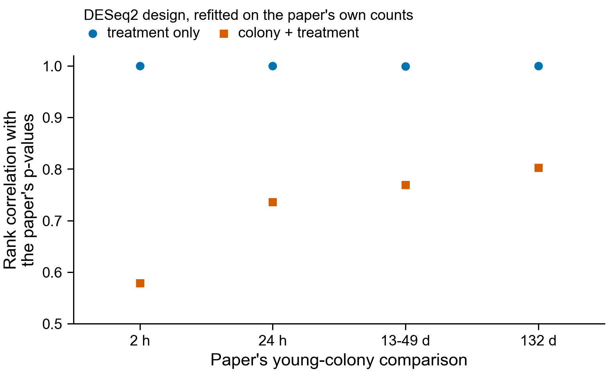
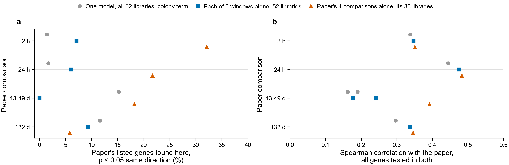
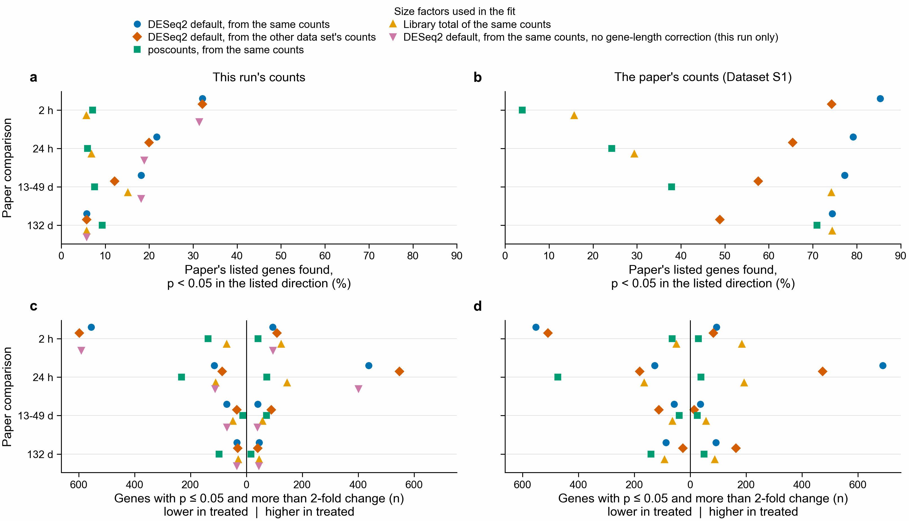
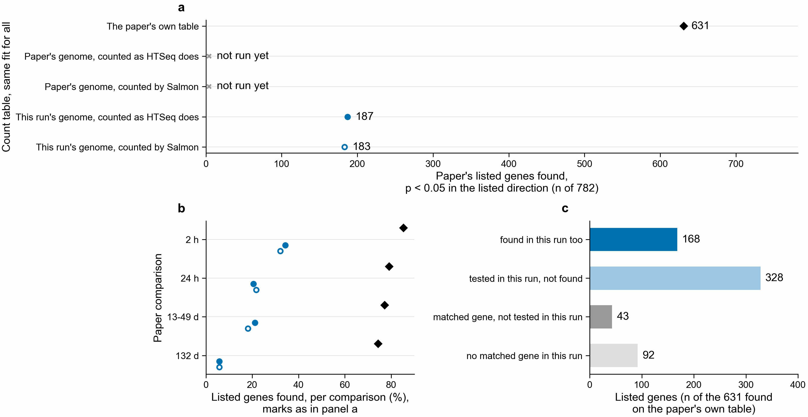

# Young Botryllus colonies after PEC: treated vs control, per time window

Domen et al. 2026 (PNAS) gave Botryllus colonies pulsatile electrical current (PEC) and
sequenced treated and control colonies from 2 hours to 132 days afterwards (SRA project
PRJNA1219309, 64 libraries). This run compares treated with control colonies at each time,
in young colonies only (370-510 days old), two ways:

- **With the genome**: nf-core/rnaseq 3.27.0 aligns reads to the April 2024 Botryllus
  assembly (STAR) and counts reads per gene (Salmon). nf-core/differentialabundance 2.0.0
  then tests each gene with DESeq2.
- **Without the genome**: SPLASH 2.11.9 finds 31-base sequences (anchors) whose following
  sequence differs between treated and control libraries, and extends each into a longer
  sequence (compactors).

The two are kept apart: separate output folders, never one table.



## Libraries and windows

Every young library is used, whatever its depth (Olga, 2026-10-27: "Don't filter on number
of reads. Keep all samples"). The 52 libraries were collected at 16 different times after
treatment, and 9 of those times have only control or only treated libraries, so times are
grouped into 6 windows that each have both:


| Window | Hours after treatment | Control | Treated |
|---|---|---:|---:|
| 2 h | 2 | 6 | 6 |
| 24 h | 24 | 6 | 6 |
| 13-17 d | 312-408 | 6 | 6 |
| 21-28 d | 504-672 | 3 | 2 |
| 49-52 d | 1176-1248 | 2 | 3 |
| 104-132 d | 2496-3168 | 3 | 3 |

Each point in the figure is one library. 40 of the 52 have under 5 million read pairs. In
the 13-17 d window 9 of 12 libraries have fewer than 3,500 pairs, and all 5 libraries in
21-28 d have fewer than 20,000, so those two comparisons can detect only large changes in
highly expressed genes.

Hours after treatment per vial come from the paper's Dataset S1 sample table
(`inputs/published_vial_hours.tsv`); treatment, colony and age from the SRA BioSample
records (`inputs/ena_sample_metadata.tsv`); read files and pair counts from the PR 203
trimming check (`inputs/trimmed-inputs.validated.json`). `make_design.py` turns these into
`samplesheet.csv`, `samples.csv`, `contrasts.csv` and `splash/<window>/`;
`plot_design.py` draws the figure.

## Settings that differ from the pipelines' defaults, and why

| Setting | Value | Why |
|---|---|---|
| rnaseq `skip_trimming` | true | reads were trimmed by Trim Galore in PR 203 |
| rnaseq `strandedness` | unstranded, every library | measured on the 3 deepest libraries (below) and assumed for the other 49; left on `auto`, Salmon cannot work out the strand from SRR32233927's 636 pairs, which stopped the PR 203 run |
| rnaseq `min_mapped_reads` | 0 | keep every library (default drops libraries under 5% aligned) |
| rnaseq `skip_deseq2_qc` | true | its DESeq2 step fails when no gene has a count in every library |
| rnaseq `skip_biotype_qc` | true | the FullNames GTF has no `gene_biotype` |
| differentialabundance `deseq2_sf_type` | poscounts | the default size factors need genes counted in every library |
| differentialabundance design | `~ colony + group`, all 52 libraries in one model | group = window and treatment; colony (4 genotypes) as blocking factor. `make run-alone` fits each comparison alone instead, see below |
| SPLASH `--Cjs_samplesheet` | control -1, treated +1 | tests treated vs control rather than any difference between libraries |
| SPLASH `--pvals_correction_col_name` | `Cjs_0_pval` | corrects the p-value for those weights |

All other settings are the pipelines' defaults.

### Strand of read 1: unstranded

`strand-check/strand_check.sbatch` (Sherlock job 49810662, 2026-10-27) ran Salmon's
library-type detection on the first 1 million read pairs of the three deepest young
libraries, against an index of the FullNames transcripts. In all three, read 1 lies on the
gene's strand for half of the fragments (`strand-check/lib_format_counts.tsv`):

| Library | Window | Fragments placed | Read 1 on the gene's strand | Salmon's call |
|---|---|---:|---:|---|
| SRR32233964 | 2 h | 460,804 | 49.9% | IU (unstranded, paired) |
| SRR32233978 | 24 h | 472,715 | 49.9% | IU |
| SRR32233986 | 24 h | 516,727 | 50.0% | IU |

A stranded library would be near 0% or 100%. The germline libraries from the same lab
were unstranded too (`nextflow-runs/botryllus-rnaseq-preprocess`).

## Run

On Sherlock, one command clones this branch into its own folder (so the shared clone on
`main` is untouched) and submits everything; nothing waits on a person:

```bash
D=/scratch/users/olgabot/2024-kmerseek-analysis-botryllus-pec-young; [ -d $D ] || git clone -b olgabot/botryllus-pec-young-windows git@github.com:seanome/2024-kmerseek-analysis.git $D; cd $D && git pull && cd nextflow-runs/botryllus-pec-young && make run
```

| Job | Waits for | Resources | Expected time |
|---|---|---|---|
| `splash_prep`, 52-task array | nothing | 4 CPUs, 4 GB, 4 h each | under 1 h; largest file 13 GB gzipped |
| SPLASH, one per window | all of `splash_prep` | 16 CPUs, 64 GB, 12 h | under 1 h each; notebook 361's runs on these reads took under 2 min per 1 GB |
| Nextflow head: rnaseq, then differentialabundance | nothing | 2 CPUs, 8 GB, 2 days | about 6-10 h; STAR index about 1 h, then alignment of the 70 million-pair library about 1-2 h |

Task sizes in nf-core/rnaseq are the pipeline's defaults (STAR: 12 CPUs, 72 GB, 16 h); no
earlier STAR run on this genome exists to size from. A task killed by the scheduler is
retried twice (`sherlock.config`).

Watch the Nextflow head with `make watch`; stop it with `make stop`. Job ids are in
`$SCRATCH/botryllus-pec-young/job_ids.txt`. `make run` refuses to submit while any job of
this run (`pec-young-*` or `nf-botryllus-pec-young`) is queued or running.

### Launch record

`make run` was given twice on 2026-10-27, at 13:41 (jobs 49841823-49841922) and 13:49
(49843510-49843518). The second round was cancelled. Before the cancel, its
`splash_prep` task 5 wrote 785 MB to `SRR32233964.fq.gz.part`; the first round had
already finished `SRR32233964.fq.gz` at 13:47:52, so that file is the first round's and
the `.part` file is a leftover. Its Nextflow head stopped at once ("Unable to acquire lock
on session"), so the first run was not touched.

### Result of the 2026-10-27 run

- SPLASH: all 6 windows finished (jobs 49841893-49841918, 16 s to 29 min each).
- nf-core/rnaseq: finished at 17:23, 1,466 tasks, none failed. Its summary says 7 of 52
  libraries failed the strand check (not yet looked at).
- nf-core/differentialabundance: DESeq2 finished for all 6 windows and wrote its tables.
  The last step, the HTML report, failed while drawing a clustering heatmap
  (`hclust`: "NA/NaN/Inf in foreign function call"), so the Nextflow head ended as FAILED
  and `differentialabundance/report/` is empty.
- Report fix (2026-11-01), in `params-differentialabundance.yaml`: two report settings
  changed, each explained there. The heatmap failed because SRR32233947 (236 read pairs)
  has 0 in all 500 genes it uses on raw counts, so the heatmap now uses all genes
  (`exploratory_n_features: -1`), where that library has some counts.
  The per-gene boxplots then failed because their colour list had fewer colours than
  the 12 treatment groups; `exploratory_main_variable: contrasts` fixes that. A copy of
  the failed report step, rerun with both settings on Sherlock, finished in 3.5 minutes
  and wrote all sections for raw, normalised and variance-stabilised counts, including
  the details for all 6 windows.
- The report built on 2026-11-01 (head job 50740329, 19 minutes, 4 steps rerun, 28 reused):
  `differentialabundance/report/rnaseq/botryllus_pec_young_differentialabundance_report.html`.
- A first try left raw counts out of the report instead. The `make run` of 2026-11-01
  19:07 (head job 50725494) failed on it after 7 minutes: the exploratory plots and the
  Shiny app are always given all three count tables and stop when fewer names are set.
  That run did show that resuming works: the 52 read-joining tasks and 6 SPLASH jobs saw
  their done files and exited, rnaseq reused every task, and differentialabundance reused
  28 finished steps, including all 6 DESeq2 fits.

Counts per window are in `significant_per_window.tsv`:

| Window | Genes with adjusted p < 0.05 | Higher in treated | Lower in treated | SPLASH anchors with corrected p < 0.05 |
|---|---:|---:|---:|---:|
| 2 h | 140 | 2 | 138 | 86,283 |
| 24 h | 76 | 27 | 49 | 936,510 |
| 13-17 d | 176 | 23 | 153 | 10,757 |
| 21-28 d | 151 | 101 | 50 | 1 |
| 49-52 d | 88 | 77 | 11 | 704 |
| 104-132 d | 51 | 5 | 46 | 9,049 |

These counts assume unstranded counting for every library. Seven libraries failed the
rnaseq strand check and have not been looked at, so the counts may change.

35,541 genes were tested in each window. Gene counts are from `padj` in
`*.deseq2.results.tsv`; anchor counts from `Cjs_0_pval_corrected` in
`splash_out/result.after_correction.scores.tsv`. Treated and control libraries come from
the same colonies in every window except 49-52 d, where colony 6941c has a treated
library (SRR32233984) and no control, so colony blocking cannot absorb it and part of
the 88 genes may be a 6941c effect. In 21-28 d all 5 libraries have under 20,000 read pairs.

### Compared with the paper

The paper's Dataset S1 has its own DESeq2 results for four young-colony comparisons
(sheets Group1, group2, Group4 and group5). By adjusted p < 0.05 those find 0 genes at 2 h,
1 at 24 h, 0 at 13 and 49 days pooled, and 11 at 132 days. The gene lists the paper
reports (its sheet "annotated DE all groups young": 43 up and 237 down at 2 h, 252 and 98
at 24 h, 18 and 48 at 13-49 d, 40 and 46 at 132 d) are therefore not adjusted-p lists.
Their size is near the number of named genes with unadjusted p < 0.05 (37 and 259 at 2 h,
221 and 79 at 24 h), but not equal, so the paper's exact rule is not known. The Methods'
cutoff (p <= 0.05 and absolute log2 fold change > 1) gives 94 and 552 at 2 h in Dataset
S1, more than the 43 and 237 listed, so the lists are cut further in a way not stated.

| Comparison | Paper, adjusted p < 0.05 | Paper, listed up / down | This run, adjusted p < 0.05 up / down | This run, unadjusted p < 0.05 up / down |
|---|---:|---:|---:|---:|
| 2 h | 0 | 43 / 237 | 2 / 138 | 4 / 279 |
| 24 h | 1 | 252 / 98 | 27 / 49 | 82 / 175 |
| 13-49 d (this run: 13-17 d) | 0 | 18 / 48 | 23 / 153 | 39 / 327 |
| 13-49 d (this run: 49-52 d) | 0 | 18 / 48 | 77 / 11 | 358 / 31 |
| 132 d (this run: 104-132 d) | 11 | 40 / 46 | 5 / 46 | 64 / 252 |

The 2 h comparison goes the same way in both (mostly lower in treated). At 24 h the paper
lists mostly higher in treated and this run finds mostly lower. The two analyses differ in
gene models (the paper's 72,115 `g` genes, this run's 35,541 `FUN_` genes), in the model
(the paper fits each comparison alone; this run fits all 52 libraries with colony as a
blocking factor), and in how 13-49 days are grouped. Table: `paper_comparison.tsv`.

### The paper's genes, one by one



This run found 30 of the 782 gene entries the paper lists (3.8%) with unadjusted p < 0.05
in the same direction, and 2 of the 782 (0.3%) with adjusted p < 0.05. The two adjusted
hits are g61570 (FUN_035465) and g1353 (FUN_019793), both in the 13-17 d window. g1353
goes the opposite way at 49-52 d (log2 fold change 16.3, 2 against 3 libraries). A listed
gene in the 13-49 d comparison counts as found if either window finds it.

The paper's genes and this run's genes are different gene models, so each paper protein
was aligned to this run's proteins with MMseqs2 and matched to its best hit with at least
90% identity over at least 50% of the paper's protein. These cutoffs were set before any
overlap was counted. 664 of the 782 entries have a match that was tested here. DIAMOND,
the first choice, stalled on the laptop while building its database, on 4 threads and on 1.

The paper's lists are not adjusted-p lists, so a low overlap at adjusted p < 0.05 does not
by itself mean the two disagree. Across all genes tested in both, the two share a signal
that follows the time point (panel b). The Spearman correlation of the signed -log10 p
is 0.16 to 0.44 at the same time point, and between -0.10 and 0.07 at any other pairing.

- Direction: 616 of 723 tested gene-window pairs point the paper's way, where 382 would by
  chance. Chance is the share of genes going that way in that window, leaving out genes
  with a fold change of exactly 0 (20,643 to 34,028 of 35,541 in the four windows from
  13 to 132 d). Every list beats chance except 13-49 d up, which matches it (9 and 13 of
  16, where 9.2 and 12.1 would by chance).
- Overlap at unadjusted p < 0.05, same direction, among genes tested in both: 9 of 433 at
  2 h, 11 of 495 at 24 h, 4 and 10 of 72 at 13-17 d and 49-52 d, 17 of 131 at 132 d. That
  is 5 to 15 times what chance would give, and still a small share of the paper's genes.
- The paper's 12 genes with adjusted p < 0.05: 7 are tested in both. None has adjusted
  p < 0.05 here, and 3 (all at 132 d) have unadjusted p < 0.05 in the same direction.
- A stricter match (95% identity over 80%, or 99% over 90%) keeps the same picture: 517 of
  602 and 344 of 404 pairs point the same way.

This compares the two results. It does not say why they differ, and which of them is
right is not tested here.

Tables: `paper_gene_summary.tsv`, `paper_gene_overlap.tsv`, `paper_gene_overlap_genes.tsv`,
`paper_gene_agreement.tsv`, `paper_gene_agreement_all_windows.tsv`. Code:
`compare_paper_genes.py`, `plot_paper_gene_overlap.py`.

### Each comparison fitted on its own, as the paper did

`make run-alone` refits on the counts of the run above, with each comparison fitted only on
its own libraries and no colony term. It runs nf-core/differentialabundance twice
(`run_each_alone.sh`):

| Output folder | Comparisons | Libraries | Size factors | Variance step (`nsub`) |
|---|---|---|---|---|
| `differentialabundance-paper/` | the paper's four: 2 h, 24 h, 13-49 d pooled, 132 d | the paper's 38 (`samples_paper.csv`) | DESeq2's default (ratio) | 1000 (default) |
| `differentialabundance-each-window/` | this run's six windows | all 52 (`samples.csv`) | poscounts | 10 |



Why these settings:

- **No colony term.** The paper's Methods do not give its design. Refitting the paper's
  own counts (Dataset S1, sheet "Pacemaker_Counts_Table") with `~ treatment` gives back
  its p-values: rank correlation 0.9995 to 0.9999 in all four groups, and 179 of 179
  genes at p < 0.05 at 132 d. With colony added the correlation is 0.58 to 0.80
  (`each-alone-checks/paper_design.out`).
- **The paper's 38 libraries.** Dataset S1's sheet "DEseq group annotation" lists them.
  They are the 52 here less 9 of 12 libraries at 13-17 d and all 5 at 21-28 d. The paper's
  Methods say libraries with fewer than 10,000 counts were removed. Here the 14 left out
  have at most 17,760 read pairs and 2,823 gene counts. The 13-49 d group keeps 3
  libraries at 13-17 d and all 5 at 49-52 d.
- **Size factors.** These are the per-library scaling factors that correct for sequencing
  depth. DESeq2's default uses only genes counted in every library, and that is what the
  paper used. 392 genes are counted in all 38 libraries, so the default works for the
  paper's set. It cannot work for all 52, so the six-window run keeps poscounts (see
  Settings). The choice matters at 2 h: fitted alone, the default gives 686 genes at
  p < 0.05, and poscounts gives 171 (`each-alone-checks/ratio.out`).
- **`nsub` 10 for the six windows.** The variance step stops unless at least `nsub` genes
  have a mean normalised count above 5. Fitted alone, 21-28 d has 14 such genes, 13-17 d
  has 490 and 49-52 d has 992 (`each-alone-checks/fits.out`), so the default of 1000 would
  stop the run. `nsub` changes only the transformed tables and the report's plots, not the
  fold changes or p-values.

Before launch, each comparison was fitted on the laptop in the pipeline's own DESeq2 image
(`each-alone-checks/`). The pipeline's own DESeq2 script was also run, with this run's
settings, on 21-28 d and on the paper's 13-49 d group. Both finished with the design
`~ 0 + group`, on 5 and 8 libraries. Fitted alone, 21-28 d tests 1,513 genes and finds
none at p < 0.05, so expect nothing from it. The pipeline's own checking step
(shinyngs `validate_fom_components.R`) accepts both new sample and comparison files.

On Sherlock:

```bash
D=/scratch/users/olgabot/2024-kmerseek-analysis-botryllus-pec-young; cd $D && git pull && cd nextflow-runs/botryllus-pec-young && make run-alone
```

Watch with `make watch-alone`, stop with `make stop-alone`.

| Task | Resources (pipeline defaults) | Measured in the 2026-11-01 run | Expected |
|---|---|---|---|
| Nextflow head (`nf-botryllus-pec-alone`) | 2 CPUs, 8 GB, 12 h | | about 1-1.5 h for both runs |
| DESeq2, one per comparison (4, then 6) | 1 CPU, 6 GB, 4 h | 1.3 GB, 2 min 15 s each | same or less: fewer libraries per fit |
| Report (Quarto) | 2 CPUs, 24 GB (`sherlock.config`; default 12 GB), 4 h | 10.9 GB, 4 min 34 s | same or less |

### Result of the 2026-11-08 refit, gene by gene against the paper

`make run-alone` ran as job 51553782 on 2026-11-08 (07:18 to 08:02 UTC, exit 0). Its
tables were compared with the paper's in the same way as above, with the same MMseqs2 gene
match (`compare_paper_genes.py ... paper` and `... each-window`).



Fitting the paper's four comparisons on its own 38 libraries finds 183 of the 782 gene
entries the paper lists (23.4%) with unadjusted p < 0.05 in the same direction. A random
gene would give 6.6. The joint fit above finds 30 (3.8%), and the six windows fitted alone
find 49 (6.3%).

| Paper comparison | Listed | One model, 52 libraries | Each window alone | Paper's comparisons alone |
|---|---|---|---|---|
| 2 h | 280 | 4 | 20 | 90 |
| 24 h | 350 | 6 | 21 | 76 |
| 13-49 d | 66 | 10 | 0 | 12 |
| 132 d | 86 | 10 | 8 | 5 |
| all | 782 | 30 | 49 | 183 |

The three columns differ in more than one way at once: libraries, size factors, colony term,
and at 13-49 d the window itself. The paper pools 13-49 d into one comparison of 8
libraries (3 at 13-17 d, 5 at 49-52 d). The six-window fit tests 13-17 d on 12 libraries,
including the 9 the paper left out, and 49-52 d on 5. So the table shows that the
paper-style fit finds more of the paper's genes, not which change causes it. At 13-17 d the
0 depends on leaving out colony: with `~ colony + treatment` the same libraries give 238
genes at p < 0.05, with `~ treatment` none (`each-alone-checks/fits.out`).

- Over all genes tested in both, the Spearman correlation of the signed -log10 p with the
  paper is 0.35, 0.48, 0.39 and 0.35 at 2 h, 24 h, 13-49 d and 132 d. At any other pairing
  it is between -0.03 and 0.07 (panel b of
  `figures/paper_gene_overlap_paper_domen2026_dataset_s1.png`).
- Among genes the paper has at p < 0.05, the paper-style fit also has p < 0.05 in the same
  direction for 159 of 391 at 2 h, 119 of 446 at 24 h, 19 of 67 at 13-49 d and 7 of 124 at
  132 d. The joint fit had 9, 11, 4 and 10 (13-17 and 49-52 d), and 17.
- At 132 d all three fits find between 5 and 10 of the 86 listed genes. These counts are
  too small to tell the fits apart.
- One listed gene reaches adjusted p < 0.05: g1465 (FUN_022126), up at 132 d, as the paper
  lists it (adjusted p 0.006). Its fold change after the pipeline's shrinkage is small
  (log2 0.013), so the direction rests on a small number.
- 552 of the 613 tested listed genes point the paper's way, where 327 would by chance.
- Refitting the paper's own counts this way gave a rank correlation of 0.9995 or more with
  its p-values (figure above). Here it is 0.35 to 0.48. The design and libraries are the
  same. The counts differ (different gene models, matched by protein, from a different
  pipeline), and so does the set of genes the size factors rest on: DESeq2's default uses
  only genes counted in every library of the fit. Per comparison that is 1,540, 2,390, 820
  and 3,083 genes in the paper's counts and 2,028, 2,545, 493 and 1,464 here, at 2 h, 24 h,
  13-49 d and 132 d (`each-alone-checks/size_factor_genes.out`). The section below tests
  which of these causes the gap: it is the counts, not the size factors.
- In the six-window fit, 86% of genes tested at 49-52 d go up with treatment, against 29%
  to 42% at 2 h, 13-17 d and 104-132 d. It is not the 6941c library, the one treated
  library whose colony has no control in this window: leaving it out still gives 87% up.
  Leaving out JA152 (colony 6996m, treated, 1,049,260 read pairs, the deepest of the five
  and the largest size factor, 2.27) gives 63% (`each-alone-checks/up_skew_49_52d.out`).
  The 49-52 d result rests on 5 libraries and leans on that one.

Tables: `three_fits_vs_paper.tsv`, and in `each-alone-comparison/paper/` and
`each-alone-comparison/each-window/` the same five tables as above. Code:
`compare_paper_genes.py`, `plot_paper_gene_overlap.py`, `plot_three_fits.py`.

### Do size factors cause the gap with the paper? Only the size factors changed

The refit above finds 183 of the paper's 782 listed genes. Two things differ between that
refit and the paper: the counts, and the size factors computed from them. A size factor is
the number each library's counts are divided by to correct for sequencing depth. This test
changes only the size factors. Counts, libraries (the paper's 38) and design (`~ treatment`,
each comparison alone) stay fixed.

Fits, for each of the four comparisons (`each-alone-checks/size_factors.R`, R DESeq2):

| Counts | Size factors |
|---|---|
| This run's | DESeq2's default, from genes counted in every library of the comparison |
| This run's | `poscounts`, which also uses genes with a zero in some libraries |
| This run's | each library's total: the sum of its gene counts |
| This run's | the paper's: DESeq2's default computed on the paper's counts, same libraries |
| The paper's (Dataset S1) | DESeq2's default |
| The paper's | `poscounts` |
| The paper's | each library's total |
| The paper's | this run's: DESeq2's default computed on this run's counts |

For each fit: genes with p <= 0.05 and more than 2-fold change (the paper's Methods cutoff),
up and down, and how many of the 782 listed genes have p < 0.05 in the listed direction.
The fold change is DESeq2's own, before the shrinkage the pipeline applies, because 2-fold
is a cutoff on it. On this run's counts a listed gene is looked up through the MMseqs2
match above. On the paper's counts it is looked up by its own ID.

Rule for reading the result, written on 2026-11-11 before any of these fits ran:

- Two fits must first give back known results. This run's counts with the default must
  give the same p-values as the pipeline's refit (job 51553782) and find 183 listed genes.
  The paper's counts with the default must give the paper's p-values (rank correlation
  0.999 or more). If either fails, the test is not read.
- The gap is the listed genes found on the paper's counts with the default, less the 183.
- Size factors explain the gap if both swaps move the count by at least half the gap:
  this run's counts with the paper's size factors find at least 183 plus half the gap, and
  the paper's counts with this run's size factors lose at least half the gap.
- Size factors do not explain the gap if each swap moves the count by less than a quarter
  of the gap. Then the counts are what differs.
- Anything in between is reported as part of the gap, with the two shares.
- The rule is read on all 782 entries. A single comparison is read on its own only if its
  gap is at least 20 genes.
- The three choices on the same counts (default, `poscounts`, library total) answer a
  second question: how much the result rests on the choice. The choice changes the result
  if two of them differ by more than a quarter of the gap in listed genes found. It does
  not bear on the gap with the paper, because the paper used the default and so did the
  refit.

Change to the fits, made after a first job (51909796) stopped part-way with the 2 h and
24 h fits printed (`each-alone-checks/size_factors.first_try.out`). The rule above is
unchanged. On this run's counts the default did not give back the pipeline's p-values: it
found 88 and 66 listed genes where the pipeline found 90 and 76. The pipeline's DESeq2 step
also corrects each gene for its length in each library, from
`salmon.merged.gene_lengths.tsv`, and the first script left that out. The paper's counts
have no length table. So every fit on this run's counts now includes the length
correction, as the pipeline does, and one more fit is added: this run's counts, the
default, without the length correction. In the 13-49 d comparison the first script also
picked libraries by window instead of by the paper's group, which is what stopped it.

#### Result (job 51943109, 2026-11-11, 13 min 17 s, 1.8 GB, R DESeq2 1.42.0)



Each row is one of the paper's comparisons and each mark is one fit. Panels a and b: share
of the paper's listed genes with p < 0.05 in the listed direction. Panels c and d: genes
with p <= 0.05 and more than 2-fold change, lower in treated to the left of zero and higher
to the right.

Size factors explain a quarter of the gap at most. The counts explain the rest.

Corrected on 2026-11-11, the same day. The paper's count table ends with six rows that are
not genes: HTSeq's tallies of reads it did not count (`__no_feature`, `__ambiguous`,
`__too_low_aQual`, `__not_aligned`, `__alignment_not_unique`) and a `Sum` row. The first
result (job 51911916, `each-alone-checks/size_factors.with_non_gene_rows.out`) kept them
as if they were genes. That inflated each library's total on the paper's counts about
5-fold and moved the other fits on the paper's counts a little. The numbers below are
without those rows. What changed: the paper's counts with the default find 631 listed
genes, not 626; with library totals 260, not 196; the paper's size factors on this run's
counts find 173, not 170; and the verdict, which read "do not explain" when one swap was
2 genes under the quarter line and is now 2 genes over it. The paper's "72,119 genes" in
the sections above are 72,113 genes and these six rows, and the counts of genes counted
in every library of the paper's table (1,540, 2,390, 820 and 3,083 above) are 1,534,
2,385, 815 and 3,077 without them.

Both checks passed. This run's counts with the default give the pipeline's p-values (rank
correlation 1.00000 in all four comparisons, largest difference in any p-value 0.005) and
find 183 listed genes. The paper's counts with the default give the paper's p-values (rank
correlation 1.00000 in all four) and find 631 of the 782, the same 631 as counting
straight from the p-values in Dataset S1 (239, 277, 51 and 64). The gap is 631 - 183 = 448
genes, so half is 224 and a quarter is 112.

| Listed genes found, of 782 | This run's counts | The paper's counts |
|---|---:|---:|
| DESeq2 default from the same counts | 183 | 631 |
| DESeq2 default from the other data set's counts (the swap) | 173 | 517 |
| `poscounts` | 54 | 182 |
| Library total | 55 | 260 |
| DESeq2 default, no gene-length correction | 171 | not applicable |

- The paper's size factors on this run's counts find 173, 10 fewer than this run's own.
  The swap was meant to close the gap and it moved the other way.
- This run's size factors on the paper's counts find 517, a loss of 114. That is 25% of
  the gap, 2 genes over the quarter the rule set (112), and far from the half (224).
- By the rule this is the in-between case: one swap accounts for none of the gap and the
  other for a quarter. Size factors are not the main cause.
- Per comparison, with the gap in brackets: at 2 h (149) the swaps move the count by 0 and
  31, at 24 h (201) by 6 and 48, at 13-49 d (39) by 4 and 13, at 132 d (59) by 0 and 22.
  At 2 h and 24 h both are under a quarter. At 13-49 d and 132 d the paper's counts lose a
  third of the gap (33% and 37%) with this run's size factors, and this run's counts gain
  nothing with the paper's.
- The two sets of default size factors are close at 2 h and 24 h: the correlation of their
  logs across the 12 libraries is 0.998 and 0.992. It is 0.89 at 13-49 d (8 libraries) and
  0.38 at 132 d (6 libraries).
- Leaving out the pipeline's gene-length correction changes 183 to 171. It is not the
  cause either.

So with the libraries, the design and the size factors all set to the paper's, this run's
counts still find 173 of the 782 listed genes where the paper's counts find 631. What is
left is the counts: different gene models (35,618 genes here, 72,113 in the paper), a
different alignment and counting pipeline, and the protein match between the two gene
sets (667 of the 782 entries have a matched gene here, 598 to 630 of them tested). Which
of these matters most is not tested here.

The second question has a clear answer: the choice of size factors changes the result,
in both data sets and by much more than a quarter of the gap.

- On the paper's own counts, `poscounts` finds 182 of the listed genes and library totals
  260, where the default finds 631. At 2 h that is 11 and 44 of 280 against 239. The
  paper's lists rest on the default size factors.
- The direction at 24 h depends on the choice. On the paper's counts the default gives 689
  genes up and 127 down at p <= 0.05 and 2-fold, `poscounts` gives 39 up and 474 down, and
  library totals give 193 up and 165 down. On this run's counts the same three give 438
  and 115, 73 and 232, and 146 and 110. This is why the first run above (`poscounts`)
  found mostly lower at 24 h where the paper lists mostly higher.
- At 2 h the default gives mostly down in both data sets (94 up and 555 down here, 94 and
  552 in the paper's counts). `poscounts` gives 42 and 137 here and 29 and 65 in the
  paper's counts, and library totals give more up than down (125 and 70, 185 and 49).
- The libraries differ in depth by a wide margin, which is why the choice has this much
  room to matter: with the default, the largest size factor is 479 times the smallest at
  2 h and 307 times at 24 h on this run's counts (490 and 176 on the paper's).
- The default rests on the genes counted in every library of the comparison (2,028 and
  2,545 of 35,618 here at 2 h and 24 h). Which of the three choices is closest to the
  truth is not tested here. It would need genes whose change is known.

The first result was run twice (jobs 51911916 and 51913692) with the same counts for all
36 fits. The only R warnings were 72 about row names when building the output table.

Tables: `size_factors_fits.tsv` (one row per fit), `size_factors_summary.tsv` (the four
comparisons added up), `size_factors_values.tsv` (each library's size factor in each fit).
Code: `each-alone-checks/size_factors.R` with its output `size_factors.out`,
`each-alone-checks/size_factors.sbatch`, `plot_size_factors.py`. The per-gene results of all 36 fits are in
`$SCRATCH/botryllus-pec-young/size-factors/size_factors_genes.tsv.gz` (16 MB, not
committed).

To rerun on Sherlock (one job, 1 CPU, 8 GB, 1 h asked; it used 13 min and 2.1 GB), from a
folder holding the inputs listed at the top of `size_factors.R`, with `size_factors.R` and `size_factors.sbatch` copied in:

```bash
cd $SCRATCH/botryllus-pec-young/size-factors && sbatch size_factors.sbatch
```

### Which part of the counts causes the gap with the paper?

The section above leaves the counts. The paper's Methods say reads were trimmed with Trim
Galore, aligned with STAR to the Botryllus genome of Voskoboynik et al. 2013, and counted
with HTSeq. This run differs from that in three ways:

1. **Genome and gene models.** The paper: the 2013 assembly and its 72,113 AUGUSTUS genes
   (`g1` to `g72113`). This run: the April 2024 assembly and its 35,541 `FUN_` genes.
2. **How reads are counted per gene**, after STAR in both. HTSeq counts a read pair for a
   gene only if it overlaps that gene alone and aligns to one place. Salmon also shares
   out pairs that fit several transcripts or places.
3. **The protein match** that links each `g` gene to a `FUN_` gene. It is needed only
   because the gene models differ, so it is counted with part 1 and bounded on its own.

The lab's copy of the 2013 genome and gene models is on Sherlock
(`/home/groups/ayeletv/Botryllus_Genome/`), so the same reads can be counted on the
paper's own genes, where no match is needed. That gives four count tables from this run's
reads, two genomes by two ways of counting, next to the paper's own table:

| | Counted as HTSeq does (featureCounts) | Counted by Salmon |
|---|---|---|
| The paper's genome and genes | A | B |
| This run's genome and genes | C | D = the refit above, 183 listed genes found |

featureCounts stands in for HTSeq: with its defaults it counts a read pair only if it
overlaps one gene and aligns to one place, as HTSeq's default does. All four use the STAR
alignments of nf-core/rnaseq 3.27.0. Every table is fitted the same way: each comparison
alone, `~ treatment`, DESeq2's default size factors, the paper's 38 libraries
(`each-alone-checks/count_split.R`). The paper's table is fitted without its six rows that
are not genes.

Rule for reading the result, written on 2026-11-11 before any of tables A, B or C existed:

- The gap is the listed genes found on the paper's table less the 183 found on D.
- **The paper's own pipeline against this rerun of it** is the paper's table less A. It
  covers what cannot be set equal here: the trimming, STAR's version and settings, and
  HTSeq against featureCounts.
- **How reads are counted** is A less B on the paper's genes, and C less D on this run's.
- **Genome, gene models and the match** is A less C counted as HTSeq does, and B less D
  counted by Salmon.
- A part is a cause of the gap if it accounts for at least a quarter of it, and the main
  cause if at least half. Counting and gene models each have two estimates. Both are
  reported, and the part is called by the smaller one.
- The match alone can explain at most the listed genes that are found on the paper's
  table and have no matched gene, or no tested gene, in this run.
- A is trusted as a rerun of the paper's pipeline only if it is close to the paper's
  table: per library, counted read pairs within 10% of the paper's (median over the 38)
  and a rank correlation across genes of at least 0.95 (median over the 38). If not, that
  is reported and A is read only against B and C.
- HTSeq can count with or without regard to strand, and the paper does not say which.
  featureCounts is run all three ways. The one used is the one whose counted pairs per
  library are closest to the paper's on the paper's genome, chosen from the counts before
  any fit is read. Until A exists, C is read with strand ignored, because the libraries
  measure as unstranded (see "Strand of read 1" above).
- A and B need a new alignment (about 4 h). Until it has run, only C is read: C less D is
  the counting part on this run's genes, and the paper's table less C is everything else.

Known when the rule was written, from the fits of the section above: the split of the
paper's listed genes by match (below), and that the two tables count a similar number of
read pairs per library (the paper's table 7.1 million for JA100, this run's 6.9 million).

#### Result so far: table C (job 51944027, 2026-11-11, 36 min)



Panel a: listed genes found on each count table, all four comparisons added up. Panel b:
the same per comparison, as a share of that comparison's list; marks as in panel a. Panel
c: the 631 listed genes found on the paper's own table, by what this run's table D has
for them.

How reads are counted is not a cause of the gap, on this run's genes. The other half of
the test, on the paper's genes, has not run.

- The gap is 631 - 183 = 448 genes, so a quarter is 112 and half is 224.
- **How reads are counted, on this run's genes: 4 genes, 1% of the gap.** Counted as HTSeq
  does with strand ignored (C), the same alignments find 187 listed genes. Counted by
  Salmon (D) they find 183. Per comparison C finds 96, 72, 14 and 5, and D finds 90, 76,
  12 and 5.
- **Everything else: the paper's table less C is 444 genes.** That is the genome and gene
  models with the match, and the paper's own pipeline against this rerun of it. Tables A
  and B are needed to tell these apart.
- **The match alone: at most 135 genes, 30% of the gap.** Of the 631 listed genes found on
  the paper's table, 92 have no matched gene in this run and 43 have a matched gene that
  is not tested here. The other 496 are tested here: 168 are found and 328 are not. So at
  least 313 of the 448 are genes that have a matched, tested gene in this run and are
  still not found.
- Those 328 mostly point the paper's way: of the 496 tested, 452 have a fold change in
  the listed direction in this run. A closer protein match does not help much: at 99%
  identity over 90% of the protein, 105 of 282 are found (37%); at 95% over 80%, 40 of
  139 (29%); at the looser 90% over 50%, 23 of 75 (31%).
- Strand. With strand ignored, C counts 95% as many read pairs per library as the paper's
  table (median over 38). Counting only read 1 on the gene's strand, or only on the
  opposite strand, counts 49% and 47% and finds 139 and 133 listed genes. So the paper's
  table looks like a count with strand ignored, as the rule assumed. The rule's own
  choice of strand waits for table A.
- Both tables that were fitted before give the same result here: the paper's table 631
  and D 183.
- featureCounts took 2 min and 7.1 GB per strand setting (8 CPUs), the 20 fits 7 min 20 s
  and 1.7 GB.

Not yet run: tables A and B, this run's reads on the paper's genome and genes. One command
on Sherlock aligns the paper's 38 libraries to the paper's genome, counts both ways and
refits all nine tables, with nothing waiting on a person:

```bash
cd /scratch/users/olgabot/2024-kmerseek-analysis-pec-count-split && git pull && cd nextflow-runs/botryllus-pec-young && make run-count-split
```

Watch with `make watch-count-split`, stop with `make stop-count-split`. Then, on the
laptop, copy `$SCRATCH/botryllus-pec-young/count-split/count_split_*.tsv` here and
`count_split.out` to `each-alone-checks/`, and run `plot_count_split.py`.

| Task | Resources asked | Measured before | Expected |
|---|---|---|---|
| Nextflow head (`nf-botryllus-pec-count-split`) | 2 CPUs, 8 GB, 12 h | 36 min and 0.5 GB for C alone (job 51944027) | about 3 to 4 h in all |
| STAR index of the paper's genome (580 Mb, 14 sequences) | pipeline default: 12 CPUs, 72 GB, 16 h | the April 2024 genome's index, 2026-10-27 run: 5 min, 18.2 GB | about the same |
| STAR alignment, 38 libraries | pipeline default: 12 CPUs, 72 GB, 16 h | 2026-10-27 run: the largest library (SRR32233964, 69.9 million pairs) took 2 h 21 min and 15.2 GB, the next two 54 and 49 min | about 2.5 h for the largest; it sets the length of the run |
| featureCounts, 3 strand settings per genome | 8 CPUs, 16 GB, 30 min | 2 min, 7.1 GB each | the same |
| The fits (36) | 1 CPU, 8 GB, 1 h | 20 fits: 7 min 20 s, 1.7 GB | about 13 min |

The first usable result is the whole result, about 3 to 4 h after launch. There is no
faster part to read first: C is already read above, and A and B both need the alignment.
The one thing not checked ahead of the run is that nf-core/rnaseq accepts the paper's
gene-model file (`nc_nsi_nf.gtf`). Its transcript and gene IDs are in the form the
pipeline's own scripts read, and the lab built a STAR index from it, but the pipeline has
not been run on it.

Tables: `count_split_fits.tsv` (one row per table and comparison),
`count_split_summary.tsv` (one row per table), `count_split_listed.tsv` (each listed gene
in each table), `count_split_libraries.tsv` (read pairs counted per library),
`count_split_match.tsv` (panel c). Code: `count_split.nf`, `run_count_split.sh`,
`each-alone-checks/count_split.R` with its output `count_split.out`,
`plot_count_split.py`, `params-rnaseq-paper-genome.yaml`, `samplesheet_paper.csv`.

## Outputs

In `$SCRATCH/botryllus-pec-young/`:

| Folder | What is in it |
|---|---|
| `rnaseq/multiqc/star_salmon/multiqc_report.html` | per-library read counts, alignment rate, strand, quality |
| `rnaseq/star_salmon/salmon.merged.gene_counts.tsv` | reads per gene, per library |
| `differentialabundance/tables/differential/` | one table per window: gene, log2 fold change, p-value, adjusted p-value |
| `differentialabundance/report/` | HTML report with PCA, volcano plots per window |
| `differentialabundance-paper/`, `differentialabundance-each-window/` | the same, with each comparison fitted on its own libraries (`make run-alone`) |
| `splash/<window>/splash_out/result.after_correction.scores.tsv` | anchors with corrected p-value and effect size |
| `splash/<window>/splash_out/result_compactors.tsv` | anchors extended into longer sequences |

## Related work

- PR 201 (notebook 361) runs SPLASH, an anchor-count model and DE-kupl on these reads for
  the paper's six groups, which include old colonies and pool 13 with 49 days. Its SPLASH
  binary is reused here.
- PR 203 recovered the trimmed reads used here and runs gene-level models on Kallisto
  counts.
