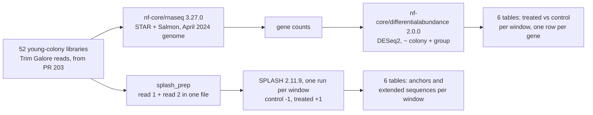
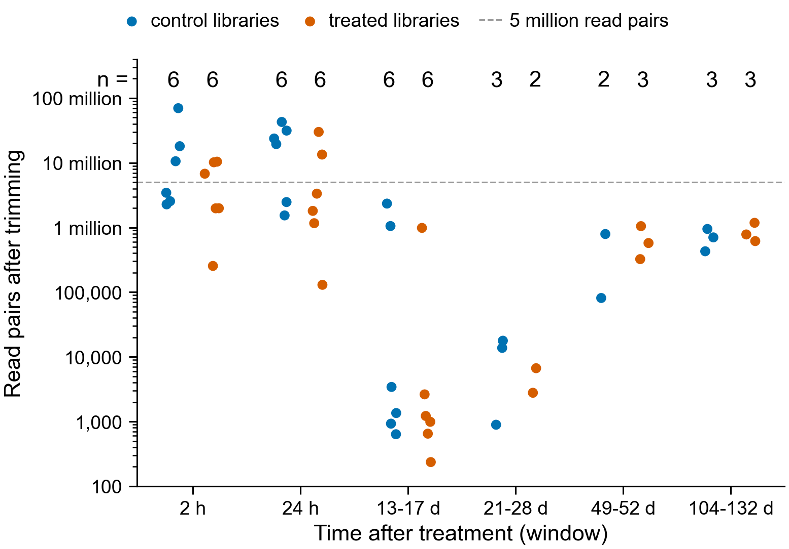

# Young Botryllus colonies after PEC: treated vs control, per time window

Domen et al. 2026 (PNAS) gave Botryllus colonies pulsatile electrical current (PEC) and
sequenced treated and control colonies from 2 hours to 132 days afterwards (SRA project
PRJNA1219309, 64 libraries). This run compares treated with control colonies at each time,
in young colonies only (370-510 days old), two ways:

- **With the genome**: nf-core/rnaseq 3.27.0 aligns reads to the April 2024 Botryllus
  assembly (STAR) and counts reads per gene (Salmon). nf-core/differentialabundance 2.0.0
  then tests each gene with DESeq2.
- **Without the genome**: SPLASH 2.11.9 finds 31-base sequences (anchors) whose following
  sequence differs between treated and control libraries, and extends each into a longer
  sequence (compactors).

The two are kept apart: separate output folders, never one table.



## Libraries and windows

Every young library is used, whatever its depth (Olga, 2026-10-27: "Don't filter on number
of reads. Keep all samples"). The 52 libraries were collected at 16 different times after
treatment, and 9 of those times have only control or only treated libraries, so times are
grouped into 6 windows that each have both:



| Window | Hours after treatment | Control | Treated |
|---|---|---:|---:|
| 2 h | 2 | 6 | 6 |
| 24 h | 24 | 6 | 6 |
| 13-17 d | 312-408 | 6 | 6 |
| 21-28 d | 504-672 | 3 | 2 |
| 49-52 d | 1176-1248 | 2 | 3 |
| 104-132 d | 2496-3168 | 3 | 3 |

Each point in the figure is one library. 40 of the 52 have under 5 million read pairs. In
the 13-17 d window 9 of 12 libraries have fewer than 3,500 pairs, and all 5 libraries in
21-28 d have fewer than 20,000, so those two comparisons can detect only large changes in
highly expressed genes.

Hours after treatment per vial come from the paper's Dataset S1 sample table
(`inputs/published_vial_hours.tsv`); treatment, colony and age from the SRA BioSample
records (`inputs/ena_sample_metadata.tsv`); read files and pair counts from the PR 203
trimming check (`inputs/trimmed-inputs.validated.json`). `make_design.py` turns these into
`samplesheet.csv`, `samples.csv`, `contrasts.csv` and `splash/<window>/`;
`plot_design.py` draws the figure.

## Settings that differ from the pipelines' defaults, and why

| Setting | Value | Why |
|---|---|---|
| rnaseq `skip_trimming` | true | reads were trimmed by Trim Galore in PR 203 |
| rnaseq `strandedness` | unstranded, every library | measured on the 3 deepest libraries (below) and assumed for the other 49; left on `auto`, Salmon cannot work out the strand from SRR32233927's 636 pairs, which stopped the PR 203 run |
| rnaseq `min_mapped_reads` | 0 | keep every library (default drops libraries under 5% aligned) |
| rnaseq `skip_deseq2_qc` | true | its DESeq2 step fails when no gene has a count in every library |
| rnaseq `skip_biotype_qc` | true | the FullNames GTF has no `gene_biotype` |
| differentialabundance `deseq2_sf_type` | poscounts | the default size factors need genes counted in every library |
| differentialabundance design | `~ colony + group`, all 52 libraries in one model | group = window and treatment; colony (4 genotypes) as blocking factor |
| SPLASH `--Cjs_samplesheet` | control -1, treated +1 | tests treated vs control rather than any difference between libraries |
| SPLASH `--pvals_correction_col_name` | `Cjs_0_pval` | corrects the p-value for those weights |

All other settings are the pipelines' defaults.

### Strand of read 1: unstranded

`strand-check/strand_check.sbatch` (Sherlock job 49810662, 2026-10-27) ran Salmon's
library-type detection on the first 1 million read pairs of the three deepest young
libraries, against an index of the FullNames transcripts. In all three, read 1 lies on the
gene's strand for half of the fragments (`strand-check/lib_format_counts.tsv`):

| Library | Window | Fragments placed | Read 1 on the gene's strand | Salmon's call |
|---|---|---:|---:|---|
| SRR32233964 | 2 h | 460,804 | 49.9% | IU (unstranded, paired) |
| SRR32233978 | 24 h | 472,715 | 49.9% | IU |
| SRR32233986 | 24 h | 516,727 | 50.0% | IU |

A stranded library would be near 0% or 100%. The germline libraries from the same lab
were unstranded too (`nextflow-runs/botryllus-rnaseq-preprocess`).

## Run

On Sherlock, one command clones this branch into its own folder (so the shared clone on
`main` is untouched) and submits everything; nothing waits on a person:

```bash
D=/scratch/users/olgabot/2024-kmerseek-analysis-botryllus-pec-young; [ -d $D ] || git clone -b olgabot/botryllus-pec-young-windows git@github.com:seanome/2024-kmerseek-analysis.git $D; cd $D && git pull && cd nextflow-runs/botryllus-pec-young && make run
```

| Job | Waits for | Resources | Expected time |
|---|---|---|---|
| `splash_prep`, 52-task array | nothing | 4 CPUs, 4 GB, 4 h each | under 1 h; largest file 13 GB gzipped |
| SPLASH, one per window | all of `splash_prep` | 16 CPUs, 64 GB, 12 h | under 1 h each; notebook 361's runs on these reads took under 2 min per 1 GB |
| Nextflow head: rnaseq, then differentialabundance | nothing | 2 CPUs, 8 GB, 2 days | about 6-10 h; STAR index about 1 h, then alignment of the 70 million-pair library about 1-2 h |

Task sizes in nf-core/rnaseq are the pipeline's defaults (STAR: 12 CPUs, 72 GB, 16 h); no
earlier STAR run on this genome exists to size from. A task killed by the scheduler is
retried twice (`sherlock.config`).

Watch the Nextflow head with `make watch`; stop it with `make stop`. Job ids are in
`$SCRATCH/botryllus-pec-young/job_ids.txt`. `make run` refuses to submit while any job of
this run (`pec-young-*` or `nf-botryllus-pec-young`) is queued or running.

### Launch record

`make run` was given twice on 2026-10-27, at 13:41 (jobs 49841823-49841922) and 13:49
(49843510-49843518). The second round was cancelled. Before the cancel, its
`splash_prep` task 5 wrote 785 MB to `SRR32233964.fq.gz.part`; the first round had
already finished `SRR32233964.fq.gz` at 13:47:52, so that file is the first round's and
the `.part` file is a leftover. Its Nextflow head stopped at once ("Unable to acquire lock
on session"), so the first run was not touched.

### Result of the 2026-10-27 run

- SPLASH: all 6 windows finished (jobs 49841893-49841918, 16 s to 29 min each).
- nf-core/rnaseq: finished at 17:23, 1,466 tasks, none failed. Its summary says 7 of 52
  libraries failed the strand check (not yet looked at).
- nf-core/differentialabundance: DESeq2 finished for all 6 windows and wrote its tables.
  The last step, the HTML report, failed while drawing a clustering heatmap
  (`hclust`: "NA/NaN/Inf in foreign function call"), so the Nextflow head ended as FAILED
  and `differentialabundance/report/` is empty.

Counts per window are in `significant_per_window.tsv`:

| Window | Genes with adjusted p < 0.05 | Higher in treated | Lower in treated | SPLASH anchors with corrected p < 0.05 |
|---|---:|---:|---:|---:|
| 2 h | 140 | 2 | 138 | 86,283 |
| 24 h | 76 | 27 | 49 | 936,510 |
| 13-17 d | 176 | 23 | 153 | 10,757 |
| 21-28 d | 151 | 101 | 50 | 1 |
| 49-52 d | 88 | 77 | 11 | 704 |
| 104-132 d | 51 | 5 | 46 | 9,049 |

35,541 genes were tested in each window. Gene counts are from `padj` in
`*.deseq2.results.tsv`; anchor counts from `Cjs_0_pval_corrected` in
`splash_out/result.after_correction.scores.tsv`. Treated and control libraries come from
the same colonies in every window. In 21-28 d all 5 libraries have under 20,000 read pairs.

### Compared with the paper

The paper's Dataset S1 has its own DESeq2 results for four young-colony comparisons
(sheets Group1, group2, Group4 and group5). By adjusted p < 0.05 those find 0 genes at 2 h,
1 at 24 h, 0 at 13 and 49 days pooled, and 11 at 132 days. The gene lists the paper
reports (its sheet "annotated DE all groups young": 43 up and 237 down at 2 h, 252 and 98
at 24 h, 18 and 48 at 13-49 d, 40 and 46 at 132 d) are therefore not adjusted-p lists.
Their size is near the number of named genes with unadjusted p < 0.05 (37 and 259 at 2 h,
221 and 79 at 24 h), but not equal, so the paper's exact rule is not known.

| Comparison | Paper, adjusted p < 0.05 | Paper, listed up / down | This run, adjusted p < 0.05 up / down | This run, unadjusted p < 0.05 up / down |
|---|---:|---:|---:|---:|
| 2 h | 0 | 43 / 237 | 2 / 138 | 4 / 279 |
| 24 h | 1 | 252 / 98 | 27 / 49 | 82 / 175 |
| 13-49 d (this run: 13-17 d) | 0 | 18 / 48 | 23 / 153 | 39 / 327 |
| 13-49 d (this run: 49-52 d) | 0 | 18 / 48 | 77 / 11 | 358 / 31 |
| 132 d (this run: 104-132 d) | 11 | 40 / 46 | 5 / 46 | 64 / 252 |

The 2 h comparison goes the same way in both (mostly lower in treated). At 24 h the paper
lists mostly higher in treated and this run finds mostly lower. The two analyses differ in
gene models (the paper's 72,115 `g` genes, this run's 35,541 `FUN_` genes), in the model
(the paper fits each comparison alone; this run fits all 52 libraries with colony as a
blocking factor), and in how 13-49 days are grouped, so genes cannot yet be matched one to
one. Table: `paper_comparison.tsv`.

## Outputs

In `$SCRATCH/botryllus-pec-young/`:

| Folder | What is in it |
|---|---|
| `rnaseq/multiqc/star_salmon/multiqc_report.html` | per-library read counts, alignment rate, strand, quality |
| `rnaseq/star_salmon/salmon.merged.gene_counts.tsv` | reads per gene, per library |
| `differentialabundance/tables/differential/` | one table per window: gene, log2 fold change, p-value, adjusted p-value |
| `differentialabundance/report/` | HTML report with PCA, volcano plots per window |
| `splash/<window>/splash_out/result.after_correction.scores.tsv` | anchors with corrected p-value and effect size |
| `splash/<window>/splash_out/result_compactors.tsv` | anchors extended into longer sequences |

## Related work

- PR 201 (notebook 361) runs SPLASH, an anchor-count model and DE-kupl on these reads for
  the paper's six groups, which include old colonies and pool 13 with 49 days. Its SPLASH
  binary is reused here.
- PR 203 recovered the trimmed reads used here and runs gene-level models on Kallisto
  counts.
